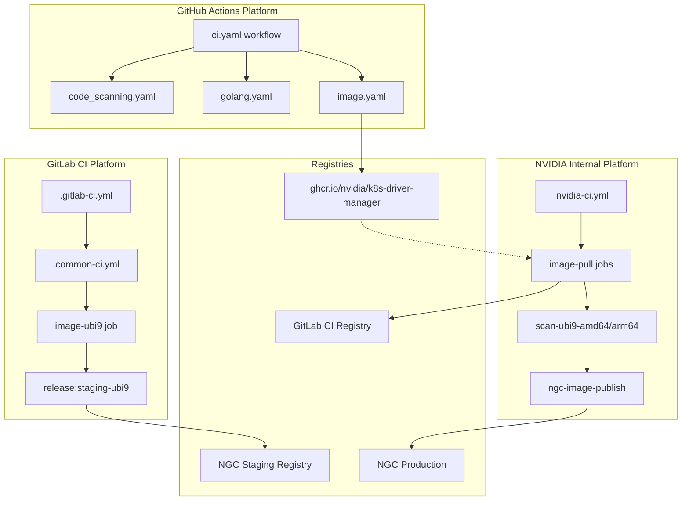
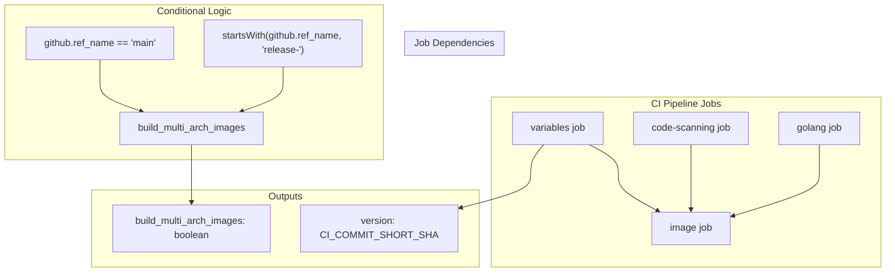
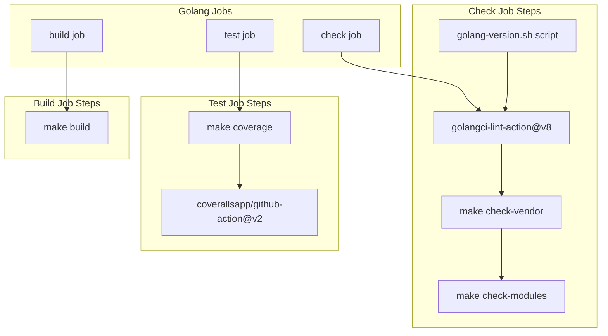
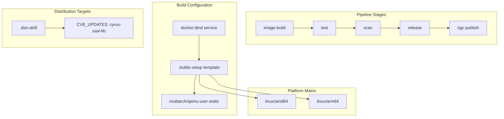
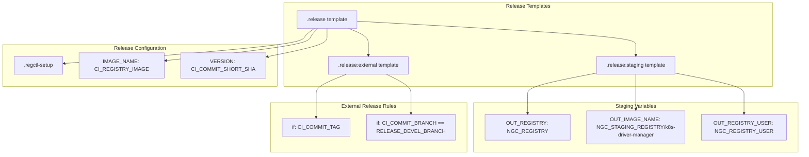
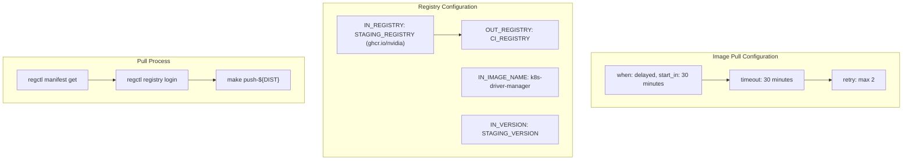
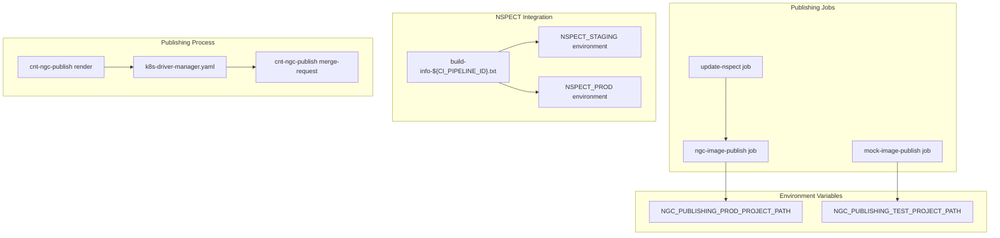
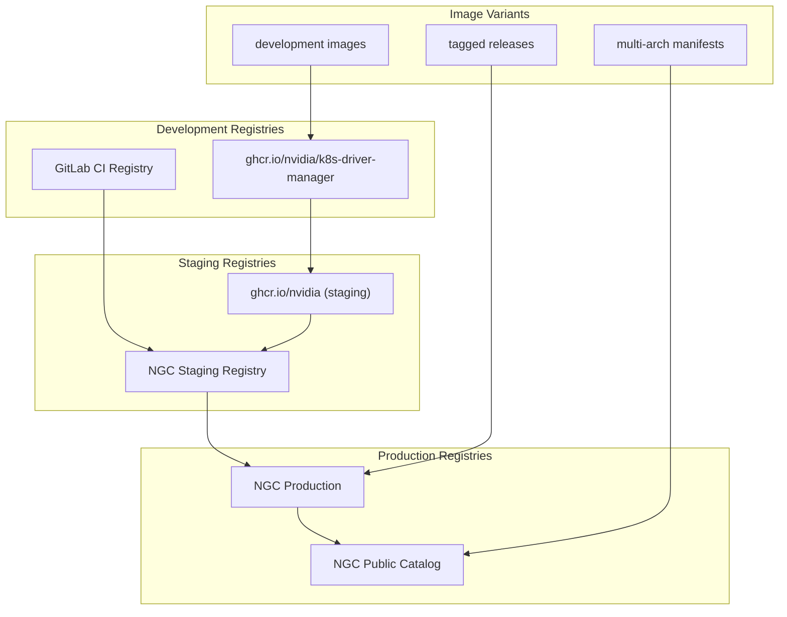

<!-- source: DeepWiki mcp.deepwiki.com · repo NVIDIA/k8s-driver-manager · page 4.2 CI/CD Pipelines · fetched 2026-10-26 -->

# CI/CD Pipelines

Relevant source files

The following files were used as context for generating this wiki page:

- [.common-ci.yml](.common-ci.yml)
- [.github/workflows/ci.yaml](.github/workflows/ci.yaml)
- [.github/workflows/code_scanning.yaml](.github/workflows/code_scanning.yaml)
- [.github/workflows/golang.yaml](.github/workflows/golang.yaml)
- [.github/workflows/image.yaml](.github/workflows/image.yaml)
- [.gitlab-ci.yml](.gitlab-ci.yml)
- [.nvidia-ci.yml](.nvidia-ci.yml)

This document covers the comprehensive CI/CD system for the k8s-driver-manager project, including GitHub Actions workflows, GitLab CI pipelines, and NVIDIA's internal security and publishing pipelines. The system implements a multi-platform strategy with separate pipelines for development workflows, container builds, security scanning, and production publishing.

For information about container image variants and build processes, see [Container Images](#4.1). For dependency management automation, see [Dependency Management](#4.3).

## Pipeline Architecture Overview

The k8s-driver-manager employs a three-tier CI/CD architecture with distinct responsibilities across different platforms.

**Sources:** [.github/workflows/ci.yaml:1-47](), [.gitlab-ci.yml:1-37](), [.nvidia-ci.yml:1-220](), [.common-ci.yml:1-147]()

## GitHub Actions Workflows

The GitHub Actions platform handles development workflows including code quality checks, testing, and public container image builds.

### Main CI Workflow

The `ci.yaml` workflow orchestrates the entire GitHub Actions pipeline with job dependencies and conditional execution.

**Sources:** [.github/workflows/ci.yaml:17-47]()

### Code Security Scanning

The CodeQL workflow performs static security analysis on the Go codebase using GitHub's security scanning infrastructure.

| Component | Configuration | Purpose |
|-----------|---------------|---------|
| `analyze` job | [.github/workflows/code_scanning.yaml:28-52]() | Runs CodeQL analysis on Go code |
| Language Target | `languages: go` | Focuses on Go-specific vulnerabilities |
| Build Mode | `build-mode: manual` | Uses custom build process |
| Build Command | `make build` | Compiles code for analysis |

**Sources:** [.github/workflows/code_scanning.yaml:1-53]()

### Golang Development Workflow

The `golang.yaml` workflow implements comprehensive Go development practices with linting, testing, and building.

**Sources:** [.github/workflows/golang.yaml:27-103]()

### Container Image Build Workflow

The `image.yaml` workflow builds multi-architecture container images with conditional publishing to GitHub Container Registry.

| Build Configuration | Value | Source |
|---------------------|-------|--------|
| Registry | `ghcr.io` | [.github/workflows/image.yaml:49]() |
| Image Name | `ghcr.io/nvidia/k8s-driver-manager` | [.github/workflows/image.yaml:55]() |
| Distributions | `[ubi9]` | [.github/workflows/image.yaml:33]() |
| Build Target | `make -f deployments/container/Makefile build-ubi9` | [.github/workflows/image.yaml:61]() |

**Sources:** [.github/workflows/image.yaml:1-62]()

## GitLab CI Pipeline

GitLab CI serves as the primary container build platform with multi-architecture support and staging deployment capabilities.

### Common CI Configuration

The `.common-ci.yml` file defines shared pipeline infrastructure used by both public GitLab and NVIDIA internal pipelines.

**Sources:** [.common-ci.yml:15-147]()

### Image Build Process

The GitLab image build jobs use Docker Buildx for multi-architecture container creation.

| Component | Configuration | Purpose |
|-----------|---------------|---------|
| Base Image | `docker:dind` | [.common-ci.yml:16]() |
| Buildx Version | `v0.16.0` | [.common-ci.yml:49]() |
| Build Platforms | `linux/amd64,linux/arm64` | [.common-ci.yml:55]() |
| Build Command | `make -f deployments/container/Makefile build-${DIST}` | [.common-ci.yml:31]() |

**Sources:** [.gitlab-ci.yml:18-37](), [.common-ci.yml:19-58]()

### Release and Staging Strategy

The `.common-ci.yml` implements a staging release mechanism that pushes images to NGC staging registry for validation.

**Sources:** [.common-ci.yml:86-147]()

## NVIDIA Internal Pipeline

The NVIDIA internal pipeline handles security scanning, vulnerability assessment, and final publishing to NGC production registry.

### Image Pull and Staging

The `.nvidia-ci.yml` implements a delayed image pull strategy to consume images from the public GitHub staging registry.

**Sources:** [.nvidia-ci.yml:39-72]()

### Security Scanning Integration

The NVIDIA pipeline integrates `pulse-cli` scanning for vulnerability assessment and compliance validation.

| Scan Component | Configuration | Purpose |
|----------------|---------------|---------|
| Scan Image | `PULSE_IMAGE` | [.nvidia-ci.yml:85]() |
| Image Archive | `k8s-driver-manager.tar` | [.nvidia-ci.yml:88]() |
| Scan Command | `pulse-cli -n $NSPECT_ID --ssa $SSA_TOKEN scan` | [.nvidia-ci.yml:102]() |
| Platform Matrix | `amd64`, `arm64` | [.nvidia-ci.yml:122-134]() |

The scan process produces several compliance artifacts:

- `pulse-cli.log` - Scan execution log
- `licenses.json` - License compliance report  
- `sbom.json` - Software Bill of Materials
- `vulns.json` - Vulnerability assessment
- `policy_evaluation.json` - Policy compliance results

**Sources:** [.nvidia-ci.yml:82-135]()

### NGC Publishing Workflow

The final stage publishes validated images to NGC production registry through automated merge request creation.

**Sources:** [.nvidia-ci.yml:136-220]()

## Multi-Platform Build Architecture

The CI/CD system supports multi-architecture builds through Docker Buildx and QEMU emulation across all pipeline platforms.

### Buildx Configuration

All pipelines use consistent Docker Buildx setup for cross-platform compilation:

| Configuration | GitHub Actions | GitLab CI | NVIDIA Internal |
|---------------|----------------|-----------|-----------------|
| Buildx Setup | `docker/setup-buildx-action@v3` | `.buildx-setup template` | Same as GitLab |
| QEMU Setup | `docker/setup-qemu-action@v3` | `multiarch/qemu-user-static` | `SKIP_QEMU_SETUP: "1"` |
| Target Platforms | `linux/amd64,linux/arm64` | `linux/amd64,linux/arm64` | `linux/amd64,linux/arm64` |

**Sources:** [.github/workflows/image.yaml:38-44](), [.common-ci.yml:47-57](), [.nvidia-ci.yml:33-34]()

### Registry Strategy

The multi-platform images flow through a structured registry hierarchy:

**Sources:** [.common-ci.yml:122-126](), [.nvidia-ci.yml:36-37](), [.nvidia-ci.yml:208-219]()

---

