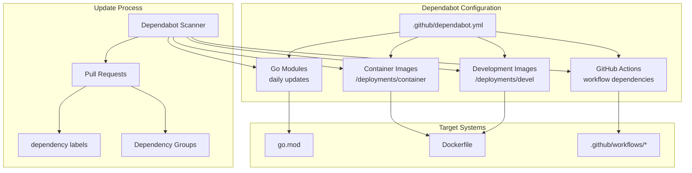
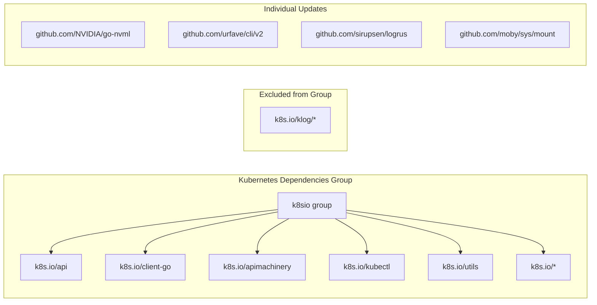
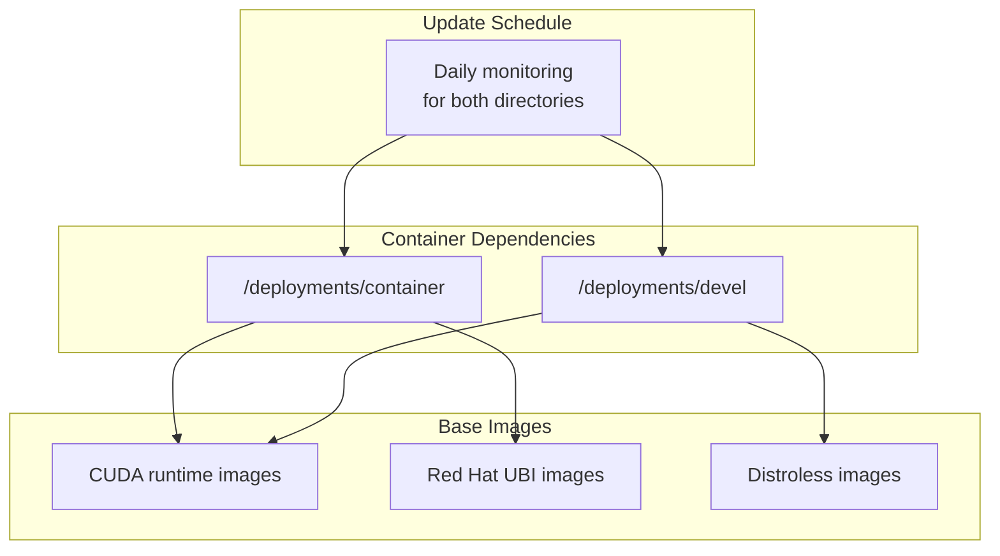
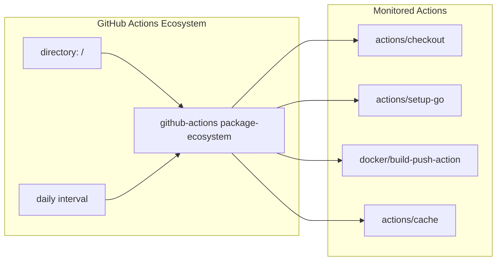
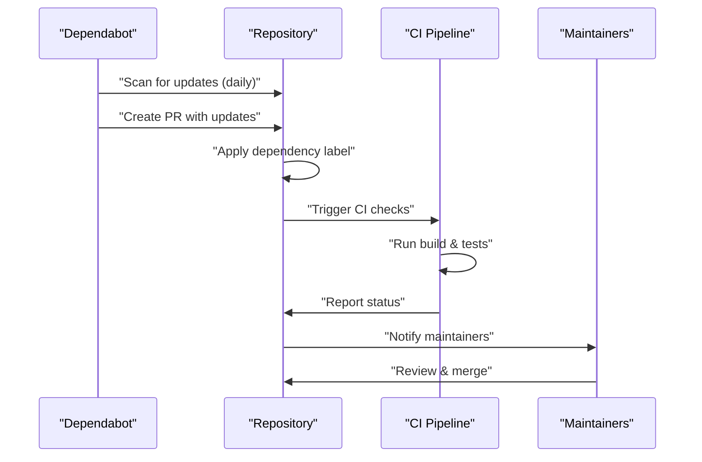

<!-- source: DeepWiki mcp.deepwiki.com · repo NVIDIA/k8s-driver-manager · page 4.3 Dependency Management · fetched 2026-10-26 -->

# Dependency Management

<details>
<summary>Relevant source files</summary>

The following files were used as context for generating this wiki page:

- [.github/dependabot.yml](.github/dependabot.yml)
- [go.mod](go.mod)
- [go.sum](go.sum)

</details>


This page documents the automated dependency management system for k8s-driver-manager, including Go modules, container images, and GitHub Actions dependencies. The system uses GitHub Dependabot for automated updates with configurable policies and grouping strategies.

For information about the build system that consumes these dependencies, see [Build System](#3.1). For details about container image creation, see [Container Images](#4.1).

## Automated Dependency Updates

The k8s-driver-manager project employs GitHub Dependabot to automatically monitor and update dependencies across multiple ecosystems. The configuration enables daily scanning and creates pull requests for available updates.



Sources: [.github/dependabot.yml:1-34]()

## Go Module Dependencies

The project uses Go modules for dependency management with a comprehensive set of direct and indirect dependencies focused on Kubernetes integration and NVIDIA GPU management.

### Core Dependencies

| Category | Package | Version | Purpose |
|----------|---------|---------|---------|
| GPU Management | `github.com/NVIDIA/go-nvml` | v0.12.9-0 | NVIDIA Management Library bindings |
| Kubernetes API | `k8s.io/api` | v0.33.2 | Kubernetes API objects |
| Kubernetes Client | `k8s.io/client-go` | v0.33.2 | Kubernetes client library |
| Kubernetes Tools | `k8s.io/kubectl` | v0.33.2 | kubectl utilities |
| CLI Framework | `github.com/urfave/cli/v2` | v2.27.7 | Command-line interface |
| Logging | `github.com/sirupsen/logrus` | v1.9.3 | Structured logging |
| System Operations | `github.com/moby/sys/mount` | v0.3.4 | Mount management |

Sources: [go.mod:1-84]()

### Dependency Grouping Strategy

The Dependabot configuration implements intelligent grouping for Kubernetes dependencies to manage related updates cohesively:



Sources: [.github/dependabot.yml:14-18]()

## Container Image Dependencies

Dependabot monitors Docker dependencies in two separate directories, each with distinct purposes and update policies.

### Container Image Locations



Sources: [.github/dependabot.yml:20-28]()

## GitHub Actions Dependencies

The system monitors GitHub Actions workflow dependencies to ensure CI/CD pipeline components remain current with security updates and feature improvements.

### Actions Monitoring



Sources: [.github/dependabot.yml:30-34]()

## Dependency Update Workflow

The automated dependency management follows a structured workflow that balances security with stability.



Sources: [.github/dependabot.yml:11-12]()

## Configuration Details

### Package Ecosystem Configuration

The Dependabot configuration supports multiple package ecosystems with specific targeting:

| Ecosystem | Directory | Schedule | Labels | Grouping |
|-----------|-----------|----------|--------|----------|
| `gomod` | `/` | daily | dependencies | k8sio group |
| `docker` | `/deployments/container` | daily | dependencies | none |
| `docker` | `/deployments/devel` | daily | dependencies | none |  
| `github-actions` | `/` | daily | dependencies | none |

Sources: [.github/dependabot.yml:6-33]()

### Dependency Exclusions

The configuration specifically excludes `k8s.io/klog/*` packages from the Kubernetes grouping to allow independent updates of logging components:

```yaml
groups:
  k8sio:
    patterns:
      - k8s.io/*
    exclude-patterns:
      - k8s.io/klog/*
```

Sources: [.github/dependabot.yml:14-18]()

---

