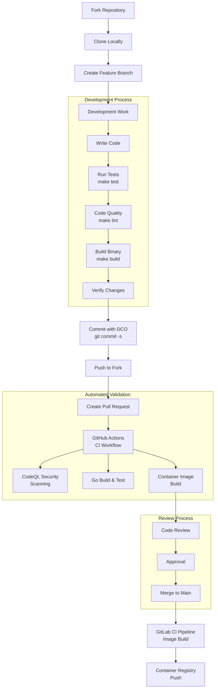
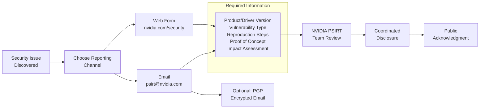
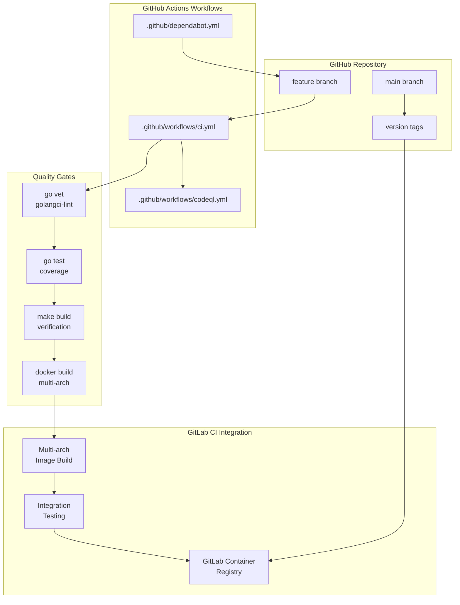
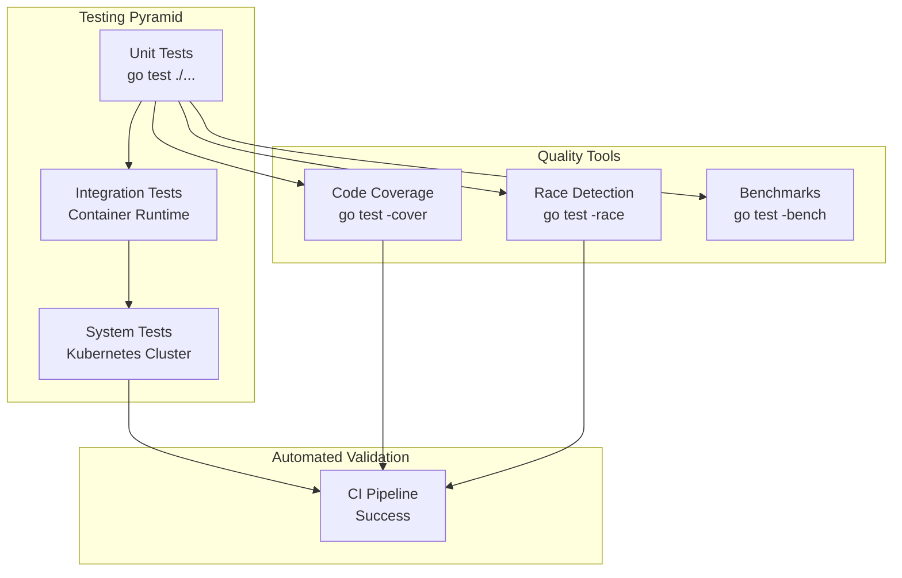

<!-- source: DeepWiki mcp.deepwiki.com · repo NVIDIA/k8s-driver-manager · page 5 Contributing · fetched 2026-10-26 -->

# Contributing

<details>
<summary>Relevant source files</summary>

The following files were used as context for generating this wiki page:

- [CONTRIBUTING.md](CONTRIBUTING.md)
- [LICENSE](LICENSE)
- [SECURITY.md](SECURITY.md)

</details>


This page provides comprehensive guidance for contributing to the k8s-driver-manager project, including contribution guidelines, security reporting procedures, and development workflows. It covers the technical processes for submitting code changes, quality requirements, and integration with the project's CI/CD systems.

For information about the build system and development environment setup, see page [3](#3). For deployment and CI/CD pipeline details, see page [4](#4).

## Contribution Guidelines

The k8s-driver-manager project welcomes contributions from the community. All contributions must comply with the Developer Certificate of Origin (DCO) and follow the established development processes.

### Developer Certificate of Origin

All commits must be signed off to certify compliance with the Developer Certificate of Origin version 1.1. This certification indicates that you have the right to submit the contribution under the project's open source license.

The sign-off process requires adding a `Signed-off-by` line to every commit message:

```
Signed-off-by: Your Name <your.email@domain.com>
```

You can automatically sign commits using:
```bash
git commit -s
```

This requires setting your Git configuration:
```bash
git config user.name "Your Name"
git config user.email "your.email@domain.com"
```

**Sources:** [CONTRIBUTING.md:1-61]()

### Contribution Workflow

The following diagram illustrates the complete contribution workflow from development to integration:



**Sources:** [CONTRIBUTING.md:1-61](), CI/CD pipeline configurations referenced in the architecture overview

## Security Reporting

Security vulnerabilities must be reported through designated channels and **not** through GitHub issues or public discussions.

### Reporting Process



### Security Contact Information

| Method | Contact | Details |
|--------|---------|---------|
| Web Form | [Security Vulnerability Submission](https://www.nvidia.com/object/submit-security-vulnerability.html) | Primary reporting method |
| Email | psirt@nvidia.com | Include all required information |
| PGP Key | [NVIDIA PGP Key](https://www.nvidia.com/en-us/security/pgp-key) | For encrypted communication |

**Sources:** [SECURITY.md:1-24]()

## Development Workflow Integration

The project uses a sophisticated multi-platform CI/CD system that automatically validates contributions:



**Sources:** Referenced from CI/CD pipeline architecture and build system documentation

## Code Quality Requirements

### Static Analysis and Testing

All contributions must pass the following quality gates:

| Tool | Purpose | Command |
|------|---------|---------|
| `go vet` | Static analysis | `make vet` |
| `golangci-lint` | Comprehensive linting | `make lint` |
| `go test` | Unit tests | `make test` |
| `gofmt` | Code formatting | `make fmt` |

### Build Verification

Changes must successfully build across all supported targets:

```bash
# Local development build
make build

# Container image build
make image

# Multi-architecture build (CI)
make image-multi-arch
```

### Testing Strategy

The project employs multiple testing layers:



**Sources:** Build system targets and testing configuration

## License and Legal

The k8s-driver-manager project is licensed under the Apache License 2.0. All contributions are subject to this license, and contributors retain copyright of their contributions while granting the necessary rights for project inclusion.

### Key License Points

- **License:** Apache License 2.0
- **Copyright:** Contributors retain copyright
- **Distribution:** Must include license copy
- **Modifications:** Must be clearly marked
- **Patent Grant:** Includes patent license grant

**Sources:** [LICENSE:1-203]()

## Dependency Management

The project uses automated dependency management through GitHub Dependabot, which creates pull requests for dependency updates. Contributors should:

1. Keep dependencies current
2. Review security implications of new dependencies  
3. Ensure compatibility with Go module requirements
4. Test thoroughly with dependency updates

**Sources:** Dependabot configuration and dependency management processes referenced in the CI/CD architecture

---

