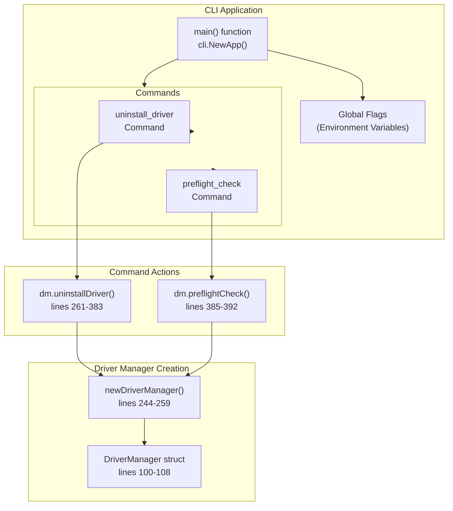
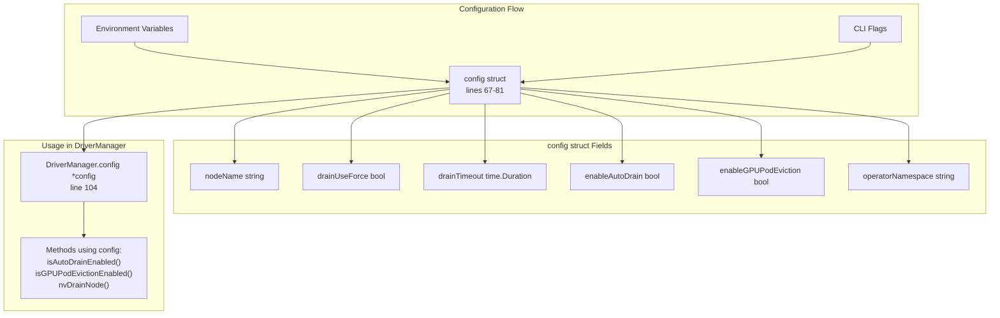
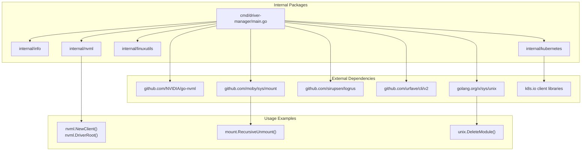

<!-- source: DeepWiki mcp.deepwiki.com · repo NVIDIA/k8s-driver-manager · page 6 Reference · fetched 2026-10-26 -->

# Reference

<details>
<summary>Relevant source files</summary>

The following files were used as context for generating this wiki page:

- [.gitignore](.gitignore)
- [cmd/driver-manager/main.go](cmd/driver-manager/main.go)
- [go.mod](go.mod)

</details>


This reference provides comprehensive documentation of the k8s-driver-manager's configuration options, environment variables, CLI interface, data structures, and technical specifications. This information is essential for developers working with the codebase and operators deploying the system.

For architectural information about how these components work together, see [Architecture](#2). For development and build procedures, see [Development](#3).

## CLI Commands and Interface

The k8s-driver-manager provides a command-line interface with two primary commands for managing NVIDIA GPU driver operations.

### CLI Command Structure



**Sources:** [cmd/driver-manager/main.go:110-242]()

### Available Commands

| Command | Purpose | Action Function |
|---------|---------|----------------|
| `uninstall_driver` | Uninstall NVIDIA driver and manage GPU operator components | [cmd/driver-manager/main.go:261-383]() |
| `preflight_check` | Perform preflight checks before driver operations | [cmd/driver-manager/main.go:385-392]() |

**Sources:** [cmd/driver-manager/main.go:214-237]()

## Configuration Reference

### Environment Variables and CLI Flags

The application accepts configuration through CLI flags and corresponding environment variables:

| CLI Flag | Environment Variable | Type | Default | Required | Description |
|----------|---------------------|------|---------|----------|-------------|
| `--node-name` | `NODE_NAME` | string | - | Yes | Name of the node to manage |
| `--drain-use-force` | `DRAIN_USE_FORCE` | bool | false | No | Use force when draining nodes |
| `--drain-pod-selector-label` | `DRAIN_POD_SELECTOR_LABEL` | string | "" | No | Pod selector label for draining |
| `--drain-timeout-seconds` | `DRAIN_TIMEOUT_SECONDS` | duration | 0s | No | Timeout for drain operations |
| `--drain-delete-emptydir-data` | `DRAIN_DELETE_EMPTYDIR_DATA` | bool | false | No | Delete emptyDir data during drain |
| `--enable-auto-drain` | `ENABLE_AUTO_DRAIN` | bool | true | No | Enable automatic node draining |
| `--enable-gpu-pod-eviction` | `ENABLE_GPU_POD_EVICTION` | bool | true | No | Enable GPU pod eviction |
| `--operator-namespace` | `OPERATOR_NAMESPACE` | string | "gpu-operator" | No | Namespace where GPU operator is installed |
| `--node-label-for-gpu-pod-eviction` | `NODE_LABEL_FOR_GPU_POD_EVICTION` | string | "" | No | Node label for GPU pod eviction |
| `--gpu-direct-rdma-enabled` | `GPU_DIRECT_RDMA_ENABLED` | bool | false | No | Enable GPU Direct RDMA |
| `--use-host-mofed` | `USE_HOST_MOFED` | bool | false | No | Use host MOFED driver |
| `--kubeconfig` | `KUBECONFIG` | string | "" | No | Path to kubeconfig file |

**Sources:** [cmd/driver-manager/main.go:127-212]()

### Configuration Data Structure



The `config` struct defined at [cmd/driver-manager/main.go:67-81]() holds all configuration values:

```go
type config struct {
    nodeName                   string
    drainUseForce              bool
    drainPodSelectorLabel      string
    drainTimeout               time.Duration
    drainDeleteEmptyDirData    bool
    enableAutoDrain            bool
    enableGPUPodEviction       bool
    operatorNamespace          string
    nodeLabelForGPUPodEviction string
    gpuDirectRDMAEnabled       bool
    useHostMofed               bool
    kubeconfig                 string
}
```

**Sources:** [cmd/driver-manager/main.go:67-81]()

## Constants and Labels

### System Constants

| Constant | Value | Purpose |
|----------|-------|---------|
| `driverRoot` | "/run/nvidia/driver" | Root directory for NVIDIA driver files |
| `driverPIDFile` | "/run/nvidia/nvidia-driver.pid" | PID file for driver process |
| `operatorNamespace` | "gpu-operator" | Default GPU operator namespace |
| `pausedStr` | "paused-for-driver-upgrade" | Label value for paused components |
| `defaultDrainTimeout` | 0 seconds | Default timeout for drain operations |
| `defaultGracePeriod` | 5 minutes | Default grace period for pod termination |
| `nvidiaDomainPrefix` | "nvidia.com" | Prefix for all NVIDIA-specific labels |

**Sources:** [cmd/driver-manager/main.go:43-65]()

### NVIDIA GPU Operator Labels

All labels use the `nvidia.com/` prefix for GPU operator component deployment control:

| Label Constant | Label Value | Component |
|---------------|-------------|-----------|
| `nvidiaDriverDeployLabel` | `nvidia.com/gpu.deploy.driver` | NVIDIA Driver |
| `nvidiaOperatorValidatorDeployLabel` | `nvidia.com/gpu.deploy.operator-validator` | Operator Validator |
| `nvidiaContainerToolkitDeployLabel` | `nvidia.com/gpu.deploy.container-toolkit` | Container Toolkit |
| `nvidiaDevicePluginDeployLabel` | `nvidia.com/gpu.deploy.device-plugin` | Device Plugin |
| `nvidiaGFDDeployLabel` | `nvidia.com/gpu.deploy.gpu-feature-discovery` | GPU Feature Discovery |
| `nvidiaDCGMExporterDeployLabel` | `nvidia.com/gpu.deploy.dcgm-exporter` | DCGM Exporter |
| `nvidiaDCGMDeployLabel` | `nvidia.com/gpu.deploy.dcgm` | DCGM |
| `nvidiaMIGManagerDeployLabel` | `nvidia.com/gpu.deploy.mig-manager` | MIG Manager |
| `nvidiaNVSMDeployLabel` | `nvidia.com/gpu.deploy.nvsm` | NVSM |
| `nvidiaSandboxValidatorDeployLabel` | `nvidia.com/gpu.deploy.sandbox-validator` | Sandbox Validator |
| `nvidiaSandboxDevicePluginDeployLabel` | `nvidia.com/gpu.deploy.sandbox-device-plugin` | Sandbox Device Plugin |
| `nvidiaVGPUDeviceManagerDeployLabel` | `nvidia.com/gpu.deploy.vgpu-device-manager` | vGPU Device Manager |

**Sources:** [cmd/driver-manager/main.go:53-65]()

## Data Structures

### Core Data Structures

The application uses three primary data structures for managing state and configuration:

#### DriverManager Structure

```go
type DriverManager struct {
    ctx        context.Context
    config     *config
    components *componentState  
    kubeClient *kube.Client
    log        *logrus.Logger
}
```

**Sources:** [cmd/driver-manager/main.go:100-108]()

#### Component State Structure

The `componentState` struct tracks deployment states of GPU operator components:

```go
type componentState struct {
    pluginDeployed              string
    gfdDeployed                 string  
    dcgmDeployed                string
    dcgmExporterDeployed        string
    nvsmDeployed                string
    toolkitDeployed             string
    validatorDeployed           string
    migManagerDeployed          string
    sandboxValidatorDeployed    string
    sandboxPluginDeployed       string
    vgpuDeviceManagerDeployed   string
    customOperandNodeLabelValue string
    autoUpgradePolicyEnabled    string
}
```

**Sources:** [cmd/driver-manager/main.go:83-98]()

### State Management Methods

| Method | Purpose | Line Reference |
|--------|---------|----------------|
| `fetchCurrentLabels()` | Retrieves current component deployment states | [cmd/driver-manager/main.go:419-458]() |
| `setComponentState()` | Maps label values to component state fields | [cmd/driver-manager/main.go:460-485]() |
| `evictAllGPUOperatorComponents()` | Sets components to paused state | [cmd/driver-manager/main.go:500-535]() |
| `rescheduleGPUOperatorComponents()` | Restores components from paused state | [cmd/driver-manager/main.go:777-805]() |

**Sources:** [cmd/driver-manager/main.go:419-870]()

## Dependencies

### Go Module Dependencies

The application's primary dependencies as defined in [go.mod:5-15]():

| Package | Version | Purpose |
|---------|---------|---------|
| `github.com/NVIDIA/go-nvml` | v0.12.9-0 | NVIDIA Management Library bindings |
| `github.com/moby/sys/mount` | v0.3.4 | Mount/unmount operations |
| `github.com/sirupsen/logrus` | v1.9.3 | Structured logging |
| `github.com/urfave/cli/v2` | v2.27.7 | CLI framework |
| `golang.org/x/sys` | v0.31.0 | System calls and Unix operations |
| `k8s.io/api` | v0.33.2 | Kubernetes API definitions |
| `k8s.io/apimachinery` | v0.33.2 | Kubernetes API machinery |
| `k8s.io/client-go` | v0.33.2 | Kubernetes client library |
| `k8s.io/kubectl` | v0.33.2 | Kubectl functionality |

**Sources:** [go.mod:5-15]()

### Internal Package Dependencies



**Sources:** [cmd/driver-manager/main.go:21-41]()

## System File Paths and Resources

### Critical System Paths

| Path | Purpose | Usage in Code |
|------|---------|---------------|
| `/run/nvidia/driver` | Driver root directory | [cmd/driver-manager/main.go:44]() |
| `/run/nvidia/nvidia-driver.pid` | Driver process PID file | [cmd/driver-manager/main.go:45]() |
| `/sys/module/nvidia/refcnt` | Kernel module reference count | [cmd/driver-manager/main.go:622]() |
| `/sys/module/nouveau/refcnt` | Nouveau driver reference count | [cmd/driver-manager/main.go:627]() |
| `/proc/modules` | Loaded kernel modules | [cmd/driver-manager/main.go:760]() |
| `/sys/bus/pci/devices` | PCI device enumeration | [cmd/driver-manager/main.go:730]() |
| `/run/mellanox/drivers/.driver-ready` | MOFED driver ready indicator | [cmd/driver-manager/main.go:755]() |

**Sources:** [cmd/driver-manager/main.go:44-775]()

### Kernel Modules

The driver manager handles these NVIDIA kernel modules in order:

1. `nvidia_modeset`
2. `nvidia_uvm` 
3. `nvidia_peermem`
4. `nvidia_fs`
5. `nvidia_vgpu_vfio`
6. `gdrdrv`
7. `nvidia`

**Sources:** [cmd/driver-manager/main.go:662-670]()