# Page: Overview

# Overview

<details>
<summary>Relevant source files</summary>

The following files were used as context for generating this wiki page:

- [LICENSE](LICENSE)
- [README.md](README.md)
- [cmd/driver-manager/main.go](cmd/driver-manager/main.go)
- [go.mod](go.mod)

</details>


The NVIDIA k8s-driver-manager is a Kubernetes component designed to orchestrate seamless upgrades of NVIDIA GPU drivers across cluster nodes. It ensures that all prerequisites are met before driver upgrades by managing GPU operator component lifecycle, node operations, and driver module cleanup.

This document covers the overall system purpose, architecture, and key components. For detailed information about the build system and development workflow, see [Build System](#3.1). For container deployment and CI/CD processes, see [Deployment](#4).

## System Purpose and Context

The k8s-driver-manager operates as part of the broader NVIDIA GPU operator ecosystem, coordinating driver upgrades through a systematic process of component eviction, node management, and driver cleanup.

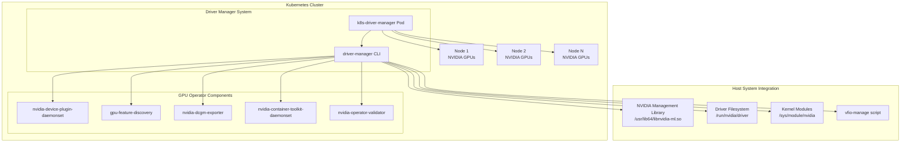

Sources: [README.md:1-12](), [cmd/driver-manager/main.go:43-65]()

## Core Application Components

The system is built around the `DriverManager` struct which coordinates operations through specialized subsystems for Kubernetes integration, driver management, and system utilities.

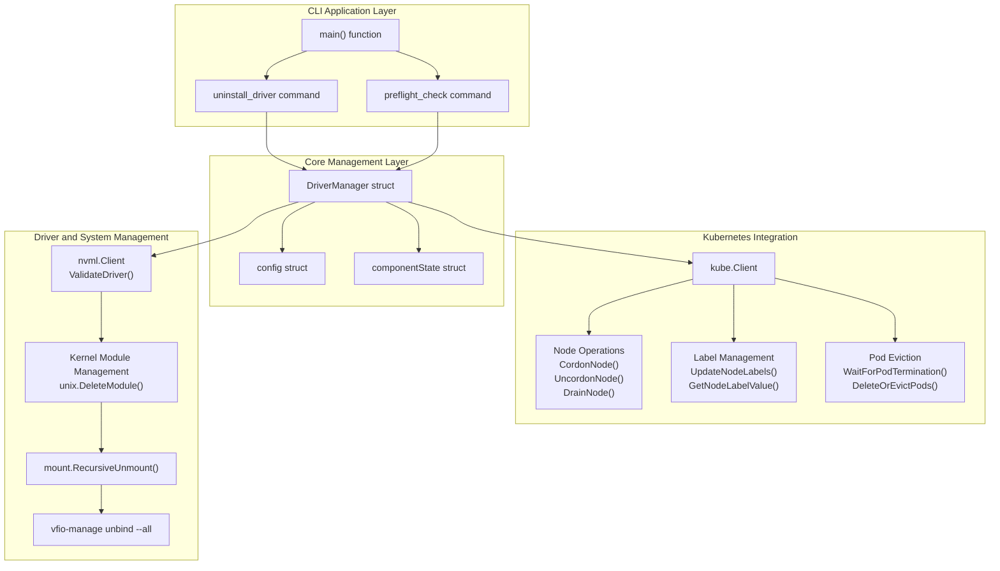

Sources: [cmd/driver-manager/main.go:100-108](), [cmd/driver-manager/main.go:67-98](), [cmd/driver-manager/main.go:214-242]()

## GPU Operator Component Management

The system manages multiple GPU operator components through a label-based deployment control mechanism, transitioning components between active, paused, and disabled states during driver upgrades.

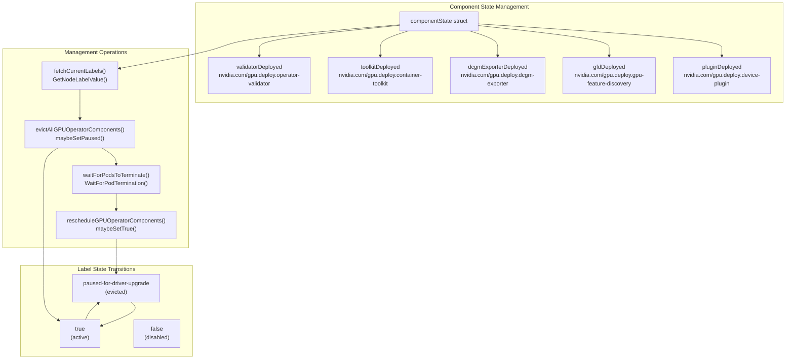

Sources: [cmd/driver-manager/main.go:84-98](), [cmd/driver-manager/main.go:500-535](), [cmd/driver-manager/main.go:777-805](), [cmd/driver-manager/main.go:537-549]()

## Driver Upgrade Workflow

The system follows a structured workflow that ensures safe driver upgrades by coordinating node drainage, component eviction, driver cleanup, and component rescheduling.

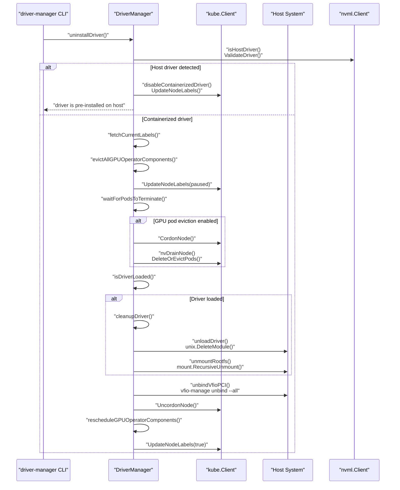

Sources: [cmd/driver-manager/main.go:261-383](), [cmd/driver-manager/main.go:636-693](), [cmd/driver-manager/main.go:695-711](), [cmd/driver-manager/main.go:716-720]()

## Configuration and Environment Integration

The system provides extensive configuration options through environment variables and CLI flags, supporting various deployment scenarios including GPU Direct RDMA, custom node selectors, and different drain policies.

| Configuration Category | Key Parameters | Environment Variables |
|------------------------|----------------|----------------------|
| Node Management | `nodeName`, `drainTimeout`, `drainUseForce` | `NODE_NAME`, `DRAIN_TIMEOUT_SECONDS`, `DRAIN_USE_FORCE` |
| GPU Pod Eviction | `enableGPUPodEviction`, `nodeLabelForGPUPodEviction` | `ENABLE_GPU_POD_EVICTION`, `NODE_LABEL_FOR_GPU_POD_EVICTION` |
| Operator Integration | `operatorNamespace` | `OPERATOR_NAMESPACE` |
| GPU Direct RDMA | `gpuDirectRDMAEnabled`, `useHostMofed` | `GPU_DIRECT_RDMA_ENABLED`, `USE_HOST_MOFED` |
| Auto Drain Policy | `enableAutoDrain` | `ENABLE_AUTO_DRAIN` |

The system integrates with Kubernetes through the `kube.Client` and validates GPU environments using `nvml.Client` with configurable driver root paths and validation policies.

Sources: [cmd/driver-manager/main.go:67-81](), [cmd/driver-manager/main.go:127-212](), [cmd/driver-manager/main.go:43-65]()

---

# Page: Architecture

# Architecture

<details>
<summary>Relevant source files</summary>

The following files were used as context for generating this wiki page:

- [README.md](README.md)
- [cmd/driver-manager/main.go](cmd/driver-manager/main.go)
- [internal/kubernetes/client.go](internal/kubernetes/client.go)
- [internal/nvml/driver-root.go](internal/nvml/driver-root.go)

</details>


This document describes the overall architecture of the k8s-driver-manager system, explaining how the components work together to orchestrate NVIDIA GPU driver upgrades across Kubernetes nodes. It covers the core application structure, integration patterns with Kubernetes and NVIDIA systems, and the orchestration flow for safe driver management operations.

For information about individual components, see [Core Components](#2.1). For deployment patterns and container images, see [Deployment](#4).

## System Overview

The k8s-driver-manager functions as a Kubernetes-native orchestrator for NVIDIA GPU driver lifecycle management. The system operates as a CLI application that executes within containers on GPU-enabled nodes, coordinating between Kubernetes APIs, NVIDIA driver systems, and Linux kernel modules to ensure safe driver transitions.

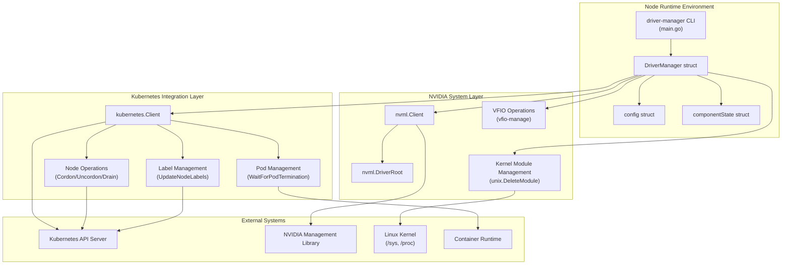

**Sources:** [cmd/driver-manager/main.go:100-109](), [internal/kubernetes/client.go:44-49](), [internal/nvml/driver-root.go:24-42]()

## Core Application Structure

The application follows a layered architecture with the `DriverManager` as the central orchestrator. The CLI interface provides two primary operations through the `urfave/cli` framework.

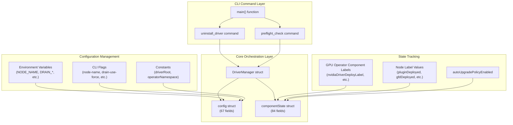

**Sources:** [cmd/driver-manager/main.go:214-237](), [cmd/driver-manager/main.go:67-98](), [cmd/driver-manager/main.go:43-65]()

## Driver Upgrade Orchestration Flow

The `uninstallDriver()` method implements a multi-phase process that safely transitions nodes from one driver version to another while maintaining cluster stability.

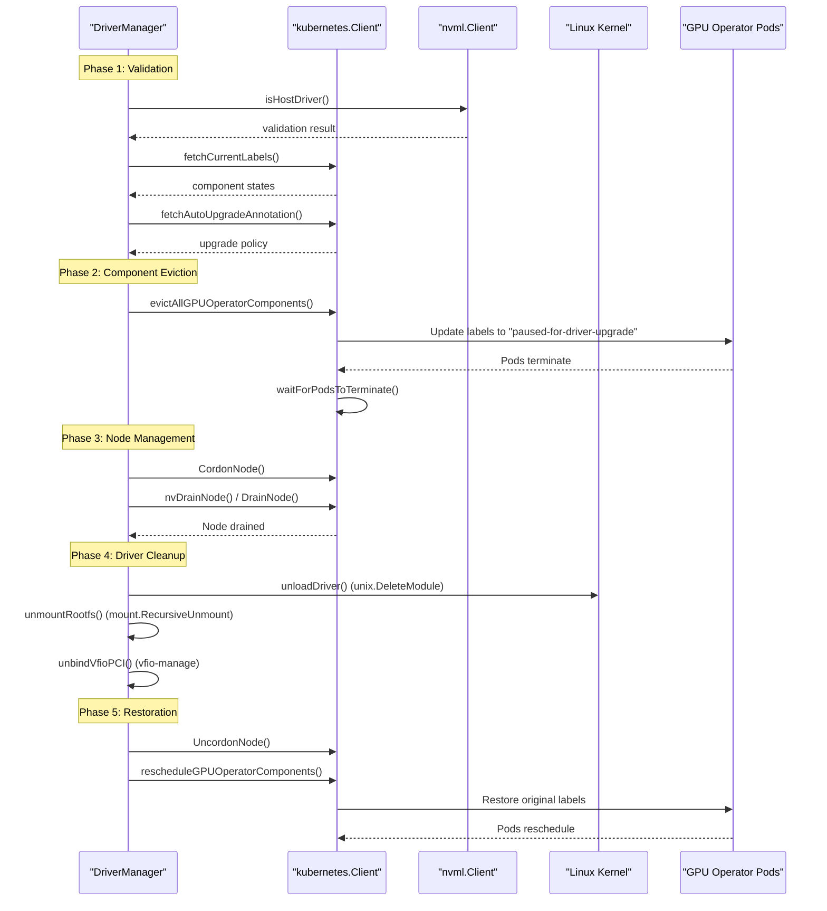

**Sources:** [cmd/driver-manager/main.go:261-383](), [cmd/driver-manager/main.go:500-535](), [cmd/driver-manager/main.go:636-657]()

## Kubernetes Integration Patterns

The system integrates deeply with Kubernetes through label-based component management and pod lifecycle operations. The `Client` struct provides abstractions over core Kubernetes operations.

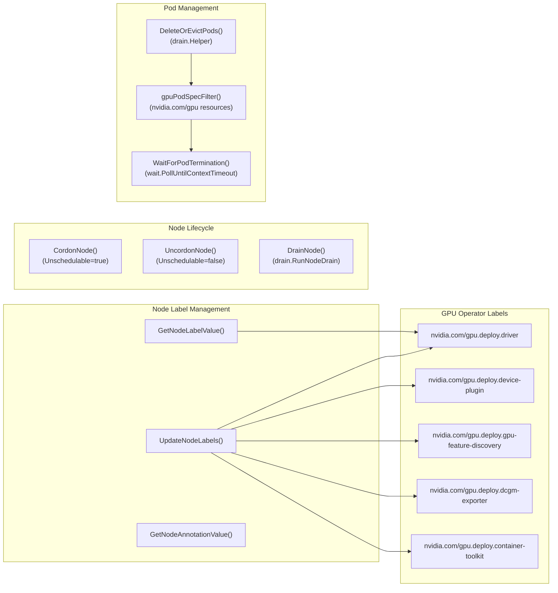

**Sources:** [internal/kubernetes/client.go:81-115](), [internal/kubernetes/client.go:129-171](), [internal/kubernetes/client.go:212-282](), [cmd/driver-manager/main.go:53-64]()

## NVIDIA Driver Management Integration

The system manages NVIDIA drivers through direct kernel module manipulation and NVML library integration. The `nvml` package provides abstractions for driver detection and validation.

```mermaid
graph TB
    subgraph "Driver Detection"
        DriverRoot["nvml.DriverRoot"]
        NVMLPath["GetNVMLPath()<br/>(library search paths)"]
        ValidateDriver["ValidateDriver()"]
    end
    
    subgraph "Kernel Module Management"
        ModuleCheck["isDriverLoaded()<br/>(/sys/module/nvidia/refcnt)"]
        ModuleUnload["unix.DeleteModule()<br/>(nvidia, nvidia_uvm, etc.)"]
        NouveauCheck["isNouveauLoaded()<br/>(/sys/module/nouveau/refcnt)"]
    end
    
    subgraph "Filesystem Operations"
        MountCheck["os.Stat(driverRoot)<br/>(/run/nvidia/driver)"]
        Unmount["mount.RecursiveUnmount()"]
        PIDFile["driverPIDFile cleanup<br/>(/run/nvidia/nvidia-driver.pid)"]
    end
    
    subgraph "VFIO Management"
        VFIOUnbind["unbindVfioPCI()<br/>(vfio-manage unbind --all)"]
        MellanoxCheck["mellanoxDevicesPresent()<br/>(/sys/bus/pci/devices)"]
        MOFEDWait["waitForMofedDriver()<br/>(/proc/modules, mlx5_core)"]
    end
    
    DriverRoot --> NVMLPath
    NVMLPath --> ValidateDriver
    
    ModuleCheck --> ModuleUnload
    ModuleUnload --> NouveauCheck
    
    MountCheck --> Unmount
    Unmount --> PIDFile
    
    VFIOUnbind --> MellanoxCheck
    MellanoxCheck --> MOFEDWait
```

**Sources:** [internal/nvml/driver-root.go:26-42](), [cmd/driver-manager/main.go:621-634](), [cmd/driver-manager/main.go:659-693](), [cmd/driver-manager/main.go:695-775]()

## Component State Management

The system tracks GPU operator component deployment states through Kubernetes node labels, enabling precise control over component scheduling during driver transitions.

| Component | Label Key | State Values |
|-----------|-----------|--------------|
| Device Plugin | `nvidia.com/gpu.deploy.device-plugin` | `true`, `false`, `paused-for-driver-upgrade` |
| GPU Feature Discovery | `nvidia.com/gpu.deploy.gpu-feature-discovery` | `true`, `false`, `paused-for-driver-upgrade` |
| DCGM Exporter | `nvidia.com/gpu.deploy.dcgm-exporter` | `true`, `false`, `paused-for-driver-upgrade` |
| Container Toolkit | `nvidia.com/gpu.deploy.container-toolkit` | `true`, `false`, `paused-for-driver-upgrade` |
| MIG Manager | `nvidia.com/gpu.deploy.mig-manager` | `true`, `false`, `paused-for-driver-upgrade` |
| Driver Container | `nvidia.com/gpu.deploy.driver` | `true`, `false`, `pre-installed` |

The `componentState` struct maintains current values and the `maybeSetPaused()` and `maybeSetTrue()` functions manage state transitions during the upgrade process.

**Sources:** [cmd/driver-manager/main.go:84-98](), [cmd/driver-manager/main.go:537-549](), [cmd/driver-manager/main.go:807-818](), [cmd/driver-manager/main.go:460-485]()

---

# Page: Core Components

# Core Components

<details>
<summary>Relevant source files</summary>

The following files were used as context for generating this wiki page:

- [cmd/driver-manager/main.go](cmd/driver-manager/main.go)
- [internal/info/version.go](internal/info/version.go)
- [internal/linuxutils/kmod.go](internal/linuxutils/kmod.go)
- [internal/nvml/driver-root.go](internal/nvml/driver-root.go)

</details>


This document details the main application components that make up the k8s-driver-manager system, including the central `DriverManager` orchestrator, configuration management, CLI interface, and supporting utilities. For information about Kubernetes API integration, see [Kubernetes Integration](#2.2). For details about NVIDIA GPU and driver management, see [NVIDIA GPU Management](#2.3).

## Main Application Components

The k8s-driver-manager is built around three core data structures that work together to orchestrate GPU driver upgrades across Kubernetes nodes.

### DriverManager Structure

The `DriverManager` struct serves as the central orchestrator for all driver management operations. It coordinates between Kubernetes API operations, driver cleanup, and component state management.

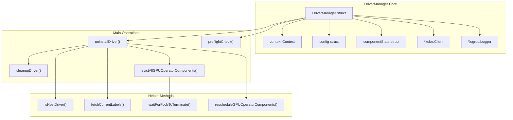

The `DriverManager` is initialized through the `newDriverManager` function and contains all necessary dependencies for managing driver operations.

Sources: [cmd/driver-manager/main.go:100-108](), [cmd/driver-manager/main.go:244-259]()

### Configuration Management

The `config` struct centralizes all environment variable-based configuration options that control driver manager behavior.

| Configuration Field | Environment Variable | Purpose |
|---------------------|---------------------|---------|
| `nodeName` | `NODE_NAME` | Target node for operations |
| `drainUseForce` | `DRAIN_USE_FORCE` | Force node draining |
| `drainTimeout` | `DRAIN_TIMEOUT_SECONDS` | Drain operation timeout |
| `enableAutoDrain` | `ENABLE_AUTO_DRAIN` | Enable automatic node draining |
| `enableGPUPodEviction` | `ENABLE_GPU_POD_EVICTION` | Enable GPU pod eviction |
| `operatorNamespace` | `OPERATOR_NAMESPACE` | GPU operator namespace |
| `gpuDirectRDMAEnabled` | `GPU_DIRECT_RDMA_ENABLED` | Enable GPU Direct RDMA |
| `useHostMofed` | `USE_HOST_MOFED` | Use host MOFED driver |
| `kubeconfig` | `KUBECONFIG` | Kubernetes config path |

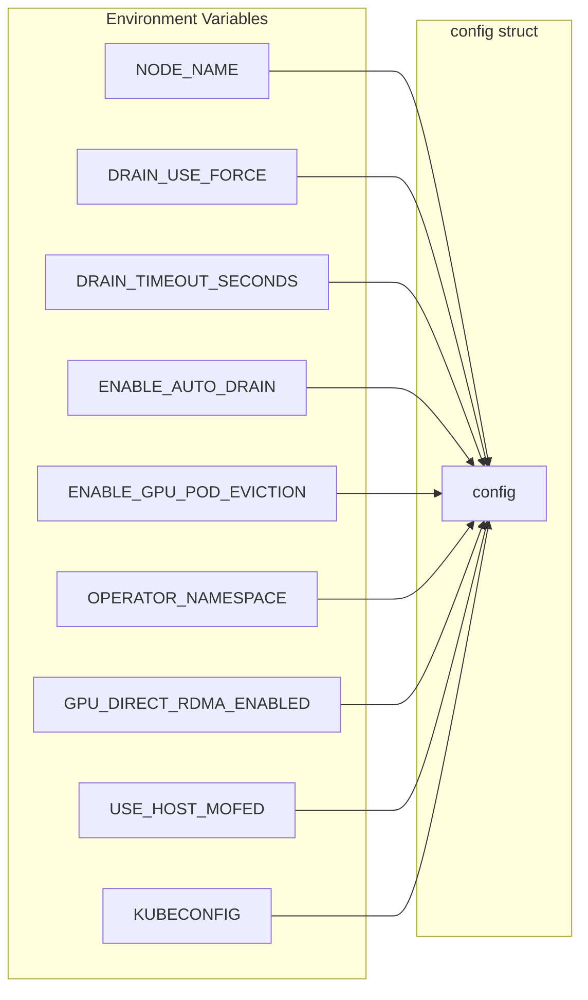

Sources: [cmd/driver-manager/main.go:68-81](), [cmd/driver-manager/main.go:127-212]()

### Component State Tracking

The `componentState` struct tracks the deployment state of all GPU operator components through Kubernetes node labels. This enables the driver manager to pause and resume components during driver upgrades.

```mermaid
graph TB
    subgraph "GPU Operator Components"
        DevicePlugin["pluginDeployed"]
        GFD["gfdDeployed"] 
        DCGM["dcgmDeployed"]
        DCGMExporter["dcgmExporterDeployed"]
        Toolkit["toolkitDeployed"]
        Validator["validatorDeployed"]
        MIGManager["migManagerDeployed"]
        NVSM["nvsmDeployed"]
        SandboxValidator["sandboxValidatorDeployed"]
        SandboxPlugin["sandboxPluginDeployed"]
        VGPUManager["vgpuDeviceManagerDeployed"]
    end
    
    subgraph "Node Labels"
        DevicePluginLabel["nvidia.com/gpu.deploy.device-plugin"]
        GFDLabel["nvidia.com/gpu.deploy.gpu-feature-discovery"]
        DCGMLabel["nvidia.com/gpu.deploy.dcgm"]
        DCGMExporterLabel["nvidia.com/gpu.deploy.dcgm-exporter"]
        ToolkitLabel["nvidia.com/gpu.deploy.container-toolkit"]
        ValidatorLabel["nvidia.com/gpu.deploy.operator-validator"]
        MIGLabel["nvidia.com/gpu.deploy.mig-manager"]
        NVSMLabel["nvidia.com/gpu.deploy.nvsm"]
        SandboxValidatorLabel["nvidia.com/gpu.deploy.sandbox-validator"]
        SandboxPluginLabel["nvidia.com/gpu.deploy.sandbox-device-plugin"]
        VGPULabel["nvidia.com/gpu.deploy.vgpu-device-manager"]
    end
    
    subgraph "componentState struct"
        ComponentState["componentState"]
    end
    
    DevicePluginLabel --> DevicePlugin
    GFDLabel --> GFD
    DCGMLabel --> DCGM
    DCGMExporterLabel --> DCGMExporter
    ToolkitLabel --> Toolkit
    ValidatorLabel --> Validator
    MIGLabel --> MIGManager
    NVSMLabel --> NVSM
    SandboxValidatorLabel --> SandboxValidator
    SandboxPluginLabel --> SandboxPlugin
    VGPULabel --> VGPUManager
    
    DevicePlugin --> ComponentState
    GFD --> ComponentState
    DCGM --> ComponentState
    DCGMExporter --> ComponentState
    Toolkit --> ComponentState
    Validator --> ComponentState
    MIGManager --> ComponentState
    NVSM --> ComponentState
    SandboxValidator --> ComponentState
    SandboxPlugin --> ComponentState
    VGPUManager --> ComponentState
```

The component state is managed through methods like `fetchCurrentLabels()`, `setComponentState()`, `maybeSetPaused()`, and `maybeSetTrue()` which handle the state transitions during driver operations.

Sources: [cmd/driver-manager/main.go:84-98](), [cmd/driver-manager/main.go:419-498](), [cmd/driver-manager/main.go:537-549](), [cmd/driver-manager/main.go:807-818]()

## CLI Interface

The application uses the `urfave/cli` framework to provide a command-line interface with two main commands for driver management operations.

```mermaid
graph TB
    subgraph "CLI Application"
        App["cli.App"]
        AppName["driver-manager"]
        AppUsage["NVIDIA Driver Manager for seamless GPU driver upgrades"]
        AppVersion["info.GetVersionString()"]
    end
    
    subgraph "CLI Commands"
        UninstallCmd["uninstall_driver"]
        PreflightCmd["preflight_check"]
    end
    
    subgraph "CLI Flags"
        NodeNameFlag["--node-name"]
        DrainForceFlag["--drain-use-force"]
        DrainTimeoutFlag["--drain-timeout-seconds"]
        AutoDrainFlag["--enable-auto-drain"]
        GPUEvictionFlag["--enable-gpu-pod-eviction"]
        OperatorNSFlag["--operator-namespace"]
        GPUDirectRDMAFlag["--gpu-direct-rdma-enabled"]
        HostMofedFlag["--use-host-mofed"]
        KubeconfigFlag["--kubeconfig"]
    end
    
    subgraph "Actions"
        UninstallAction["dm.uninstallDriver()"]
        PreflightAction["dm.preflightCheck()"]
    end
    
    App --> AppName
    App --> AppUsage
    App --> AppVersion
    App --> UninstallCmd
    App --> PreflightCmd
    App --> NodeNameFlag
    App --> DrainForceFlag
    App --> DrainTimeoutFlag
    App --> AutoDrainFlag
    App --> GPUEvictionFlag
    App --> OperatorNSFlag
    App --> GPUDirectRDMAFlag
    App --> HostMofedFlag
    App --> KubeconfigFlag
    
    UninstallCmd --> UninstallAction
    PreflightCmd --> PreflightAction
```

### CLI Commands

- **`uninstall_driver`**: Performs the complete driver uninstallation process, including component eviction, node draining, driver cleanup, and component rescheduling
- **`preflight_check`**: Validates prerequisites before driver operations (currently a placeholder for future implementation)

Sources: [cmd/driver-manager/main.go:110-242](), [cmd/driver-manager/main.go:214-237]()

## Internal Utilities

The k8s-driver-manager includes several internal utility packages that provide specialized functionality for driver management operations.

### Version Information

The `info` package provides version management functionality through build-time variable injection.

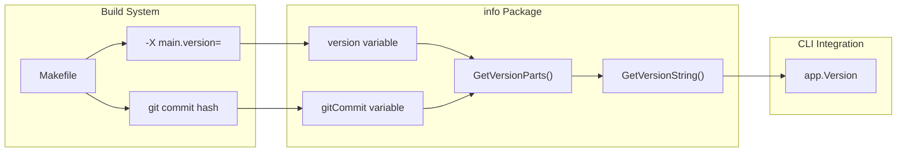

Sources: [internal/info/version.go:21-43]()

### Kernel Module Management

The `linuxutils` package provides kernel module inspection capabilities through the `KernelModules` struct.

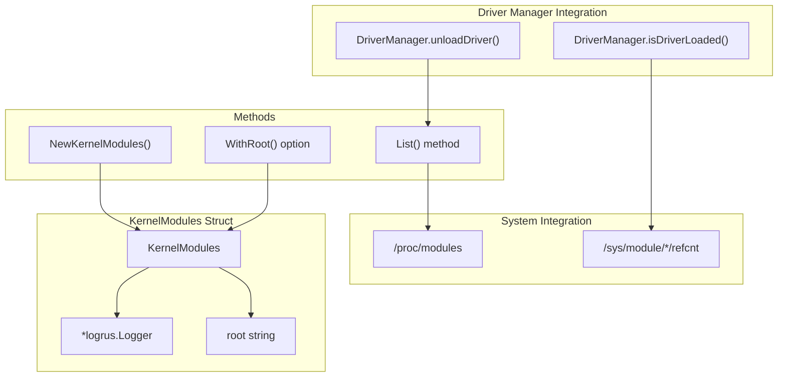

The `KernelModules` struct provides module listing functionality and is used by the driver manager to inspect loaded NVIDIA kernel modules during cleanup operations.

Sources: [internal/linuxutils/kmod.go:34-48](), [internal/linuxutils/kmod.go:56-107]()

### NVIDIA Driver Management

The `nvml` package provides utilities for locating and validating NVIDIA driver installations through the `DriverRoot` type.

```mermaid
graph TB
    subgraph "DriverRoot Type"
        DriverRootType["DriverRoot string"]
        GetNVMLPath["GetNVMLPath()"]
        FindFile["findFile()"]
        ResolveLink["resolveLink()"]
    end
    
    subgraph "Search Paths"
        UsrLib64["/usr/lib64"]
        UsrLibX86["/usr/lib/x86_64-linux-gnu"]
        UsrLibARM["/usr/lib/aarch64-linux-gnu"]
        Lib64["/lib64"]
        LibX86["/lib/x86_64-linux-gnu"]
        LibARM["/lib/aarch64-linux-gnu"]
    end
    
    subgraph "Target Files"
        NVMLLib["libnvidia-ml.so.1"]
    end
    
    subgraph "Driver Manager Usage"
        IsHostDriver["DriverManager.isHostDriver()"]
        HostRoot["nvml.DriverRoot(\"/host\")"]
        NVMLClient["nvml.NewClient()"]
    end
    
    DriverRootType --> GetNVMLPath
    GetNVMLPath --> FindFile
    FindFile --> ResolveLink
    GetNVMLPath --> UsrLib64
    GetNVMLPath --> UsrLibX86
    GetNVMLPath --> UsrLibARM
    GetNVMLPath --> Lib64
    GetNVMLPath --> LibX86
    GetNVMLPath --> LibARM
    FindFile --> NVMLLib
    
    IsHostDriver --> HostRoot
    HostRoot --> GetNVMLPath
    GetNVMLPath --> NVMLClient
```

The `DriverRoot` type abstracts driver root filesystem operations and provides a standardized way to locate NVIDIA libraries across different system configurations.

Sources: [internal/nvml/driver-root.go:24-70](), [cmd/driver-manager/main.go:396-406]()

---

# Page: Kubernetes Integration

# Kubernetes Integration

<details>
<summary>Relevant source files</summary>

The following files were used as context for generating this wiki page:

- [cmd/driver-manager/main.go](cmd/driver-manager/main.go)
- [internal/kubernetes/client.go](internal/kubernetes/client.go)

</details>


This document describes how the k8s-driver-manager integrates with Kubernetes APIs to orchestrate GPU driver upgrades across cluster nodes. It covers the client implementation, node management operations, pod eviction mechanisms, and GPU operator component orchestration through label manipulation.

For information about the core driver management components, see [Core Components](#2.1). For details about NVIDIA GPU-specific operations, see [NVIDIA GPU Management](#2.3).

## Core Integration Components

The Kubernetes integration is built around two primary components: the `DriverManager` struct that coordinates operations and the `Client` struct that provides Kubernetes API access.

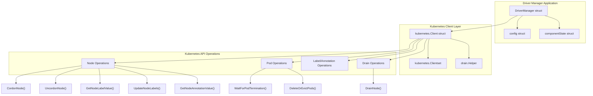

The `DriverManager` struct instantiates a `Client` through the `newDriverManager` function, which creates the Kubernetes client connection using either in-cluster configuration or a specified kubeconfig file. The client provides a high-level interface for all Kubernetes operations required during driver upgrades.

**Sources:** [cmd/driver-manager/main.go:100-108](), [cmd/driver-manager/main.go:244-259](), [internal/kubernetes/client.go:44-49](), [internal/kubernetes/client.go:59-78]()

## Node Management Operations

Node management is central to the driver upgrade process, involving cordoning nodes to prevent new pod scheduling, updating labels to control GPU operator component placement, and managing node annotations for upgrade policies.

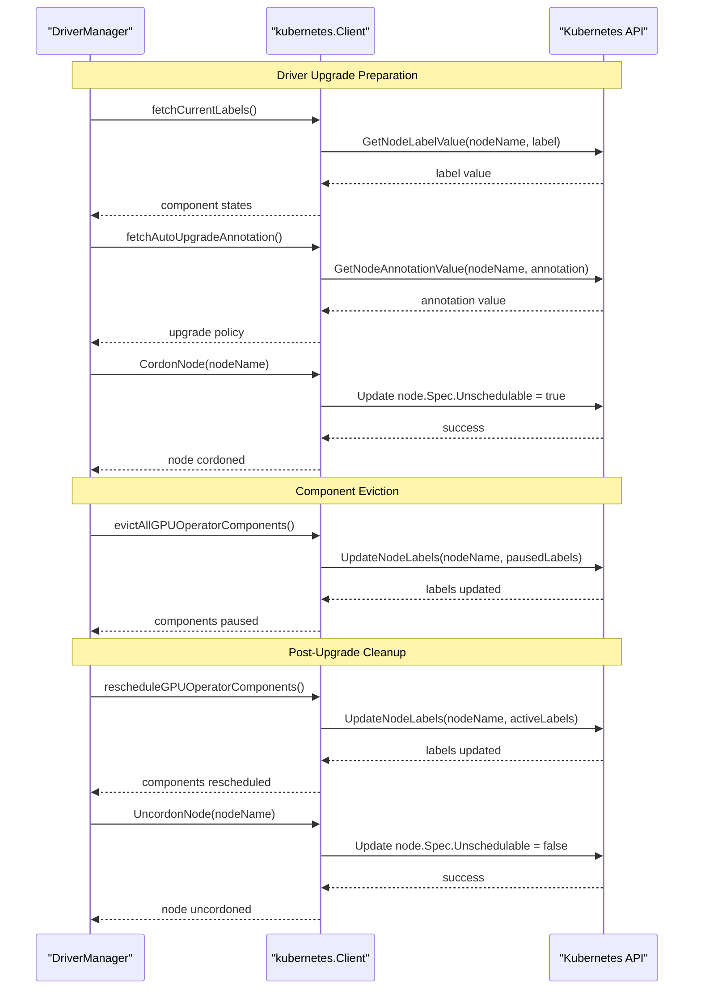

The node management workflow begins with fetching current component states through `GetNodeLabelValue` calls for each GPU operator component label. The `fetchAutoUpgradeAnnotation` method retrieves the upgrade policy from the `nvidia.com/gpu-driver-upgrade-enabled` annotation to determine whether automatic operations are permitted.

**Sources:** [cmd/driver-manager/main.go:419-458](), [cmd/driver-manager/main.go:487-498](), [internal/kubernetes/client.go:81-92](), [internal/kubernetes/client.go:117-127](), [internal/kubernetes/client.go:129-149](), [internal/kubernetes/client.go:151-171]()

## Pod Management and Eviction

Pod management focuses on safely evicting GPU workloads before driver operations begin. The system provides both targeted GPU pod eviction and full node draining capabilities.

The `DeleteOrEvictPods` method implements GPU-specific pod filtering through the `gpuPodSpecFilter` function, which identifies pods requesting NVIDIA GPU resources by examining resource requests and limits for names prefixed with `nvidia.com/gpu` or `nvidia.com/mig-`.

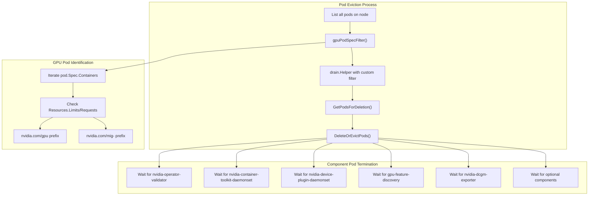

The `WaitForPodTermination` method monitors pod termination for each GPU operator component using label selectors and field selectors to match pods on the specific node. The system waits up to 5 minutes (defined by `defaultGracePeriod`) for each component to terminate.

**Sources:** [internal/kubernetes/client.go:211-282](), [internal/kubernetes/client.go:284-301](), [internal/kubernetes/client.go:173-190](), [cmd/driver-manager/main.go:551-618](), [cmd/driver-manager/main.go:48-49]()

## GPU Operator Component Orchestration

The driver manager orchestrates GPU operator components through a sophisticated label-based system that controls pod scheduling across the cluster. Each component is managed through specific node labels with the `nvidia.com/` prefix.

| Component | Label | Purpose |
|-----------|--------|---------|
| Driver | `nvidia.com/gpu.deploy.driver` | Controls driver container deployment |
| Device Plugin | `nvidia.com/gpu.deploy.device-plugin` | Manages device plugin scheduling |
| Container Toolkit | `nvidia.com/gpu.deploy.container-toolkit` | Controls toolkit daemon scheduling |
| GPU Feature Discovery | `nvidia.com/gpu.deploy.gpu-feature-discovery` | Manages GFD pod placement |
| DCGM Exporter | `nvidia.com/gpu.deploy.dcgm-exporter` | Controls monitoring component |
| MIG Manager | `nvidia.com/gpu.deploy.mig-manager` | Manages Multi-Instance GPU configuration |
| Validator | `nvidia.com/gpu.deploy.operator-validator` | Controls validation pod scheduling |

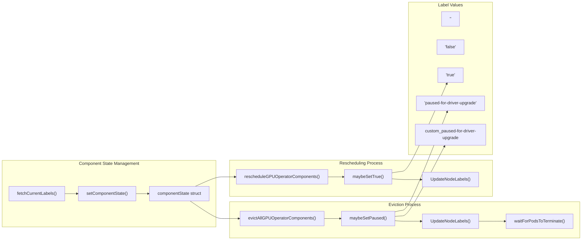

The `maybeSetPaused` function transforms component label values to prevent pod scheduling by appending `paused-for-driver-upgrade` or replacing `true` with the paused string. The `maybeSetTrue` function reverses this process, using regular expressions to remove paused markers and restore original values.

**Sources:** [cmd/driver-manager/main.go:53-65](), [cmd/driver-manager/main.go:460-485](), [cmd/driver-manager/main.go:500-535](), [cmd/driver-manager/main.go:537-549](), [cmd/driver-manager/main.go:777-804](), [cmd/driver-manager/main.go:807-818]()

## Client Implementation Details

The `Client` struct provides a comprehensive wrapper around the Kubernetes client-go library, implementing context-aware operations with proper error handling and logging.

The client initialization supports both in-cluster and external kubeconfig authentication through `clientcmd.BuildConfigFromFlags`. The `DrainOptions` struct encapsulates drain operation parameters including force deletion, empty directory handling, timeout configuration, and pod selector filtering.

| Method | Purpose | Key Parameters |
|---------|----------|----------------|
| `GetNodeLabelValue` | Retrieves node label values | `nodeName`, `label` |
| `UpdateNodeLabels` | Updates multiple node labels | `nodeName`, `nodeLabels map[string]string` |
| `GetNodeAnnotationValue` | Retrieves node annotation values | `nodeName`, `annotation` |
| `CordonNode` / `UncordonNode` | Controls node schedulability | `nodeName` |
| `DrainNode` | Performs full node drainage | `nodeName`, `DrainOptions` |
| `DeleteOrEvictPods` | Evicts GPU-specific pods | `nodeName`, `DrainOptions` |
| `WaitForPodTermination` | Monitors pod termination | `selectorMap`, `namespace`, `nodeName`, `timeout` |

The drain functionality integrates with kubectl's drain package, utilizing the `drain.Helper` struct with custom pod filters for GPU-specific eviction logic. The `gpuPodSpecFilter` examines container resource specifications to identify pods requiring GPU resources.

**Sources:** [internal/kubernetes/client.go:51-57](), [internal/kubernetes/client.go:59-78](), [internal/kubernetes/client.go:94-115](), [internal/kubernetes/client.go:192-209](), [internal/kubernetes/client.go:37-41]()

---

# Page: NVIDIA GPU Management

# NVIDIA GPU Management

<details>
<summary>Relevant source files</summary>

The following files were used as context for generating this wiki page:

- [cmd/driver-manager/main.go](cmd/driver-manager/main.go)
- [internal/linuxutils/kmod.go](internal/linuxutils/kmod.go)
- [internal/nvml/driver-root.go](internal/nvml/driver-root.go)

</details>


This document covers how the k8s-driver-manager handles NVIDIA GPU drivers, kernel modules, and GPU resources through NVML integration. It details the driver lifecycle management, kernel module operations, and system-level GPU resource management that enables seamless driver upgrades in Kubernetes environments.

For information about Kubernetes integration and node management, see [Kubernetes Integration](#2.2). For details about the overall system architecture, see [Architecture](#2).

## Driver Detection and Validation

The driver manager implements sophisticated logic to detect and validate NVIDIA driver installations across different deployment scenarios. The system distinguishes between pre-installed host drivers and containerized drivers managed by the GPU Operator.

```mermaid
flowchart TD
    Start["Driver Manager Start"] --> HostCheck["isHostDriver()"]
    HostCheck --> HostRoot["hostRoot := nvml.DriverRoot('/host')"]
    HostRoot --> NVMLPath["hostRoot.GetNVMLPath()"]
    NVMLPath --> PathFound{Path Found?}
    PathFound -->|Yes| CreateClient["nvmlClient := nvml.NewClient()"]
    PathFound -->|No| ContainerDriver["Use Containerized Driver"]
    CreateClient --> ValidateDriver["nvmlClient.ValidateDriver()"]
    ValidateDriver --> Valid{Valid?}
    Valid -->|Yes| PreInstalled["Set driver as pre-installed"]
    Valid -->|No| ContainerDriver
    PreInstalled --> DisableContainer["disableContainerizedDriver()"]
    DisableContainer --> UpdateLabels["Update Node Labels"]
    ContainerDriver --> ProceedUpgrade["Proceed with Driver Upgrade"]
```

The `DriverManager.isHostDriver()` method performs driver detection by examining the host filesystem for NVML libraries and validating driver functionality. When a pre-installed driver is detected, the system automatically disables containerized driver deployment.

**Sources:** [cmd/driver-manager/main.go:396-406](), [cmd/driver-manager/main.go:408-417](), [internal/nvml/driver-root.go:26-42]()

## NVML Integration Architecture

The system integrates with NVIDIA's Management Library (NVML) through a modular architecture that abstracts driver discovery and validation operations.

```mermaid
graph TB
    subgraph "NVML Integration Layer"
        DriverRoot["DriverRoot struct"]
        NVMLClient["nvml.Client"]
        LibrarySearch["Library Search Paths"]
    end
    
    subgraph "File System Integration"
        HostFS["/host filesystem"]
        ContainerFS["/run/nvidia/driver"]
        LibPaths["Library Paths:<br/>/usr/lib64<br/>/usr/lib/x86_64-linux-gnu<br/>/usr/lib/aarch64-linux-gnu<br/>/lib64"]
    end
    
    subgraph "Driver Manager Operations"
        HostDetection["isHostDriver()"]
        DriverValidation["ValidateDriver()"]
        PathResolution["GetNVMLPath()"]
    end
    
    DriverRoot --> LibrarySearch
    LibrarySearch --> LibPaths
    LibPaths --> HostFS
    LibPaths --> ContainerFS
    NVMLClient --> DriverValidation
    DriverRoot --> PathResolution
    PathResolution --> HostDetection
    HostDetection --> DriverValidation
    
    style DriverRoot fill:#f9f,stroke:#333,stroke-width:2px
    style NVMLClient fill:#bbf,stroke:#333,stroke-width:2px
```

The `DriverRoot` type provides filesystem abstraction for driver discovery, searching multiple standard library paths across different Linux distributions. The `GetNVMLPath()` method implements a comprehensive search strategy for locating the NVML library.

**Sources:** [internal/nvml/driver-root.go:24-42](), [internal/nvml/driver-root.go:47-59](), [cmd/driver-manager/main.go:398-405]()

## Kernel Module Management

The driver manager maintains detailed control over NVIDIA kernel modules, implementing ordered loading and unloading sequences to prevent dependency conflicts and ensure clean driver transitions.

| Module | Purpose | Unload Order |
|--------|---------|--------------|
| `nvidia_modeset` | Display management | 1 |
| `nvidia_uvm` | Unified Virtual Memory | 2 |
| `nvidia_peermem` | Peer-to-peer memory access | 3 |
| `nvidia_fs` | GPU filesystem support | 4 |
| `nvidia_vgpu_vfio` | Virtual GPU VFIO support | 5 |
| `gdrdrv` | GPUDirect RDMA driver | 6 |
| `nvidia` | Core NVIDIA driver | 7 |

```mermaid
sequenceDiagram
    participant DM as "DriverManager"
    participant KM as "KernelModules"
    participant Sys as "/sys/module"
    participant Proc as "/proc/modules"
    
    DM->>DM: "unloadDriver()"
    DM->>Sys: "Check /sys/module/{module}/refcnt"
    Sys-->>DM: "Module status"
    
    loop For each module
        DM->>+Sys: "unix.DeleteModule(module, 0)"
        alt Module in use
            Sys-->>-DM: "Error: Module in use"
            DM->>KM: "List('nvidia')"
            KM->>Proc: "Read /proc/modules"
            Proc-->>KM: "Module details"
            KM-->>DM: "Display module usage"
        else Module unloaded
            Sys-->>-DM: "Success"
        end
    end
```

The `unloadDriver()` method implements a systematic approach to kernel module management, checking module reference counts and handling dependencies. The `KernelModules` utility provides detailed module introspection capabilities.

**Sources:** [cmd/driver-manager/main.go:659-693](), [cmd/driver-manager/main.go:662-670](), [internal/linuxutils/kmod.go:56-107]()

## Driver Installation States

The driver manager tracks multiple installation states and deployment configurations through Kubernetes node labels and filesystem markers.

```mermaid
stateDiagram-v2
    [*] --> Detecting
    Detecting --> PreInstalled: "Host driver found"
    Detecting --> Containerized: "No host driver"
    
    PreInstalled --> Disabled: "disableContainerizedDriver()"
    Disabled --> LabelUpdated: "Set nvidia.com/gpu.deploy.driver=pre-installed"
    
    Containerized --> Loading: "Driver loading"
    Loading --> Loaded: "isDriverLoaded() == true"
    Loading --> Failed: "Load failure"
    
    Loaded --> Unloading: "Driver upgrade triggered"
    Unloading --> Cleaning: "cleanupDriver()"
    Cleaning --> Unmounted: "unmountRootfs()"
    Unmounted --> [*]: "Ready for new driver"
    
    Failed --> [*]: "Retry or manual intervention"
    
    note right of PreInstalled
        /sys/module/nvidia/refcnt exists
        NVML validation successful
    end note
    
    note right of Loaded
        Driver PID file exists
        /run/nvidia/driver mounted
    end note
```

The system uses filesystem indicators like `/sys/module/nvidia/refcnt` and `/run/nvidia/nvidia-driver.pid` to determine driver states, combined with NVML validation for comprehensive status assessment.

**Sources:** [cmd/driver-manager/main.go:621-624](), [cmd/driver-manager/main.go:649-656](), [cmd/driver-manager/main.go:44-45]()

## Cleanup and Uninstallation Process

The driver cleanup process follows a structured sequence to ensure complete driver removal and system stability during upgrades.

```mermaid
flowchart TD
    Start["cleanupDriver()"] --> UnloadMods["unloadDriver()"]
    UnloadMods --> ModSuccess{Modules Unloaded?}
    ModSuccess -->|Yes| UnmountFS["unmountRootfs()"]
    ModSuccess -->|No| LogError["Log module errors"]
    
    UnmountFS --> CheckMount{"/run/nvidia/driver exists?"}
    CheckMount -->|Yes| RecursiveUnmount["mount.RecursiveUnmount()"]
    CheckMount -->|No| SkipUnmount["Skip unmount"]
    
    RecursiveUnmount --> UnmountSuccess{Success?}
    UnmountSuccess -->|Yes| RemovePID["Remove PID file"]
    UnmountSuccess -->|No| UnmountError["Return unmount error"]
    
    SkipUnmount --> RemovePID
    RemovePID --> CheckPID{"/run/nvidia/nvidia-driver.pid exists?"}
    CheckPID -->|Yes| DeletePID["os.Remove(driverPIDFile)"]
    CheckPID -->|No| Complete["Cleanup complete"]
    DeletePID --> Complete
    
    LogError --> ReturnError["Return module errors"]
    UnmountError --> End["End with error"]
    Complete --> End["End successfully"]
    ReturnError --> End
```

The cleanup process handles filesystem unmounting, PID file management, and error recovery. The `unmountRootfs()` method performs recursive unmounting to handle complex mount hierarchies.

**Sources:** [cmd/driver-manager/main.go:636-657](), [cmd/driver-manager/main.go:695-711](), [cmd/driver-manager/main.go:649-656]()

## VFIO and Device Management

The driver manager integrates with VFIO (Virtual Function I/O) infrastructure for device management, particularly important for virtualization and device passthrough scenarios.

```mermaid
graph LR
    subgraph "Device Management"
        VFIO["vfio-pci driver"]
        Devices["GPU Devices"]
        Unbind["unbindVfioPCI()"]
    end
    
    subgraph "External Tools"
        VFIOManage["vfio-manage command"]
        UnbindAll["unbind --all"]
    end
    
    subgraph "System Integration"
        SysFS["/sys/bus/pci/devices"]
        PCIDevices["PCI Device Enumeration"]
    end
    
    Unbind --> VFIOManage
    VFIOManage --> UnbindAll
    UnbindAll --> Devices
    VFIO --> Devices
    PCIDevices --> SysFS
    SysFS --> Devices
```

The `unbindVfioPCI()` method ensures clean device state transitions by unbinding all devices from the VFIO-PCI driver, preventing conflicts during driver upgrades.

**Sources:** [cmd/driver-manager/main.go:716-720](), [cmd/driver-manager/main.go:713-720]()

## Nouveau Driver Management

The system includes handling for the open-source Nouveau driver, which must be unloaded before NVIDIA proprietary drivers can be installed.

```mermaid
flowchart LR
    Check["isNouveauLoaded()"] --> Exists{"/sys/module/nouveau/refcnt exists?"}
    Exists -->|Yes| Unload["unloadNouveau()"]
    Exists -->|No| Skip["Skip unload"]
    Unload --> DeleteMod["unix.DeleteModule('nouveau', 0)"]
    DeleteMod --> Success["Nouveau unloaded"]
    Skip --> Continue["Continue with NVIDIA driver"]
    Success --> Continue
```

The Nouveau driver detection and unloading ensures compatibility with NVIDIA proprietary drivers by checking for kernel module presence and performing clean removal when necessary.

**Sources:** [cmd/driver-manager/main.go:626-628](), [cmd/driver-manager/main.go:631-634](), [cmd/driver-manager/main.go:374-379]()

---

# Page: Development

# Development

<details>
<summary>Relevant source files</summary>

The following files were used as context for generating this wiki page:

- [Makefile](Makefile)
- [go.mod](go.mod)
- [go.sum](go.sum)

</details>


This page provides guidance for developers working on the k8s-driver-manager codebase, covering development workflows, build processes, and code organization. It serves as the entry point for understanding how to build, test, and modify the project.

For detailed information about specific development aspects, see:
- Build system configuration and targets: [Build System](#3.1)
- Development environment setup and tooling: [Development Environment](#3.2) 
- Testing strategies and code quality tools: [Testing and Quality](#3.3)

## Development Workflow Overview

The k8s-driver-manager project follows a Make-based development workflow with Docker containerization support. The primary development entry points are defined in the root `Makefile`, which orchestrates building, testing, and code quality checks.

### Make Target Architecture

```mermaid
graph TB
    subgraph "Primary Targets"
        all["all"]
        build["build"]
        check["check"] 
        test["test"]
    end
    
    subgraph "Code Quality"
        fmt["fmt"]
        lint["lint"]
        goimports["goimports"]
    end
    
    subgraph "Dependencies"
        vendor["vendor"]
        mod_tidy["mod-tidy"]
        mod_vendor["mod-vendor"] 
        mod_verify["mod-verify"]
        check_vendor["check-vendor"]
    end
    
    subgraph "Coverage"
        coverage["coverage"]
        COVERAGE_FILE["coverage.out"]
    end
    
    subgraph "Docker Targets"
        docker_build["docker-build"]
        docker_test["docker-test"]
        docker_lint["docker-lint"]
        shell[".shell"]
    end
    
    all --> check
    all --> test
    all --> build
    
    check --> lint
    test --> build
    test --> COVERAGE_FILE
    coverage --> test
    
    vendor --> mod_tidy
    vendor --> mod_vendor
    vendor --> mod_verify
    check_vendor --> vendor
    
    docker_build --> build
    docker_test --> test
    docker_lint --> lint
```

**Sources:** [Makefile:28-42](), [Makefile:64-87]()

### Go Module Dependencies

The project uses Go modules for dependency management with a focus on Kubernetes and NVIDIA GPU integration:

```mermaid
graph TB
    subgraph "Core Module"
        main_mod["github.com/NVIDIA/k8s-driver-manager"]
    end
    
    subgraph "NVIDIA Dependencies" 
        nvml["github.com/NVIDIA/go-nvml v0.12.9-0"]
    end
    
    subgraph "Kubernetes Dependencies"
        k8s_api["k8s.io/api v0.33.2"]
        k8s_apimachinery["k8s.io/apimachinery v0.33.2"] 
        k8s_client_go["k8s.io/client-go v0.33.2"]
        k8s_kubectl["k8s.io/kubectl v0.33.2"]
    end
    
    subgraph "System Integration"
        mount["github.com/moby/sys/mount v0.3.4"]
        golang_sys["golang.org/x/sys v0.31.0"]
    end
    
    subgraph "CLI & Logging"
        cli["github.com/urfave/cli/v2 v2.27.7"]
        logrus["github.com/sirupsen/logrus v1.9.3"]
    end
    
    main_mod --> nvml
    main_mod --> k8s_api
    main_mod --> k8s_apimachinery
    main_mod --> k8s_client_go
    main_mod --> k8s_kubectl
    main_mod --> mount
    main_mod --> golang_sys
    main_mod --> cli
    main_mod --> logrus
```

**Sources:** [go.mod:1-15](), [go.mod:5-14]()

## Development Environment Configuration

The project provides a containerized development environment using Docker. The `BUILDIMAGE` environment variable controls which image is used for development tasks.

### Docker-based Development Workflow  

```mermaid
sequenceDiagram
    participant Dev as Developer
    participant Make as Makefile
    participant Docker as Docker Engine
    participant Container as Build Container
    
    Dev->>Make: "make docker-build"
    Make->>Docker: "docker run $(BUILDIMAGE)"
    Docker->>Container: "Mount PWD:/work"
    Container->>Container: "GOOS=linux go build ./..."
    Container-->>Make: "Build artifacts"
    Make-->>Dev: "Completed"
    
    Dev->>Make: "make .shell"
    Make->>Docker: "docker run -ti $(BUILDIMAGE)"
    Docker->>Container: "Interactive shell"
    Container-->>Dev: "Development environment"
```

**Sources:** [Makefile:64-87](), [Makefile:77-87]()

## Code Organization and Build Process

The codebase follows Go module conventions with the main module located at `github.com/NVIDIA/k8s-driver-manager`. The build process uses standard Go tooling enhanced with Make targets for automation.

### Build Configuration

| Target | Purpose | Implementation |
|--------|---------|---------------|  
| `build` | Compile Go packages | `GOOS=$(GOOS) go build ./...` |
| `test` | Run unit tests with coverage | `go test -coverprofile=$(COVERAGE_FILE).with-mocks` |
| `lint` | Static analysis | `golangci-lint run ./...` |
| `fmt` | Code formatting | `gofmt -s -l -w` on all Go files |
| `goimports` | Import organization | `goimports -local $(MODULE) -w` |

**Sources:** [Makefile:38-54]()

### Dependency Management Process

The project maintains strict dependency management through automated Make targets:

```mermaid
flowchart LR
    start[["Developer Change"]] --> mod_tidy["mod-tidy"]
    mod_tidy --> mod_vendor["mod-vendor"] 
    mod_vendor --> mod_verify["mod-verify"]
    mod_verify --> check_vendor["check-vendor"]
    check_vendor --> git_diff["git diff --exit-code"]
    git_diff --> success[["Dependencies Valid"]]
    git_diff --> failure[["Commit Required"]]
```

The `vendor` target orchestrates the complete dependency update process, while `check-vendor` validates that vendored dependencies match the committed state.

**Sources:** [Makefile:89-113]()

## Code Quality Standards

The development process enforces code quality through multiple automated checks:

- **Formatting**: `gofmt` ensures consistent code style across all Go files
- **Import Management**: `goimports` with local module preference organizes imports  
- **Static Analysis**: `golangci-lint` performs comprehensive linting
- **Test Coverage**: Coverage reports generated with mock exclusion via `grep -v "_mock.go"`

**Sources:** [Makefile:44-62]()

## Interactive Development

For interactive development sessions, the `.shell` target provides access to the containerized build environment:

```bash
make .shell
```

This launches an interactive container with the project directory mounted at `/work`, providing access to all development tools and dependencies in a consistent environment.

**Sources:** [Makefile:77-87]()

---

# Page: Build System

# Build System

<details>
<summary>Relevant source files</summary>

The following files were used as context for generating this wiki page:

- [Makefile](Makefile)
- [deployments/container/Makefile](deployments/container/Makefile)
- [deployments/container/multi-arch.mk](deployments/container/multi-arch.mk)
- [deployments/container/native-only.mk](deployments/container/native-only.mk)

</details>


## Purpose and Scope

This document describes the Make-based build system used by the k8s-driver-manager project. The build system provides targets for compiling Go code, running tests, performing quality checks, building container images, and managing dependencies. It supports both local development and containerized builds with multi-architecture support.

For information about development environment setup, see [Development Environment](#3.2). For CI/CD pipeline integration, see [CI/CD Pipelines](#4.2).

## Build System Architecture

The build system consists of a hierarchical Makefile structure that coordinates Go compilation, testing, quality assurance, and container image building.

### Build System Component Flow

```mermaid
flowchart TD
    RootMakefile["Root Makefile"] --> GoTargets["Go Build Targets"]
    RootMakefile --> DockerTargets["Docker Build Targets"]
    RootMakefile --> QualityTargets["Quality Targets"]
    
    GoTargets --> BuildTarget["build"]
    GoTargets --> TestTarget["test"]
    GoTargets --> VendorTargets["vendor management"]
    
    QualityTargets --> LintTarget["lint"]
    QualityTargets --> FmtTarget["fmt"]
    QualityTargets --> CoverageTarget["coverage"]
    
    DockerTargets --> ContainerMakefile["deployments/container/Makefile"]
    
    ContainerMakefile --> MultiArchMk["multi-arch.mk"]
    ContainerMakefile --> NativeOnlyMk["native-only.mk"]
    
    MultiArchMk --> PlatformBuilds["linux/amd64, linux/arm64"]
    NativeOnlyMk --> NativeBuild["linux/amd64"]
    
    VendorTargets --> ModTidy["mod-tidy"]
    VendorTargets --> ModVendor["mod-vendor"] 
    VendorTargets --> ModVerify["mod-verify"]
```

**Sources:** [Makefile:19-114](), [deployments/container/Makefile:22-83](), [deployments/container/multi-arch.mk:15-25](), [deployments/container/native-only.mk:15-20]()

## Core Makefile Targets

The root Makefile defines the primary build targets used for development and CI operations.

### Primary Build Targets

| Target | Purpose | Command |
|--------|---------|---------|
| `build` | Compile Go binaries | `GOOS=$(GOOS) go build ./...` |
| `test` | Run tests with coverage | `go test -coverprofile=$(COVERAGE_FILE).with-mocks $(MODULE)/...` |
| `lint` | Static code analysis | `golangci-lint run ./...` |
| `fmt` | Format Go source code | `gofmt -s -l -w` on all Go files |
| `vendor` | Manage Go module dependencies | Executes `mod-tidy`, `mod-vendor`, `mod-verify` |
| `check` | Run all quality checks | Executes all `CHECK_TARGETS` |
| `all` | Full build and test cycle | Executes `check`, `test`, `build` |

### Make Configuration Variables

The build system uses several configurable variables:

```makefile
DOCKER   ?= docker
GO       ?= go
GOOS     ?= linux
MODULE   := github.com/NVIDIA/k8s-driver-manager
REGISTRY ?= nvidia
IMAGE_NAME = $(REGISTRY)/k8s-driver-manager
```

**Sources:** [Makefile:15-26](), [Makefile:36-63]()

## Go Build Process

The Go build process handles compilation, testing, and dependency management for the k8s-driver-manager application.

### Go Build Target Flow

```mermaid
flowchart LR
    BuildCmd["make build"] --> GoOSCheck["GOOS=linux"]
    GoOSCheck --> GoBuild["go build ./..."]
    GoBuild --> BinaryOutput["Compiled binaries"]
    
    TestCmd["make test"] --> BuildDep["Depends on build"]
    BuildDep --> GoTest["go test -coverprofile=coverage.out.with-mocks"]
    GoTest --> CoverageFile["coverage.out.with-mocks"]
    
    CoverageCmd["make coverage"] --> TestDep["Depends on test"]
    TestDep --> FilterMocks["Filter _mock.go files"]
    FilterMocks --> CoverageReport["go tool cover -func=coverage.out"]
```

### Dependency Management Workflow

The `vendor` target orchestrates Go module management through three sequential operations:

```mermaid
flowchart TD
    VendorTarget["make vendor"] --> ModTidy["mod-tidy"]
    ModTidy --> ModVendor["mod-vendor"]
    ModVendor --> ModVerify["mod-verify"]
    
    ModTidy --> FindGoMod["Find all go.mod files"]
    FindGoMod --> ExcludeTestData["Exclude testdata/, third_party/"]
    ExcludeTestData --> RunGoModTidy["go mod tidy in each directory"]
    
    ModVendor --> FindVendorMod["Find go.mod for vendoring"]
    FindVendorMod --> ExcludeDeployments["Exclude deployments/"]
    ExcludeDeployments --> RunGoModVendor["go mod vendor in each directory"]
    
    ModVerify --> VerifyAllMods["go mod verify for all modules"]
    VerifyAllMods --> CheckVendor["check-vendor validates git diff"]
```

**Sources:** [Makefile:89-114]()

## Container Build System

The container build system is implemented through a separate Makefile hierarchy in the `deployments/container/` directory, supporting both single-architecture and multi-architecture builds.

### Container Build Architecture

```mermaid
flowchart TD
    ContainerMakefile["deployments/container/Makefile"] --> BuildMultiArch{"BUILD_MULTI_ARCH_IMAGES?"}
    
    BuildMultiArch -->|true| MultiArchMk["multi-arch.mk"]
    BuildMultiArch -->|false| NativeOnlyMk["native-only.mk"]
    
    MultiArchMk --> DockerBuildx["docker buildx build"]
    NativeOnlyMk --> DockerBuild["docker build"]
    
    DockerBuildx --> MultiPlatform["--platform=linux/amd64,linux/arm64"]
    DockerBuild --> SinglePlatform["--platform=linux/amd64"]
    
    MultiPlatform --> ImageOutput["Multi-arch image"]
    SinglePlatform --> NativeImage["Native image"]
    
    ContainerMakefile --> DistributionTargets["DISTRIBUTIONS := ubi9"]
    DistributionTargets --> BuildTargets["BUILD_TARGETS"]
    DistributionTargets --> PushTargets["PUSH_TARGETS"]
```

### Container Build Targets

The container build system defines distribution-specific targets:

| Target Pattern | Purpose | Example |
|----------------|---------|---------|
| `build-<dist>` | Build container for distribution | `build-ubi9` |
| `push-<dist>` | Push container to registry | `push-ubi9` |
| `<dist>` | Shorthand for `build-<dist>` | `ubi9` |

### Docker Build Command Structure

The container build process uses a standardized Docker build command with configurable options:

```bash
DOCKER_BUILDKIT=1 $(DOCKER) $(BUILDX) build --pull \
    $(DOCKER_BUILD_OPTIONS) \
    $(DOCKER_BUILD_PLATFORM_OPTIONS) \
    --tag $(IMAGE) \
    --build-arg GOLANG_VERSION="$(GOLANG_VERSION)" \
    --build-arg VERSION="$(VERSION)" \
    --build-arg GIT_COMMIT="$(GIT_COMMIT)" \
    --build-arg CVE_UPDATES="$(CVE_UPDATES)" \
    --file $(DOCKERFILE) \
    $(CURDIR)
```

**Sources:** [deployments/container/Makefile:59-70](), [deployments/container/multi-arch.mk:17-18](), [deployments/container/native-only.mk:15]()

## Multi-Architecture Build Support

The build system provides comprehensive multi-architecture support through Docker Buildx when `BUILD_MULTI_ARCH_IMAGES=true`.

### Multi-Architecture Configuration

```mermaid
flowchart LR
    BuildxCheck["BUILD_MULTI_ARCH_IMAGES=true"] --> BuildxVar["BUILDX = buildx"]
    BuildxVar --> PlatformOptions["--platform=linux/amd64,linux/arm64"]
    PlatformOptions --> BuildOptions["--output=type=image,push=PUSH_ON_BUILD"]
    BuildOptions --> AttestationOptions["--provenance=ATTACH_ATTESTATIONS"]
    AttestationOptions --> SbomOptions["--sbom=ATTACH_ATTESTATIONS"]
    
    NativeCheck["BUILD_MULTI_ARCH_IMAGES=false"] --> NativePlatform["--platform=linux/amd64"]
    NativePlatform --> DockerPush["docker tag + docker push"]
```

### Multi-Architecture vs Native-Only Build Differences

| Aspect | Multi-Architecture | Native-Only |
|--------|-------------------|-------------|
| Docker Command | `docker buildx build` | `docker build` |
| Platform Support | `linux/amd64,linux/arm64` | `linux/amd64` |
| Build Options | `--output=type=image,push=$(PUSH_ON_BUILD)` | Standard Docker build |
| Push Method | Built-in push or `regctl image copy` | `docker tag` + `docker push` |
| Attestations | Configurable SBOM/Provenance | Not supported |

**Sources:** [deployments/container/multi-arch.mk:17-25](), [deployments/container/native-only.mk:15-20]()

## Containerized Development

The build system supports containerized development through Docker-based execution of build targets.

### Docker Build Environment

```mermaid
flowchart TD
    DockerTargets["DOCKER_TARGETS"] --> PatternRule["docker-% pattern"]
    PatternRule --> DockerRun["docker run with BUILDIMAGE"]
    DockerRun --> MountWorkspace["-v $(PWD):/work"]
    DockerRun --> UserMapping["--user $(id -u):$(id -g)"]
    DockerRun --> CacheMapping["-e GOCACHE=/tmp/.cache/go"]
    DockerRun --> ModCacheMapping["-e GOMODCACHE=/tmp/.cache/gomod"]
    DockerRun --> ExecuteMake["make $(target)"]
    
    ShellTarget[".shell target"] --> InteractiveRun["docker run -ti"]
    InteractiveRun --> SameConfig["Same volume/user config"]
    SameConfig --> InteractiveShell["Interactive development shell"]
```

### Docker Target Pattern

All primary Makefile targets have corresponding Docker variants following the pattern:

- `docker-build` → runs `make build` in container
- `docker-test` → runs `make test` in container  
- `docker-lint` → runs `make lint` in container

The `.shell` target provides an interactive development environment using the same containerized setup.

**Sources:** [Makefile:64-87]()

## Build Quality Integration

The build system integrates multiple quality assurance tools and processes.

### Quality Check Pipeline

```mermaid
flowchart LR
    QualityEntry["make check"] --> CheckTargets["CHECK_TARGETS := lint"]
    CheckTargets --> LintExecution["golangci-lint run ./..."]
    
    FmtTarget["make fmt"] --> GoFmt["gofmt -s -l -w"]
    GoImportsTarget["make goimports"] --> GoImports["goimports -local $(MODULE) -w"]
    
    TestTarget["make test"] --> TestExecution["go test -coverprofile"]
    TestExecution --> CoverageGeneration["coverage.out.with-mocks"]
    
    CoverageTarget["make coverage"] --> FilterMocks["grep -v _mock.go"]
    FilterMocks --> CoverageReport["go tool cover -func"]
```

### Vendor Validation

The `check-vendor` target ensures dependency consistency by validating that vendored dependencies match the current module state:

```bash
check-vendor: vendor
    git diff --exit-code HEAD -- go.mod go.sum vendor
```

This prevents issues where local changes to dependencies are not properly committed to version control.

**Sources:** [Makefile:44-63](), [Makefile:112-114]()

---

# Page: Development Environment

# Development Environment

<details>
<summary>Relevant source files</summary>

The following files were used as context for generating this wiki page:

- [deployments/devel/Dockerfile](deployments/devel/Dockerfile)
- [deployments/devel/Makefile](deployments/devel/Makefile)
- [deployments/devel/go.mod](deployments/devel/go.mod)
- [deployments/devel/tools.go](deployments/devel/tools.go)

</details>


This document describes the Docker-based development environment for k8s-driver-manager, including containerized tooling, dependency management, and the development workflow setup.

For information about the main build system and production builds, see [Build System](#3.1). For testing and quality assurance tooling, see [Testing and Quality](#3.3).

## Development Container Overview

The k8s-driver-manager project provides a standardized development environment through a Docker container that includes all necessary development tools and dependencies. This approach ensures consistent tooling across different developer machines and CI environments.

```mermaid
graph TB
    subgraph "Host Development Machine"
        HostCode["Source Code<br/>/work directory"]
        HostDocker["Docker Engine"]
    end
    
    subgraph "Development Container"
        subgraph "Base Image"
            Golang["golang:1.24.6<br/>Base Image"]
        end
        
        subgraph "Development Tools"
            GolangciLint["golangci-lint<br/>Code Linting"]
            Moq["moq<br/>Mock Generation"]
            GitConfig["Git Configuration<br/>Safe Directory"]
        end
        
        subgraph "Build Environment"
            WorkDir["/work<br/>Working Directory"]
            GoMods["Go Modules<br/>Downloaded Dependencies"]
        end
    end
    
    subgraph "Tool Installation Process"
        ToolsGo["tools.go<br/>Tool Dependencies"]
        MakeInstall["make install-tools<br/>Installation Target"]
        
        ToolsGo --> MakeInstall
        MakeInstall --> GolangciLint
        MakeInstall --> Moq
    end
    
    HostCode --> WorkDir
    HostDocker --> Golang
    
    Golang --> WorkDir
    WorkDir --> GoMods
```

**Development Container Architecture**

The development container is built from the `golang:1.24.6` base image and automatically installs all required development tools through the `make install-tools` target.

Sources: [deployments/devel/Dockerfile:17](), [deployments/devel/Dockerfile:22](), [deployments/devel/Dockerfile:26]()

## Tool Management System

The development environment uses Go's build tags pattern to manage development tool dependencies. This ensures tools are version-controlled and consistently installed across all development environments.

```mermaid
graph LR
    subgraph "Tool Definition"
        ToolsGo["tools.go<br/>Build Tags: tools"]
        BuildTag["//go:build tools"]
        
        subgraph "Tool Imports"
            GolangciImport["github.com/golangci/golangci-lint/cmd/golangci-lint"]
            MoqImport["github.com/matryer/moq"]
        end
    end
    
    subgraph "Dependency Management"
        GoMod["go.mod<br/>Tool Dependencies"]
        GoSum["go.sum<br/>Dependency Hashes"]
    end
    
    subgraph "Installation Process"
        MakeTarget["make install-tools"]
        GoInstall["go install %<br/>Tool Installation"]
        AwkParsing["awk -F'\"' '{print $2}'<br/>Import Path Extraction"]
    end
    
    BuildTag --> ToolsGo
    ToolsGo --> GolangciImport
    ToolsGo --> MoqImport
    
    GolangciImport --> GoMod
    MoqImport --> GoMod
    GoMod --> GoSum
    
    MakeTarget --> AwkParsing
    AwkParsing --> GoInstall
    
    GoInstall --> GolangciImport
    GoInstall --> MoqImport
```

**Tool Dependency Management Flow**

The `tools.go` file uses Go build tags to define development tool dependencies without including them in the main application binary. The `make install-tools` target parses these imports and installs the tools using `go install`.

| Tool | Purpose | Import Path |
|------|---------|-------------|
| `golangci-lint` | Code linting and static analysis | `github.com/golangci/golangci-lint/cmd/golangci-lint` |
| `moq` | Interface mock generation | `github.com/matryer/moq` |

Sources: [deployments/devel/tools.go:1-2](), [deployments/devel/tools.go:24-25](), [deployments/devel/Makefile:19-21]()

## Development Workflow Components

The development environment provides several Make targets that facilitate common development tasks within the containerized environment.

### Module Management

```mermaid
graph TD
    subgraph "Module Operations"
        Download["make download<br/>Download Dependencies"]
        Modules["make modules<br/>Tidy & Verify"]
        CheckModules["make check-modules<br/>Git Diff Check"]
    end
    
    subgraph "Go Commands"
        GoModDownload["go mod download"]
        GoModTidy["go mod tidy"]
        GoModVerify["go mod verify"]
        GitDiff["git diff --quiet HEAD<br/>go.mod go.sum"]
    end
    
    subgraph "Files"
        GoModFile["go.mod"]
        GoSumFile["go.sum"]
        GitRepo["Git Repository"]
    end
    
    Download --> GoModDownload
    Modules --> GoModTidy
    Modules --> GoModVerify
    CheckModules --> GitDiff
    
    GoModDownload --> GoModFile
    GoModTidy --> GoModFile
    GoModTidy --> GoSumFile
    GoModVerify --> GoSumFile
    GitDiff --> GitRepo
```

**Module Management Targets**

- `download`: Downloads all Go module dependencies specified in `go.mod`
- `modules`: Tidies dependencies and verifies module checksums
- `check-modules`: Ensures module files are synchronized with Git

Sources: [deployments/devel/Makefile:15-17](), [deployments/devel/Makefile:38-43]()

### Container Image Building

The development environment includes targets for building the development container image with proper Docker configuration.

| Variable | Default | Purpose |
|----------|---------|---------|
| `DOCKER` | `docker` | Docker command to use for builds |
| `DOCKERFILE_DEVEL` | `deployments/devel/Dockerfile` | Development Dockerfile path |
| `DOCKERFILE_CONTEXT` | `deployments/devel` | Build context directory |
| `BUILDIMAGE` | From `versions.mk` | Development image tag |

Sources: [deployments/devel/Makefile:24](), [deployments/devel/Makefile:27-28](), [deployments/devel/Makefile:31-36]()

## Environment Setup Process

The development environment setup follows a specific sequence to ensure all dependencies and tools are properly configured.

```mermaid
sequenceDiagram
    participant Developer as "Developer"
    participant Docker as "Docker Engine"
    participant Container as "Dev Container"
    participant GoTools as "Go Toolchain"
    participant Git as "Git Repository"
    
    Developer->>Docker: "docker build -f deployments/devel/Dockerfile"
    Docker->>Container: "Create container with golang:1.24.6"
    Container->>Container: "WORKDIR /work"
    Container->>Container: "COPY * ."
    Container->>GoTools: "make install-tools"
    
    GoTools->>GoTools: "go mod download"
    GoTools->>GoTools: "Parse tools.go imports"
    GoTools->>GoTools: "go install golangci-lint"
    GoTools->>GoTools: "go install moq"
    
    Container->>Git: "git config --add safe.directory /work"
    Git-->>Container: "Git configuration complete"
    
    Container-->>Developer: "Development environment ready"
```

**Development Environment Initialization**

The container setup process automatically downloads dependencies, installs development tools, and configures Git to work within the containerized environment.

### Git Configuration

The development container automatically configures Git to recognize the `/work` directory as a safe directory, allowing Git operations to function properly within the container environment.

```bash
git config --file=/.gitconfig --add safe.directory /work
```

This configuration is necessary because the container may run with different user permissions than the host system, and Git's security features require explicit permission to operate in such directories.

Sources: [deployments/devel/Dockerfile:24-26]()

### Tool Dependencies

The development environment manages a comprehensive set of static analysis and development tools through its dependency system:

| Category | Tools | Purpose |
|----------|-------|---------|
| **Primary Tools** | `golangci-lint`, `moq` | Code linting and mock generation |
| **Linters** | `errcheck`, `gosec`, `govet` | Error handling and security analysis |
| **Formatters** | `gofmt`, `goimports`, `gofumpt` | Code formatting and import management |
| **Analysis** | `go-critic`, `revive`, `staticcheck` | Advanced static analysis |

The complete tool dependency tree is managed through the `go.mod` file in the development module, ensuring reproducible tool versions across all development environments.

Sources: [deployments/devel/go.mod:7-10](), [deployments/devel/go.mod:12-197]()

---

# Page: Testing and Quality

# Testing and Quality

<details>
<summary>Relevant source files</summary>

The following files were used as context for generating this wiki page:

- [.github/workflows/code_scanning.yaml](.github/workflows/code_scanning.yaml)
- [.github/workflows/golang.yaml](.github/workflows/golang.yaml)
- [deployments/devel/go.sum](deployments/devel/go.sum)

</details>


This document describes the testing strategy, code quality tools, and static analysis integration used in the k8s-driver-manager project. It covers unit testing frameworks, linting configurations, CI/CD quality gates, and security scanning processes that ensure code reliability and maintainability.

For information about the build system and development workflow, see [Build System](#3.1). For CI/CD pipeline details, see [CI/CD Pipelines](#4.2).

## Testing Strategy

The project employs a comprehensive testing approach combining unit tests, coverage reporting, and automated quality checks through CI/CD pipelines.

### Unit Testing Framework

```mermaid
graph TB
    subgraph "Testing Tools"
        TestFramework["testify v1.10.0"]
        MockFramework["gomega v1.36.2"]
        BDDFramework["ginkgo/v2 v2.22.2"]
    end
    
    subgraph "Make Targets"
        CoverageTarget["make coverage"]
        TestTarget["make test"]
        CheckVendor["make check-vendor"]
    end
    
    subgraph "Coverage Reporting"
        CoverageOut["coverage.out"]
        Coveralls["coveralls.app"]
    end
    
    TestFramework --> CoverageTarget
    MockFramework --> TestTarget
    BDDFramework --> TestTarget
    CoverageTarget --> CoverageOut
    CoverageOut --> Coveralls
    CheckVendor --> TestTarget

    style TestFramework fill:#f9f,stroke:#333,stroke-width:2px
    style CoverageTarget fill:#bbf,stroke:#333,stroke-width:2px
```

**Testing Framework Integration**
The project uses multiple complementary testing frameworks:
- `testify` for assertion-based unit tests
- `gomega` for matcher-based assertions  
- `ginkgo/v2` for BDD-style test organization

**Sources:** [deployments/devel/go.sum:538-539](), [.github/workflows/golang.yaml:75-76]()

### Coverage and Quality Metrics

```mermaid
flowchart LR
    subgraph "Test Execution"
        UnitTests["Unit Tests"]
        CoverageGen["Coverage Generation"]
    end
    
    subgraph "CI Integration"
        GHActions["GitHub Actions"]
        CoverallsUpload["Coveralls Upload"]
    end
    
    subgraph "Quality Gates"
        CoverageThreshold["Coverage Threshold"]
        PassFail["Pass/Fail Status"]
    end
    
    UnitTests --> CoverageGen
    CoverageGen --> GHActions
    GHActions --> CoverallsUpload
    CoverallsUpload --> CoverageThreshold
    CoverageThreshold --> PassFail

    style CoverageGen fill:#f9f,stroke:#333,stroke-width:2px
    style CoverallsUpload fill:#bbf,stroke:#333,stroke-width:2px
```

The `make coverage` target generates test coverage reports that are automatically uploaded to Coveralls during CI runs, providing visibility into code coverage metrics and trends.

**Sources:** [.github/workflows/golang.yaml:75-82]()

## Static Analysis and Linting

The project uses an extensive suite of linting tools orchestrated through `golangci-lint` to enforce code quality and consistency.

### Linter Configuration

```mermaid
graph TB
    subgraph "Primary Linter"
        GolangCILint["golangci-lint v1.64.7"]
    end
    
    subgraph "Code Quality Linters"
        Revive["revive v1.7.0"]
        GoFmt["gofmt v0.0.0-20250106114630"]
        GoImports["gci v0.13.5"]
        Ineffassign["ineffassign v0.1.0"]
    end
    
    subgraph "Security Linters"
        Gosec["gosec/v2 v2.22.2"]
        Errcheck["errcheck v1.9.0"]
    end
    
    subgraph "Style Linters"
        GoCritic["go-critic v0.12.0"]
        Gofumpt["gofumpt v0.7.0"]
        Misspell["misspell v0.6.0"]
    end
    
    GolangCILint --> GoFmt
    GolangCILint --> GoImports
    GolangCILint --> Revive
    GolangCILint --> Ineffassign
    GolangCILint --> Gosec
    GolangCILint --> Errcheck
    GolangCILint --> GoCritic
    GolangCILint --> Gofumpt
    GolangCILint --> Misspell

    style GolangCILint fill:#f9f,stroke:#333,stroke-width:3px
```

**Comprehensive Linting Suite**
The project includes over 50 specialized linters covering:
- **Code formatting**: `gofmt`, `gofumpt`, `gci` for import organization
- **Security**: `gosec` for vulnerability detection, `errcheck` for error handling
- **Performance**: `ineffassign`, `prealloc` for optimization opportunities
- **Style**: `revive`, `go-critic` for coding standards

**Sources:** [deployments/devel/go.sum:232-248](), [.github/workflows/golang.yaml:45-50]()

### Advanced Analysis Tools

| Tool Category | Tool Name | Version | Purpose |
|---------------|-----------|---------|---------|
| Cyclomatic Complexity | `gocyclo` | v0.6.0 | Function complexity analysis |
| Dead Code Detection | `ineffassign` | v0.1.0 | Unused variable detection |
| Import Organization | `gci` | v0.13.5 | Import statement formatting |
| Interface Bloat | `interfacebloat` | v1.1.0 | Interface size validation |
| Test Helpers | `testify` | v1.10.0 | Assertion and mocking |
| Vulnerability Scanning | `gosec` | v2.22.2 | Security issue detection |

**Sources:** [deployments/devel/go.sum:153-154](), [deployments/devel/go.sum:279-280](), [deployments/devel/go.sum:128-129]()

## CI/CD Quality Integration

Quality checks are integrated into the CI/CD pipeline through GitHub Actions workflows that run on every pull request and main branch update.

### Quality Gate Workflow

```mermaid
sequenceDiagram
    participant Dev as "Developer"
    participant PR as "Pull Request"
    participant GHA as "GitHub Actions"
    participant Linter as "golangci-lint"
    participant Tests as "Unit Tests"
    participant CodeQL as "CodeQL Scanner"
    
    Dev->>PR: "Create PR"
    PR->>GHA: "Trigger Workflows"
    GHA->>Linter: "Run Linting"
    GHA->>Tests: "Run Tests + Coverage"
    GHA->>CodeQL: "Run Security Scan"
    
    Linter->>GHA: "Linting Results"
    Tests->>GHA: "Test Results + Coverage"
    CodeQL->>GHA: "Security Results"
    
    GHA->>PR: "Quality Gate Status"
    PR->>Dev: "Pass/Fail Feedback"
```

**Automated Quality Enforcement**
Three parallel workflows validate code quality:
1. **Golang Workflow** - Linting, testing, and coverage reporting
2. **CodeQL Workflow** - Security vulnerability scanning  
3. **Module Validation** - Dependency and vendor directory checks

**Sources:** [.github/workflows/golang.yaml:27-103](), [.github/workflows/code_scanning.yaml:27-53]()

### Build and Test Integration

```mermaid
graph LR
    subgraph "Check Job"
        Checkout["actions/checkout@v4"]
        GoSetup["actions/setup-go@v5"]
        Lint["golangci-lint-action@v8"]
        ModCheck["make check-vendor"]
    end
    
    subgraph "Test Job"
        TestCheckout["actions/checkout@v4"]
        TestGoSetup["actions/setup-go@v5"]
        RunTests["make coverage"]
        UploadCov["coverallsapp/github-action@v2"]
    end
    
    subgraph "Build Job"
        BuildCheckout["actions/checkout@v4"]
        BuildGoSetup["actions/setup-go@v5"]
        MakeBuild["make build"]
    end
    
    Checkout --> GoSetup
    GoSetup --> Lint
    Lint --> ModCheck
    
    TestCheckout --> TestGoSetup
    TestGoSetup --> RunTests
    RunTests --> UploadCov
    
    BuildCheckout --> BuildGoSetup
    BuildGoSetup --> MakeBuild

    style Lint fill:#f9f,stroke:#333,stroke-width:2px
    style RunTests fill:#bbf,stroke:#333,stroke-width:2px
    style MakeBuild fill:#9f9,stroke:#333,stroke-width:2px
```

The CI pipeline runs three parallel jobs ensuring code quality through linting, test coverage validation, and successful compilation before allowing merge.

**Sources:** [.github/workflows/golang.yaml:28-56](), [.github/workflows/golang.yaml:57-83](), [.github/workflows/golang.yaml:84-103]()

## Security Scanning

Security analysis is performed through CodeQL integration, providing automated vulnerability detection and security issue reporting.

### CodeQL Analysis Pipeline

```mermaid
flowchart TD
    subgraph "Trigger Events"
        PROpen["PR: opened"]
        PRSync["PR: synchronize"]  
        MainBranch["Push: main"]
        ReleaseBranch["Push: release-*"]
    end
    
    subgraph "CodeQL Workflow"
        Initialize["Initialize CodeQL"]
        BuildStep["make build"]
        Analyze["Perform CodeQL Analysis"]
    end
    
    subgraph "Results"
        SecurityEvents["security-events: write"]
        SarifUpload["SARIF Upload"]
        GHSecurity["GitHub Security Tab"]
    end
    
    PROpen --> Initialize
    PRSync --> Initialize
    MainBranch --> Initialize
    ReleaseBranch --> Initialize
    
    Initialize --> BuildStep
    BuildStep --> Analyze
    Analyze --> SecurityEvents
    SecurityEvents --> SarifUpload
    SarifUpload --> GHSecurity

    style Initialize fill:#f9f,stroke:#333,stroke-width:2px
    style Analyze fill:#bbf,stroke:#333,stroke-width:2px
```

**CodeQL Configuration**
- **Language**: Go with manual build mode
- **Trigger**: Pull requests and main/release branch pushes
- **Timeout**: 360 minutes for comprehensive analysis
- **Permissions**: `security-events: write` for result upload

**Sources:** [.github/workflows/code_scanning.yaml:15-53]()

## Development Quality Tools

The project leverages specialized development tools to maintain code quality during active development.

### Linter Categories and Tools

```mermaid
mindmap
    root("Quality Tools")
        ("Code Formatting")
            ("gofmt")
            ("gofumpt") 
            ("gci - imports")
        ("Error Detection")
            ("errcheck")
            ("gosec")
            ("nilaway")
        ("Performance")
            ("ineffassign")
            ("prealloc") 
            ("bodyclose")
        ("Style Enforcement")
            ("revive")
            ("go-critic")
            ("stylecheck")
        ("Testing")
            ("testifylint")
            ("testpackage")
            ("tparallel")
```

**Specialized Analysis Tools**
The development environment includes highly specialized linters for specific Go patterns:
- `nilaway` for nil pointer analysis
- `bodyclose` for HTTP response body closure
- `tparallel` for parallel test validation
- `contextcheck` for context.Context usage

**Sources:** [deployments/devel/go.sum:78-80](), [deployments/devel/go.sum:550-551](), [deployments/devel/go.sum:398-399](), [deployments/devel/go.sum:334-335]()

---

# Page: Deployment

# Deployment

<details>
<summary>Relevant source files</summary>

The following files were used as context for generating this wiki page:

- [.github/workflows/image.yaml](.github/workflows/image.yaml)
- [deployments/container/Dockerfile.ubi9](deployments/container/Dockerfile.ubi9)
- [deployments/container/Makefile](deployments/container/Makefile)

</details>


This section covers the deployment aspects of the k8s-driver-manager, including container image building, registry management, and deployment strategies. It focuses on the technical implementation details of how the driver manager is packaged and distributed for Kubernetes environments.

For information about the CI/CD pipelines that orchestrate these deployments, see [CI/CD Pipelines](#4.2). For details about container image variants and multi-architecture builds, see [Container Images](#4.1). For dependency management in the deployment process, see [Dependency Management](#4.3).

## Container Build Architecture

The k8s-driver-manager uses a sophisticated container build system centered around Make-based automation and Docker Buildx for multi-architecture support. The build process is defined in the container deployment directory and integrates with multiple CI/CD systems.

```mermaid
graph TB
    subgraph "Build Sources"
        GoMod["go.mod / go.sum"]
        DriverCmd["cmd/driver-manager/"]
        InternalPkg["internal/"]
        VfioScript["scripts/vfio-manage"]
        DockerfileUbi9["deployments/container/Dockerfile.ubi9"]
    end
    
    subgraph "Build System"
        ContainerMakefile["deployments/container/Makefile"]
        VersionsMk["versions.mk"]
        NativeOnlyMk["native-only.mk"]
        MultiArchMk["multi-arch.mk"]
        
        ContainerMakefile --> VersionsMk
        ContainerMakefile --> NativeOnlyMk
        ContainerMakefile --> MultiArchMk
    end
    
    subgraph "Build Targets"
        BuildUbi9["build-ubi9"]
        PushUbi9["push-ubi9"]
        TestUbi9["test-ubi9"]
        
        BuildUbi9 --> PushUbi9
    end
    
    subgraph "Build Process"
        DockerBuildkit["DOCKER_BUILDKIT=1"]
        DockerBuildx["docker buildx build"]
        QemuSetup["QEMU emulation"]
        
        DockerBuildkit --> DockerBuildx
        DockerBuildx --> QemuSetup
    end
    
    subgraph "Build Arguments"
        GolangVersion["GOLANG_VERSION"]
        VersionArg["VERSION"]
        GitCommit["GIT_COMMIT"]
        CveUpdates["CVE_UPDATES"]
    end
    
    GoMod --> DockerfileUbi9
    DriverCmd --> DockerfileUbi9
    InternalPkg --> DockerfileUbi9
    VfioScript --> DockerfileUbi9
    
    ContainerMakefile --> BuildUbi9
    BuildUbi9 --> DockerBuildx
    
    GolangVersion --> DockerBuildx
    VersionArg --> DockerBuildx
    GitCommit --> DockerBuildx
    CveUpdates --> DockerBuildx
```

**Sources:** [deployments/container/Makefile:1-83](), [deployments/container/Dockerfile.ubi9:1-73]()

## Registry and Distribution Strategy

The deployment process involves multiple container registries and distribution channels, each serving different purposes in the development and release lifecycle.

```mermaid
graph TB
    subgraph "Build Environments"
        GitHubActions["GitHub Actions"]
        GitLabCI["GitLab CI"]
        LocalDev["Local Development"]
    end
    
    subgraph "Image Configuration"
        ImageName["IMAGE_NAME"]
        Registry["REGISTRY"]
        ImageVersion["IMAGE_VERSION"]
        OutImageName["OUT_IMAGE_NAME"]
        
        Registry --> ImageName
        ImageVersion --> ImageName
        ImageName --> OutImageName
    end
    
    subgraph "Target Registries"
        GHCR["ghcr.io/nvidia/k8s-driver-manager"]
        NGC["NVIDIA GPU Cloud"]
        NvidiaRegistry["nvidia/k8s-driver-manager"]
        
        GHCR --> NGC
    end
    
    subgraph "Build Variables"
        BuildMultiArch["BUILD_MULTI_ARCH_IMAGES"]
        PushOnBuild["PUSH_ON_BUILD"]
        DockerBuildOptions["DOCKER_BUILD_OPTIONS"]
        DockerBuildPlatform["DOCKER_BUILD_PLATFORM_OPTIONS"]
    end
    
    subgraph "Authentication"
        GitHubToken["GITHUB_TOKEN"]
        GitHubActor["github.actor"]
        RegistryLogin["docker/login-action@v3"]
        
        GitHubActor --> RegistryLogin
        GitHubToken --> RegistryLogin
    end
    
    GitHubActions --> GHCR
    GitLabCI --> NGC
    LocalDev --> NvidiaRegistry
    
    BuildMultiArch --> DockerBuildOptions
    PushOnBuild --> DockerBuildOptions
    
    RegistryLogin --> GHCR
    
    ImageName --> GHCR
    ImageName --> NGC
    ImageName --> NvidiaRegistry
```

**Sources:** [.github/workflows/image.yaml:46-62](), [deployments/container/Makefile:25-36]()

## Multi-Architecture Build Process

The system supports building for multiple CPU architectures through Docker Buildx and QEMU emulation. The build process automatically detects the target architecture and configures the appropriate build parameters.

| Component | Configuration | Purpose |
|-----------|--------------|---------|
| `BUILD_MULTI_ARCH_IMAGES` | `true`/`false` | Controls whether to build for multiple architectures |
| `DOCKER_BUILDKIT` | `1` | Enables BuildKit for advanced build features |
| `BUILDX` | Conditional on multi-arch | Uses `docker buildx` when multi-arch is enabled |
| `QEMU` | `tonistiigi/binfmt:master` | Provides cross-platform emulation |

The Dockerfile implements architecture detection logic:

```dockerfile
arch="$(uname -m)"; \
case "${arch##*-}" in \
    x86_64 | amd64) ARCH='amd64' ;; \
    ppc64el | ppc64le) ARCH='ppc64le' ;; \
    aarch64 | arm64) ARCH='arm64' ;; \
    *) echo "unsupported architecture" ; exit 1 ;; \
esac;
```

**Sources:** [deployments/container/Dockerfile.ubi9:30-35](), [deployments/container/Makefile:15-20](), [.github/workflows/image.yaml:38-44]()

## Container Image Structure

The k8s-driver-manager uses a multi-stage Docker build with specific base images for different purposes:

| Stage | Base Image | Purpose |
|-------|------------|---------|
| `build` | `nvcr.io/nvidia/cuda:13.0.0-base-ubi9` | Compilation environment with CUDA and build tools |
| `runtime` | `nvcr.io/nvidia/distroless/cc:v3.1.11-dev` | Minimal runtime with only required libraries |

The final image includes:
- `driver-manager` binary built from `cmd/driver-manager/`
- `vfio-manage` script from `scripts/vfio-manage`
- Default entrypoint: `driver-manager preflight_check`

Build arguments control versioning and metadata:
- `VERSION`: Software version for labeling
- `GIT_COMMIT`: Git commit hash for traceability  
- `VERSION_PKG`: Go package path for version injection
- `GOLANG_VERSION`: Go compiler version

**Sources:** [deployments/container/Dockerfile.ubi9:15-72]()

## Deployment Targets and Distribution

The deployment system defines several make targets for different distribution scenarios:

| Target | Distribution | Purpose |
|--------|-------------|---------|
| `build-ubi9` | Red Hat UBI9 | Primary production build |
| `push-ubi9` | Registry push | Upload to configured registry |
| `test-ubi9` | Testing | Validation of built images |

The default push target is `ubi9`, indicating this is the primary supported distribution. The build process supports conditional behavior based on the `BUILD_MULTI_ARCH_IMAGES` flag, including different Makefile configurations through `native-only.mk` and `multi-arch.mk`.

Version management is handled through `versions.mk` with automated commit functionality for version bumps using the pattern "Bump to version $(VERSION)".

**Sources:** [deployments/container/Makefile:39-83]()

---

# Page: Container Images

# Container Images

<details>
<summary>Relevant source files</summary>

The following files were used as context for generating this wiki page:

- [deployments/container/Dockerfile.ubi9](deployments/container/Dockerfile.ubi9)
- [deployments/container/Makefile](deployments/container/Makefile)
- [deployments/container/multi-arch.mk](deployments/container/multi-arch.mk)
- [deployments/container/native-only.mk](deployments/container/native-only.mk)

</details>


This page documents the container image build process for the k8s-driver-manager, including the multi-stage build architecture, multi-architecture support, and the Make-based build system. This covers how the driver-manager application is packaged into container images for deployment on Kubernetes clusters.

For information about the CI/CD pipelines that orchestrate these builds, see [CI/CD Pipelines](#4.2). For deployment configurations that use these images, see the main [Deployment](#4) section.

## Build Architecture Overview

The k8s-driver-manager uses a multi-stage Docker build process to create optimized container images. The build system supports both single-architecture and multi-architecture image creation.

### Multi-Stage Build Process

```mermaid
graph TB
    subgraph "Build Stage"
        CUDABase["nvcr.io/nvidia/cuda:13.0.0-base-ubi9"]
        GoSource["Go Source Code<br/>cmd/driver-manager<br/>internal/"]
        GoDeps["Go Dependencies<br/>go.mod, go.sum, vendor/"]
        GoToolchain["Go Toolchain<br/>Downloaded via wget"]
        BuildProcess["Go Build Process<br/>-ldflags with VERSION and GIT_COMMIT"]
        DriverManagerBinary["driver-manager binary"]
        
        CUDABase --> BuildProcess
        GoSource --> BuildProcess
        GoDeps --> BuildProcess
        GoToolchain --> BuildProcess
        BuildProcess --> DriverManagerBinary
    end
    
    subgraph "Runtime Stage"
        DistrolessBase["nvcr.io/nvidia/distroless/cc:v3.1.11-dev"]
        VFIOScript["scripts/vfio-manage"]
        FinalImage["k8s-driver-manager:tag"]
        EntryPoint["ENTRYPOINT: driver-manager preflight_check"]
        
        DistrolessBase --> FinalImage
        DriverManagerBinary --> FinalImage
        VFIOScript --> FinalImage
        FinalImage --> EntryPoint
    end
```

The build process uses `nvcr.io/nvidia/cuda:13.0.0-base-ubi9` as the build base image and `nvcr.io/nvidia/distroless/cc:v3.1.11-dev` as the minimal runtime image. The final image contains the `driver-manager` binary and the `vfio-manage` script.

Sources: [deployments/container/Dockerfile.ubi9:15-72]()

### Build System Components

```mermaid
graph TB
    subgraph "Build Configuration"
        Makefile["deployments/container/Makefile"]
        VersionsFile["versions.mk"]
        MultiArchMk["multi-arch.mk"]
        NativeOnlyMk["native-only.mk"]
        
        Makefile --> VersionsFile
        Makefile --> MultiArchMk
        Makefile --> NativeOnlyMk
    end
    
    subgraph "Build Targets"
        UBI9Target["build-ubi9"]
        PushTargets["push-ubi9"]
        DefaultDistribution["DISTRIBUTIONS := ubi9"]
        
        DefaultDistribution --> UBI9Target
        UBI9Target --> PushTargets
    end
    
    subgraph "Build Options"
        BuildMultiArch["BUILD_MULTI_ARCH_IMAGES"]
        DockerBuildX["docker buildx"]
        RegularDocker["docker build"]
        PlatformOptions["--platform=linux/amd64,linux/arm64"]
        
        BuildMultiArch --> DockerBuildX
        BuildMultiArch --> RegularDocker
        DockerBuildX --> PlatformOptions
    end
    
    subgraph "Build Arguments"
        GolangVersion["GOLANG_VERSION"]
        Version["VERSION"]
        GitCommit["GIT_COMMIT"]
        CVEUpdates["CVE_UPDATES"]
    end
    
    Makefile --> UBI9Target
    UBI9Target --> BuildOptions
    BuildOptions --> BuildArguments
```

The build system uses Make targets to orchestrate Docker builds. The `BUILD_MULTI_ARCH_IMAGES` variable controls whether single-architecture or multi-architecture builds are performed.

Sources: [deployments/container/Makefile:15-70](), [deployments/container/multi-arch.mk:15-24](), [deployments/container/native-only.mk:15-19]()

## Multi-Architecture Support

The build system supports creating images for multiple CPU architectures through Docker Buildx.

### Architecture Detection and Go Installation

The Dockerfile includes architecture detection logic for downloading the appropriate Go toolchain:

| Architecture Input | Detected ARCH | Go Binary |
|-------------------|---------------|-----------|
| `x86_64`, `amd64` | `amd64` | `go${VERSION}.linux-amd64.tar.gz` |
| `ppc64el`, `ppc64le` | `ppc64le` | `go${VERSION}.linux-ppc64le.tar.gz` |
| `aarch64`, `arm64` | `arm64` | `go${VERSION}.linux-arm64.tar.gz` |

Sources: [deployments/container/Dockerfile.ubi9:28-38]()

### Build Configuration Modes

The system supports two build modes controlled by the `BUILD_MULTI_ARCH_IMAGES` variable:

#### Multi-Architecture Mode

When `BUILD_MULTI_ARCH_IMAGES=true`:
- Uses `docker buildx build` with platform options
- Targets: `--platform=linux/amd64,linux/arm64`
- Supports pushing during build: `--output=type=image,push=$(PUSH_ON_BUILD)`
- Uses `regctl` for image copying between registries

Sources: [deployments/container/multi-arch.mk:15-24]()

#### Native-Only Mode  

When `BUILD_MULTI_ARCH_IMAGES=false`:
- Uses standard `docker build`
- Platform: `--platform=linux/amd64`
- Uses `docker tag` and `docker push` for publishing

Sources: [deployments/container/native-only.mk:15-19]()

## Image Configuration

### Base Images and Dependencies

The container build process uses specific base images for different stages:

| Stage | Base Image | Purpose |
|-------|------------|---------|
| Build | `nvcr.io/nvidia/cuda:13.0.0-base-ubi9` | Provides CUDA environment and build tools |
| Runtime | `nvcr.io/nvidia/distroless/cc:v3.1.11-dev` | Minimal runtime with C library dependencies |

### Build Arguments and Labels

The image accepts several build arguments for customization:

| Build Argument | Purpose | Example |
|----------------|---------|---------|
| `GOLANG_VERSION` | Go version for building | `1.21.3` |
| `VERSION` | Application version | `v0.6.8` |
| `GIT_COMMIT` | Git commit hash | `abc123def` |
| `CVE_UPDATES` | Security updates | `true` |
| `TARGETARCH` | Target architecture | `amd64` |

The final image includes metadata labels:

```dockerfile
LABEL io.k8s.display-name="NVIDIA Driver Upgrade Manager for Kubernetes"
LABEL name="NVIDIA Driver Upgrade Manager for Kubernetes"  
LABEL vendor="NVIDIA"
LABEL version="${VERSION}"
```

Sources: [deployments/container/Dockerfile.ubi9:44-68]()

## Build Process Flow

### Standard Build Process

```mermaid
sequenceDiagram
    participant Dev as Developer
    participant Make as Makefile
    participant Docker as Docker Engine
    participant Registry as Container Registry
    
    Dev->>Make: make build-ubi9
    Make->>Make: Load versions.mk
    Make->>Docker: DOCKER_BUILDKIT=1 docker build
    Note over Docker: Multi-stage build process
    Docker->>Docker: Build stage with CUDA base
    Docker->>Docker: Install Go toolchain
    Docker->>Docker: Build driver-manager binary
    Docker->>Docker: Runtime stage with distroless
    Docker->>Docker: Copy binary and scripts
    Docker->>Make: Image tagged as k8s-driver-manager:version
    Make->>Dev: Build complete
    
    Dev->>Make: make push-ubi9
    Make->>Docker: docker tag and push
    Docker->>Registry: Push final image
```

### Multi-Architecture Build Process

For multi-architecture builds, the process uses Docker Buildx:

```mermaid
sequenceDiagram
    participant Dev as Developer
    participant Make as Makefile  
    participant BuildX as Docker Buildx
    participant Registry as Container Registry
    participant RegCtl as regctl
    
    Dev->>Make: BUILD_MULTI_ARCH_IMAGES=true make build-ubi9
    Make->>BuildX: docker buildx build --platform=linux/amd64,linux/arm64
    Note over BuildX: Parallel builds for each architecture
    BuildX->>BuildX: Build amd64 variant
    BuildX->>BuildX: Build arm64 variant  
    BuildX->>BuildX: Create manifest list
    BuildX->>Make: Multi-arch image ready
    
    Dev->>Make: make push-ubi9
    Make->>RegCtl: regctl image copy
    RegCtl->>Registry: Push manifest and images
```

Sources: [deployments/container/Makefile:57-70](), [deployments/container/multi-arch.mk:21-24]()

## Image Naming and Versioning

### Default Image Configuration

The build system uses the following defaults:

| Variable | Default Value | Purpose |
|----------|---------------|---------|
| `REGISTRY` | `nvidia` | Default registry prefix |
| `IMAGE_NAME` | `$(REGISTRY)/k8s-driver-manager` | Full image name |
| `IMAGE_VERSION` | `$(VERSION)` | Version from versions.mk |
| `IMAGE` | `$(IMAGE_NAME):$(IMAGE_VERSION)` | Complete image reference |

### Output Image Customization

The system supports customizing the output image name and version:

| Variable | Purpose |
|----------|---------|
| `OUT_IMAGE_NAME` | Override output image name |
| `OUT_IMAGE_VERSION` | Override output version |
| `OUT_IMAGE` | Final output image reference |

This allows building with one name/version and pushing with different credentials or to different registries.

Sources: [deployments/container/Makefile:25-36]()

---

# Page: CI/CD Pipelines

# CI/CD Pipelines

<details>
<summary>Relevant source files</summary>

The following files were used as context for generating this wiki page:

- [.common-ci.yml](.common-ci.yml)
- [.github/workflows/ci.yaml](.github/workflows/ci.yaml)
- [.github/workflows/code_scanning.yaml](.github/workflows/code_scanning.yaml)
- [.github/workflows/golang.yaml](.github/workflows/golang.yaml)
- [.github/workflows/image.yaml](.github/workflows/image.yaml)
- [.gitlab-ci.yml](.gitlab-ci.yml)
- [.nvidia-ci.yml](.nvidia-ci.yml)

</details>


This document covers the comprehensive CI/CD system for the k8s-driver-manager project, including GitHub Actions workflows, GitLab CI pipelines, and NVIDIA's internal security and publishing pipelines. The system implements a multi-platform strategy with separate pipelines for development workflows, container builds, security scanning, and production publishing.

For information about container image variants and build processes, see [Container Images](#4.1). For dependency management automation, see [Dependency Management](#4.3).

## Pipeline Architecture Overview

The k8s-driver-manager employs a three-tier CI/CD architecture with distinct responsibilities across different platforms.

```mermaid
graph TB
    subgraph "GitHub Actions Platform"
        GH_CI["ci.yaml workflow"]
        GH_CodeQL["code_scanning.yaml"]
        GH_Golang["golang.yaml"]
        GH_Image["image.yaml"]
        
        GH_CI --> GH_CodeQL
        GH_CI --> GH_Golang
        GH_CI --> GH_Image
    end
    
    subgraph "GitLab CI Platform"
        GL_Main[".gitlab-ci.yml"]
        GL_Common[".common-ci.yml"]
        GL_ImageBuild["image-ubi9 job"]
        GL_Release["release:staging-ubi9"]
        
        GL_Main --> GL_Common
        GL_Common --> GL_ImageBuild
        GL_ImageBuild --> GL_Release
    end
    
    subgraph "NVIDIA Internal Platform"
        NV_CI[".nvidia-ci.yml"]
        NV_Pull["image-pull jobs"]
        NV_Scan["scan-ubi9-amd64/arm64"]
        NV_Publish["ngc-image-publish"]
        
        NV_CI --> NV_Pull
        NV_Pull --> NV_Scan
        NV_Scan --> NV_Publish
    end
    
    subgraph "Registries"
        GHCR["ghcr.io/nvidia/k8s-driver-manager"]
        GL_Registry["GitLab CI Registry"]
        NGC_Staging["NGC Staging Registry"]
        NGC_Prod["NGC Production"]
    end
    
    GH_Image --> GHCR
    GL_Release --> NGC_Staging
    NV_Pull --> GL_Registry
    NV_Publish --> NGC_Prod
    
    GHCR -.-> NV_Pull
```

**Sources:** [.github/workflows/ci.yaml:1-47](), [.gitlab-ci.yml:1-37](), [.nvidia-ci.yml:1-220](), [.common-ci.yml:1-147]()

## GitHub Actions Workflows

The GitHub Actions platform handles development workflows including code quality checks, testing, and public container image builds.

### Main CI Workflow

The `ci.yaml` workflow orchestrates the entire GitHub Actions pipeline with job dependencies and conditional execution.

```mermaid
graph TB
    subgraph "CI Pipeline Jobs"
        Variables["variables job"]
        CodeScanning["code-scanning job"]
        Golang["golang job"]
        Image["image job"]
    end
    
    subgraph "Job Dependencies"
        Variables --> Image
        Golang --> Image
        CodeScanning --> Image
    end
    
    subgraph "Conditional Logic"
        MainBranch["github.ref_name == 'main'"]
        ReleaseBranch["startsWith(github.ref_name, 'release-')"]
        MultiArch["build_multi_arch_images"]
        
        MainBranch --> MultiArch
        ReleaseBranch --> MultiArch
    end
    
    subgraph "Outputs"
        VersionOutput["version: CI_COMMIT_SHORT_SHA"]
        MultiArchFlag["build_multi_arch_images: boolean"]
    end
    
    Variables --> VersionOutput
    MultiArch --> MultiArchFlag
```

**Sources:** [.github/workflows/ci.yaml:17-47]()

### Code Security Scanning

The CodeQL workflow performs static security analysis on the Go codebase using GitHub's security scanning infrastructure.

| Component | Configuration | Purpose |
|-----------|---------------|---------|
| `analyze` job | [.github/workflows/code_scanning.yaml:28-52]() | Runs CodeQL analysis on Go code |
| Language Target | `languages: go` | Focuses on Go-specific vulnerabilities |
| Build Mode | `build-mode: manual` | Uses custom build process |
| Build Command | `make build` | Compiles code for analysis |

**Sources:** [.github/workflows/code_scanning.yaml:1-53]()

### Golang Development Workflow

The `golang.yaml` workflow implements comprehensive Go development practices with linting, testing, and building.

```mermaid
graph TB
    subgraph "Golang Jobs"
        Check["check job"]
        Test["test job"] 
        Build["build job"]
    end
    
    subgraph "Check Job Steps"
        GoVersion["golang-version.sh script"]
        GoLint["golangci-lint-action@v8"]
        VendorCheck["make check-vendor"]
        ModulesCheck["make check-modules"]
        
        GoVersion --> GoLint
        GoLint --> VendorCheck
        VendorCheck --> ModulesCheck
    end
    
    subgraph "Test Job Steps"
        Coverage["make coverage"]
        Coveralls["coverallsapp/github-action@v2"]
        
        Coverage --> Coveralls
    end
    
    subgraph "Build Job Steps"
        MakeBuild["make build"]
    end
    
    Check --> GoLint
    Test --> Coverage
    Build --> MakeBuild
```

**Sources:** [.github/workflows/golang.yaml:27-103]()

### Container Image Build Workflow

The `image.yaml` workflow builds multi-architecture container images with conditional publishing to GitHub Container Registry.

| Build Configuration | Value | Source |
|---------------------|-------|--------|
| Registry | `ghcr.io` | [.github/workflows/image.yaml:49]() |
| Image Name | `ghcr.io/nvidia/k8s-driver-manager` | [.github/workflows/image.yaml:55]() |
| Distributions | `[ubi9]` | [.github/workflows/image.yaml:33]() |
| Build Target | `make -f deployments/container/Makefile build-ubi9` | [.github/workflows/image.yaml:61]() |

**Sources:** [.github/workflows/image.yaml:1-62]()

## GitLab CI Pipeline

GitLab CI serves as the primary container build platform with multi-architecture support and staging deployment capabilities.

### Common CI Configuration

The `.common-ci.yml` file defines shared pipeline infrastructure used by both public GitLab and NVIDIA internal pipelines.

```mermaid
graph TB
    subgraph "Pipeline Stages"
        ImageBuild["image-build"]
        Test["test"]
        Scan["scan"] 
        Release["release"]
        NgcPublish["ngc-publish"]
    end
    
    subgraph "Build Configuration"
        DockerDind["docker:dind service"]
        BuildxSetup[".buildx-setup template"]
        QemuSetup["multiarch/qemu-user-static"]
        
        DockerDind --> BuildxSetup
        BuildxSetup --> QemuSetup
    end
    
    subgraph "Platform Matrix"
        AMD64["linux/amd64"]
        ARM64["linux/arm64"]
        
        BuildxSetup --> AMD64
        BuildxSetup --> ARM64
    end
    
    subgraph "Distribution Targets"
        UBI9[".dist-ubi9"]
        CVEUpdates["CVE_UPDATES: cyrus-sasl-lib"]
        
        UBI9 --> CVEUpdates
    end
    
    ImageBuild --> Test
    Test --> Scan
    Scan --> Release
    Release --> NgcPublish
```

**Sources:** [.common-ci.yml:15-147]()

### Image Build Process

The GitLab image build jobs use Docker Buildx for multi-architecture container creation.

| Component | Configuration | Purpose |
|-----------|---------------|---------|
| Base Image | `docker:dind` | [.common-ci.yml:16]() |
| Buildx Version | `v0.16.0` | [.common-ci.yml:49]() |
| Build Platforms | `linux/amd64,linux/arm64` | [.common-ci.yml:55]() |
| Build Command | `make -f deployments/container/Makefile build-${DIST}` | [.common-ci.yml:31]() |

**Sources:** [.gitlab-ci.yml:18-37](), [.common-ci.yml:19-58]()

### Release and Staging Strategy

The `.common-ci.yml` implements a staging release mechanism that pushes images to NGC staging registry for validation.

```mermaid
graph TB
    subgraph "Release Templates"
        BaseRelease[".release template"]
        StagingRelease[".release:staging template"]
        ExternalRelease[".release:external template"]
    end
    
    subgraph "Release Configuration"
        RegctlSetup[".regctl-setup"]
        ImageName["IMAGE_NAME: CI_REGISTRY_IMAGE"]
        Version["VERSION: CI_COMMIT_SHORT_SHA"]
        
        BaseRelease --> RegctlSetup
        BaseRelease --> ImageName
        BaseRelease --> Version
    end
    
    subgraph "Staging Variables"
        NgcRegistry["OUT_REGISTRY: NGC_REGISTRY"]
        NgcStaging["OUT_IMAGE_NAME: NGC_STAGING_REGISTRY/k8s-driver-manager"]
        NgcUser["OUT_REGISTRY_USER: NGC_REGISTRY_USER"]
        
        StagingRelease --> NgcRegistry
        StagingRelease --> NgcStaging
        StagingRelease --> NgcUser
    end
    
    subgraph "External Release Rules"
        TagRule["if: CI_COMMIT_TAG"]
        BranchRule["if: CI_COMMIT_BRANCH == RELEASE_DEVEL_BRANCH"]
        
        ExternalRelease --> TagRule
        ExternalRelease --> BranchRule
    end
    
    BaseRelease --> StagingRelease
    BaseRelease --> ExternalRelease
```

**Sources:** [.common-ci.yml:86-147]()

## NVIDIA Internal Pipeline

The NVIDIA internal pipeline handles security scanning, vulnerability assessment, and final publishing to NGC production registry.

### Image Pull and Staging

The `.nvidia-ci.yml` implements a delayed image pull strategy to consume images from the public GitHub staging registry.

```mermaid
graph TB
    subgraph "Image Pull Configuration"
        DelayedStart["when: delayed, start_in: 30 minutes"]
        Timeout["timeout: 30 minutes"]
        RetryLogic["retry: max 2"]
        
        DelayedStart --> Timeout
        Timeout --> RetryLogic
    end
    
    subgraph "Registry Configuration"
        InRegistry["IN_REGISTRY: STAGING_REGISTRY (ghcr.io/nvidia)"]
        InImage["IN_IMAGE_NAME: k8s-driver-manager"]
        InVersion["IN_VERSION: STAGING_VERSION"]
        OutRegistry["OUT_REGISTRY: CI_REGISTRY"]
        
        InRegistry --> OutRegistry
    end
    
    subgraph "Pull Process"
        ManifestCheck["regctl manifest get"]
        RegistryLogin["regctl registry login"]
        ImagePush["make push-${DIST}"]
        
        ManifestCheck --> RegistryLogin
        RegistryLogin --> ImagePush
    end
```

**Sources:** [.nvidia-ci.yml:39-72]()

### Security Scanning Integration

The NVIDIA pipeline integrates `pulse-cli` scanning for vulnerability assessment and compliance validation.

| Scan Component | Configuration | Purpose |
|----------------|---------------|---------|
| Scan Image | `PULSE_IMAGE` | [.nvidia-ci.yml:85]() |
| Image Archive | `k8s-driver-manager.tar` | [.nvidia-ci.yml:88]() |
| Scan Command | `pulse-cli -n $NSPECT_ID --ssa $SSA_TOKEN scan` | [.nvidia-ci.yml:102]() |
| Platform Matrix | `amd64`, `arm64` | [.nvidia-ci.yml:122-134]() |

The scan process produces several compliance artifacts:

- `pulse-cli.log` - Scan execution log
- `licenses.json` - License compliance report  
- `sbom.json` - Software Bill of Materials
- `vulns.json` - Vulnerability assessment
- `policy_evaluation.json` - Policy compliance results

**Sources:** [.nvidia-ci.yml:82-135]()

### NGC Publishing Workflow

The final stage publishes validated images to NGC production registry through automated merge request creation.

```mermaid
graph TB
    subgraph "Publishing Jobs"
        UpdateNspect["update-nspect job"]
        NgcPublish["ngc-image-publish job"]
        MockPublish["mock-image-publish job"]
    end
    
    subgraph "NSPECT Integration"
        BuildInfo["build-info-${CI_PIPELINE_ID}.txt"]
        NspectStaging["NSPECT_STAGING environment"]
        NspectProd["NSPECT_PROD environment"]
        
        BuildInfo --> NspectStaging
        BuildInfo --> NspectProd
    end
    
    subgraph "Publishing Process"
        CntRender["cnt-ngc-publish render"]
        MergeRequest["cnt-ngc-publish merge-request"]
        YamlOutput["k8s-driver-manager.yaml"]
        
        CntRender --> YamlOutput
        YamlOutput --> MergeRequest
    end
    
    subgraph "Environment Variables"
        ProdPath["NGC_PUBLISHING_PROD_PROJECT_PATH"]
        TestPath["NGC_PUBLISHING_TEST_PROJECT_PATH"]
        
        NgcPublish --> ProdPath
        MockPublish --> TestPath
    end
    
    UpdateNspect --> NgcPublish
```

**Sources:** [.nvidia-ci.yml:136-220]()

## Multi-Platform Build Architecture

The CI/CD system supports multi-architecture builds through Docker Buildx and QEMU emulation across all pipeline platforms.

### Buildx Configuration

All pipelines use consistent Docker Buildx setup for cross-platform compilation:

| Configuration | GitHub Actions | GitLab CI | NVIDIA Internal |
|---------------|----------------|-----------|-----------------|
| Buildx Setup | `docker/setup-buildx-action@v3` | `.buildx-setup template` | Same as GitLab |
| QEMU Setup | `docker/setup-qemu-action@v3` | `multiarch/qemu-user-static` | `SKIP_QEMU_SETUP: "1"` |
| Target Platforms | `linux/amd64,linux/arm64` | `linux/amd64,linux/arm64` | `linux/amd64,linux/arm64` |

**Sources:** [.github/workflows/image.yaml:38-44](), [.common-ci.yml:47-57](), [.nvidia-ci.yml:33-34]()

### Registry Strategy

The multi-platform images flow through a structured registry hierarchy:

```mermaid
graph TB
    subgraph "Development Registries"
        GHCR["ghcr.io/nvidia/k8s-driver-manager"]
        GitLabReg["GitLab CI Registry"]
    end
    
    subgraph "Staging Registries"
        NgcStaging["NGC Staging Registry"]
        StagingGHCR["ghcr.io/nvidia (staging)"]
    end
    
    subgraph "Production Registries"
        NgcProd["NGC Production"]
        NgcPublic["NGC Public Catalog"]
    end
    
    subgraph "Image Variants"
        DevImage["development images"]
        TaggedImage["tagged releases"]
        MultiArch["multi-arch manifests"]
    end
    
    GHCR --> StagingGHCR
    GitLabReg --> NgcStaging
    StagingGHCR --> NgcStaging
    NgcStaging --> NgcProd
    NgcProd --> NgcPublic
    
    DevImage --> GHCR
    TaggedImage --> NgcProd
    MultiArch --> NgcPublic
```

**Sources:** [.common-ci.yml:122-126](), [.nvidia-ci.yml:36-37](), [.nvidia-ci.yml:208-219]()

---

# Page: Dependency Management

# Dependency Management

<details>
<summary>Relevant source files</summary>

The following files were used as context for generating this wiki page:

- [.github/dependabot.yml](.github/dependabot.yml)
- [go.mod](go.mod)
- [go.sum](go.sum)

</details>


This page documents the automated dependency management system for k8s-driver-manager, including Go modules, container images, and GitHub Actions dependencies. The system uses GitHub Dependabot for automated updates with configurable policies and grouping strategies.

For information about the build system that consumes these dependencies, see [Build System](#3.1). For details about container image creation, see [Container Images](#4.1).

## Automated Dependency Updates

The k8s-driver-manager project employs GitHub Dependabot to automatically monitor and update dependencies across multiple ecosystems. The configuration enables daily scanning and creates pull requests for available updates.

```mermaid
graph TB
    subgraph "Dependabot Configuration"
        Config[".github/dependabot.yml"]
        Config --> GoMod["Go Modules<br/>daily updates"]
        Config --> Docker1["Container Images<br/>/deployments/container"]  
        Config --> Docker2["Development Images<br/>/deployments/devel"]
        Config --> Actions["GitHub Actions<br/>workflow dependencies"]
    end
    
    subgraph "Update Process"
        Scanner["Dependabot Scanner"]
        PRs["Pull Requests"]
        Labels["dependency labels"]
        Groups["Dependency Groups"]
        
        Scanner --> PRs
        PRs --> Labels
        PRs --> Groups
    end
    
    subgraph "Target Systems"
        GoModFile["go.mod"]
        DockerFiles["Dockerfile"]
        WorkflowFiles[".github/workflows/*"]
    end
    
    GoMod --> GoModFile
    Docker1 --> DockerFiles
    Docker2 --> DockerFiles  
    Actions --> WorkflowFiles
    
    Scanner --> GoMod
    Scanner --> Docker1
    Scanner --> Docker2
    Scanner --> Actions
```

Sources: [.github/dependabot.yml:1-34]()

## Go Module Dependencies

The project uses Go modules for dependency management with a comprehensive set of direct and indirect dependencies focused on Kubernetes integration and NVIDIA GPU management.

### Core Dependencies

| Category | Package | Version | Purpose |
|----------|---------|---------|---------|
| GPU Management | `github.com/NVIDIA/go-nvml` | v0.12.9-0 | NVIDIA Management Library bindings |
| Kubernetes API | `k8s.io/api` | v0.33.2 | Kubernetes API objects |
| Kubernetes Client | `k8s.io/client-go` | v0.33.2 | Kubernetes client library |
| Kubernetes Tools | `k8s.io/kubectl` | v0.33.2 | kubectl utilities |
| CLI Framework | `github.com/urfave/cli/v2` | v2.27.7 | Command-line interface |
| Logging | `github.com/sirupsen/logrus` | v1.9.3 | Structured logging |
| System Operations | `github.com/moby/sys/mount` | v0.3.4 | Mount management |

Sources: [go.mod:1-84]()

### Dependency Grouping Strategy

The Dependabot configuration implements intelligent grouping for Kubernetes dependencies to manage related updates cohesively:

```mermaid
graph LR
    subgraph "Kubernetes Dependencies Group"
        K8sGroup["k8sio group"]
        K8sGroup --> API["k8s.io/api"]
        K8sGroup --> Client["k8s.io/client-go"]
        K8sGroup --> Apimachinery["k8s.io/apimachinery"]
        K8sGroup --> Kubectl["k8s.io/kubectl"]
        K8sGroup --> Utils["k8s.io/utils"]
        K8sGroup --> Other["k8s.io/*"]
    end
    
    subgraph "Excluded from Group"
        Excluded["k8s.io/klog/*"]
    end
    
    subgraph "Individual Updates"
        NVML["github.com/NVIDIA/go-nvml"]
        CLI["github.com/urfave/cli/v2"]
        Logrus["github.com/sirupsen/logrus"]
        Mount["github.com/moby/sys/mount"]
    end
```

Sources: [.github/dependabot.yml:14-18]()

## Container Image Dependencies

Dependabot monitors Docker dependencies in two separate directories, each with distinct purposes and update policies.

### Container Image Locations

```mermaid
graph TB
    subgraph "Container Dependencies"
        ContainerDir["/deployments/container"]
        DevelDir["/deployments/devel"]
    end
    
    subgraph "Base Images"
        CUDA["CUDA runtime images"]
        UBI["Red Hat UBI images"]
        Distroless["Distroless images"]
    end
    
    subgraph "Update Schedule"
        Daily["Daily monitoring<br/>for both directories"]
    end
    
    ContainerDir --> CUDA
    ContainerDir --> UBI
    DevelDir --> CUDA
    DevelDir --> Distroless
    
    Daily --> ContainerDir
    Daily --> DevelDir
```

Sources: [.github/dependabot.yml:20-28]()

## GitHub Actions Dependencies

The system monitors GitHub Actions workflow dependencies to ensure CI/CD pipeline components remain current with security updates and feature improvements.

### Actions Monitoring

```mermaid
graph LR
    subgraph "GitHub Actions Ecosystem"
        ActionsConfig["github-actions package-ecosystem"]
        RootDir["directory: /"]
        DailySchedule["daily interval"]
    end
    
    subgraph "Monitored Actions"
        CheckoutAction["actions/checkout"]
        SetupGo["actions/setup-go"]
        DockerBuildx["docker/build-push-action"]
        CacheAction["actions/cache"]
    end
    
    ActionsConfig --> CheckoutAction
    ActionsConfig --> SetupGo
    ActionsConfig --> DockerBuildx
    ActionsConfig --> CacheAction
    
    RootDir --> ActionsConfig
    DailySchedule --> ActionsConfig
```

Sources: [.github/dependabot.yml:30-34]()

## Dependency Update Workflow

The automated dependency management follows a structured workflow that balances security with stability.

```mermaid
sequenceDiagram
    participant D as "Dependabot"
    participant R as "Repository"
    participant CI as "CI Pipeline"  
    participant M as "Maintainers"
    
    D->>R: "Scan for updates (daily)"
    D->>R: "Create PR with updates"
    R->>R: "Apply dependency label"
    R->>CI: "Trigger CI checks"
    CI->>CI: "Run build & tests"
    CI->>R: "Report status"
    R->>M: "Notify maintainers"
    M->>R: "Review & merge"
```

Sources: [.github/dependabot.yml:11-12]()

## Configuration Details

### Package Ecosystem Configuration

The Dependabot configuration supports multiple package ecosystems with specific targeting:

| Ecosystem | Directory | Schedule | Labels | Grouping |
|-----------|-----------|----------|--------|----------|
| `gomod` | `/` | daily | dependencies | k8sio group |
| `docker` | `/deployments/container` | daily | dependencies | none |
| `docker` | `/deployments/devel` | daily | dependencies | none |  
| `github-actions` | `/` | daily | dependencies | none |

Sources: [.github/dependabot.yml:6-33]()

### Dependency Exclusions

The configuration specifically excludes `k8s.io/klog/*` packages from the Kubernetes grouping to allow independent updates of logging components:

```yaml
groups:
  k8sio:
    patterns:
      - k8s.io/*
    exclude-patterns:
      - k8s.io/klog/*
```

Sources: [.github/dependabot.yml:14-18]()

---

# Page: Contributing

# Contributing

<details>
<summary>Relevant source files</summary>

The following files were used as context for generating this wiki page:

- [CONTRIBUTING.md](CONTRIBUTING.md)
- [LICENSE](LICENSE)
- [SECURITY.md](SECURITY.md)

</details>


This page provides comprehensive guidance for contributing to the k8s-driver-manager project, including contribution guidelines, security reporting procedures, and development workflows. It covers the technical processes for submitting code changes, quality requirements, and integration with the project's CI/CD systems.

For information about the build system and development environment setup, see page [3](#3). For deployment and CI/CD pipeline details, see page [4](#4).

## Contribution Guidelines

The k8s-driver-manager project welcomes contributions from the community. All contributions must comply with the Developer Certificate of Origin (DCO) and follow the established development processes.

### Developer Certificate of Origin

All commits must be signed off to certify compliance with the Developer Certificate of Origin version 1.1. This certification indicates that you have the right to submit the contribution under the project's open source license.

The sign-off process requires adding a `Signed-off-by` line to every commit message:

```
Signed-off-by: Your Name <your.email@domain.com>
```

You can automatically sign commits using:
```bash
git commit -s
```

This requires setting your Git configuration:
```bash
git config user.name "Your Name"
git config user.email "your.email@domain.com"
```

**Sources:** [CONTRIBUTING.md:1-61]()

### Contribution Workflow

The following diagram illustrates the complete contribution workflow from development to integration:

```mermaid
flowchart TD
    Fork["Fork Repository"] --> Clone["Clone Locally"]
    Clone --> Branch["Create Feature Branch"]
    Branch --> Dev["Development Work"]
    
    subgraph "Development Process"
        Dev --> Code["Write Code"]
        Code --> Test["Run Tests<br/>make test"]
        Test --> Lint["Code Quality<br/>make lint"]
        Lint --> Build["Build Binary<br/>make build"]
        Build --> Verify["Verify Changes"]
    end
    
    Verify --> Commit["Commit with DCO<br/>git commit -s"]
    Commit --> Push["Push to Fork"]
    Push --> PR["Create Pull Request"]
    
    subgraph "Automated Validation"
        PR --> GHActions["GitHub Actions<br/>CI Workflow"]
        GHActions --> CodeQL["CodeQL Security<br/>Scanning"]
        GHActions --> GoTest["Go Build & Test"]
        GHActions --> ImageBuild["Container Image<br/>Build"]
    end
    
    subgraph "Review Process"
        ImageBuild --> Review["Code Review"]
        Review --> Approve["Approval"]
        Approve --> Merge["Merge to Main"]
    end
    
    Merge --> GLPipeline["GitLab CI Pipeline<br/>Image Build"]
    GLPipeline --> Registry["Container Registry<br/>Push"]
```

**Sources:** [CONTRIBUTING.md:1-61](), CI/CD pipeline configurations referenced in the architecture overview

## Security Reporting

Security vulnerabilities must be reported through designated channels and **not** through GitHub issues or public discussions.

### Reporting Process

```mermaid
flowchart LR
    Discover["Security Issue<br/>Discovered"] --> Choose["Choose Reporting<br/>Channel"]
    
    Choose --> Web["Web Form<br/>nvidia.com/security"]
    Choose --> Email["Email<br/>psirt@nvidia.com"]
    
    subgraph "Required Information"
        Info["Product/Driver Version<br/>Vulnerability Type<br/>Reproduction Steps<br/>Proof of Concept<br/>Impact Assessment"]
    end
    
    Web --> Info
    Email --> Info
    Email --> PGP["Optional: PGP<br/>Encrypted Email"]
    
    Info --> PSIRT["NVIDIA PSIRT<br/>Team Review"]
    PSIRT --> Response["Coordinated<br/>Disclosure"]
    Response --> Acknowledgment["Public<br/>Acknowledgment"]
```

### Security Contact Information

| Method | Contact | Details |
|--------|---------|---------|
| Web Form | [Security Vulnerability Submission](https://www.nvidia.com/object/submit-security-vulnerability.html) | Primary reporting method |
| Email | psirt@nvidia.com | Include all required information |
| PGP Key | [NVIDIA PGP Key](https://www.nvidia.com/en-us/security/pgp-key) | For encrypted communication |

**Sources:** [SECURITY.md:1-24]()

## Development Workflow Integration

The project uses a sophisticated multi-platform CI/CD system that automatically validates contributions:

```mermaid
flowchart TB
    subgraph "GitHub Repository"
        MainBranch["main branch"]
        PRBranch["feature branch"]
        Tags["version tags"]
    end
    
    subgraph "GitHub Actions Workflows"
        CIWorkflow[".github/workflows/ci.yml"]
        SecurityScan[".github/workflows/codeql.yml"]
        Dependabot[".github/dependabot.yml"]
    end
    
    subgraph "GitLab CI Integration"
        GLRegistry["GitLab Container<br/>Registry"]
        GLBuild["Multi-arch<br/>Image Build"]
        GLTest["Integration<br/>Testing"]
    end
    
    subgraph "Quality Gates"
        GoLint["go vet<br/>golangci-lint"]
        UnitTest["go test<br/>coverage"]
        BuildTest["make build<br/>verification"]
        ImageTest["docker build<br/>multi-arch"]
    end
    
    PRBranch --> CIWorkflow
    CIWorkflow --> SecurityScan
    CIWorkflow --> GoLint
    GoLint --> UnitTest
    UnitTest --> BuildTest
    BuildTest --> ImageTest
    
    ImageTest --> GLBuild
    GLBuild --> GLTest
    GLTest --> GLRegistry
    
    MainBranch --> Tags
    Tags --> GLRegistry
    
    Dependabot --> PRBranch
```

**Sources:** Referenced from CI/CD pipeline architecture and build system documentation

## Code Quality Requirements

### Static Analysis and Testing

All contributions must pass the following quality gates:

| Tool | Purpose | Command |
|------|---------|---------|
| `go vet` | Static analysis | `make vet` |
| `golangci-lint` | Comprehensive linting | `make lint` |
| `go test` | Unit tests | `make test` |
| `gofmt` | Code formatting | `make fmt` |

### Build Verification

Changes must successfully build across all supported targets:

```bash
# Local development build
make build

# Container image build
make image

# Multi-architecture build (CI)
make image-multi-arch
```

### Testing Strategy

The project employs multiple testing layers:

```mermaid
flowchart TD
    subgraph "Testing Pyramid"
        Unit["Unit Tests<br/>go test ./..."]
        Integration["Integration Tests<br/>Container Runtime"]
        System["System Tests<br/>Kubernetes Cluster"]
    end
    
    subgraph "Quality Tools"
        Coverage["Code Coverage<br/>go test -cover"]
        Race["Race Detection<br/>go test -race"]
        Bench["Benchmarks<br/>go test -bench"]
    end
    
    Unit --> Integration
    Integration --> System
    
    Unit --> Coverage
    Unit --> Race
    Unit --> Bench
    
    subgraph "Automated Validation"
        System --> CIPass["CI Pipeline<br/>Success"]
        Coverage --> CIPass
        Race --> CIPass
    end
```

**Sources:** Build system targets and testing configuration

## License and Legal

The k8s-driver-manager project is licensed under the Apache License 2.0. All contributions are subject to this license, and contributors retain copyright of their contributions while granting the necessary rights for project inclusion.

### Key License Points

- **License:** Apache License 2.0
- **Copyright:** Contributors retain copyright
- **Distribution:** Must include license copy
- **Modifications:** Must be clearly marked
- **Patent Grant:** Includes patent license grant

**Sources:** [LICENSE:1-203]()

## Dependency Management

The project uses automated dependency management through GitHub Dependabot, which creates pull requests for dependency updates. Contributors should:

1. Keep dependencies current
2. Review security implications of new dependencies  
3. Ensure compatibility with Go module requirements
4. Test thoroughly with dependency updates

**Sources:** Dependabot configuration and dependency management processes referenced in the CI/CD architecture

---

# Page: Reference

# Reference

<details>
<summary>Relevant source files</summary>

The following files were used as context for generating this wiki page:

- [.gitignore](.gitignore)
- [cmd/driver-manager/main.go](cmd/driver-manager/main.go)
- [go.mod](go.mod)

</details>


This reference provides comprehensive documentation of the k8s-driver-manager's configuration options, environment variables, CLI interface, data structures, and technical specifications. This information is essential for developers working with the codebase and operators deploying the system.

For architectural information about how these components work together, see [Architecture](#2). For development and build procedures, see [Development](#3).

## CLI Commands and Interface

The k8s-driver-manager provides a command-line interface with two primary commands for managing NVIDIA GPU driver operations.

### CLI Command Structure

```mermaid
graph TB
    subgraph "CLI Application"
        MainApp["main() function<br/>cli.NewApp()"]
        AppFlags["Global Flags<br/>(Environment Variables)"]
        Commands["Commands Array"]
        
        MainApp --> AppFlags
        MainApp --> Commands
    end
    
    subgraph "Commands"
        UninstallCmd["uninstall_driver<br/>Command"]
        PreflightCmd["preflight_check<br/>Command"]
        
        Commands --> UninstallCmd
        Commands --> PreflightCmd
    end
    
    subgraph "Command Actions"
        UninstallAction["dm.uninstallDriver()<br/>lines 261-383"]
        PreflightAction["dm.preflightCheck()<br/>lines 385-392"]
        
        UninstallCmd --> UninstallAction
        PreflightCmd --> PreflightAction
    end
    
    subgraph "Driver Manager Creation"
        NewDriverManager["newDriverManager()<br/>lines 244-259"]
        DMStruct["DriverManager struct<br/>lines 100-108"]
        
        UninstallAction --> NewDriverManager
        PreflightAction --> NewDriverManager
        NewDriverManager --> DMStruct
    end
```

**Sources:** [cmd/driver-manager/main.go:110-242]()

### Available Commands

| Command | Purpose | Action Function |
|---------|---------|----------------|
| `uninstall_driver` | Uninstall NVIDIA driver and manage GPU operator components | [cmd/driver-manager/main.go:261-383]() |
| `preflight_check` | Perform preflight checks before driver operations | [cmd/driver-manager/main.go:385-392]() |

**Sources:** [cmd/driver-manager/main.go:214-237]()

## Configuration Reference

### Environment Variables and CLI Flags

The application accepts configuration through CLI flags and corresponding environment variables:

| CLI Flag | Environment Variable | Type | Default | Required | Description |
|----------|---------------------|------|---------|----------|-------------|
| `--node-name` | `NODE_NAME` | string | - | Yes | Name of the node to manage |
| `--drain-use-force` | `DRAIN_USE_FORCE` | bool | false | No | Use force when draining nodes |
| `--drain-pod-selector-label` | `DRAIN_POD_SELECTOR_LABEL` | string | "" | No | Pod selector label for draining |
| `--drain-timeout-seconds` | `DRAIN_TIMEOUT_SECONDS` | duration | 0s | No | Timeout for drain operations |
| `--drain-delete-emptydir-data` | `DRAIN_DELETE_EMPTYDIR_DATA` | bool | false | No | Delete emptyDir data during drain |
| `--enable-auto-drain` | `ENABLE_AUTO_DRAIN` | bool | true | No | Enable automatic node draining |
| `--enable-gpu-pod-eviction` | `ENABLE_GPU_POD_EVICTION` | bool | true | No | Enable GPU pod eviction |
| `--operator-namespace` | `OPERATOR_NAMESPACE` | string | "gpu-operator" | No | Namespace where GPU operator is installed |
| `--node-label-for-gpu-pod-eviction` | `NODE_LABEL_FOR_GPU_POD_EVICTION` | string | "" | No | Node label for GPU pod eviction |
| `--gpu-direct-rdma-enabled` | `GPU_DIRECT_RDMA_ENABLED` | bool | false | No | Enable GPU Direct RDMA |
| `--use-host-mofed` | `USE_HOST_MOFED` | bool | false | No | Use host MOFED driver |
| `--kubeconfig` | `KUBECONFIG` | string | "" | No | Path to kubeconfig file |

**Sources:** [cmd/driver-manager/main.go:127-212]()

### Configuration Data Structure

```mermaid
graph TB
    subgraph "Configuration Flow"
        EnvVars["Environment Variables"]
        CLIFlags["CLI Flags"]
        ConfigStruct["config struct<br/>lines 67-81"]
        
        EnvVars --> ConfigStruct
        CLIFlags --> ConfigStruct
    end
    
    subgraph "config struct Fields"
        NodeName["nodeName string"]
        DrainForce["drainUseForce bool"]
        DrainTimeout["drainTimeout time.Duration"]
        AutoDrain["enableAutoDrain bool"]
        GPUEviction["enableGPUPodEviction bool"]
        Namespace["operatorNamespace string"]
        
        ConfigStruct --> NodeName
        ConfigStruct --> DrainForce
        ConfigStruct --> DrainTimeout
        ConfigStruct --> AutoDrain
        ConfigStruct --> GPUEviction
        ConfigStruct --> Namespace
    end
    
    subgraph "Usage in DriverManager"
        DMConfig["DriverManager.config *config<br/>line 104"]
        Methods["Methods using config:<br/>isAutoDrainEnabled()<br/>isGPUPodEvictionEnabled()<br/>nvDrainNode()"]
        
        ConfigStruct --> DMConfig
        DMConfig --> Methods
    end
```

The `config` struct defined at [cmd/driver-manager/main.go:67-81]() holds all configuration values:

```go
type config struct {
    nodeName                   string
    drainUseForce              bool
    drainPodSelectorLabel      string
    drainTimeout               time.Duration
    drainDeleteEmptyDirData    bool
    enableAutoDrain            bool
    enableGPUPodEviction       bool
    operatorNamespace          string
    nodeLabelForGPUPodEviction string
    gpuDirectRDMAEnabled       bool
    useHostMofed               bool
    kubeconfig                 string
}
```

**Sources:** [cmd/driver-manager/main.go:67-81]()

## Constants and Labels

### System Constants

| Constant | Value | Purpose |
|----------|-------|---------|
| `driverRoot` | "/run/nvidia/driver" | Root directory for NVIDIA driver files |
| `driverPIDFile` | "/run/nvidia/nvidia-driver.pid" | PID file for driver process |
| `operatorNamespace` | "gpu-operator" | Default GPU operator namespace |
| `pausedStr` | "paused-for-driver-upgrade" | Label value for paused components |
| `defaultDrainTimeout` | 0 seconds | Default timeout for drain operations |
| `defaultGracePeriod` | 5 minutes | Default grace period for pod termination |
| `nvidiaDomainPrefix` | "nvidia.com" | Prefix for all NVIDIA-specific labels |

**Sources:** [cmd/driver-manager/main.go:43-65]()

### NVIDIA GPU Operator Labels

All labels use the `nvidia.com/` prefix for GPU operator component deployment control:

| Label Constant | Label Value | Component |
|---------------|-------------|-----------|
| `nvidiaDriverDeployLabel` | `nvidia.com/gpu.deploy.driver` | NVIDIA Driver |
| `nvidiaOperatorValidatorDeployLabel` | `nvidia.com/gpu.deploy.operator-validator` | Operator Validator |
| `nvidiaContainerToolkitDeployLabel` | `nvidia.com/gpu.deploy.container-toolkit` | Container Toolkit |
| `nvidiaDevicePluginDeployLabel` | `nvidia.com/gpu.deploy.device-plugin` | Device Plugin |
| `nvidiaGFDDeployLabel` | `nvidia.com/gpu.deploy.gpu-feature-discovery` | GPU Feature Discovery |
| `nvidiaDCGMExporterDeployLabel` | `nvidia.com/gpu.deploy.dcgm-exporter` | DCGM Exporter |
| `nvidiaDCGMDeployLabel` | `nvidia.com/gpu.deploy.dcgm` | DCGM |
| `nvidiaMIGManagerDeployLabel` | `nvidia.com/gpu.deploy.mig-manager` | MIG Manager |
| `nvidiaNVSMDeployLabel` | `nvidia.com/gpu.deploy.nvsm` | NVSM |
| `nvidiaSandboxValidatorDeployLabel` | `nvidia.com/gpu.deploy.sandbox-validator` | Sandbox Validator |
| `nvidiaSandboxDevicePluginDeployLabel` | `nvidia.com/gpu.deploy.sandbox-device-plugin` | Sandbox Device Plugin |
| `nvidiaVGPUDeviceManagerDeployLabel` | `nvidia.com/gpu.deploy.vgpu-device-manager` | vGPU Device Manager |

**Sources:** [cmd/driver-manager/main.go:53-65]()

## Data Structures

### Core Data Structures

The application uses three primary data structures for managing state and configuration:

#### DriverManager Structure

```go
type DriverManager struct {
    ctx        context.Context
    config     *config
    components *componentState  
    kubeClient *kube.Client
    log        *logrus.Logger
}
```

**Sources:** [cmd/driver-manager/main.go:100-108]()

#### Component State Structure

The `componentState` struct tracks deployment states of GPU operator components:

```go
type componentState struct {
    pluginDeployed              string
    gfdDeployed                 string  
    dcgmDeployed                string
    dcgmExporterDeployed        string
    nvsmDeployed                string
    toolkitDeployed             string
    validatorDeployed           string
    migManagerDeployed          string
    sandboxValidatorDeployed    string
    sandboxPluginDeployed       string
    vgpuDeviceManagerDeployed   string
    customOperandNodeLabelValue string
    autoUpgradePolicyEnabled    string
}
```

**Sources:** [cmd/driver-manager/main.go:83-98]()

### State Management Methods

| Method | Purpose | Line Reference |
|--------|---------|----------------|
| `fetchCurrentLabels()` | Retrieves current component deployment states | [cmd/driver-manager/main.go:419-458]() |
| `setComponentState()` | Maps label values to component state fields | [cmd/driver-manager/main.go:460-485]() |
| `evictAllGPUOperatorComponents()` | Sets components to paused state | [cmd/driver-manager/main.go:500-535]() |
| `rescheduleGPUOperatorComponents()` | Restores components from paused state | [cmd/driver-manager/main.go:777-805]() |

**Sources:** [cmd/driver-manager/main.go:419-870]()

## Dependencies

### Go Module Dependencies

The application's primary dependencies as defined in [go.mod:5-15]():

| Package | Version | Purpose |
|---------|---------|---------|
| `github.com/NVIDIA/go-nvml` | v0.12.9-0 | NVIDIA Management Library bindings |
| `github.com/moby/sys/mount` | v0.3.4 | Mount/unmount operations |
| `github.com/sirupsen/logrus` | v1.9.3 | Structured logging |
| `github.com/urfave/cli/v2` | v2.27.7 | CLI framework |
| `golang.org/x/sys` | v0.31.0 | System calls and Unix operations |
| `k8s.io/api` | v0.33.2 | Kubernetes API definitions |
| `k8s.io/apimachinery` | v0.33.2 | Kubernetes API machinery |
| `k8s.io/client-go` | v0.33.2 | Kubernetes client library |
| `k8s.io/kubectl` | v0.33.2 | Kubectl functionality |

**Sources:** [go.mod:5-15]()

### Internal Package Dependencies

```mermaid
graph TB
    subgraph "Internal Packages"
        Main["cmd/driver-manager/main.go"]
        Info["internal/info"]
        Kube["internal/kubernetes"]
        Linux["internal/linuxutils"] 
        NVML["internal/nvml"]
        
        Main --> Info
        Main --> Kube
        Main --> Linux
        Main --> NVML
    end
    
    subgraph "External Dependencies"
        GoNVML["github.com/NVIDIA/go-nvml"]
        Mount["github.com/moby/sys/mount"]
        Logrus["github.com/sirupsen/logrus"]
        CLI["github.com/urfave/cli/v2"]
        UnixSys["golang.org/x/sys/unix"]
        K8sClient["k8s.io client libraries"]
        
        Main --> GoNVML
        Main --> Mount
        Main --> Logrus
        Main --> CLI
        Main --> UnixSys
        Kube --> K8sClient
    end
    
    subgraph "Usage Examples"
        NVMLUsage["nvml.NewClient()<br/>nvml.DriverRoot()"]
        MountUsage["mount.RecursiveUnmount()"]
        UnixUsage["unix.DeleteModule()"]
        
        NVML --> NVMLUsage
        Mount --> MountUsage
        UnixSys --> UnixUsage
    end
```

**Sources:** [cmd/driver-manager/main.go:21-41]()

## System File Paths and Resources

### Critical System Paths

| Path | Purpose | Usage in Code |
|------|---------|---------------|
| `/run/nvidia/driver` | Driver root directory | [cmd/driver-manager/main.go:44]() |
| `/run/nvidia/nvidia-driver.pid` | Driver process PID file | [cmd/driver-manager/main.go:45]() |
| `/sys/module/nvidia/refcnt` | Kernel module reference count | [cmd/driver-manager/main.go:622]() |
| `/sys/module/nouveau/refcnt` | Nouveau driver reference count | [cmd/driver-manager/main.go:627]() |
| `/proc/modules` | Loaded kernel modules | [cmd/driver-manager/main.go:760]() |
| `/sys/bus/pci/devices` | PCI device enumeration | [cmd/driver-manager/main.go:730]() |
| `/run/mellanox/drivers/.driver-ready` | MOFED driver ready indicator | [cmd/driver-manager/main.go:755]() |

**Sources:** [cmd/driver-manager/main.go:44-775]()

### Kernel Modules

The driver manager handles these NVIDIA kernel modules in order:

1. `nvidia_modeset`
2. `nvidia_uvm` 
3. `nvidia_peermem`
4. `nvidia_fs`
5. `nvidia_vgpu_vfio`
6. `gdrdrv`
7. `nvidia`

**Sources:** [cmd/driver-manager/main.go:662-670]()