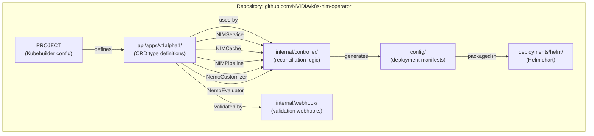
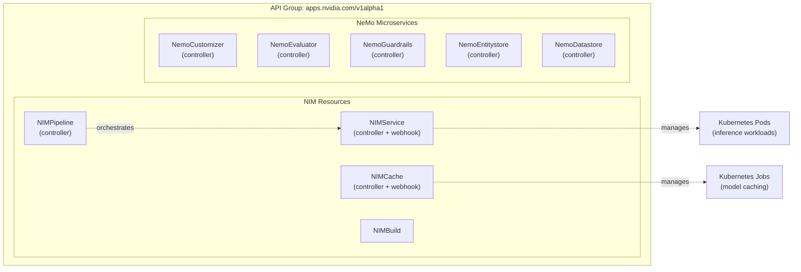
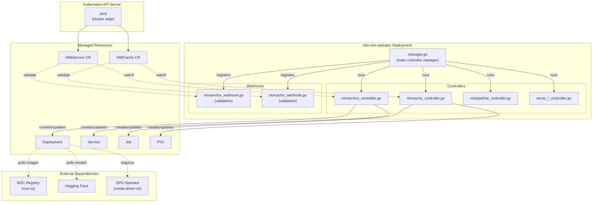
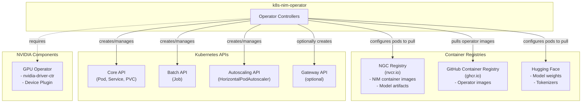

<!-- source: DeepWiki mcp.deepwiki.com · repo NVIDIA/k8s-nim-operator · page 1 Overview · fetched 2026-10-26 -->

# Overview

<details>
<summary>Relevant source files</summary>

The following files were used as context for generating this wiki page:

- [.github/ISSUE_TEMPLATE/bug_report.md](.github/ISSUE_TEMPLATE/bug_report.md)
- [PROJECT](PROJECT)
- [README.md](README.md)

</details>


This document provides an overview of the k8s-nim-operator project, introducing its purpose, core components, and high-level architecture. For detailed API reference documentation, see [API Reference](#5). For installation and deployment instructions, see [Getting Started](#2) and [Deployment](#7).

## Purpose and Scope

The k8s-nim-operator is a Kubernetes Operator designed to facilitate the deployment, management, and scaling of NVIDIA NIM (NVIDIA Inference Microservices) on Kubernetes clusters. NVIDIA NIM microservices deliver AI foundation models as accelerated inference microservices that are portable across data center, workstation, and cloud environments, accelerating generative AI development and deployment. [README.md:6-13]()

This operator implements the Kubernetes operator pattern to manage custom resources representing NIM services, model caching, inference pipelines, and NeMo microservices through a declarative API. [PROJECT:11-98]()

**Sources**: [README.md:1-13](), [PROJECT:1-99]()

## What is k8s-nim-operator?

The k8s-nim-operator extends Kubernetes with custom resource definitions (CRDs) and controllers that automate the lifecycle management of NVIDIA AI inference workloads. The operator runs as a deployment within the Kubernetes cluster and continuously reconciles the desired state (defined in custom resources) with the actual cluster state.

### Project Structure



**Key Components**:

| Component | Location | Purpose |
|-----------|----------|---------|
| CRD Type Definitions | `api/apps/v1alpha1/` | Go structs defining custom resource schemas [PROJECT:19,31,43]() |
| Controllers | `internal/controller/` | Reconciliation loops for each resource type [PROJECT:15,27,39]() |
| Validation Webhooks | `internal/webhook/` | Admission webhooks for `NIMService` and `NIMCache` [PROJECT:21-22,33-34]() |
| Deployment Manifests | `config/` | Kustomize-based Kubernetes manifests [README.md:59]() |
| Helm Chart | `deployments/helm/` | Helm packaging for operator installation |

**Sources**: [README.md:1-110](), [PROJECT:1-99]()

## Custom Resources

The operator manages multiple custom resources under the API group `apps.nvidia.com/v1alpha1`. These resources are divided into functional categories:

### Resource Categories



### Resource Summary Table

| Custom Resource | Controller | Webhook | Purpose |
|-----------------|------------|---------|---------|
| `NIMService` | ✓ | ✓ | Deploys and manages NIM inference microservices [PROJECT:17-23]() |
| `NIMCache` | ✓ | ✓ | Manages model caching to PersistentVolumeClaims [PROJECT:29-35]() |
| `NIMPipeline` | ✓ | ✗ | Orchestrates multi-step inference workflows [PROJECT:41-44]() |
| `NIMBuild` | ✗ | ✗ | Builds custom NIM containers [PROJECT:94-97]() |
| `NemoCustomizer` | ✓ | ✗ | Manages model customization workflows [PROJECT:87-89]() |
| `NemoEvaluator` | ✓ | ✗ | Evaluates model performance [PROJECT:51-53]() |
| `NemoGuardrails` | ✓ | ✗ | Implements safety guardrails for AI models [PROJECT:78-80]() |
| `NemoEntitystore` | ✓ | ✗ | Manages entity data for NeMo workflows [PROJECT:60-62]() |
| `NemoDatastore` | ✓ | ✗ | Manages data storage for NeMo services [PROJECT:69-71]() |

**Sources**: [PROJECT:11-98]()

## Core Architecture

The operator follows the standard Kubernetes operator pattern with controllers, webhooks, and custom resource definitions.



### Controller Reconciliation Pattern

The operator implements the Kubernetes reconciliation pattern where each controller:

1. **Watches** for changes to its custom resource type via the Kubernetes API.
2. **Reconciles** the actual cluster state to match the desired state defined in the custom resource.
3. **Updates** the custom resource status to reflect the current state.
4. **Re-queues** reconciliation if the operation fails or needs to be retried.

For detailed information on the reconciliation loops, see [Operator Pattern](#3.1).

**Sources**: [PROJECT:11-98](), [README.md:1-110]()

## Key Features

### 1. Declarative Model Deployment
Users define NIM services using Kubernetes custom resources. The operator handles:
- Container deployment and configuration.
- GPU resource allocation.
- Service exposure (ClusterIP, LoadBalancer, Ingress, Gateway API).
- Auto-scaling via Horizontal Pod Autoscaler. [README.md:8-10]()

### 2. Model Caching
The `NIMCache` resource pre-downloads and caches model artifacts to PersistentVolumeClaims, enabling:
- Faster pod startup times.
- Shared model storage across multiple pods.
- Reduced external registry traffic. [.github/ISSUE_TEMPLATE/bug_report.md:31-36]()

### 3. Validation Webhooks
Both `NIMService` and `NIMCache` implement admission webhooks that validate resource specifications before they are persisted to etcd, preventing invalid configurations from being applied. [PROJECT:21-22,33-34]()

### 4. Multi-Architecture Support
The operator is built and distributed as multi-architecture images supporting `linux/amd64` and `linux/arm64`. [README.md:24-28]()

**Sources**: [PROJECT:21-35](), [README.md:50-52](), [README.md:8-10](), [.github/ISSUE_TEMPLATE/bug_report.md:31-36]()

## Dependencies and Integration Points

### Required Dependencies

| Dependency | Version | Purpose |
|------------|---------|---------|
| Kubernetes | v1.28+ | Orchestration platform [README.md:19]() |
| NVIDIA GPU Operator | Latest | GPU driver and runtime management [.github/ISSUE_TEMPLATE/bug_report.md:15]() |
| NVIDIA GPUs | Supported by NIM | Hardware acceleration for inference [README.md:20]() |

### External Integrations



### Authentication Requirements
The operator and deployed workloads require credentials for access to the NVIDIA container registry and model repositories. [README.md:30-32]()

**Sources**: [.github/ISSUE_TEMPLATE/bug_report.md:10-46](), [README.md:15-21]()

## Deployment Targets

The operator supports multiple deployment methods:

1. **Helm Chart** - Recommended for production deployments.
2. **OLM Bundle** - For OpenShift and OLM-enabled clusters.
3. **Raw Manifests** - For development and testing. [README.md:81-92]()

**Sources**: [README.md:74-92]()

## System Requirements

### Kubernetes Environment

| Component | Requirement |
|-----------|-------------|
| Kubernetes Version | v1.28 or higher [README.md:19]() |
| Container Runtime | Containerd, CRI-O, or Docker [.github/ISSUE_TEMPLATE/bug_report.md:13]() |
| Kubernetes Flavors | K8s, OCP, Rancher, GKE, EKS [.github/ISSUE_TEMPLATE/bug_report.md:14]() |

### Hardware Requirements

| Resource | Requirement |
|----------|-------------|
| GPUs | NVIDIA GPUs supported by target NIM microservices [README.md:20]() |
| Storage | PVC support for model caching [.github/ISSUE_TEMPLATE/bug_report.md:36]() |

**Sources**: [README.md:17-21](), [.github/ISSUE_TEMPLATE/bug_report.md:10-18]()

## Project Layout

The repository follows the Kubebuilder v4 project structure: [PROJECT:7]()

```
k8s-nim-operator/
├── api/                      # CRD type definitions
│   └── apps/v1alpha1/       # API group version
├── internal/
│   ├── controller/          # Controller reconciliation logic
│   └── webhook/             # Admission webhook handlers
├── config/                  # Kustomize manifests
│   ├── crd/                # Generated CRD YAML files
│   ├── rbac/               # RBAC manifests
│   └── default/            # Default deployment configuration
├── deployments/
│   ├── container/          # Container build files
│   └── helm/               # Helm chart
├── bundle/                 # OLM bundle manifests
├── pkg/                    # Shared packages
└── PROJECT                 # Kubebuilder project metadata
```

**Sources**: [PROJECT:1-99](), [README.md:99-110]()

## Next Steps

- To install and configure the operator, see [Getting Started](#2)
- To understand the operator architecture in depth, see [Architecture](#3)
- To learn about individual custom resources, see [Custom Resources](#4)
- To contribute to the project, see [Contributing](#10)
- For troubleshooting common issues, see [Troubleshooting](#11)

---

