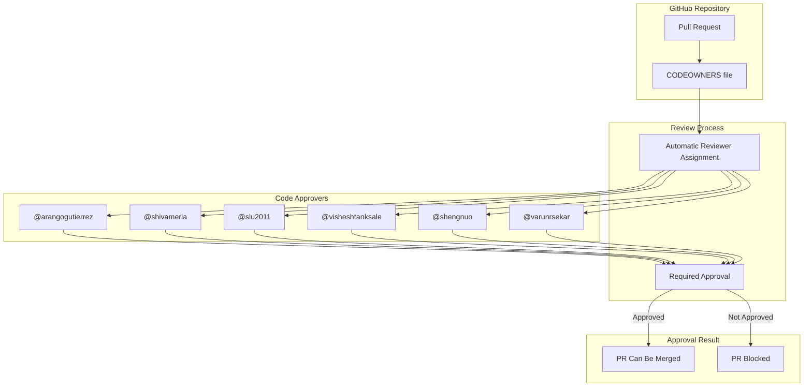
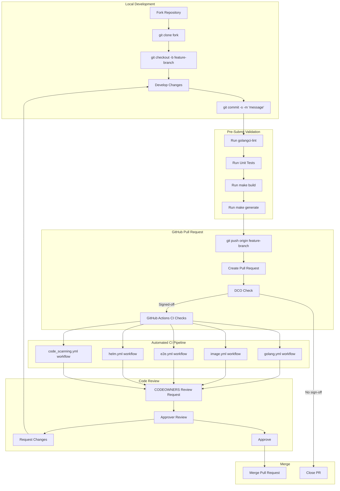
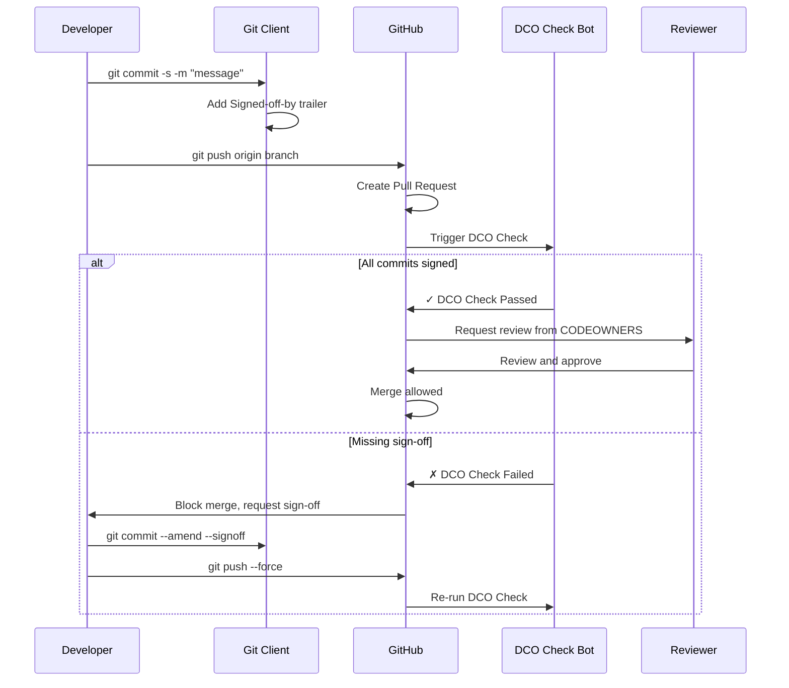

<!-- source: DeepWiki mcp.deepwiki.com · repo NVIDIA/k8s-nim-operator · page 10 Contributing · fetched 2026-10-26 -->

# Contributing

<details>
<summary>Relevant source files</summary>

The following files were used as context for generating this wiki page:

- [CODEOWNERS](CODEOWNERS)
- [CONTRIBUTING.md](CONTRIBUTING.md)
- [SECURITY.md](SECURITY.md)

</details>


## Purpose and Scope

This document provides guidelines for contributing to the `k8s-nim-operator` project. It covers the Developer Certificate of Origin (DCO) requirements, code ownership structure, and the pull request review process. For step-by-step instructions on making contributions, see [How to Contribute](#10.1). For information about reporting security vulnerabilities, see [Security Reporting](#10.2).

## Developer Certificate of Origin (DCO)

All contributions to the `k8s-nim-operator` project must be signed off using the Developer Certificate of Origin (DCO). This is the only formal requirement for contributing code to the project [CONTRIBUTING.md:8-9]().

### DCO Requirements

The DCO is a legally binding statement that certifies you have the right to submit your contribution as open-source code. The full DCO text is defined at [developercertificate.org](http://developercertificate.org/) and reproduced in [CONTRIBUTING.md:16-53]().

By signing off on a commit, you certify that:

- **(a)** You created the contribution and have the right to submit it under the open source license indicated in the file [CONTRIBUTING.md:32-34]().
- **(b)** The contribution is based on previous work covered under an appropriate open source license [CONTRIBUTING.md:36-42]().
- **(c)** The contribution was provided to you by someone who certified (a), (b), or (c) [CONTRIBUTING.md:44-47]().
- **(d)** You understand the contribution and all personal information is public and maintained indefinitely [CONTRIBUTING.md:48-52]().

### Sign-Off Mechanism

Each git commit message must include a sign-off line in the following format:

```text
Signed-off-by: Joe Smith <joe.smith@email.com>
```

**Requirements:**
- Must use your real name; pseudonyms and anonymous contributions are not accepted [CONTRIBUTING.md:59]().
- Email address must match your git configuration.
- Automatic sign-off can be enabled using `git commit -s` [CONTRIBUTING.md:61-62]().

**Sources:** [CONTRIBUTING.md:1-63]()

## Code Ownership and Review Structure

The `k8s-nim-operator` uses a code ownership model defined in the `CODEOWNERS` file to ensure appropriate review of all contributions.

### Code Ownership Model



### General Code Approvers

All files in the repository (`*` pattern) require approval from at least one of the general approvers defined in [CODEOWNERS:2]():

| GitHub Handle | Role |
|--------------|------|
| `@arangogutierrez` | General Approver |
| `@shivamerla` | General Approver |
| `@slu2011` | General Approver |
| `@visheshtanksale` | General Approver |
| `@shengnuo` | General Approver |
| `@varunrsekar` | General Approver |

**Implications:**
- Pull requests automatically request review from these approvers [CODEOWNERS:2]().
- At least one approval from this group is required to merge.
- Approvers are responsible for reviewing code quality, architecture, and testing.

**Sources:** [CODEOWNERS:1-3]()

## Contribution Workflow

The following diagram illustrates the complete contribution workflow from initial development through merge:



### Pre-Submission Checklist

Before submitting a pull request, contributors should verify their changes locally. For detailed build instructions, see [Building the Operator](#6.1). For testing procedures, see [Testing](#6.2). For code quality standards, see [Code Quality](#6.3).

**Sources:** [CONTRIBUTING.md:1-63](), [CODEOWNERS:1-3]()

## DCO Enforcement

DCO sign-off is automatically verified by GitHub checks. The enforcement mechanism ensures every commit is signed [CONTRIBUTING.md:55]().



**Important Notes:**
- All commits in the PR must be signed off, not just the latest one [CONTRIBUTING.md:55]().
- Amending commits requires force-pushing to update the PR.
- The DCO check is a required status check that blocks merging if it fails.

**Sources:** [CONTRIBUTING.md:55-62]()

## Security Considerations

NVIDIA is dedicated to the security of its software products [SECURITY.md:3](). Contributors should **never** report security issues through GitHub pull requests or issues [SECURITY.md:5]().

For security vulnerability reporting, see [Security Reporting](#10.2), which covers:
- **NVIDIA PSIRT** contact via web form or email (`psirt@nvidia.com`) [SECURITY.md:10-11]().
- Use of PGP keys for secure communication [SECURITY.md:12]().
- Required information for reporting (Product name, vulnerability type, reproduction steps) [SECURITY.md:14-18]().
- Coordinated vulnerability disclosure policy [SECURITY.md:20]().

**Sources:** [SECURITY.md:1-24]()

## License

All contributions to the `k8s-nim-operator` are licensed under the **Apache License 2.0** [CONTRIBUTING.md:3](). By contributing, you agree that your contributions will be licensed under this framework. For complete license information, see [License](#12).

**Sources:** [CONTRIBUTING.md:3]()

---

