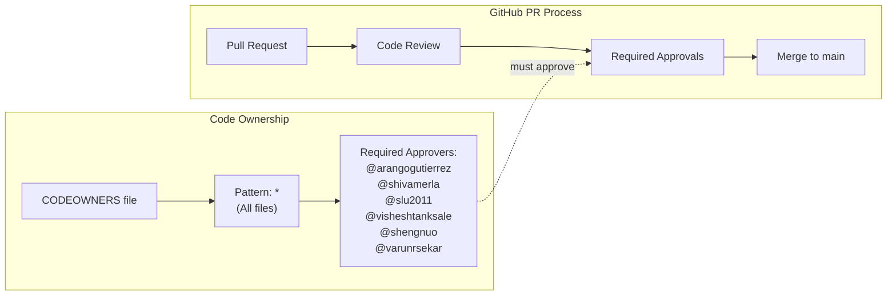
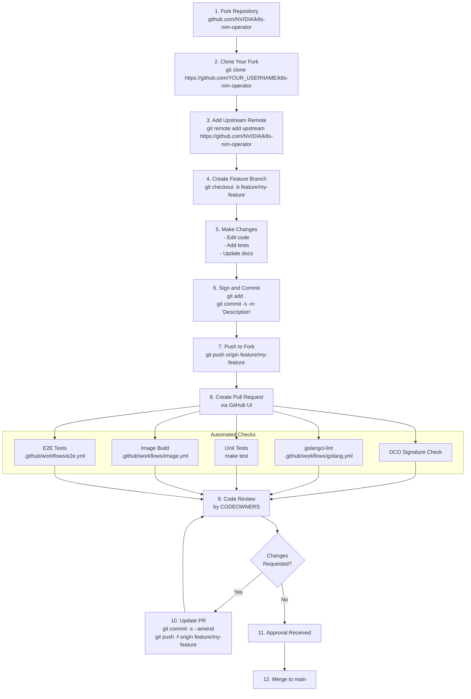
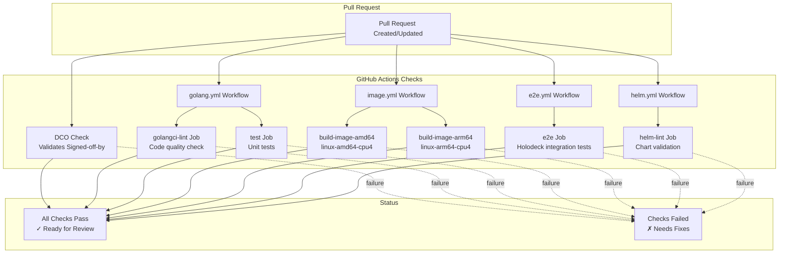

<!-- source: DeepWiki mcp.deepwiki.com · repo NVIDIA/k8s-nim-operator · page 10.1 How to Contribute · fetched 2026-10-26 -->

# How to Contribute

<details>
<summary>Relevant source files</summary>

The following files were used as context for generating this wiki page:

- [.github/ISSUE_TEMPLATE/feature_request.md](.github/ISSUE_TEMPLATE/feature_request.md)
- [.github/ISSUE_TEMPLATE/question---general-discussion.md](.github/ISSUE_TEMPLATE/question---general-discussion.md)
- [CODEOWNERS](CODEOWNERS)
- [CONTRIBUTING.md](CONTRIBUTING.md)

</details>


## Purpose and Scope

This page provides a step-by-step guide for contributing code to the k8s-nim-operator project. It covers the Developer Certificate of Origin (DCO) sign-off requirement, code ownership structure, and the complete workflow from forking the repository to getting your pull request merged.

For information about reporting security vulnerabilities, see [Security Reporting](#10.2). For general project guidelines and community expectations, see [Contributing](#10).

---

## Prerequisites

Before contributing to k8s-nim-operator, ensure you have:

- **Git** installed and configured with your real name and email
- A **GitHub account** 
- **Go 1.22+** for local development (see [Building the Operator](#6.1))
- **Docker** or **Podman** for building container images
- **kubectl** and access to a Kubernetes cluster for testing (optional but recommended)

---

## Developer Certificate of Origin (DCO)

### What is DCO?

The k8s-nim-operator project requires all contributors to certify that they have the right to submit their contributions under the project's open-source license. This is done through the Developer Certificate of Origin (DCO), a legally binding statement that affirms your contribution rights.

The DCO is defined at [developercertificate.org](http://developercertificate.org/) and consists of four key certifications:

| Certification | Description |
|--------------|-------------|
| **(a) Original Work** | You created the contribution and have the right to submit it under the open source license |
| **(b) Derived Work** | The contribution is based on previous work under an appropriate open source license that permits your submission |
| **(c) Provided by Others** | The contribution was provided by someone who certified (a), (b), or (c), and you have not modified it |
| **(d) Public Record** | You understand the contribution and all personal information becomes part of the permanent public record |

The full DCO text is available in [CONTRIBUTING.md:16-53]().

### How to Sign Your Commits

Every git commit must include a `Signed-off-by` line at the end of the commit message. This line certifies that you agree to the DCO.

**Format:**
```
Signed-off-by: Your Name <your.email@example.com>
```

**Automated Signing:**

Configure your git identity (use your real name, not a pseudonym):

```bash
git config user.name "Your Name"
git config user.email "your.email@example.com"
```

Then sign commits automatically using the `-s` flag [CONTRIBUTING.md:61-62]():

```bash
git commit -s -m "Add support for new NIM feature"
```

This will append the `Signed-off-by` line automatically based on your git configuration [CONTRIBUTING.md:55-57]().

**Manual Signing:**

If you forget to use `-s`, you can amend your last commit:

```bash
git commit --amend -s
```

For multiple unsigned commits, you may need to rebase and sign each commit:

```bash
git rebase -i HEAD~<number-of-commits>
# Mark commits for editing, then for each:
git commit --amend -s
git rebase --continue
```

### DCO Verification

The project uses automated DCO checking in CI/CD pipelines. Pull requests with unsigned commits will fail the DCO check and cannot be merged until all commits are properly signed.

**Sources:** [CONTRIBUTING.md:1-63]()

---

## Code Ownership Structure

### CODEOWNERS File

The k8s-nim-operator uses a `CODEOWNERS` file to define code review requirements. This file specifies which team members must approve changes before they can be merged.



**Diagram: Code ownership and review requirements**

### Review Requirements

According to [CODEOWNERS:2](), all files in the repository require approval from at least one of the following maintainers:

| GitHub Handle | Role |
|--------------|------|
| `@arangogutierrez` | General Approver |
| `@shivamerla` | General Approver |
| `@slu2011` | General Approver |
| `@visheshtanksale` | General Approver |
| `@shengnuo` | General Approver |
| `@varunrsekar` | General Approver |

GitHub automatically requests reviews from these code owners when a pull request is opened. At least one approval from this list is required before the PR can be merged.

**Sources:** [CODEOWNERS:1-3]()

---

## Contribution Workflow

### Step-by-Step Process



**Diagram: Complete contribution workflow from fork to merge**

### Detailed Steps

#### 1. Fork and Clone

Fork the repository on GitHub, then clone your fork:

```bash
git clone https://github.com/YOUR_USERNAME/k8s-nim-operator.git
cd k8s-nim-operator
```

Add the upstream repository as a remote:

```bash
git remote add upstream https://github.com/NVIDIA/k8s-nim-operator.git
```

#### 2. Keep Your Fork Updated

Before starting work, sync with upstream:

```bash
git fetch upstream
git checkout main
git merge upstream/main
git push origin main
```

#### 3. Create a Feature Branch

Create a descriptive branch for your changes:

```bash
git checkout -b feature/add-new-crd-field
```

Use meaningful branch names that describe the change:
- `feature/` for new features
- `fix/` for bug fixes
- `docs/` for documentation changes
- `refactor/` for code refactoring

#### 4. Make Your Changes

Edit the code, add tests, and update documentation. Follow the project's coding standards (see [Code Quality](#6.3)).

If you're adding or modifying API types, regenerate code:

```bash
make generate
make manifests
```

Run tests locally:

```bash
make test
```

Run linters:

```bash
make lint
```

#### 5. Commit with DCO Sign-off

Commit your changes with a descriptive message and DCO sign-off:

```bash
git add .
git commit -s -m "Add validation webhook for NIMService replicas field

This commit adds a validation webhook that ensures the replicas
field in NIMService is greater than 0 when autoscaling is disabled.

Fixes #123"
```

**Commit Message Guidelines:**
- Use a clear, concise subject line (50 characters or less)
- Provide detailed explanation in the body if needed
- Reference related issues with `Fixes #123` or `Relates to #456`
- Include the `Signed-off-by` line (automatic with `-s` flag [CONTRIBUTING.md:62]())

#### 6. Push to Your Fork

Push your branch to your GitHub fork:

```bash
git push origin feature/add-new-crd-field
```

#### 7. Create a Pull Request

Go to the GitHub UI and create a pull request from your branch to the upstream `main` branch. 

When creating issues or feature requests, use the provided templates which assign maintainers like `@shivamerla` and `@visheshtanksale` by default [.github/ISSUE_TEMPLATE/feature_request.md:6]() [.github/ISSUE_TEMPLATE/question---general-discussion.md:6]().

**PR Description Template:**

```markdown
## Description
Brief description of what this PR does.

## Related Issues
Fixes #123

## Changes Made
- Added validation webhook for NIMService
- Updated CRD with new validation rules
- Added unit tests for webhook logic

## Testing
- [ ] Unit tests pass (`make test`)
- [ ] E2E tests pass (if applicable)
- [ ] Manually tested on Kubernetes cluster

## Checklist
- [x] Code follows project style guidelines
- [x] All commits are signed with DCO (`git commit -s`)
- [x] Documentation updated (if needed)
- [x] Tests added/updated
```

#### 8. Code Review Process

Once your PR is submitted:

1. **Automated checks run** (DCO, linting, tests, image builds)
2. **CODEOWNERS are notified** and assigned as reviewers [CODEOWNERS:2]()
3. **Reviewers provide feedback** through comments and requested changes
4. **You address feedback** by pushing additional signed commits
5. **Reviewers approve** when satisfied with the changes
6. **Maintainers merge** the PR into `main`

**Responding to Review Comments:**

```bash
# Make requested changes
git add .
git commit -s -m "Address review feedback: improve error handling"
git push origin feature/add-new-crd-field
```

The PR will automatically update with your new commits.

**Sources:** [CONTRIBUTING.md:55-62](), [CODEOWNERS:1-3](), [.github/ISSUE_TEMPLATE/feature_request.md:1-21]()

---

## Automated Checks

All pull requests must pass automated checks before they can be merged.



**Diagram: Automated checks that run on every pull request**

### Check Descriptions

| Check | Purpose | Trigger | Reference |
|-------|---------|---------|-----------|
| **DCO Validation** | Ensures all commits are signed with `Signed-off-by` | All PRs | [CONTRIBUTING.md:55-62]() |
| **golangci-lint** | Runs static analysis and code quality checks | All PRs | See [Code Quality](#6.3) |
| **Unit Tests** | Executes `make test` to validate code correctness | All PRs | See [Testing](#6.2) |
| **Image Build (amd64)** | Builds operator image for AMD64 architecture | All PRs to main/release-* | See [Multi-Architecture Image Building](#8.4) |
| **Image Build (arm64)** | Builds operator image for ARM64 architecture | All PRs to main/release-* | See [Multi-Architecture Image Building](#8.4) |
| **E2E Tests** | Runs end-to-end integration tests in Holodeck | All PRs | See [Testing](#6.2) |
| **Helm Lint** | Validates Helm chart syntax and best practices | All PRs modifying charts | See [Deployment](#7) |

If any check fails, the PR cannot be merged. Review the check logs in the GitHub UI, fix the issues, and push new signed commits to update the PR.

**Sources:** [CODEOWNERS:1-3](), [CONTRIBUTING.md:1-63]()

---

## Common Scenarios

### Fixing a DCO Failure

If you forgot to sign your commits, the DCO check will fail. To fix:

```bash
# For the most recent commit
git commit --amend -s --no-edit
git push -f origin your-branch

# For multiple commits (interactive rebase)
git rebase -i HEAD~3  # Replace 3 with number of commits
# Mark each commit as 'edit' or 'reword'
# For each commit during rebase:
git commit --amend -s --no-edit
git rebase --continue
# After all commits are signed:
git push -f origin your-branch
```

### Resolving Merge Conflicts

If your branch conflicts with `main`:

```bash
# Sync with upstream
git fetch upstream
git rebase upstream/main

# Resolve conflicts in your editor
git add <resolved-files>
git rebase --continue

# Force push (rewrites history)
git push -f origin your-branch
```

### Adding More Changes to an Existing PR

Simply push additional signed commits to the same branch:

```bash
git add .
git commit -s -m "Address review feedback"
git push origin your-branch
```

The PR will automatically update.

### Squashing Commits Before Merge

Maintainers may request you to squash commits. To combine the last N commits:

```bash
git rebase -i HEAD~N

# In the editor, change 'pick' to 'squash' for commits you want to combine
# Save and close the editor
# Edit the combined commit message
# Ensure Signed-off-by is present

git push -f origin your-branch
```

**Sources:** [CONTRIBUTING.md:55-62]()

---

## Getting Help

If you encounter issues during the contribution process:

- **Questions about the code:** Open a GitHub issue with the `question` label [.github/ISSUE_TEMPLATE/question---general-discussion.md:5]()
- **Technical help:** Ask in the project's communication channels (see [Overview](#1))
- **Security issues:** Follow the process in [Security Reporting](#10.2)
- **DCO or process questions:** Tag one of the [How to Contribute](#10.1) in your PR comments [CODEOWNERS:2]()

The maintainers are committed to helping new contributors succeed. Don't hesitate to ask for guidance.

**Sources:** [CODEOWNERS:1-3](), [CONTRIBUTING.md:1-63](), [.github/ISSUE_TEMPLATE/question---general-discussion.md:1-11]()

---

