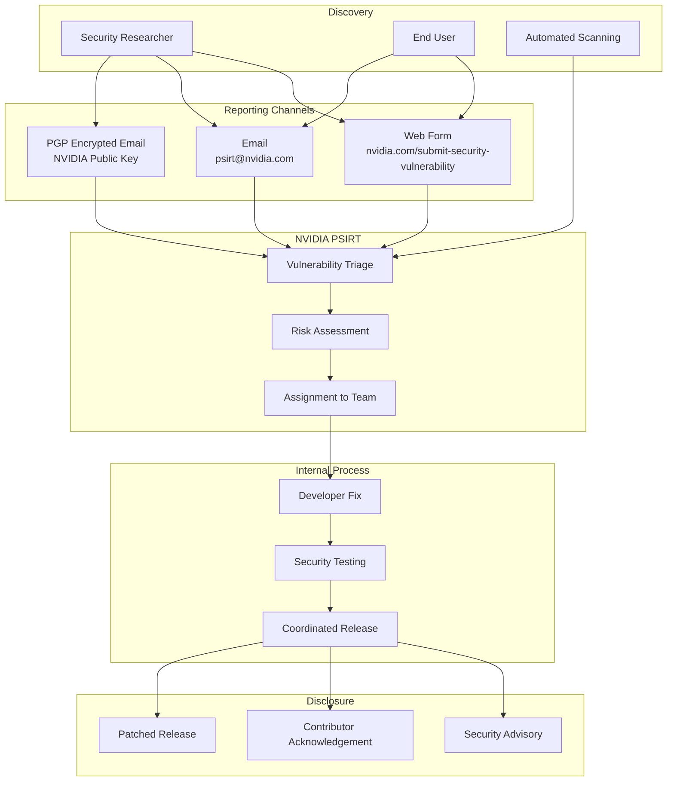
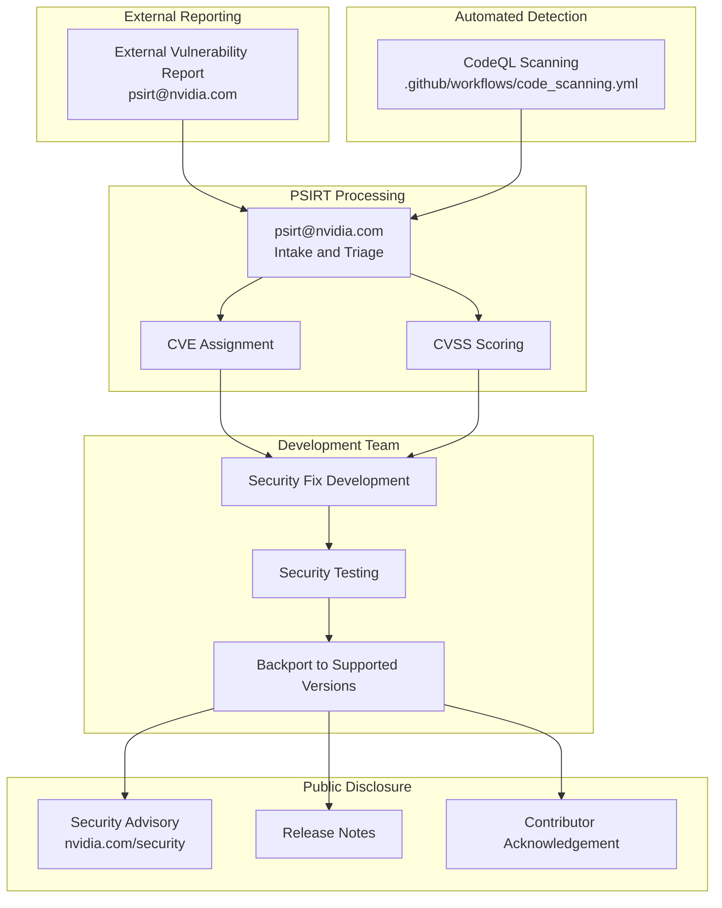
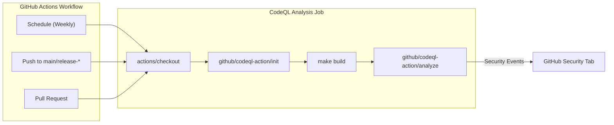

<!-- source: DeepWiki mcp.deepwiki.com · repo NVIDIA/k8s-nim-operator · page 10.2 Security Reporting · fetched 2026-10-26 -->

# Security Reporting

Relevant source files

The following files were used as context for generating this wiki page:

- [.github/workflows/code_scanning.yml](.github/workflows/code_scanning.yml)
- [SECURITY.md](SECURITY.md)

## Purpose and Scope

This document describes the process for reporting security vulnerabilities in the `k8s-nim-operator`. It covers the official channels for submitting security reports to NVIDIA's Product Security Incident Response Team (PSIRT), required information for vulnerability reports, and the coordinated disclosure policy.

For general contribution guidelines including code review and DCO requirements, see [How to Contribute](#10.1).

---

## Overview

NVIDIA is dedicated to the security and trust of its software products, including the `k8s-nim-operator`. Security vulnerabilities should be reported through dedicated security channels rather than public issue trackers to allow for coordinated disclosure and remediation [SECURITY.md:1-5]().

**Important**: Do not report security vulnerabilities through GitHub Issues or Pull Requests. Public disclosure of security vulnerabilities before they are addressed can put users at risk [SECURITY.md:5-5]().

**Sources**: [SECURITY.md:1-5]()

---

## Security Reporting Workflow

The following diagram illustrates how security vulnerabilities are reported and processed:

**Sources**: [SECURITY.md:1-24]()

---

## Reporting Channels

### Web Submission Form

The primary channel for reporting security vulnerabilities is NVIDIA's web-based submission form:

- **URL**: [https://www.nvidia.com/object/submit-security-vulnerability.html](https://www.nvidia.com/object/submit-security-vulnerability.html)
- **Use Case**: All security vulnerability reports [SECURITY.md:10-10]()

### Email Submission

For direct communication with the PSIRT team:

- **Email Address**: `psirt@nvidia.com` [SECURITY.md:11-11]()
- **Response Time**: Monitored by PSIRT team during business hours
- **Use Case**: Direct communication or follow-up on existing reports

### Secure Email with PGP

For sensitive vulnerability information that requires encryption:

- **Email Address**: `psirt@nvidia.com`
- **PGP Key**: [NVIDIA Public PGP Key](https://www.nvidia.com/en-us/security/pgp-key) [SECURITY.md:12-12]()
- **Use Case**: Highly sensitive vulnerability details, exploit code, or proof-of-concept requiring confidentiality

**Sources**: [SECURITY.md:9-12]()

---

## Required Information

When submitting a security vulnerability report, include the following information to facilitate efficient triage and remediation:

| Information Category | Required Details |
|---------------------|------------------|
| **Product Identification** | Product name: `k8s-nim-operator` Version or branch containing the vulnerability [SECURITY.md:14-14]() |
| **Vulnerability Type** | Classification (e.g., code execution, denial of service, buffer overflow) [SECURITY.md:15-15]() |
| **Reproduction Steps** | Detailed instructions to reproduce the vulnerability [SECURITY.md:16-16]() |
| **Proof of Concept** | Exploit code or demonstration [SECURITY.md:17-17]() |
| **Impact Assessment** | Potential impact of successful exploitation, including how an attacker could exploit it [SECURITY.md:18-18]() |

**Sources**: [SECURITY.md:13-18]()

---

## Vulnerability Processing Flow

The following diagram shows how reported vulnerabilities flow through NVIDIA's internal systems and relate to the operator's automated scanning infrastructure:

**Sources**: [SECURITY.md:1-24](), [.github/workflows/code_scanning.yml:15-49]()

---

## Coordinated Disclosure Policy

NVIDIA follows a coordinated vulnerability disclosure policy to balance security with transparency:

### Disclosure Timeline

1. **Report Receipt**: PSIRT acknowledges receipt of vulnerability reports.
2. **Coordinated Release**: Public disclosure occurs after fix is available.
3. **Public Advisory**: Security advisory published on [nvidia.com/security](https://www.nvidia.com/en-us/security) [SECURITY.md:24-24]().

### Contributor Acknowledgement

While NVIDIA does not currently operate a bug bounty program, the company offers acknowledgement for externally reported security issues:

- **Credit**: Security researchers are acknowledged when an externally reported issue is addressed under the coordinated vulnerability disclosure policy [SECURITY.md:20-20]().
- **Policy Details**: Available on [NVIDIA PSIRT Policies](https://www.nvidia.com/en-us/security/psirt-policies/) [SECURITY.md:20-20]().

**Sources**: [SECURITY.md:20-21]()

---

## Security Infrastructure Integration

The `k8s-nim-operator` incorporates automated security scanning as part of its CI/CD lifecycle:

### Static Analysis with CodeQL

The repository uses GitHub CodeQL for static analysis to identify potential security vulnerabilities in the Go codebase.

- **Workflow**: `.github/workflows/code_scanning.yml` [15-15]()
- **Trigger**: Every Sunday at midnight, and on pushes to `main`, `release-*` branches, and pull requests [18-24]()
- **Implementation**: The `analyze` job runs `make build` before performing the `github/codeql-action/analyze` step [27-49]()

**Sources**: [.github/workflows/code_scanning.yml:15-49]()

---

## Best Practices for Security Reporting

### Do

- **Use Official Channels**: Report via web form or `psirt@nvidia.com` [SECURITY.md:10-11]().
- **Provide Complete Information**: Include product version, vulnerability type, and reproduction steps [SECURITY.md:13-18]().
- **Use PGP Encryption**: Use the NVIDIA public PGP key for secure email communication [SECURITY.md:12-12]().
- **Coordinate Disclosure**: Work with NVIDIA on disclosure timing.

### Do Not

- **Public Disclosure**: Do not open GitHub issues for security vulnerabilities [SECURITY.md:5-5]().
- **Premature PoC Release**: Do not publish exploit code before coordinated disclosure.

**Sources**: [SECURITY.md:5-18]()

---

## Product Security Resources

For comprehensive security information about NVIDIA products:

- **Main Portal**: [nvidia.com/security](https://www.nvidia.com/en-us/security) [SECURITY.md:24-24]()
- **PSIRT Policies**: [nvidia.com/security/psirt-policies](https://www.nvidia.com/en-us/security/psirt-policies/) [SECURITY.md:20-20]()
- **Vulnerability Submission**: [Security Vulnerability Submission Form](https://www.nvidia.com/object/submit-security-vulnerability.html) [SECURITY.md:10-10]()

**Sources**: [SECURITY.md:20-24]()

---

