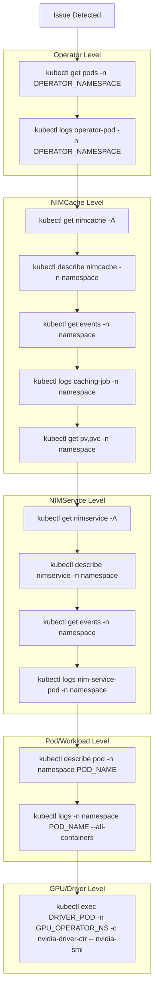
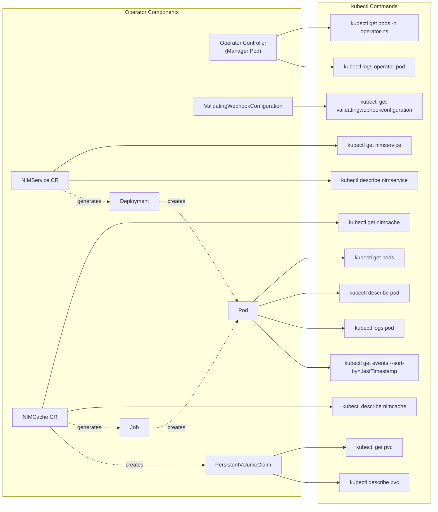

<!-- source: DeepWiki mcp.deepwiki.com · repo NVIDIA/k8s-nim-operator · page 11 Troubleshooting · fetched 2026-10-26 -->

# Troubleshooting

<details>
<summary>Relevant source files</summary>

The following files were used as context for generating this wiki page:

- [.github/ISSUE_TEMPLATE/bug_report.md](.github/ISSUE_TEMPLATE/bug_report.md)
- [.github/workflows/e2e.yml](.github/workflows/e2e.yml)

</details>


This page provides diagnostic procedures, common issue resolution, and debugging techniques for the k8s-nim-operator. It covers how to collect diagnostic information, identify root causes, and resolve issues with operator components, custom resources, and managed workloads.

For installation and configuration guidance, see [Getting Started](#2). For detailed API documentation, see [API Reference](#5). For reporting security vulnerabilities, see [Security Reporting](#10.2).

## Purpose and Scope

This troubleshooting guide addresses:

- Collecting diagnostic information for bug reports
- Debugging operator controller issues
- Resolving NIMCache and NIMService problems
- Identifying GPU and driver issues
- Analyzing validation webhook failures
- Investigating image pull and authentication errors

For details on collecting specific logs and command outputs, see [Diagnostic Information](#11.1).

---

## Diagnostic Information Collection

When reporting issues or investigating problems, collect comprehensive diagnostic information covering the operator, custom resources, and cluster state.

### System Information

Record the following environment details:

| Category | Information Required |
|----------|---------------------|
| Operating System | OS distribution and version (e.g., RHEL8.6, Ubuntu22.04) |
| Kernel | Kernel version from `uname -r` |
| Container Runtime | Type and version (Containerd, CRI-O, Docker) |
| Kubernetes | Flavor and version (K8s, OCP, Rancher, GKE, EKS) |
| GPU Operator | Installed version |
| NIM Operator | Installed version |
| NIM Microservices | LLM NIM versions deployed |
| NeMo Services | NeMo service versions deployed |

**Sources:** [.github/ISSUE_TEMPLATE/bug_report.md:11-18]()

### Diagnostic Data Collection Flow



**Sources:** [.github/ISSUE_TEMPLATE/bug_report.md:26-45]()

### Automated Testing Failures

If you are a developer seeing failures in the CI/CD pipeline, the `End-to-end Tests` workflow archives logs for debugging.

```bash
# Check E2E test script
./hack/e2e_tests.sh
```

**Sources:** [.github/workflows/e2e.yml:74-82]()

---

## Common Issues by Component

### Operator Controller Issues

#### Operator Pod Not Running

**Symptoms:**
- Operator pod in `CrashLoopBackOff` or `Error` state
- Custom resources not reconciling

**Diagnosis:**
```bash
kubectl get pods -n <OPERATOR_NAMESPACE>
kubectl describe pod <operator-pod> -n <OPERATOR_NAMESPACE>
kubectl logs <operator-pod> -n <OPERATOR_NAMESPACE>
```

**Common Causes:**
1. **RBAC Permissions:** Operator lacks necessary ClusterRole permissions
2. **Webhook Certificate Issues:** ValidatingWebhookConfiguration cannot reach webhook server
3. **Image Pull Errors:** Cannot pull operator image from registry
4. **Resource Constraints:** Insufficient CPU/memory limits

**Sources:** [.github/ISSUE_TEMPLATE/bug_report.md:28-30]()

### NIMCache Issues

#### Caching Job Failures

**Symptoms:**
- NIMCache status shows `Failed` condition
- Caching job pod in `Error` or `CrashLoopBackOff`

**Diagnosis:**
```bash
kubectl get nimcache <name> -n <namespace> -o yaml
kubectl describe nimcache <name> -n <namespace>
kubectl logs <caching-job-pod> -n <namespace>
```

**Common Causes:**
1. **Authentication Failures:** NGC API key or Hugging Face token invalid
2. **Network Issues:** Cannot reach model registry
3. **Storage Exhaustion:** PVC insufficient space for model
4. **Model Not Found:** Specified model profile does not exist

**Sources:** [.github/ISSUE_TEMPLATE/bug_report.md:31-36]()

### NIMService Issues

#### Service Pods Not Starting

**Symptoms:**
- NIMService deployment has 0 ready replicas
- Pods stuck in `Pending` or `ImagePullBackOff`

**Diagnosis:**
```bash
kubectl get nimservice <name> -n <namespace>
kubectl describe nimservice <name> -n <namespace>
kubectl get pods -n <namespace> -l app=<nimservice-name>
kubectl describe pod <pod-name> -n <namespace>
```

**Common Causes:**
1. **GPU Unavailability:** No nodes with available GPU resources
2. **Image Pull Errors:** Cannot pull NIM container image
3. **NIMCache Not Ready:** Service depends on cache that has not completed
4. **Volume Mount Failures:** PVC from NIMCache cannot be mounted

**Sources:** [.github/ISSUE_TEMPLATE/bug_report.md:37-41]()

### GPU and Driver Issues

#### GPU Not Available to Pods

**Symptoms:**
- Pods pending with event: `insufficient nvidia.com/gpu`
- `nvidia-smi` not accessible from pod

**Diagnosis:**
```bash
# Check GPU allocatable on nodes
kubectl describe nodes | grep -A 10 "Allocatable" | grep nvidia.com/gpu

# Verify GPU operator pods
kubectl get pods -n <GPU_OPERATOR_NAMESPACE>
```

**Resolution:**
```bash
# Check driver container
kubectl exec <DRIVER_POD> -n <GPU_OPERATOR_NAMESPACE> \
  -c nvidia-driver-ctr -- nvidia-smi
```

**Sources:** [.github/ISSUE_TEMPLATE/bug_report.md:15](), [.github/ISSUE_TEMPLATE/bug_report.md:45]()

---

## Debugging Workflow

### Component-to-Command Mapping

The following diagram maps operator components to diagnostic kubectl commands:



**Sources:** [.github/ISSUE_TEMPLATE/bug_report.md:26-45]()

---

## Reporting Issues

When creating bug reports, include:

1. Complete system information from [System Information](#system-information)
2. Output from all relevant diagnostic commands
3. Operator and workload logs
4. Steps to reproduce the issue
5. Expected vs actual behavior

Submit issues at: https://github.com/NVIDIA/k8s-nim-operator/issues

Use the bug report template at [.github/ISSUE_TEMPLATE/bug_report.md:1-46]()

**Sources:** [.github/ISSUE_TEMPLATE/bug_report.md:1-46]()

---

