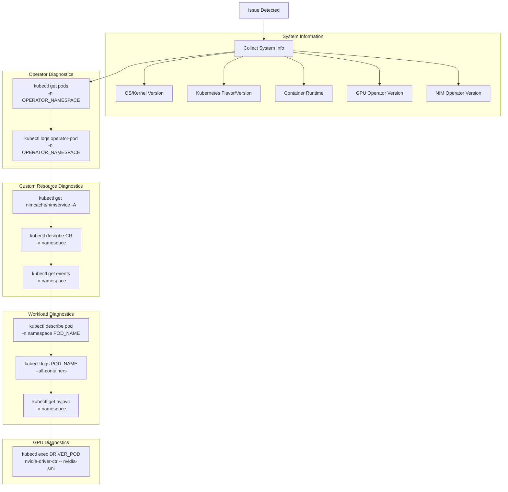
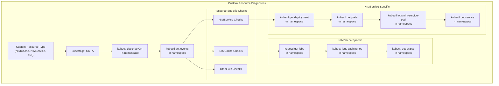
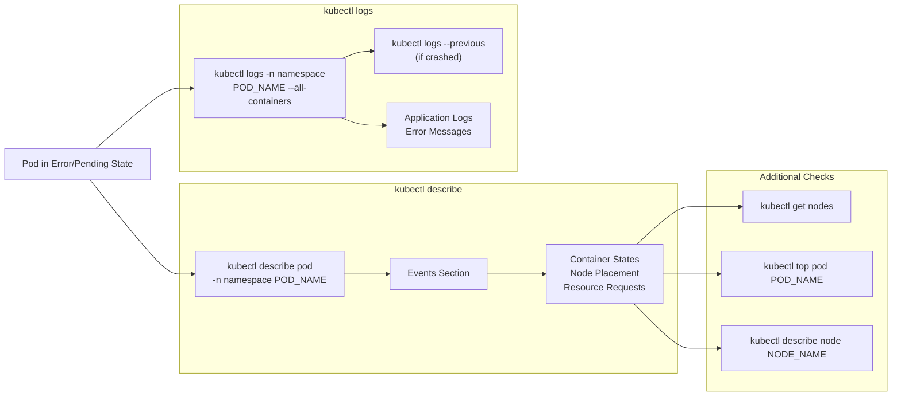
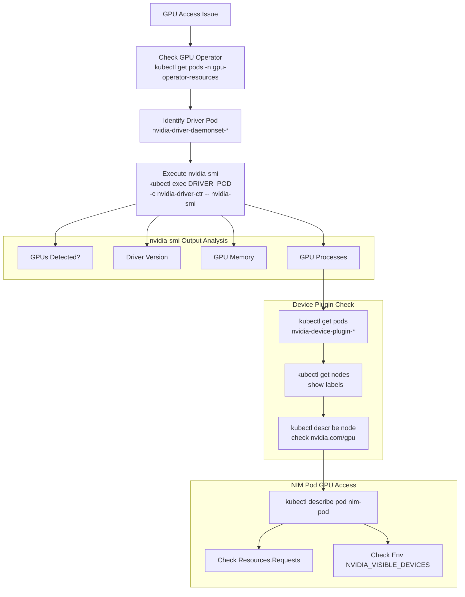
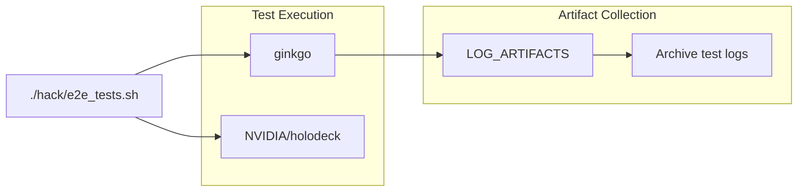

<!-- source: DeepWiki mcp.deepwiki.com · repo NVIDIA/k8s-nim-operator · page 11.1 Diagnostic Information · fetched 2026-10-26 -->

# Diagnostic Information

<details>
<summary>Relevant source files</summary>

The following files were used as context for generating this wiki page:

- [.github/ISSUE_TEMPLATE/bug_report.md](.github/ISSUE_TEMPLATE/bug_report.md)
- [.github/workflows/e2e.yml](.github/workflows/e2e.yml)

</details>


This page provides a comprehensive guide for collecting diagnostic information when troubleshooting issues with the k8s-nim-operator. This information is essential for debugging operator problems, filing bug reports, and working with NVIDIA support. The diagnostic procedures documented here align with the operator's bug report template and cover all managed custom resources.

For general troubleshooting approaches and common issues, see [Troubleshooting](#11). For information about reporting security issues, see [Security Reporting](#10.2).

---

## Overview of Diagnostic Collection

Diagnostic information for the k8s-nim-operator falls into five categories: system information, operator state, custom resource state, Kubernetes workload state, and GPU infrastructure state. The following diagram illustrates the diagnostic collection workflow:

**Diagnostic Collection Workflow**



**Sources:** [.github/ISSUE_TEMPLATE/bug_report.md:1-46]()

---

## System Information Requirements

Before collecting detailed diagnostics, gather high-level system information. This establishes the environment context and helps identify platform-specific issues.

### Required System Details

The following table outlines the required system information:

| Category | Information Required | Example Values |
|----------|---------------------|----------------|
| Operating System | OS distribution and version | RHEL 8.6, Ubuntu 22.04 |
| Kernel | Kernel version | 5.15.0-56-generic |
| Container Runtime | Runtime type and version | containerd 1.6.8, CRI-O 1.25 |
| Kubernetes | Flavor and version | Kubernetes 1.27, OCP 4.12, GKE 1.26 |
| GPU Operator | Installed version | 23.9.0 |
| NIM Operator | Installed version | 1.0.0 |
| LLM NIM | NIM image versions in use | nvcr.io/nvidia/nim-llm:1.0.0 |
| NeMo Services | NeMo microservice versions | nvcr.io/nvidia/nemo:24.01 |

These values are required in bug reports as specified in [.github/ISSUE_TEMPLATE/bug_report.md:10-18]().

**Collection Commands:**

```bash
# Operating System
cat /etc/os-release

# Kernel Version
uname -r

# Container Runtime (for containerd)
crictl version

# Kubernetes Version
kubectl version --short

# GPU Operator Version
kubectl get pods -n gpu-operator-resources -o yaml | grep image:

# NIM Operator Version
kubectl get deployment -n nim-operator-system -o yaml | grep image:
```

**Sources:** [.github/ISSUE_TEMPLATE/bug_report.md:10-18]()

---

## Operator Diagnostics

The operator controller manages all custom resources. Operator pod status and logs are the starting point for diagnosing controller-level issues.

### Operator Pod Status

Check the operator deployment and pod status:

```bash
# List operator pods
kubectl get pods -n OPERATOR_NAMESPACE

# Detailed pod information
kubectl get pods -n OPERATOR_NAMESPACE -o wide

# View operator deployment
kubectl get deployment -n OPERATOR_NAMESPACE
```

Expected output shows pods in `Running` state with all containers ready (e.g., `1/1`). Pods in `CrashLoopBackOff`, `Error`, or `Pending` states indicate operator-level problems.

### Operator Logs

Retrieve operator controller logs to diagnose reconciliation failures:

```bash
# Stream operator logs
kubectl logs <operator-pod> -n OPERATOR_NAMESPACE

# Retrieve recent logs with timestamps
kubectl logs <operator-pod> -n OPERATOR_NAMESPACE --timestamps

# Get logs from previous pod instance (if crashed)
kubectl logs <operator-pod> -n OPERATOR_NAMESPACE --previous
```

The operator logs contain reconciliation events, webhook validation results, and error messages. Look for:
- `Reconciler error` messages indicating controller failures
- `Webhook validation failed` messages from admission webhooks
- `Failed to create/update/delete` messages for resource management issues

**Sources:** [.github/ISSUE_TEMPLATE/bug_report.md:28-30]()

---

## Custom Resource Diagnostics

Each custom resource managed by the operator requires specific diagnostic procedures. The operator reconciles these resources and updates their status conditions.

**Custom Resource Diagnostic Hierarchy**



**Sources:** [.github/ISSUE_TEMPLATE/bug_report.md:28-42]()

### NIMCache Diagnostics

`NIMCache` resources manage model caching via Kubernetes Jobs and PersistentVolumeClaims. The following diagnostics cover the complete caching workflow:

#### NIMCache Status

```bash
# List all NIMCache resources
kubectl get nimcache -A

# Describe specific NIMCache
kubectl describe nimcache <nimcache-name> -n <namespace>

# Get NIMCache with status
kubectl get nimcache <nimcache-name> -n <namespace> -o yaml
```

Check the status conditions for:
- `Ready: True` indicates successful caching
- `Ready: False` with reason indicates failure cause
- `CachingJob` status shows Job completion

#### NIMCache Events

```bash
# Get events in namespace
kubectl get events -n <namespace>

# Filter events for NIMCache
kubectl get events -n <namespace> --field-selector involvedObject.name=<nimcache-name>

# Sort events by timestamp
kubectl get events -n <namespace> --sort-by='.lastTimestamp'
```

#### Caching Job Status

The NIMCache controller creates a Kubernetes Job to download and cache models:

```bash
# List Jobs in namespace
kubectl get jobs -n <namespace>

# Describe caching Job
kubectl describe job <caching-job> -n <namespace>

# Get Job pods
kubectl get pods -n <namespace> -l job-name=<caching-job>

# Retrieve Job logs
kubectl logs <caching-job-pod> -n <namespace>
```

Common issues:
- Job stuck in `Pending`: Check PVC binding and node scheduling
- Job `Failed`: Check logs for model download errors or authentication issues
- Job `BackoffLimitExceeded`: Indicates repeated failures

#### PersistentVolume Diagnostics

NIMCache uses PVCs to store cached models. Verify storage resources:

```bash
# List PVs and PVCs
kubectl get pv,pvc -n <namespace>

# Describe PVC
kubectl describe pvc <pvc-name> -n <namespace>

# Check PVC events
kubectl get events -n <namespace> --field-selector involvedObject.name=<pvc-name>
```

Check for:
- PVC in `Bound` state (successful binding)
- PVC in `Pending` state (unmet storage requirements)
- Available storage capacity matches requested size

**Sources:** [.github/ISSUE_TEMPLATE/bug_report.md:31-36]()

### NIMService Diagnostics

`NIMService` resources create Deployments running NIM inference containers. Diagnostics cover the Deployment, Pods, Services, and networking layers.

#### NIMService Status

```bash
# List all NIMService resources
kubectl get nimservice -A

# Describe specific NIMService
kubectl describe nimservice <nimservice-name> -n <namespace>

# Get NIMService with full status
kubectl get nimservice <nimservice-name> -n <namespace> -o yaml
```

Examine status conditions:
- `Available: True` indicates running pods
- `Progressing: True` indicates ongoing rollout
- Conditions provide reconciliation state

#### NIMService Events

```bash
# Get all events
kubectl get events -n <namespace>

# Filter for NIMService
kubectl get events -n <namespace> --field-selector involvedObject.name=<nimservice-name>
```

#### Deployment and Pod Status

NIMService creates a Deployment managing inference pods:

```bash
# Get Deployment
kubectl get deployment -n <namespace>

# Describe Deployment
kubectl describe deployment <deployment-name> -n <namespace>

# List pods
kubectl get pods -n <namespace> -l app=<nimservice-name>

# Describe pod
kubectl describe pod <nim-service-pod> -n <namespace>
```

#### NIMService Logs

```bash
# Get pod logs
kubectl logs <nim-service-pod> -n <namespace>

# Stream logs
kubectl logs <nim-service-pod> -n <namespace> -f

# Get logs from all containers
kubectl logs <nim-service-pod> -n <namespace> --all-containers

# Previous container logs (if crashed)
kubectl logs <nim-service-pod> -n <namespace> --previous
```

NIM container logs show:
- Model loading progress
- HTTP server startup
- Inference request handling
- Authentication errors (NGC API keys)

#### Service and Networking

Verify Service resources created by NIMService:

```bash
# List Services
kubectl get service -n <namespace>

# Describe Service
kubectl describe service <service-name> -n <namespace>

# Check endpoints
kubectl get endpoints <service-name> -n <namespace>
```

If using Ingress or Gateway API:

```bash
# Check Ingress
kubectl get ingress -n <namespace>
kubectl describe ingress <ingress-name> -n <namespace>

# Check Gateway API resources
kubectl get gateway -n <namespace>
kubectl get httproute -n <namespace>
```

**Sources:** [.github/ISSUE_TEMPLATE/bug_report.md:37-41]()

### Other Custom Resources

For NIMPipeline, NemoCustomizer, NemoGuardrail, NemoEntitystore, NemoDatastore, and NemoEvaluator resources, follow the general pattern:

```bash
# List resources (replace <resource-type> with actual type)
kubectl get <resource-type> -A

# Describe resource
kubectl describe <resource-type> <resource-name> -n <namespace>

# Get events
kubectl get events -n <namespace>

# Check related workloads
kubectl get pods,jobs,deployments -n <namespace>
```

Refer to resource-specific documentation: [NIMPipeline](#4.1.3), [NemoCustomizer](#4.2.1), [NemoGuardrail](#4.2.2), [NemoEntitystore](#4.2.3), [NemoDatastore](#4.2.4), [NemoEvaluator](#4.2.5).

**Sources:** [.github/ISSUE_TEMPLATE/bug_report.md:28-42]()

---

## General Kubernetes Workload Diagnostics

When pods or deployments exhibit issues (Error, Pending, CrashLoopBackOff states), collect detailed Kubernetes diagnostics.

### Pod State Diagnostics

**Command Reference for Pod Issues**



**Sources:** [.github/ISSUE_TEMPLATE/bug_report.md:43-44]()

### Pod Describe Output

The `kubectl describe pod` command provides comprehensive pod state information:

```bash
kubectl describe pod -n <namespace> <POD_NAME>
```

Key sections to examine:

| Section | Information | Common Issues |
|---------|-------------|---------------|
| **Status** | Phase (Running, Pending, Failed) | Pod stuck in Pending or CrashLoopBackOff |
| **Conditions** | PodScheduled, Initialized, Ready, ContainersReady | Unmet scheduling constraints |
| **Init Containers** | Initialization container status | Init container failures blocking pod start |
| **Containers** | Container states (Running, Waiting, Terminated) | Container crashes or image pull failures |
| **Node** | Assigned node name | Not scheduled due to resource constraints |
| **Events** | Recent events and reasons | ImagePullBackOff, FailedScheduling, OOMKilled |

Common event reasons to watch for:
- `FailedScheduling`: Node resource constraints or affinity rules
- `ImagePullBackOff`: Image pull authentication or availability
- `OOMKilled`: Container memory limit exceeded
- `InvalidImageName`: Incorrect image specification
- `FailedMount`: Volume mount failures

**Sources:** [.github/ISSUE_TEMPLATE/bug_report.md:43]()

### Pod Logs

Retrieve application logs from all containers in a pod:

```bash
# All containers in pod
kubectl logs -n <namespace> <POD_NAME> --all-containers

# Specific container
kubectl logs -n <namespace> <POD_NAME> -c <container-name>

# Previous container instance (after crash)
kubectl logs -n <namespace> <POD_NAME> --previous

# Stream logs
kubectl logs -n <namespace> <POD_NAME> --all-containers -f

# Recent logs with timestamps
kubectl logs -n <namespace> <POD_NAME> --all-containers --timestamps --tail=100
```

For NIM-specific containers, logs typically include:
- Model loading and initialization
- CUDA/GPU detection messages
- HTTP server startup
- Request processing traces
- Error stacktraces

**Sources:** [.github/ISSUE_TEMPLATE/bug_report.md:44]()

---

## GPU Infrastructure Diagnostics

The k8s-nim-operator depends on the NVIDIA GPU Operator for GPU access. When NIM pods cannot access GPUs, diagnose the GPU infrastructure layer.

### GPU Operator Status

Verify GPU Operator deployment:

```bash
# List GPU Operator pods
kubectl get pods -n <GPU_OPERATOR_NAMESPACE>

# Common GPU Operator namespaces: gpu-operator, gpu-operator-resources
kubectl get pods -n gpu-operator-resources
```

Expected pods include:
- `nvidia-driver-daemonset-*`: GPU driver containers
- `nvidia-container-toolkit-daemonset-*`: Container runtime configuration
- `nvidia-device-plugin-daemonset-*`: Kubernetes device plugin
- `gpu-feature-discovery-*`: GPU feature labeling

### nvidia-smi Verification

Execute `nvidia-smi` from the driver container to verify GPU availability:

```bash
# Execute nvidia-smi
kubectl exec <DRIVER_POD_NAME> -n <GPU_OPERATOR_NAMESPACE> -c nvidia-driver-ctr -- nvidia-smi

# Check GPU utilization
kubectl exec <DRIVER_POD_NAME> -n <GPU_OPERATOR_NAMESPACE> -c nvidia-driver-ctr -- nvidia-smi --query-gpu=index,name,utilization.gpu,memory.used,memory.total --format=csv

# Check running processes on GPUs
kubectl exec <DRIVER_POD_NAME> -n <GPU_OPERATOR_NAMESPACE> -c nvidia-driver-ctr -- nvidia-smi pmon
```

Expected `nvidia-smi` output shows:
- GPU models and driver version
- Memory allocation
- Running processes using GPUs
- GPU utilization percentages

**GPU Diagnostic Flow**



**Sources:** [.github/ISSUE_TEMPLATE/bug_report.md:45]()

### Node GPU Resources

Verify nodes advertise GPU capacity:

```bash
# Check node labels for GPU
kubectl get nodes --show-labels | grep nvidia.com/gpu

# Describe node to see GPU capacity
kubectl describe node <NODE_NAME>

# Look for:
# Capacity:
#   nvidia.com/gpu: 4
# Allocatable:
#   nvidia.com/gpu: 4
```

### NIM Pod GPU Allocation

Check if NIM pods have GPU resources allocated:

```bash
# Describe NIM pod
kubectl describe pod <nim-pod> -n <namespace>

# Check resource requests/limits
# Look for:
# Limits:
#   nvidia.com/gpu: 1
# Requests:
#   nvidia.com/gpu: 1

# Check environment variables
# NVIDIA_VISIBLE_DEVICES should be set
```

**Sources:** [.github/ISSUE_TEMPLATE/bug_report.md:45]()

---

## E2E Test Diagnostics

When running End-to-End (E2E) tests, additional diagnostic artifacts are collected automatically. The E2E pipeline uses `Holodeck` to provision infrastructure and `ginkgo` to execute tests.

**E2E Diagnostic Data Flow**



**Sources:** [.github/workflows/e2e.yml:47-82]()

If an E2E test fails, the workflow archives logs for up to 15 days. These logs can be downloaded from the GitHub Actions run summary.

**Sources:** [.github/workflows/e2e.yml:76-82]()

---

## Diagnostic Information Checklist

Use this checklist when filing bug reports or troubleshooting issues:

### System Information
- [ ] Operating System and version
- [ ] Kernel version
- [ ] Container runtime type and version
- [ ] Kubernetes flavor and version
- [ ] GPU Operator version
- [ ] NIM Operator version
- [ ] LLM NIM versions in use
- [ ] NeMo Service versions

### Operator Diagnostics
- [ ] Operator pod status: `kubectl get pods -n OPERATOR_NAMESPACE`
- [ ] Operator logs: `kubectl logs <operator-pod> -n OPERATOR_NAMESPACE`

### Custom Resource Diagnostics

**NIMCache:**
- [ ] NIMCache list: `kubectl get nimcache -A`
- [ ] NIMCache describe: `kubectl describe nimcache -n <namespace>`
- [ ] Events: `kubectl get events -n <namespace>`
- [ ] Caching job logs: `kubectl logs <caching-job> -n <namespace>`
- [ ] PV/PVC status: `kubectl get pv,pvc -n <namespace>`

**NIMService:**
- [ ] NIMService list: `kubectl get nimservice -A`
- [ ] NIMService describe: `kubectl describe nimservice -n <namespace>`
- [ ] Events: `kubectl get events -n <namespace>`
- [ ] NIM pod logs: `kubectl logs <nim-service-pod> -n <namespace>`

### General Workload Diagnostics
- [ ] Pod describe (if error/pending): `kubectl describe pod -n <namespace> POD_NAME`
- [ ] Pod logs (if error/pending): `kubectl logs -n <namespace> POD_NAME --all-containers`

### GPU Diagnostics
- [ ] nvidia-smi output: `kubectl exec DRIVER_POD_NAME -n <GPU_OPERATOR_NAMESPACE> -c nvidia-driver-ctr -- nvidia-smi`
- [ ] Node GPU capacity: `kubectl describe node <NODE_NAME>`

**Sources:** [.github/ISSUE_TEMPLATE/bug_report.md:26-45]()

---

## Summary

This diagnostic guide provides systematic procedures for collecting information about k8s-nim-operator issues. Following these procedures ensures comprehensive bug reports with all necessary context. The diagnostic workflow progresses from system-level information through operator state, custom resources, workloads, and GPU infrastructure.

Key diagnostic principles:
1. Start with system information to establish environment context
2. Check operator logs before resource-specific diagnostics
3. Use `kubectl describe` to examine resource state and events
4. Collect logs from all relevant containers with `--all-containers`
5. Verify GPU infrastructure when NIM pods cannot access GPUs

For filing bug reports with complete diagnostic information, use the template at [.github/ISSUE_TEMPLATE/bug_report.md:1-46]().

**Sources:** [.github/ISSUE_TEMPLATE/bug_report.md:1-46](), [.github/workflows/e2e.yml:76-82]()

---

