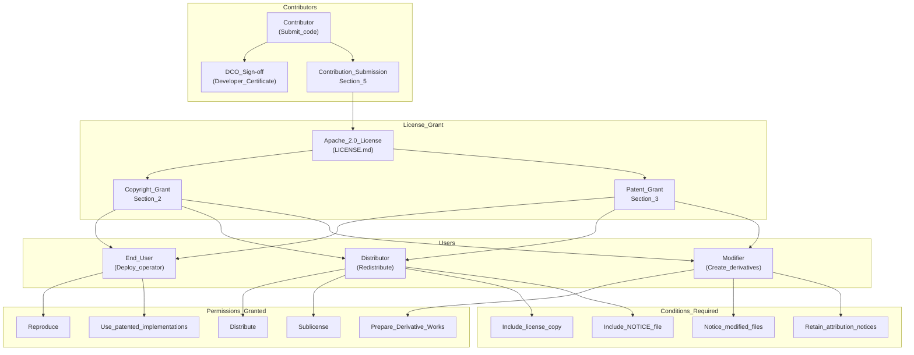
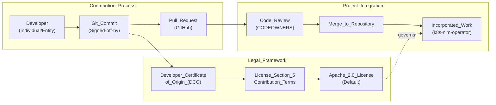
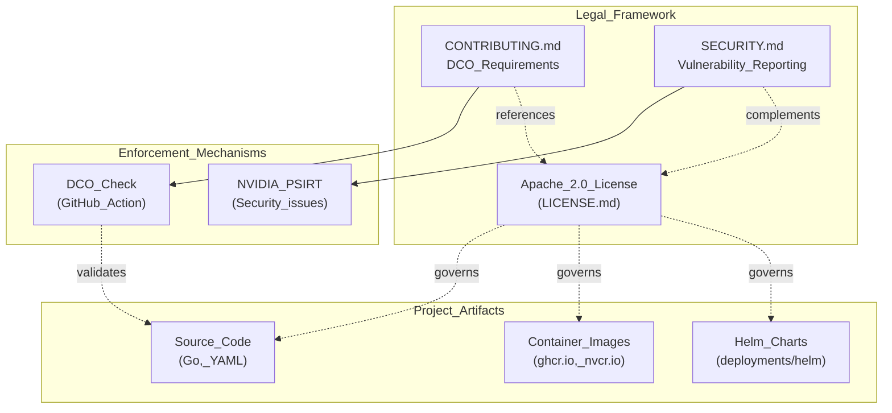

<!-- source: DeepWiki mcp.deepwiki.com · repo NVIDIA/k8s-nim-operator · page 12 License · fetched 2026-10-26 -->

# License

<details>
<summary>Relevant source files</summary>

The following files were used as context for generating this wiki page:

- [LICENSE.md](LICENSE.md)

</details>


This page documents the licensing terms under which the k8s-nim-operator is distributed, including the permissions granted to users and contributors, conditions for use and redistribution, and legal framework governing the project.

For information about contributing to the project and DCO requirements, see [Contributing](#10).

## Overview

The k8s-nim-operator is licensed under the **Apache License, Version 2.0** (Apache-2.0). This is a permissive open-source license that allows users to freely use, modify, and distribute the software while providing clear terms for patent grants and liability limitations.

The complete license text is available in [LICENSE.md:1-201]().

**Sources:** [LICENSE.md:1-201]()

## License Structure

The Apache 2.0 license is organized into nine main sections that define the legal framework:

| Section | Purpose | Key Impact |
|---------|---------|------------|
| 1. Definitions | Defines legal terms used throughout the license | Establishes what constitutes "Work", "Derivative Works", "Contribution", etc. [LICENSE.md:7-64]() |
| 2. Grant of Copyright License | Grants copyright permissions | Allows reproduction, modification, distribution, display, and sublicensing [LICENSE.md:66-71]() |
| 3. Grant of Patent License | Grants patent permissions | Provides patent protection for contributors' patented implementations [LICENSE.md:73-87]() |
| 4. Redistribution | Conditions for distributing the software | Requires license inclusion, change notices, and attribution preservation [LICENSE.md:89-128]() |
| 5. Submission of Contributions | Terms for contributing code | Contributions are under Apache 2.0 unless explicitly stated otherwise [LICENSE.md:130-136]() |
| 6. Trademarks | Trademark usage restrictions | Does not grant permission to use NVIDIA trademarks [LICENSE.md:138-141]() |
| 7. Warranty Disclaimer | No warranty provision | Software provided "AS IS" without warranties [LICENSE.md:143-151]() |
| 8. Liability Limitation | Limitation of liability | Contributors not liable for damages [LICENSE.md:153-163]() |
| 9. Accepting Additional Liability | Optional support terms | Users may offer warranties at their own risk [LICENSE.md:165-174]() |

**Sources:** [LICENSE.md:1-176]()

## License Application Flow

The following diagram illustrates how the Apache 2.0 license applies to different actors in the k8s-nim-operator ecosystem:



**Sources:** [LICENSE.md:66-136]()

## Permissions Granted

The Apache 2.0 license grants users the following permissions:

### Copyright Permissions

Under Section 2 ([LICENSE.md:66-71]()), each "Contributor" grants a license to:

- **Reproduce**: Make copies of the operator source code and binaries.
- **Prepare Derivative Works**: Modify and create customized versions.
- **Publicly Display**: Show the software publicly.
- **Publicly Perform**: Execute the software in public contexts.
- **Sublicense**: Grant the same permissions to downstream users.
- **Distribute**: Share the Work and Derivative Works in "Source" or "Object" form.

These permissions are:
- **Perpetual**: Never expire.
- **Worldwide**: Valid in all jurisdictions.
- **Non-exclusive**: Multiple parties can exercise these rights.
- **No-charge**: No royalty fees required.
- **Irrevocable**: Cannot be revoked (except for patent litigation, see below).

### Patent Permissions

Section 3 ([LICENSE.md:73-87]()) provides patent protection:

- Contributors grant patent licenses for their contributions.
- Applies to patent claims necessarily infringed by their code.
- **Defensive termination**: If you institute patent litigation against any entity alleging that the "Work" constitutes direct or contributory patent infringement, then any patent licenses granted to You under this License for that Work shall terminate as of the date such litigation is filed ([LICENSE.md:81-87]()).

**Sources:** [LICENSE.md:66-87]()

## Redistribution Conditions

When redistributing the k8s-nim-operator or "Derivative Works", Section 4 ([LICENSE.md:89-128]()) requires:

### Required Actions

| Requirement | Description | Location |
|------------|-------------|----------|
| **Include License** | Provide copy of Apache 2.0 license to recipients | [LICENSE.md:94-95]() |
| **Mark Modifications** | Clearly state changes made to modified files | [LICENSE.md:97-98]() |
| **Preserve Notices** | Retain copyright, patent, trademark, and attribution notices from Source | [LICENSE.md:100-104]() |
| **Include NOTICE** | If present, include readable copy of attribution notices contained within such NOTICE file | [LICENSE.md:106-121]() |

### Distribution Formats

The operator may be distributed in two forms:

- **Source Form**: The preferred form for making modifications, including source code and documentation [LICENSE.md:26-28]().
- **Object Form**: Any form resulting from mechanical transformation, such as compiled binaries or container images [LICENSE.md:30-33]().

Both forms must comply with redistribution conditions.

### Permitted Additional Terms

Redistributors may ([LICENSE.md:123-128]()):
- Add their own copyright statements for modifications.
- Provide additional or different license terms for use, reproduction, or distribution of their modifications.
- Must not conflict with Apache 2.0 terms for the original Work.

**Sources:** [LICENSE.md:89-128]()

## Contribution Terms

The following diagram shows how contributions flow into the project under the license:



**Sources:** [LICENSE.md:130-136]()

### Default Licensing of Contributions

Section 5 ([LICENSE.md:130-136]()) establishes:

> "Unless You explicitly state otherwise, any Contribution intentionally submitted for inclusion in the Work by You to the Licensor shall be under the terms and conditions of this License, without any additional terms or conditions."

This means:
- All contributions default to Apache 2.0 licensing.
- No separate Contributor License Agreement (CLA) is typically required beyond the license terms.
- Separate license agreements with the Licensor take precedence if they exist.

### Developer Certificate of Origin

While not part of the license itself, the project requires DCO sign-off (see [Contributing](#10)). This certifies that contributors have the legal right to submit their contributions under the Apache 2.0 license.

**Sources:** [LICENSE.md:130-136]()

## Trademark Restrictions

Section 6 ([LICENSE.md:138-141]()) explicitly states:

> "This License does not grant permission to use the trade names, trademarks, service marks, or product names of the Licensor, except as required for reasonable and customary use in describing the origin of the Work and reproducing the content of the NOTICE file."

### Implications for k8s-nim-operator

- **NVIDIA® trademarks**: Not licensed for independent use.
- **NIM™ brand**: Usage restricted to NVIDIA and authorized parties.
- **Descriptive use**: Allowed for accurately describing the operator's origin.
- **Attribution**: Required when reproducing NOTICE file content.

Users creating Derivative Works should avoid implying endorsement by NVIDIA through trademark usage.

**Sources:** [LICENSE.md:138-141]()

## Warranty and Liability Disclaimers

### No Warranty (Section 7)

The operator is provided "AS IS" ([LICENSE.md:143-151]()):

- No warranties of MERCHANTABILITY.
- No warranties of FITNESS FOR A PARTICULAR PURPOSE.
- No warranties of TITLE or NON-INFRINGEMENT.
- Users bear all risks of using or redistributing the Work.

This is standard for open-source software and means users must evaluate the operator's suitability for their specific use cases.

### Limitation of Liability (Section 8)

Contributors have limited liability ([LICENSE.md:153-163]()):

- No liability for direct, indirect, special, incidental, or consequential damages.
- Includes damages from: loss of goodwill, work stoppage, computer failure, commercial losses.
- Applies even if the contributor was advised of potential damages.
- Users assume responsibility for determining appropriateness of use.

### Optional Additional Liability (Section 9)

Redistributors may optionally ([LICENSE.md:165-174]()):
- Offer support, warranty, or indemnity for a fee.
- Must act on their own behalf only.
- Must indemnify original contributors for any resulting liability.

**Sources:** [LICENSE.md:143-174]()

## License Metadata in Codebase

### File Headers

Typical Apache 2.0 licensed projects include a copyright header in source files following the appendix template provided in [LICENSE.md:178-201]().

```text
Copyright [yyyy] [name of copyright owner]

Licensed under the Apache License, Version 2.0 (the "License");
you may not use this file except in compliance with the License.
You may obtain a copy of the License at

    http://www.apache.org/licenses/LICENSE-2.0

Unless required by applicable law or agreed to in writing, software
distributed under the License is distributed on an "AS IS" BASIS,
WITHOUT WARRANTIES OR CONDITIONS OF ANY KIND, either express or implied.
See the License for the specific language governing permissions and
limitations under the License.
```

### Container Image Metadata

Container images published to registries (GHCR, NGC) include license metadata in image labels, ensuring the license travels with distributed binaries.

**Sources:** [LICENSE.md:178-201]()

## Compliance Checklist

The following table summarizes compliance requirements for different use cases:

| Use Case | Required Actions | Optional Actions |
|----------|-----------------|------------------|
| **Using the operator** | None (implicit license grant) | Review warranty disclaimer |
| **Modifying source code** | Mark changed files with notices [LICENSE.md:97-98]() | Add your copyright to modifications |
| **Distributing original** | Include LICENSE.md copy [LICENSE.md:94-95]() | None |
| **Distributing modified** | Include LICENSE.md copy<br/>Mark modified files<br/>Preserve attribution notices | Add your copyright<br/>Provide additional terms for your modifications |
| **Contributing code** | Sign DCO (Signed-off-by)<br/>Ensure rights to contribute | None |
| **Sublicensing** | Include LICENSE.md in sublicensed distributions | Offer additional support/warranty (Section 9) |

**Sources:** [LICENSE.md:89-174]()

## Relationship to Other Legal Documents



**Sources:** [LICENSE.md:1-201]()

### Related Documentation

- **Contributing Guidelines**: See [How to Contribute](#10.1) for DCO sign-off requirements and contribution process.
- **Security Policy**: See [Security Reporting](#10.2) for vulnerability disclosure procedures.

## Further Information

- **Full License Text**: [LICENSE.md:1-201]()
- **Official Apache 2.0 License**: http://www.apache.org/licenses/LICENSE-2.0
- **Apache License FAQ**: https://www.apache.org/foundation/license-faq.html
- **SPDX License Identifier**: `Apache-2.0`

**Sources:** [LICENSE.md:1-4]()

---

