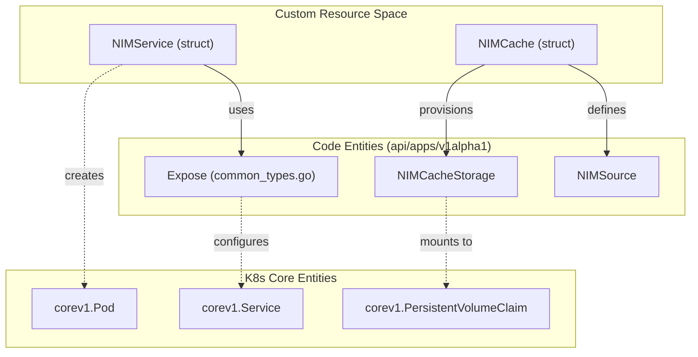
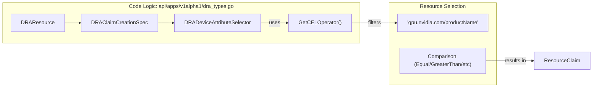

<!-- source: DeepWiki mcp.deepwiki.com · repo NVIDIA/k8s-nim-operator · page 13 Glossary · fetched 2026-10-26 -->

# Glossary

Relevant source files

The following files were used as context for generating this wiki page:

- [.github/ISSUE_TEMPLATE/bug_report.md](.github/ISSUE_TEMPLATE/bug_report.md)
- [README.md](README.md)
- [api/apps/v1alpha1/common_types.go](api/apps/v1alpha1/common_types.go)
- [api/apps/v1alpha1/dra_types.go](api/apps/v1alpha1/dra_types.go)
- [api/apps/v1alpha1/groupversion_info.go](api/apps/v1alpha1/groupversion_info.go)
- [api/apps/v1alpha1/nemo_common_types.go](api/apps/v1alpha1/nemo_common_types.go)
- [api/apps/v1alpha1/nimcache_types.go](api/apps/v1alpha1/nimcache_types.go)
- [api/apps/v1alpha1/nimservice_types.go](api/apps/v1alpha1/nimservice_types.go)

This page provides definitions for codebase-specific terms, jargon, abbreviations, and domain concepts used within the NVIDIA NIM Operator. It serves as a technical reference for engineers to understand the mapping between high-level AI/Kubernetes concepts and their specific implementations in the code.

## Core Concepts

### NIM (NVIDIA Inference Microservice)
A containerized microservice designed to deliver AI foundation models with accelerated inference. In this codebase, a NIM is typically managed via the `NIMService` controller.
*   **Implementation**: Defined as the `NIMService` struct in `api/apps/v1alpha1/nimservice_types.go`.
*   **Key Field**: `spec.image` defines the NIM container to run [[api/apps/v1alpha1/nimservice_types.go:98-98]]().

### NeMo Microservices
A suite of microservices for building, customizing, and deploying generative AI applications. The operator supports several NeMo-specific Custom Resources (CRs) such as `NemoCustomizer`, `NemoEvaluator`, and `NemoGuardrail` [[README.md:50-52]]().

### DRA (Dynamic Resource Allocation)
A Kubernetes feature (v1.28+) that allows for more flexible requesting of resources like GPUs. The operator uses DRA to manage complex GPU requirements that go beyond simple integer counts.
*   **Data Structures**: `DRAResource`, `DRAClaimCreationSpec`, and `DRADeviceAttributeSelector` [[api/apps/v1alpha1/dra_types.go:34-150]]().

---

## Technical Terms & Implementation Pointers

### API & Controller Patterns

| Term | Definition | Code Reference |
| :--- | :--- | :--- |
| **Reconciliation Loop** | The internal loop where the controller compares the current state of the cluster with the desired state defined in a CR. | `internal/controller/` |
| **Common Types** | Reusable API structures used across multiple CRDs (e.g., `Expose`, `Storage`, `Metrics`). | [[api/apps/v1alpha1/common_types.go:47-53]]() |
| **Expose** | A unified structure to define how a service is reachable via `Service`, `Ingress`, or `Gateway` (Gateway API). | [[api/apps/v1alpha1/common_types.go:47-53]]() |
| **Router** | A modern abstraction for `Ingress` or `Gateway` configurations, allowing domain-based routing. | [[api/apps/v1alpha1/common_types.go:56-76]]() |

### Infrastructure & Storage

| Term | Definition | Code Reference |
| :--- | :--- | :--- |
| **NIMCache** | A mechanism to pre-download and cache model weights onto a PersistentVolume (PV) to speed up pod startup. | [[api/apps/v1alpha1/nimcache_types.go:34-62]]() |
| **ModelPuller** | The specific container image responsible for downloading model weights from sources like NGC or HuggingFace. | [[api/apps/v1alpha1/nimcache_types.go:87-87]]() |
| **LWS (LeaderWorkerSet)** | A backend type used for Multi-Node NIM deployments where a group of pods works together for inference. | [[api/apps/v1alpha1/nimservice_types.go:80-80]]() |

---

## Code Entity Mapping

The following diagrams bridge the gap between high-level system concepts and the actual Go structs and constants used in the codebase.

### Diagram 1: Resource Lifecycle and Data Flow
This diagram shows how the `NIMService` and `NIMCache` entities interact with Kubernetes core resources.

**Sources:** [[api/apps/v1alpha1/nimservice_types.go:97-142]](), [[api/apps/v1alpha1/nimcache_types.go:34-62]](), [[api/apps/v1alpha1/common_types.go:47-53]]()

### Diagram 2: DRA (Dynamic Resource Allocation) Logic
This diagram illustrates how the `DRAResource` struct in the code translates to GPU selection logic.

**Sources:** [[api/apps/v1alpha1/dra_types.go:34-72]](), [[api/apps/v1alpha1/dra_types.go:130-148]](), [[api/apps/v1alpha1/dra_types.go:150-168]]()

---

## Domain Jargon

### Model Sources
*   **NGC**: NVIDIA GPU Cloud. The primary registry for NVIDIA-optimized AI models. The operator uses `NGC_API_KEY` for authentication [[api/apps/v1alpha1/common_types.go:41-41]]().
*   **HF (HuggingFace)**: A popular repository for open-source models. The operator supports pulling models from HF Hub using `HF_TOKEN` [[api/apps/v1alpha1/common_types.go:43-43]]().
*   **Universal NIM**: A NIM configuration that uses a `ModelEndpoint` instead of a static model spec [[api/apps/v1alpha1/nimcache_types.go:129-129]]().

### Platform Types
*   **Standalone**: A standard deployment where the operator manages Pods/Deployments directly [[api/apps/v1alpha1/nimservice_types.go:88-88]]().
*   **KServe**: Integration with the KServe ecosystem for advanced model serving features like serverless scaling [[api/apps/v1alpha1/nimservice_types.go:90-90]]().

### Multi-Node & Parallelism
*   **Tensor Parallelism**: Splitting a single model's computations across multiple GPUs [[api/apps/v1alpha1/nimcache_types.go:141-141]]().
*   **LWS Backend**: The operator uses `LeaderWorkerSet` to orchestrate multi-node inference, where one leader pod coordinates several worker pods [[api/apps/v1alpha1/nimservice_types.go:146-149]]().

**Sources:**
*   [[README.md:6-14]]()
*   [[api/apps/v1alpha1/common_types.go:31-44]]()
*   [[api/apps/v1alpha1/nimservice_types.go:51-91]]()
*   [[api/apps/v1alpha1/nimcache_types.go:66-74]]()
*   [[api/apps/v1alpha1/dra_types.go:1-168]]()