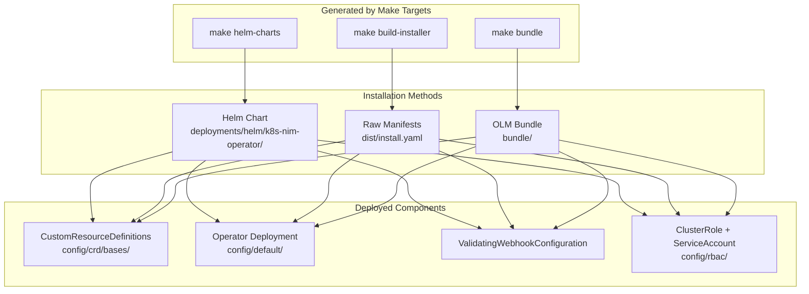
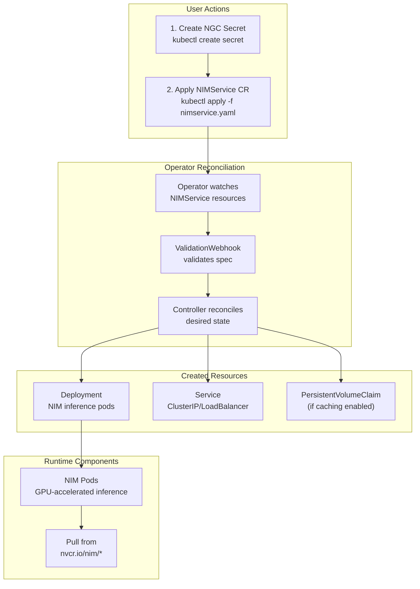
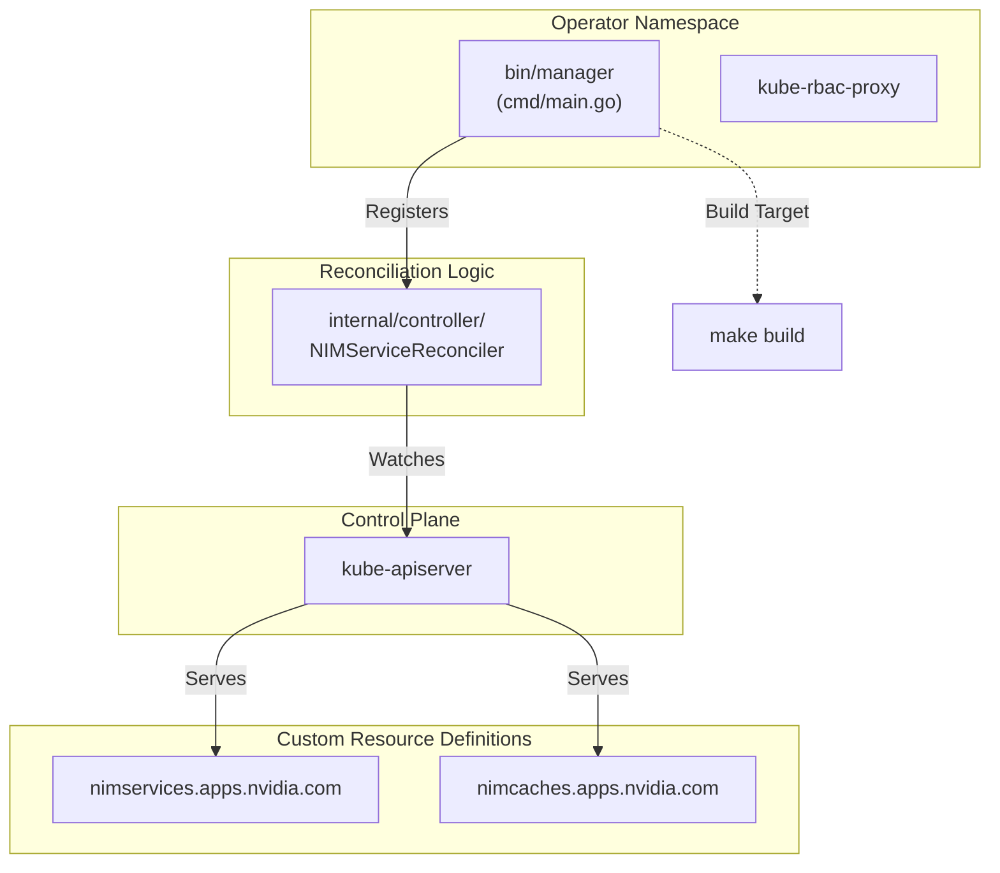

<!-- source: DeepWiki mcp.deepwiki.com · repo NVIDIA/k8s-nim-operator · page 2 Getting Started · fetched 2026-10-26 -->

# Getting Started

<details>
<summary>Relevant source files</summary>

The following files were used as context for generating this wiki page:

- [Makefile](Makefile)
- [README.md](README.md)
- [bundle/manifests/apps.nvidia.com_nimservices.yaml](bundle/manifests/apps.nvidia.com_nimservices.yaml)

</details>


This guide provides a quick start for deploying the `k8s-nim-operator` in a Kubernetes cluster and running your first NVIDIA NIM inference service. It covers prerequisites, installation methods, and a basic deployment example.

For detailed architecture information, see [Architecture](). For production deployment patterns and advanced configuration, see [Deployment](). For complete Custom Resource reference documentation, see [Custom Resources]().

---

## Prerequisites

Before installing the `k8s-nim-operator`, ensure your environment meets the following requirements:

| Requirement | Version/Details | Purpose |
|------------|----------------|---------|
| Kubernetes | v1.28 or higher | Operator runtime environment [README.md:19]() |
| NVIDIA GPUs | Supported by target NIM models | AI inference acceleration [README.md:20]() |
| NVIDIA GPU Operator | Installed and configured | GPU device plugin and drivers |
| Container Runtime | Docker, containerd, or CRI-O | Container execution |
| NGC API Key | From NVIDIA NGC | Model registry authentication |
| kubectl | Matching cluster version | Cluster management |

### Obtaining NGC Credentials

NVIDIA NIM microservices are distributed through NGC (NVIDIA GPU Cloud). To pull NIM container images and models:

1. Create an NGC account at [https://catalog.ngc.nvidia.com](https://catalog.ngc.nvidia.com)
2. Generate an API key from your account settings.
3. Store the API key securely - it will be used as an image pull secret and for model downloads.

**Sources:** [README.md:17-21]()

---

## Installation Methods

The `k8s-nim-operator` can be installed using three methods. Each method produces the same deployed components but suits different operational workflows:



**Diagram: Installation Methods and Component Flow**

### Method 1: Using Raw Manifests (Quickest for Testing)

This method generates a single consolidated YAML file containing all CRDs and deployment manifests:

```bash
# Generate install.yaml with specific image
make build-installer IMG=ghcr.io/nvidia/k8s-nim-operator:v0.1.0
```

The `build-installer` target in [Makefile:163-168]() uses `kustomize` to build manifests from [config/default/]() and produces [dist/install.yaml]().

**Pros:**
- Single command installation.
- No external dependencies (Helm, OLM).
- Easy to inspect generated YAML.

### Method 2: Using Helm (Recommended for Production)

Helm provides parameterized configuration and upgrade management. The chart is located in `deployments/helm/k8s-nim-operator/`.

```bash
# Package the chart
make helm-charts

# Install from local chart
helm install nim-operator deployments/helm/k8s-nim-operator/ \
  --namespace nim-operator \
  --create-namespace \
  --set image.repository=ghcr.io/nvidia/k8s-nim-operator \
  --set image.tag=v0.1.0
```

The [Makefile:172-175]() target packages Helm charts using semantic versioning (strips `v` prefix from `VERSION`).

### Method 3: Using Operator Lifecycle Manager (Enterprise)

OLM provides automated operator lifecycle management. OLM bundles are generated and validated via Makefile targets:

```bash
# Generate bundle
make bundle

# Validate bundle
make bundle-validate
```

**Sources:** [Makefile:163-184](), [README.md:74-92]()

---

## Quick Start: Deploying the Operator

This section walks through a complete installation using the raw manifests method.

### Step 1: Install CRDs

Install the Custom Resource Definitions into your cluster:

```bash
make install
```

This applies CRDs from [config/crd/bases/]() using the [Makefile:193-194]() target.

Verify CRD installation:
```bash
kubectl get crds | grep apps.nvidia.com
```

Expected output includes:
- `nimservices.apps.nvidia.com` [bundle/manifests/apps.nvidia.com_nimservices.yaml:7]()
- `nimcaches.apps.nvidia.com`
- `nimpipelines.apps.nvidia.com`
- `nimbuilds.apps.nvidia.com`
- `nemocustomizers.apps.nvidia.com`

### Step 2: Deploy the Operator

Deploy the operator controller to the cluster:

```bash
make deploy IMG=ghcr.io/nvidia/k8s-nim-operator:v0.1.0
```

The [Makefile:201-203]() target patches the image reference in [config/manager/]() and applies manifests from [config/default/]().

Verify operator deployment:
```bash
kubectl get deployment -n k8s-nim-operator-system
```

**Sources:** [README.md:34-44](), [Makefile:193-203]()

---

## Deploying Your First NIM Service

Once the operator is installed, you can deploy NVIDIA NIM microservices using the `NIMService` Custom Resource.



**Diagram: NIMService Deployment Flow**

### Step 1: Create NGC Image Pull Secret

Create a Kubernetes secret containing your NGC API key:

```bash
kubectl create secret docker-registry ngc-secret \
  --docker-server=nvcr.io \
  --docker-username='$oauthtoken' \
  --docker-password=<your-ngc-api-key> \
  --namespace=default
```

### Step 2: Create NIMService Resource

Create a file named `nimservice-example.yaml` using the `NIMService` kind [bundle/manifests/apps.nvidia.com_nimservices.yaml:11]():

```yaml
apiVersion: apps.nvidia.com/v1alpha1
kind: NIMService
metadata:
  name: meta-llama3-8b-instruct
spec:
  image:
    repository: nvcr.io/nim/meta/llama3-8b-instruct
    tag: "1.0.0"
    pullSecrets:
      - ngc-secret
  resources:
    limits:
      nvidia.com/gpu: 1
  expose:
    service:
      type: ClusterIP
      port: 8000
```

Apply the resource:
```bash
kubectl apply -f nimservice-example.yaml
```

**Sources:** [README.md:50-52](), [bundle/manifests/apps.nvidia.com_nimservices.yaml:8-49]()

---

## Component Deployment Diagram

This diagram bridges the Natural Language Space of "Deployment" to the Code Entity Space by showing how the `manager` binary interacts with specific CRDs and controllers.



**Diagram: Code Entity to Component Mapping**

**Sources:** [Makefile:156-158](), [bundle/manifests/apps.nvidia.com_nimservices.yaml:7](), [README.md:40-44]()

---

## Uninstalling the Operator

To remove the operator and its resources:

### 1. Remove Instances
Delete all deployed Custom Resources:
```bash
kubectl delete -k config/samples/
```

### 2. Undeploy Operator
Remove the controller and RBAC:
```bash
make undeploy
```

### 3. Uninstall CRDs
Remove the Custom Resource Definitions:
```bash
make uninstall
```

**Sources:** [README.md:54-72](), [Makefile:197-207]()

---

## Build and Development Workflow

For developers who want to build the operator from source:

```bash
# Clone repository
git clone https://github.com/NVIDIA/k8s-nim-operator.git
cd k8s-nim-operator

# Build operator binary locally
make build

# Run unit tests
make test
```

The `make build` target in [Makefile:156-158]() compiles the `manager` binary from [cmd/main.go]() after running code generation and validation checks.

**Sources:** [README.md:99-107](), [Makefile:156-161]()

---

