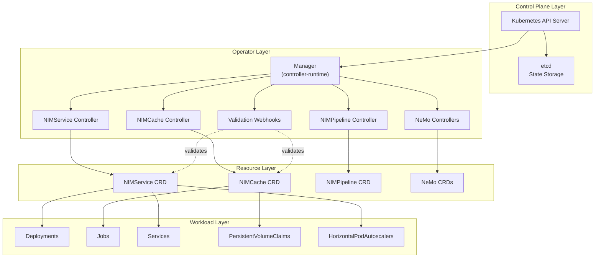
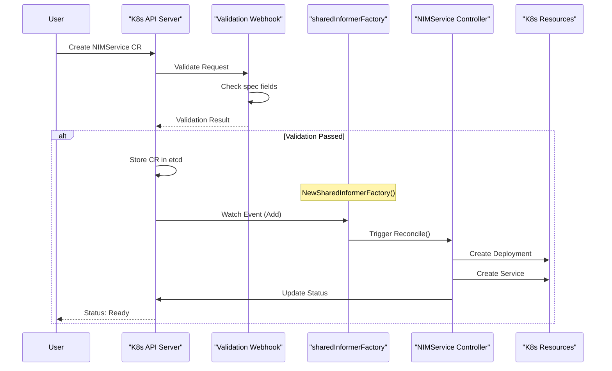
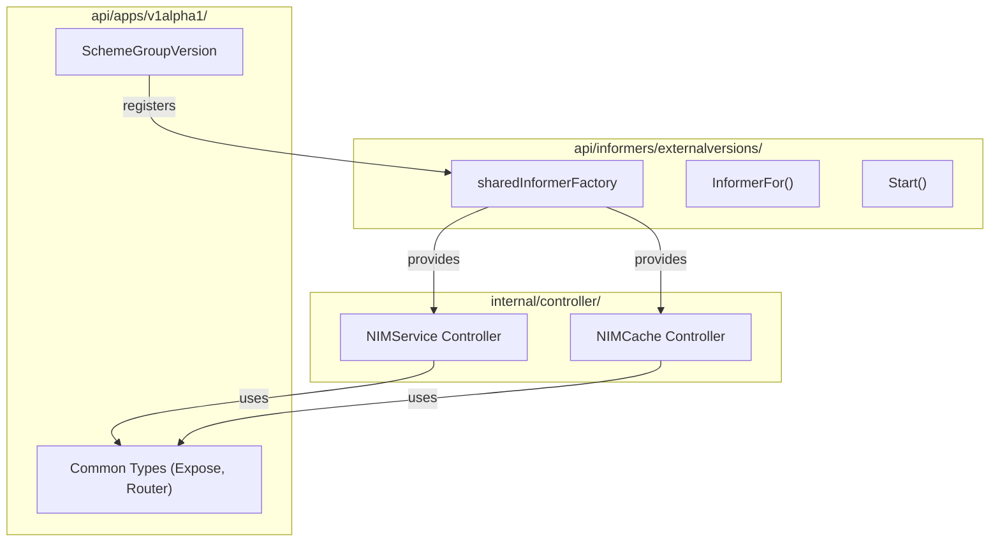

<!-- source: DeepWiki mcp.deepwiki.com · repo NVIDIA/k8s-nim-operator · page 3 Architecture · fetched 2026-10-26 -->

# Architecture

Relevant source files

The following files were used as context for generating this wiki page:

- [api/apps/v1alpha1/common_types.go](api/apps/v1alpha1/common_types.go)
- [api/apps/v1alpha1/groupversion_info.go](api/apps/v1alpha1/groupversion_info.go)
- [api/informers/externalversions/factory.go](api/informers/externalversions/factory.go)

## Purpose and Scope

This document provides a comprehensive overview of the k8s-nim-operator's architecture, focusing on the overall system structure, component interactions, and integration points. It establishes the foundational architectural patterns that enable the operator to manage NVIDIA NIM (NVIDIA Inference Microservices) and NeMo workloads on Kubernetes.

For detailed information about the operator pattern implementation and reconciliation loops, see [Operator Pattern](#3.1). For API design principles and versioning strategy, see [API Design](#3.2). For specific Custom Resource documentation, see [Custom Resources](#4).

---

## System Overview

The k8s-nim-operator is a Kubernetes operator built using the Kubebuilder framework. It extends Kubernetes with domain-specific Custom Resource Definitions (CRDs) to manage AI inference workloads and provides automated lifecycle management for NVIDIA NIM microservices.

### Core Components

| Component | Purpose | File Path Reference |
|-----------|---------|---------------------|
| **Operator Controller** | Manages reconciliation loops for all CRDs | `internal/controller/` |
| **Validation Webhooks** | Validates NIMService and NIMCache resources | `internal/webhook/` |
| **API Definitions** | Defines CRD schemas and common types | [api/apps/v1alpha1/common_types.go:1-171]() |
| **Generated Client** | Provides programmatic access to CRDs | [api/informers/externalversions/factory.go:1-205]() |
| **RBAC Manifests** | Defines operator permissions | `config/rbac/` |
| **CRD Manifests** | Contains generated CRD YAML definitions | `config/crd/bases/` |

**Sources**: [api/apps/v1alpha1/groupversion_info.go:1-42](), [api/informers/externalversions/factory.go:1-55]()

---

## Architectural Layers

The operator architecture consists of four distinct layers, each with specific responsibilities:

**Figure 1: Architectural Layers**

**Sources**: [api/apps/v1alpha1/groupversion_info.go:17-41](), [api/apps/v1alpha1/common_types.go:46-136]()

---

## Component Interaction Flow

The following diagram illustrates how components interact during a typical NIMService deployment lifecycle, bridging the gap between high-level logic and code entities like `sharedInformerFactory`.

**Figure 2: Component Interaction Sequence**

**Sources**: [api/informers/externalversions/factory.go:92-121](), [api/apps/v1alpha1/common_types.go:147-170]()

---

## Custom Resource Management

The operator manages resources under the `apps.nvidia.com/v1alpha1` API group. These resources leverage common types to ensure consistency.

### NIM Resources

| Resource | Purpose | Code Reference |
|----------|---------|----------------|
| **NIMService** | Deploys NIM inference microservices | [api/apps/v1alpha1/common_types.go:47-53]() |
| **NIMCache** | Manages model artifact caching | [api/apps/v1alpha1/common_types.go:139-144]() |
| **NIMPipeline** | Orchestrates multi-step inference workflows | [api/apps/v1alpha1/groupversion_info.go:27-30]() |

### Common API Entities

The architecture relies on reusable types defined in `common_types.go`:
- `Expose`: Defines how services are exposed via `Service`, `Ingress`, or `Router` [api/apps/v1alpha1/common_types.go:47-53]().
- `Router`: Configures advanced routing including `Gateway` and `EPPConfig` [api/apps/v1alpha1/common_types.go:56-76]().
- `Service`: Standardizes service definitions for NIM ports [api/apps/v1alpha1/common_types.go:147-170]().

**Sources**: [api/apps/v1alpha1/common_types.go:31-170](), [api/apps/v1alpha1/groupversion_info.go:17-41]()

---

## Controller and Informer Architecture

The operator uses a generated `SharedInformerFactory` to manage resource caches efficiently. This reduces API server load by sharing a single connection for multiple controllers.

**Figure 3: Informer and Controller Interaction**

**Sources**: [api/informers/externalversions/factory.go:37-55](), [api/informers/externalversions/factory.go:179-199](), [api/apps/v1alpha1/groupversion_info.go:27-35]()

---

## External Dependencies and Integration

The operator integrates with several external systems to provide complete AI inference capabilities:

| Dependency | Purpose | Code Variable |
|------------|---------|---------------|
| **NGC Registry** | Hosts NIM container images | `NGCAPIKey` [api/apps/v1alpha1/common_types.go:41-41]() |
| **Hugging Face** | Model artifact source | `HFToken` [api/apps/v1alpha1/common_types.go:43-43]() |
| **Gateway API** | Advanced traffic routing | `gatewayv1.BackendRef` [api/apps/v1alpha1/common_types.go:135-135]() |
| **Prometheus** | Metrics collection | `DefaultNamedPortMetrics` [api/apps/v1alpha1/common_types.go:38-39]() |

**Sources**: [api/apps/v1alpha1/common_types.go:31-44](), [api/apps/v1alpha1/common_types.go:117-136]()

---

## Summary

The k8s-nim-operator architecture follows proven Kubernetes patterns:

1. **Declarative API**: Uses `SchemeGroupVersion` to register `apps.nvidia.com/v1alpha1` [api/apps/v1alpha1/groupversion_info.go:27-30]().
2. **Efficient Caching**: Implements `sharedInformerFactory` to minimize API calls [api/informers/externalversions/factory.go:37-55]().
3. **Modular Design**: Uses common types like `Expose` and `Router` to promote code reuse across different NIM resources [api/apps/v1alpha1/common_types.go:47-76]().

For implementation details of the operator pattern, see [Operator Pattern](#3.1). For API design principles and versioning, see [API Design](#3.2).

---

