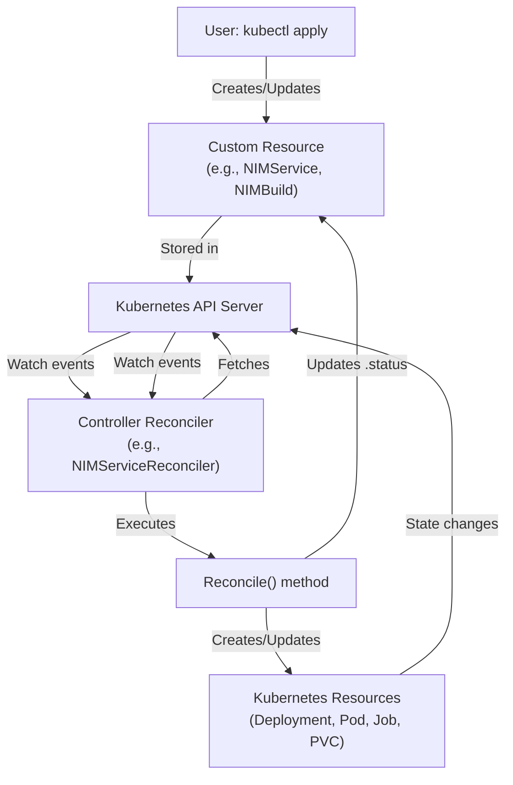
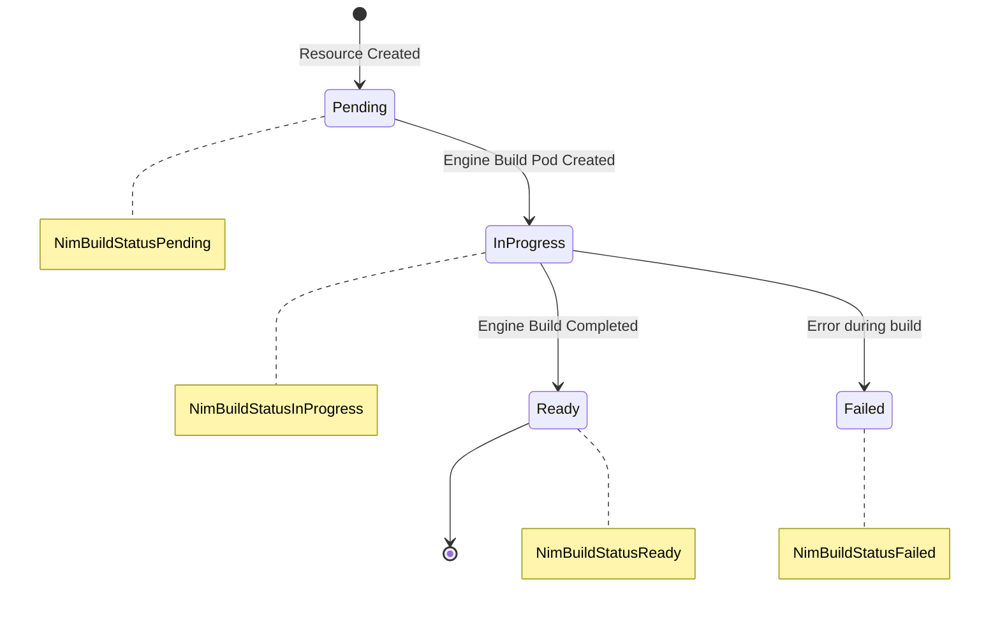
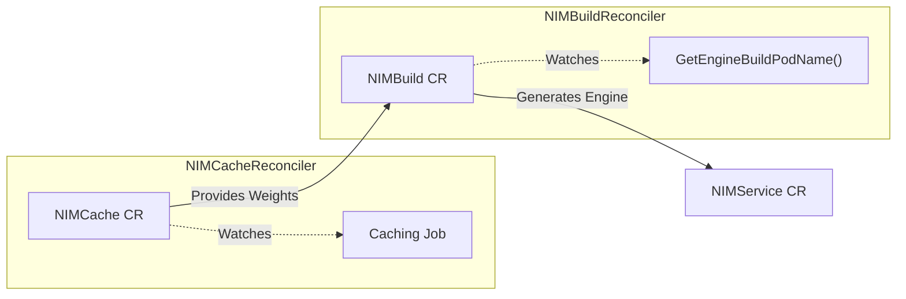

<!-- source: DeepWiki mcp.deepwiki.com · repo NVIDIA/k8s-nim-operator · page 3.1 Operator Pattern · fetched 2026-10-26 -->

# Operator Pattern

Relevant source files

The following files were used as context for generating this wiki page:

- [api/apps/v1alpha1/nimbuild_types.go](api/apps/v1alpha1/nimbuild_types.go)
- [api/apps/v1alpha1/nimcache_types.go](api/apps/v1alpha1/nimcache_types.go)
- [api/apps/v1alpha1/nimpipeline_types.go](api/apps/v1alpha1/nimpipeline_types.go)
- [api/apps/v1alpha1/nimservice_types.go](api/apps/v1alpha1/nimservice_types.go)

This page explains the Kubernetes operator pattern and how it is implemented in the `k8s-nim-operator`. The operator pattern is a core architectural principle that enables the operator to manage complex AI inference workloads declaratively through custom resources. Each controller continuously watches for changes to custom resources and reconciles the actual cluster state with the desired state.

The `k8s-nim-operator` is built using Kubebuilder, a framework for building Kubernetes operators using Go. The operator manages multiple custom resources under the `apps.nvidia.com/v1alpha1` API group.

## Kubernetes Operator Pattern Overview

The `k8s-nim-operator` implements the standard Kubernetes operator pattern, which extends Kubernetes functionality through custom controllers that manage application-specific resources. The pattern consists of three key components:

1.  **Custom Resource Definitions (CRDs)**: Define new resource types in Kubernetes, such as `NIMService`, `NIMCache`, `NIMBuild`, and `NIMPipeline`.
2.  **Controllers**: Watch and reconcile custom resources.
3.  **Reconciliation Loop**: Continuously drive cluster state toward desired state.

### Controllers in k8s-nim-operator

The operator implements multiple controllers, each managing a specific custom resource:

| Controller | Resource Kind | Purpose |
| :--- | :--- | :--- |
| `NIMServiceReconciler` | `NIMService` | Manages NIM inference service deployments, including standalone and KServe platforms [api/apps/v1alpha1/nimservice_types.go:83-91](). |
| `NIMCacheReconciler` | `NIMCache` | Manages model caching jobs and PVCs for NGC, HuggingFace, or DataStore sources [api/apps/v1alpha1/nimcache_types.go:64-74](). |
| `NIMBuildReconciler` | `NIMBuild` | Manages the building of optimized TensorRT-LLM engines from model weights [api/apps/v1alpha1/nimbuild_types.go:29-30](). |
| `NIMPipelineReconciler` | `NIMPipeline` | Orchestrates multi-step inference pipelines by managing service dependencies [api/apps/v1alpha1/nimpipeline_types.go:40-47](). |

### Basic Controller Flow

**Diagram: Kubernetes Operator Pattern Implementation**

This diagram illustrates the operator pattern flow: users create custom resources like `NIMService` [api/apps/v1alpha1/nimservice_types.go:87-93](), controllers watch for changes via the Kubernetes API, execute reconciliation logic, and manage underlying Kubernetes resources.

Sources: [api/apps/v1alpha1/nimservice_types.go:51-64](), [api/apps/v1alpha1/nimbuild_types.go:85-123]()

## Reconciliation Flow

The `Reconcile()` method is the entry point for all reconciliation logic. Controllers follow a consistent pattern to ensure the desired state specified in the `Spec` is reflected in the cluster, while reporting the current state in the `Status`.

### Data Flow and Status Updates

Each CRD defines a `Spec` (desired state) and a `Status` (observed state). For example, `NIMBuild` tracks the progress of an engine build through various states:

**Diagram: NIMBuild State Machine**

Sources: [api/apps/v1alpha1/nimbuild_types.go:110-123]()

### Reconciliation Logic Steps

1.  **Fetch Resource**: The controller retrieves the object (e.g., `NIMBuild` [api/apps/v1alpha1/nimbuild_types.go:68-75]()) using the client.
2.  **Validation**: For resources like `NIMCache`, the controller ensures exactly one source (NGC, HF, or DataStore) is defined [api/apps/v1alpha1/nimcache_types.go:64-65]().
3.  **Dependency Resolution**: `NIMBuild` checks if the referenced `NIMCache` is ready before proceeding [api/apps/v1alpha1/nimbuild_types.go:86-87]().
4.  **Resource Generation**: The controller renders sub-resources. For `NIMBuild`, this includes the Engine Build Pod [api/apps/v1alpha1/nimbuild_types.go:162-165]() and Local Manifest Reader Pod [api/apps/v1alpha1/nimbuild_types.go:168-170]().
5.  **Status Reporting**: The controller updates conditions such as `NIM_SERVICE_READY` [api/apps/v1alpha1/nimservice_types.go:52-53]() or `NIM_PIPELINE_FAILED` [api/apps/v1alpha1/nimpipeline_types.go:29-30]().

## Resource Lifecycle Management

### NIMCache and NIMBuild Interaction

The operator manages a complex lifecycle where resources depend on one another. A `NIMBuild` requires a `NIMCache` to be populated with model weights before it can build an engine.

**Diagram: Resource Interaction Data Flow**

Sources: [api/apps/v1alpha1/nimbuild_types.go:31-32](), [api/apps/v1alpha1/nimbuild_types.go:162-165]()

### Multi-Node and Platform Support

The `NIMServiceReconciler` handles advanced deployment patterns:
*   **Inference Platforms**: Supports `standalone` (default) and `kserve` [api/apps/v1alpha1/nimservice_types.go:83-91]().
*   **Multi-Node**: Manages `LeaderWorkerSet` (LWS) for distributed inference when `multiNode` is configured [api/apps/v1alpha1/nimservice_types.go:144-150]().
*   **Autoscaling**: Integrates with Horizontal Pod Autoscaler (HPA) via the `Scale` field, ensuring it is mutually exclusive with `multiNode` or static `replicas` [api/apps/v1alpha1/nimservice_types.go:93-96]().

## Status Management and Conditions

Controllers update resource status through a consistent condition-based mechanism. This allows users to diagnose issues by looking at the `status.conditions` of a resource.

| Condition Type | Associated Resource | Description |
| :--- | :--- | :--- |
| `NIM_SERVICE_READY` | `NIMService` | Indicates the NIM deployment is ready to serve traffic [api/apps/v1alpha1/nimservice_types.go:52-53](). |
| `NIM_BUILD_ENGINE_BUILD_POD_COMPLETED` | `NIMBuild` | Indicates the engine optimization process finished successfully [api/apps/v1alpha1/nimbuild_types.go:99-100](). |
| `NIM_PIPELINE_READY` | `NIMPipeline` | Indicates all services in the pipeline are operational [api/apps/v1alpha1/nimpipeline_types.go:27-28](). |
| `NIM_BUILD_WAIT_FOR_NIM_CACHE_READY` | `NIMBuild` | Indicates the build is blocked by a pending cache [api/apps/v1alpha1/nimbuild_types.go:86-87](). |

Sources: [api/apps/v1alpha1/nimservice_types.go:51-64](), [api/apps/v1alpha1/nimbuild_types.go:85-123](), [api/apps/v1alpha1/nimpipeline_types.go:26-38]()

---

