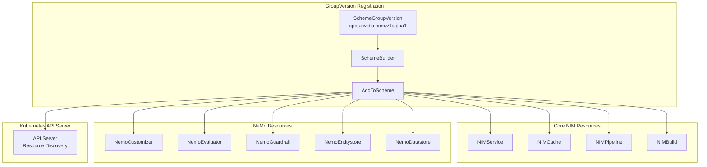
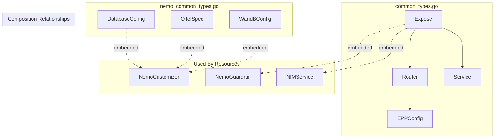
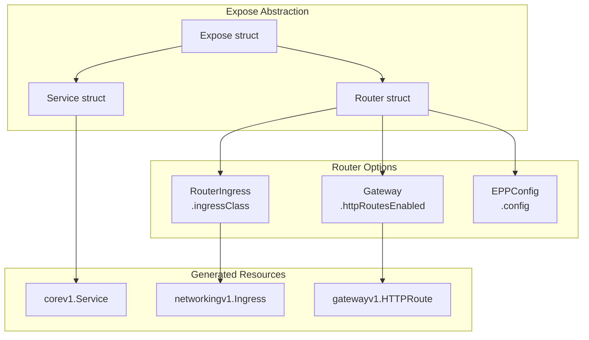

<!-- source: DeepWiki mcp.deepwiki.com · repo NVIDIA/k8s-nim-operator · page 3.2 API Design · fetched 2026-10-26 -->

# API Design

<details>
<summary>Relevant source files</summary>

The following files were used as context for generating this wiki page:

- [api/apps/v1alpha1/common_types.go](api/apps/v1alpha1/common_types.go)
- [api/apps/v1alpha1/groupversion_info.go](api/apps/v1alpha1/groupversion_info.go)
- [api/apps/v1alpha1/nemo_common_types.go](api/apps/v1alpha1/nemo_common_types.go)
- [api/apps/v1alpha1/zz_generated.deepcopy.go](api/apps/v1alpha1/zz_generated.deepcopy.go)

</details>


## Purpose and Scope

This document describes the API design principles and structure of the k8s-nim-operator. It covers the API group organization (`apps.nvidia.com/v1alpha1`), versioning strategy, and how common types promote code reuse across custom resources. For detailed reference documentation of individual API types and fields, see [API Reference](#5).

## API Group Structure

The k8s-nim-operator defines its API under a single API group with a consistent versioning scheme. All custom resources follow the Kubernetes API conventions and leverage the kubebuilder framework for code generation.

### Group, Version, and Domain

The API is organized under the following coordinates:

| Component | Value |
|-----------|-------|
| **Domain** | `nvidia.com` |
| **Group** | `apps` |
| **Full API Group** | `apps.nvidia.com` |
| **Version** | `v1alpha1` |
| **Schema Path** | `github.com/NVIDIA/k8s-nim-operator/api/apps/v1alpha1` |

The domain and group combination creates a namespaced API group that prevents conflicts with other operators in the cluster. The full API group is defined in [api/apps/v1alpha1/groupversion_info.go:19]() and [api/apps/v1alpha1/groupversion_info.go:29]().

```go
// Defined in groupversion_info.go
SchemeGroupVersion = schema.GroupVersion{Group: "apps.nvidia.com", Version: "v1alpha1"}
```

**Sources:** [api/apps/v1alpha1/groupversion_info.go:17-42]()

### Custom Resource Types

The operator manages several distinct custom resource types, organized into functional categories:

#### Core NIM Resources
These resources manage the deployment, caching, and orchestration of NVIDIA Inference Microservices.
- `NIMService`: Deploy and manage NIM inference services.
- `NIMCache`: Manage model caching and persistent volumes.
- `NIMPipeline`: Orchestrate multi-step inference workflows.
- `NIMBuild`: Build custom NIM containers.

#### NeMo Microservices
These resources manage components of the NVIDIA NeMo framework for advanced AI workflows.
- `NemoCustomizer`: Model customization workflows.
- `NemoEvaluator`: Model evaluation workflows.
- `NemoGuardrails`: Safety guardrails for AI models.
- `NemoEntitystore`: Entity management for NeMo.
- `NemoDatastore`: Data management for NeMo.

**Sources:** [api/apps/v1alpha1/groupversion_info.go:31-41]()

### API Resource Registration Diagram



**Sources:** [api/apps/v1alpha1/groupversion_info.go:27-41]()

## Versioning Strategy

### Alpha Version Semantics

The operator currently uses `v1alpha1` as its API version, indicating:
- **Alpha stability level**: The API is under active development and may change between releases.
- **Version 1**: This is the first iteration of the alpha API.
- **No backward compatibility guarantees**: Breaking changes may occur in future alpha versions.

**Sources:** [api/apps/v1alpha1/groupversion_info.go:29]()

## Common Types Pattern

A key design principle of the operator's API is the use of **common types** to promote code reuse and consistency across custom resources. These reusable components are defined in [api/apps/v1alpha1/common_types.go]() and [api/apps/v1alpha1/nemo_common_types.go]().

### Core Common Types

| Type | File Location | Purpose |
|------|---------------|---------|
| `Expose` | [api/apps/v1alpha1/common_types.go:47]() | Service exposure via Service, Ingress, or Gateway API |
| `Router` | [api/apps/v1alpha1/common_types.go:56]() | Ingress and Gateway API routing configuration |
| `Service` | [api/apps/v1alpha1/common_types.go:147]() | Kubernetes Service configuration |
| `EPPConfig` | [api/apps/v1alpha1/common_types.go:79]() | Endpoint Picker Extension configuration for Gateway API |
| `DatabaseConfig` | [api/apps/v1alpha1/nemo_common_types.go:56]() | External database connection settings for NeMo |
| `OTelSpec` | [api/apps/v1alpha1/nemo_common_types.go:134]() | OpenTelemetry settings for tracing and logging |
| `WandBConfig` | [api/apps/v1alpha1/nemo_common_types.go:101]() | Weights and Biases service configuration |

**Sources:** [api/apps/v1alpha1/common_types.go:45-180](), [api/apps/v1alpha1/nemo_common_types.go:1-188]()

### Common Types Composition Diagram



**Sources:** [api/apps/v1alpha1/common_types.go:47-170](), [api/apps/v1alpha1/nemo_common_types.go:56-160]()

## Service Exposure Abstraction

The `Expose` structure provides a unified abstraction over multiple Kubernetes networking primitives.

### Expose Type Architecture



The `Expose` type supports three primary exposure mechanisms:
1. **Service**: Creates a standard Kubernetes Service [api/apps/v1alpha1/common_types.go:147-170]().
2. **Router**: Modern routing via Ingress or Gateway API [api/apps/v1alpha1/common_types.go:56-76]().
3. **EPPConfig**: Integrates with the `gateway-api-inference-extension` to provide advanced endpoint picking [api/apps/v1alpha1/common_types.go:79-106]().

### Validation Rules

The API enforces mutual exclusivity between Router options using CEL validation:

```go
// From common_types.go line 55
// +kubebuilder:validation:XValidation:rule="!(has(self.gateway) && has(self.ingress))", message="ingress and gateway cannot be specified together"
```

This ensures that the operator doesn't attempt to reconcile conflicting routing resources for the same service.

**Sources:** [api/apps/v1alpha1/common_types.go:55-56](), [api/apps/v1alpha1/common_types.go:78-79]()

## Named Ports Convention

The API defines standard named port constants for consistent service discovery:

```go
// From common_types.go lines 31-39
const (
	DefaultAPIPort = 8000
	DefaultNamedPortAPI = "api"
	DefaultNamedPortGRPC = "grpc"
	DefaultNamedPortMetrics = "metrics"
)
```

These constants are used by controllers when generating Service and Container specifications to ensure interoperability between NIM components.

**Sources:** [api/apps/v1alpha1/common_types.go:31-39]()

## NeMo Common Types

For NeMo microservices, the API defines specific types to handle external integrations:

| Type | Purpose | Key Fields |
|------|---------|------------|
| `DatabaseConfig` | SQL Database connection | `Host`, `Port`, `DatabaseName`, `Credentials` |
| `ArgoWorkflows` | Workflow orchestration | `Endpoint`, `ServiceAccount` |
| `WandBConfig` | Training tracking | `SecretName`, `ProjectName` |
| `OTelSpec` | Observability | `ExporterOtlpEndpoint`, `LogLevel`, `ExporterConfig` |

**Sources:** [api/apps/v1alpha1/nemo_common_types.go:19-160]()

## Code Generation

The operator relies heavily on `controller-gen` for deepcopy functions and CRD generation. The `zz_generated.deepcopy.go` file contains the implementation for cloning complex API structures, ensuring that the reconciliation loop works with safe copies of the state.

**Sources:** [api/apps/v1alpha1/zz_generated.deepcopy.go:1-230]()

---

