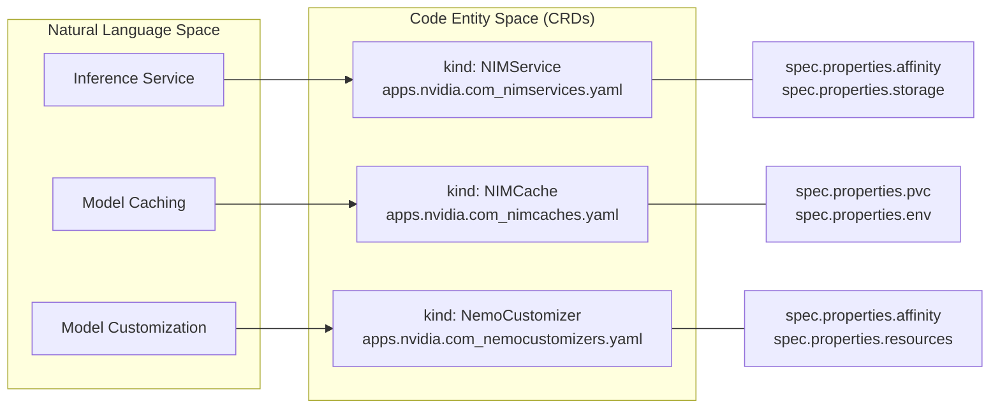
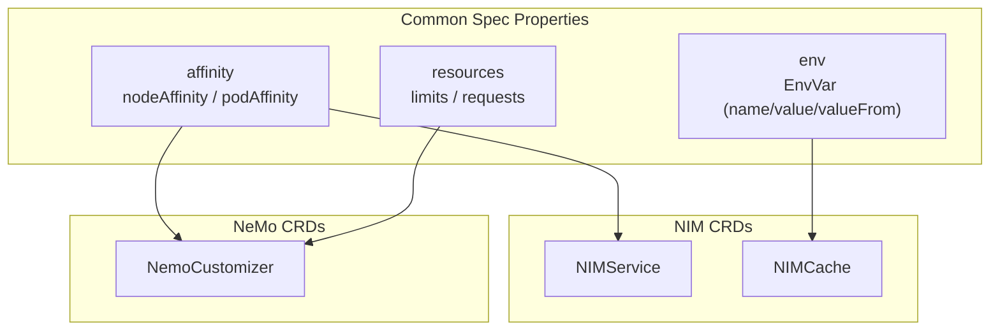

<!-- source: DeepWiki mcp.deepwiki.com · repo NVIDIA/k8s-nim-operator · page 4 Custom Resources · fetched 2026-10-26 -->

# Custom Resources

<details>
<summary>Relevant source files</summary>

The following files were used as context for generating this wiki page:

- [bundle/manifests/apps.nvidia.com_nemocustomizers.yaml](bundle/manifests/apps.nvidia.com_nemocustomizers.yaml)
- [bundle/manifests/apps.nvidia.com_nimcaches.yaml](bundle/manifests/apps.nvidia.com_nimcaches.yaml)
- [bundle/manifests/apps.nvidia.com_nimservices.yaml](bundle/manifests/apps.nvidia.com_nimservices.yaml)

</details>


This document provides an overview of all Custom Resource Definitions (CRDs) managed by the `k8s-nim-operator`. It categorizes resources by their functional purpose and explains the common API patterns shared across resources.

For detailed specifications of individual resources, see [NIM Resources](#4.1) and [NeMo Microservices](#4.2). For information about reusable API components like `Expose`, `Metrics`, and `Autoscaling`, see [Common Types](#5.1). For Dynamic Resource Allocation features, see [Dynamic Resource Allocation](#5.2).

## API Group Structure

All custom resources in `k8s-nim-operator` belong to the `apps.nvidia.com` API group, version `v1alpha1`. The API group is defined in the project structure and manifested in the CRD definitions [bundle/manifests/apps.nvidia.com_nimservices.yaml:9-25]().

```
API Group: apps.nvidia.com
Version: v1alpha1
Domain: nvidia.com
Resources: 9 CRDs (Managed via controllers and validation webhooks)
```

The `v1alpha1` designation indicates that the API is under active development. All resources are namespaced, meaning they exist within a specific Kubernetes namespace context [bundle/manifests/apps.nvidia.com_nimservices.yaml:15]().

**Sources:** [bundle/manifests/apps.nvidia.com_nimservices.yaml:1-25](), [bundle/manifests/apps.nvidia.com_nimcaches.yaml:1-28](), [bundle/manifests/apps.nvidia.com_nemocustomizers.yaml:1-25]()

## Resource Categories

The operator manages two primary categories of resources: NIM Resources for inference workloads and NeMo Resources for AI workflow operations.

### NIM Resources Overview

NIM Resources provide the core functionality for deploying NVIDIA NIM (NVIDIA Inference Microservices) on Kubernetes. These resources handle model serving, caching, and workflow orchestration.

| Resource | Kind | Validation Webhook | Primary Purpose |
|----------|------|-------------------|-----------------|
| `NIMService` | `NIMService` | Yes | Deploy and manage NIM inference services with GPU resources [bundle/manifests/apps.nvidia.com_nimservices.yaml:11]() |
| `NIMCache` | `NIMCache` | Yes | Pre-cache model artifacts to PersistentVolumeClaims [bundle/manifests/apps.nvidia.com_nimcaches.yaml:11]() |
| `NIMPipeline` | `NIMPipeline` | No | Orchestrate multi-step inference workflows |
| `NIMBuild` | `NIMBuild` | No | Build custom NIM container images |

For detailed documentation, see [NIM Resources](#4.1).

**Sources:** [bundle/manifests/apps.nvidia.com_nimservices.yaml:1-50](), [bundle/manifests/apps.nvidia.com_nimcaches.yaml:1-51]()

### NeMo Microservices Overview

NeMo Resources extend the operator with specialized capabilities for NeMo Framework workflows, including model customization and data management.

| Resource | Kind | Primary Purpose |
|----------|------|-----------------|
| `NemoCustomizer` | `NemoCustomizer` | Customize NeMo models with domain-specific data [bundle/manifests/apps.nvidia.com_nemocustomizers.yaml:11]() |
| `NemoGuardrail` | `NemoGuardrail` | Implement safety guardrails for AI models |
| `NemoEntitystore` | `NemoEntitystore` | Manage entity data for NeMo workflows |
| `NemoDatastore` | `NemoDatastore` | Handle data storage for NeMo services |
| `NemoEvaluator` | `NemoEvaluator` | Evaluate NeMo model performance |

For detailed documentation, see [NeMo Microservices](#4.2).

**Sources:** [bundle/manifests/apps.nvidia.com_nemocustomizers.yaml:1-48]()

## Code-to-Entity Mapping

The following diagram bridges the "Natural Language Space" of system features to the "Code Entity Space" by mapping CRD kinds to their structural definitions in the YAML manifests.

Title: CRD Schema Mapping


**Sources:** [bundle/manifests/apps.nvidia.com_nimservices.yaml:11-50](), [bundle/manifests/apps.nvidia.com_nimcaches.yaml:11-51](), [bundle/manifests/apps.nvidia.com_nemocustomizers.yaml:11-49]()

## Common API Patterns

The operator uses standardized patterns across its CRDs to ensure a consistent user experience. Many resources share common fields for infrastructure configuration.

### Shared Infrastructure Fields

Most resources, such as `NIMService` and `NemoCustomizer`, share common scheduling and environment configurations:

- **Affinity**: Standard Kubernetes node and pod affinity rules [bundle/manifests/apps.nvidia.com_nimservices.yaml:50-130](), [bundle/manifests/apps.nvidia.com_nemocustomizers.yaml:50-130]().
- **Environment Variables**: Custom environment variables for container execution, supporting `valueFrom` for secrets and configmaps [bundle/manifests/apps.nvidia.com_nimcaches.yaml:72-153]().
- **Tolerations**: Ability to schedule on tainted nodes, critical for GPU-specific workloads.

Title: Shared Spec Components


**Sources:** [bundle/manifests/apps.nvidia.com_nimservices.yaml:50-130](), [bundle/manifests/apps.nvidia.com_nimcaches.yaml:72-153](), [bundle/manifests/apps.nvidia.com_nemocustomizers.yaml:50-130]()

## Status and Lifecycle

All resources implement a standard status block to report the health and state of the managed components.

- **State**: High-level status string (e.g., `Ready`, `Pending`, `Failed`) [bundle/manifests/apps.nvidia.com_nimservices.yaml:18-20]().
- **Conditions**: Detailed list of status conditions following Kubernetes API conventions.
- **Resource References**: Specific fields like `.status.pvc` in `NIMCache` to track generated infrastructure [bundle/manifests/apps.nvidia.com_nimcaches.yaml:21-23]().

**Sources:** [bundle/manifests/apps.nvidia.com_nimservices.yaml:17-25](), [bundle/manifests/apps.nvidia.com_nimcaches.yaml:17-27]()

## Next Steps

- For core inference deployment details, see [NIM Resources](#4.1).
- For advanced model customization and guardrails, see [NeMo Microservices](#4.2).
- For detailed API type definitions and reusable structures, see [Common Types](#5.1).

---

