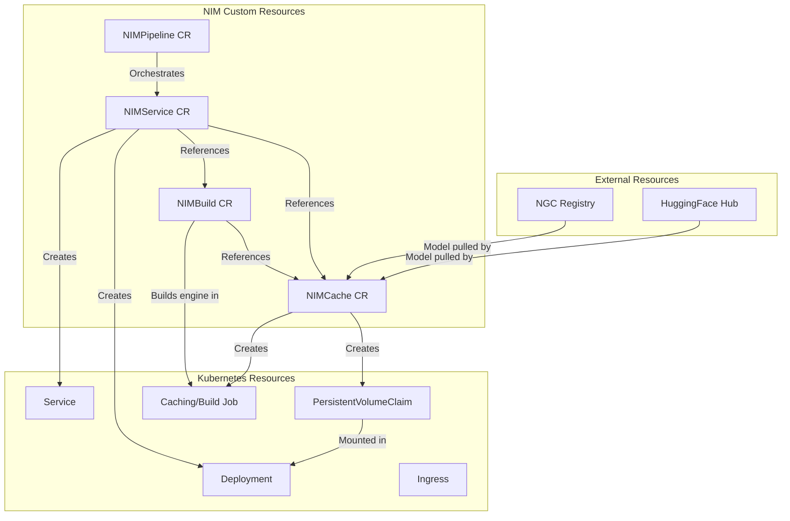
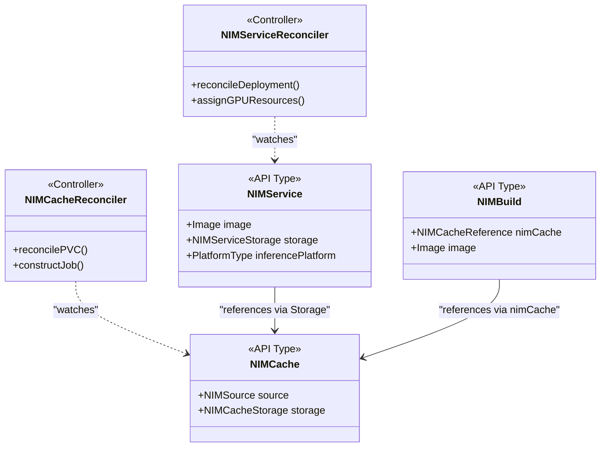

<!-- source: DeepWiki mcp.deepwiki.com · repo NVIDIA/k8s-nim-operator · page 4.1 NIM Resources · fetched 2026-10-26 -->

# NIM Resources

Relevant source files

The following files were used as context for generating this wiki page:

- [api/apps/v1alpha1/nimbuild_types.go](api/apps/v1alpha1/nimbuild_types.go)
- [api/apps/v1alpha1/nimcache_types.go](api/apps/v1alpha1/nimcache_types.go)
- [api/apps/v1alpha1/nimpipeline_types.go](api/apps/v1alpha1/nimpipeline_types.go)
- [api/apps/v1alpha1/nimservice_types.go](api/apps/v1alpha1/nimservice_types.go)

## Purpose and Scope

This document provides an overview of the core NVIDIA Inference Microservices (NIM) resources in the `k8s-nim-operator` and explains their relationships and interactions. These resources constitute the foundational building blocks for deploying AI inference services in Kubernetes. This page covers the high-level architecture and relationships between the main custom resources, while detailed information about each specific resource can be found in their respective documentation pages: [NIMService](#4.1.1), [NIMCache](#4.1.2), [NIMPipeline](#4.1.3), and [NIMBuild](#4.1.4).

## Resource Architecture Overview

The operator manages the lifecycle of NIM components by bridging high-level AI requirements (models, profiles, engines) with standard Kubernetes primitives (Deployments, Jobs, PVCs).

*Figure 1: NIM Resources Architecture and Relationships*

**Sources:**
- [api/apps/v1alpha1/nimcache_types.go:34-62]()
- [api/apps/v1alpha1/nimservice_types.go:97-142]()
- [api/apps/v1alpha1/nimbuild_types.go:30-46]()
- [api/apps/v1alpha1/nimpipeline_types.go:41-47]()

---

## Core NIM Resources

### NIMService
The `NIMService` is the primary resource for deploying an inference microservice. It manages the underlying `Deployment` and `Service` objects, handling complex logic like GPU resource allocation and inference platform selection (e.g., Standalone vs KServe).

- **Inference Platforms:** Supports `standalone` and `kserve` via `InferencePlatform` [api/apps/v1alpha1/nimservice_types.go:134-138]().
- **Multi-Node:** Supports multi-node deployments using `LeaderWorkerSet` (LWS) [api/apps/v1alpha1/nimservice_types.go:145-151]().
- **Scaling:** Integrates with `Autoscaling` for HPA management [api/apps/v1alpha1/nimservice_types.go:124-124]().

For details, see [NIMService](#4.1.1).

### NIMCache
`NIMCache` manages the "Model-to-Storage" lifecycle. It handles pulling model weights from sources like NVIDIA NGC, HuggingFace Hub, or NeMo DataStore and persisting them into a `PersistentVolumeClaim` (PVC).

- **Sources:** Supports `NGCSource`, `HuggingFaceHubSource`, and `NemoDataStoreSource` [api/apps/v1alpha1/nimcache_types.go:66-74]().
- **Profile Selection:** Can automatically cache specific profiles based on precision, engine (tensorrt_llm, vllm), and GPU SKU [api/apps/v1alpha1/nimcache_types.go:133-150]().

For details, see [NIMCache](#4.1.2).

### NIMPipeline
`NIMPipeline` provides orchestration for multi-step inference workflows. It defines a collection of `NIMService` instances and the dependencies between them.

- **Dependency Management:** Injects environment variables (endpoints, ports) into dependent services [api/apps/v1alpha1/nimpipeline_types.go:58-67]().
- **Lifecycle:** Aggregates states of all sub-services into a single pipeline state [api/apps/v1alpha1/nimpipeline_types.go:70-78]().

For details, see [NIMPipeline](#4.1.3).

### NIMBuild
`NIMBuild` is used for optimizing models by building TensorRT-LLM engines. It takes weights from a `NIMCache` and runs a build job to produce an optimized engine for specific hardware.

- **Inputs:** References a `NIMCache` and a specific profile [api/apps/v1alpha1/nimbuild_types.go:56-59]().
- **Output:** Produces an `OutputProfile` representing the built engine [api/apps/v1alpha1/nimbuild_types.go:49-54]().

For details, see [NIMBuild](#4.1.4).

---

## Resource Relationships in Code

The following diagram illustrates how the API types associate with specific controllers and logic within the codebase.

*Figure 2: Association of API Types to Controller Logic*

**Sources:**
- [api/apps/v1alpha1/nimcache_types.go:68-83]()
- [api/apps/v1alpha1/nimservice_types.go:105-105]()
- [api/apps/v1alpha1/nimbuild_types.go:32-32]()

---

## Status and Lifecycle

Each resource implements a standard state machine via its `.status.state` field and a `Conditions` array to report reconciliation progress.

| Resource | Key Status States | Condition Types |
|----------|-------------------|-----------------|
| **NIMCache** | `Pending`, `InProgress`, `Ready`, `Failed` | `NIMCacheConditionReady`, `NIMCacheConditionFailed` |
| **NIMService** | `Pending`, `NotReady`, `Ready`, `Failed` | `NIMServiceConditionReady`, `NIMServiceConditionFailed` |
| **NIMBuild** | `Started`, `InProgress`, `Ready`, `Failed` | `NimBuildConditionEngineBuildPodCompleted` |
| **NIMPipeline** | `NotReady`, `Ready`, `Failed` | `NIMPipelineConditionReady` |

**Sources:**
- [api/apps/v1alpha1/nimcache_types.go:152-164]()
- [api/apps/v1alpha1/nimservice_types.go:51-64]()
- [api/apps/v1alpha1/nimbuild_types.go:85-123]()
- [api/apps/v1alpha1/nimpipeline_types.go:26-38]()

---

