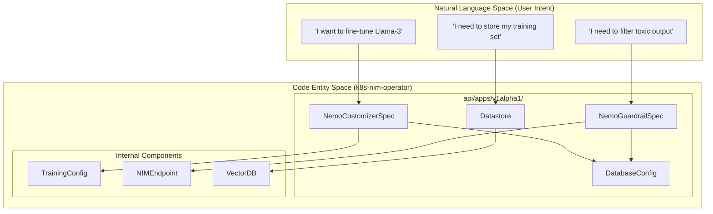
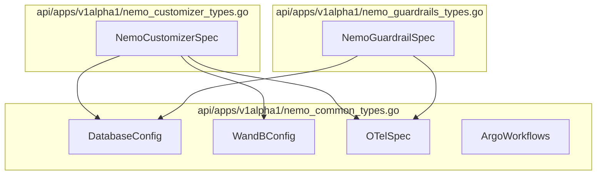

<!-- source: DeepWiki mcp.deepwiki.com · repo NVIDIA/k8s-nim-operator · page 4.2 NeMo Microservices · fetched 2026-10-26 -->

# NeMo Microservices

Relevant source files

The following files were used as context for generating this wiki page:

- [api/apps/v1alpha1/nemo_common_types.go](api/apps/v1alpha1/nemo_common_types.go)
- [api/apps/v1alpha1/nemo_customizer_types.go](api/apps/v1alpha1/nemo_customizer_types.go)
- [api/apps/v1alpha1/nemo_guardrails_types.go](api/apps/v1alpha1/nemo_guardrails_types.go)

## Purpose and Scope

This document provides an overview of NeMo-related Custom Resources managed by the `k8s-nim-operator`. These resources extend the operator's capabilities beyond basic inference serving to support advanced AI workflows including model customization, evaluation, safety guardrails, and data management.

For information about core NIM inference resources (NIMService, NIMCache, NIMPipeline), see [NIM Resources](#4.1). For detailed specifications of individual NeMo resources, refer to their respective subsections ([NemoCustomizer](#4.2.1), [NemoGuardrail](#4.2.2), [NemoEntitystore](#4.2.3), [NemoDatastore](#4.2.4), [NemoEvaluator](#4.2.5)).

**Sources:** [api/apps/v1alpha1/nemo_customizer_types.go:69-129](), [api/apps/v1alpha1/nemo_guardrails_types.go:62-97]()

---

## Overview

NeMo Microservices are Kubernetes Custom Resources that enable deployment and management of NVIDIA NeMo framework components on Kubernetes. While NIM resources focus on serving pre-trained models for inference, NeMo resources provide the tooling and infrastructure for the entire AI lifecycle, including:

- **Model Customization**: Fine-tuning and adapting foundation models for specific use cases.
- **Evaluation**: Assessing model performance and quality metrics.
- **Safety and Governance**: Implementing guardrails to ensure responsible AI deployment.
- **Data Management**: Managing entities and datasets for training and evaluation workflows.

All NeMo resources are part of the `apps.nvidia.com/v1alpha1` API group and share common configuration structures for external dependencies like databases, tracking services, and telemetry.

**Sources:** [api/apps/v1alpha1/nemo_common_types.go:19-160](), [api/apps/v1alpha1/nemo_customizer_types.go:42-67]()

---

## NeMo Resource Types

The operator manages five distinct NeMo Custom Resource types, each serving a specific purpose in the AI workflow:

| Resource | Purpose | API Group | Primary Configuration |
|----------|---------|-----------|-----------------------|
| `NemoCustomizer` | Model fine-tuning and customization workflows | `apps.nvidia.com/v1alpha1` | `TrainingConfig`, `WandBConfig`, `MLFlow` |
| `NemoEvaluator` | Model evaluation and performance assessment | `apps.nvidia.com/v1alpha1` | Evaluation jobs and metrics |
| `NemoGuardrail` | Safety guardrails and content filtering | `apps.nvidia.com/v1alpha1` | `NIMEndpoint`, `GuardrailConfig` |
| `NemoEntitystore` | Entity management for NeMo workflows | `apps.nvidia.com/v1alpha1` | `DatabaseConfig` |
| `NemoDatastore` | Data management and storage orchestration | `apps.nvidia.com/v1alpha1` | `DatabaseConfig`, `VectorDB` |

**Sources:** [api/apps/v1alpha1/nemo_customizer_types.go:72-129](), [api/apps/v1alpha1/nemo_guardrails_types.go:65-97](), [api/apps/v1alpha1/nemo_common_types.go:27-53]()

---

## Architecture Integration

The following diagram illustrates how NeMo resources bridge the gap between high-level AI requirements and the underlying code entities that manage them:

**Diagram: Mapping User Intent to Code Entities**

**Sources:** [api/apps/v1alpha1/nemo_customizer_types.go:72-129](), [api/apps/v1alpha1/nemo_guardrails_types.go:65-97](), [api/apps/v1alpha1/nemo_common_types.go:56-79]()

---

## API Structure and Code Organization

NeMo resources utilize a shared set of types defined in `nemo_common_types.go` to maintain consistency across different microservices.

**Diagram: Shared Code Dependencies**

**Sources:** [api/apps/v1alpha1/nemo_common_types.go:56-160](), [api/apps/v1alpha1/nemo_customizer_types.go:122-129](), [api/apps/v1alpha1/nemo_guardrails_types.go:92-97]()

---

## Common Patterns

### External Service Integration
NeMo microservices frequently interact with external infrastructure. The operator provides standardized Go structs for these connections:

| Code Entity | Purpose | Key Fields |
|-------------|---------|------------|
| `DatabaseConfig` | External Postgres/SQL storage | `Host`, `Port`, `DatabaseName`, `Credentials` |
| `WandBConfig` | Weights & Biases experiment tracking | `SecretName`, `ProjectName`, `Entity` |
| `OTelSpec` | OpenTelemetry observability | `ExporterOtlpEndpoint`, `LogLevel`, `ExporterConfig` |
| `ArgoWorkflows` | Workflow orchestration | `Endpoint`, `ServiceAccount` |

**Sources:** [api/apps/v1alpha1/nemo_common_types.go:19-160]()

### Resource Lifecycle and Status
All NeMo resources implement a standard status pattern to track readiness:
- **Ready**: Service is fully operational.
- **Pending**: Resources are being provisioned.
- **Failed**: A terminal error has occurred.

For instance, `NemoGuardrail` uses `NemoGuardrailStatus` to track `AvailableReplicas` and `Conditions`.

**Sources:** [api/apps/v1alpha1/nemo_guardrails_types.go:44-60](), [api/apps/v1alpha1/nemo_guardrails_types.go:127-132]()

---

## Relationship to NIM Resources

NeMo resources act as the control and safety plane for NIM inference services. 

- **Customization**: `NemoCustomizer` uses `TrainingConfig` to produce fine-tuned models that are eventually served by a `NIMService`.
- **Safety**: `NemoGuardrail` acts as a proxy/wrapper around a `NIMEndpoint` (defined by its `BaseURL`) to provide content filtering.
- **Data**: `NemoDatastore` and `NemoEntitystore` provide the stateful backend for RAG (Retrieval-Augmented Generation) workflows served via NIM.

**Sources:** [api/apps/v1alpha1/nemo_customizer_types.go:132-159](), [api/apps/v1alpha1/nemo_guardrails_types.go:99-117]()

---

## Next Steps

For detailed specifications of individual NeMo resources, including their full API schemas, configuration options, and usage examples, refer to:

- [NemoCustomizer](#4.2.1) — Documentation for model customization workflows.
- [NemoGuardrail](#4.2.2) — Reference for implementing safety guardrails on AI models.
- [NemoEntitystore](#4.2.3) — Documentation for entity management in NeMo workflows.
- [NemoDatastore](#4.2.4) — Reference for data management in NeMo services.
- [NemoEvaluator](#4.2.5) — Documentation for model evaluation workflows.

**Sources:** [api/apps/v1alpha1/nemo_customizer_types.go:1-129](), [api/apps/v1alpha1/nemo_guardrails_types.go:1-97]()

---

