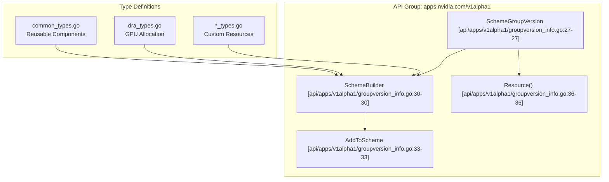
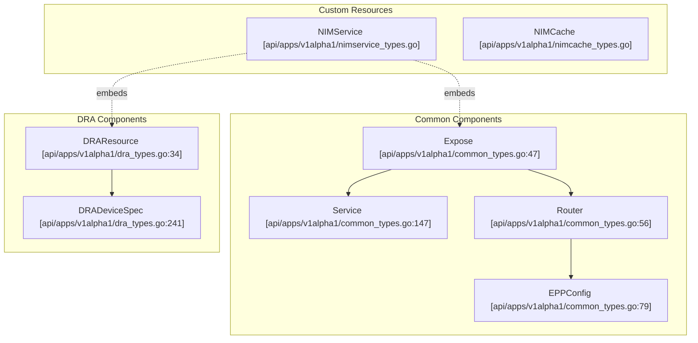

<!-- source: DeepWiki mcp.deepwiki.com · repo NVIDIA/k8s-nim-operator · page 5 API Reference · fetched 2026-10-26 -->

# API Reference

Relevant source files

The following files were used as context for generating this wiki page:

- [api/apps/v1alpha1/common_types.go](api/apps/v1alpha1/common_types.go)
- [api/apps/v1alpha1/dra_types.go](api/apps/v1alpha1/dra_types.go)
- [api/versioned/clientset.go](api/versioned/clientset.go)

This section provides detailed reference documentation for the API types defined by the k8s-nim-operator. It covers reusable components that are embedded in custom resource specifications, enabling consistent configuration patterns across all operator-managed resources.

The API types are organized into two main categories:
- **Common Types** ([Common Types](#5.1)): Reusable configuration structures for service exposure, metrics, autoscaling, image specifications, and persistent storage.
- **Dynamic Resource Allocation** ([Dynamic Resource Allocation](#5.2)): Types for GPU allocation and device selection using Kubernetes DRA.

For documentation of specific custom resources that use these types (such as `NIMService` and `NIMCache`), see [Custom Resources](#4).

---

## API Group Structure

All operator API types belong to the `apps.nvidia.com` API group with version `v1alpha1`. This follows Kubernetes conventions for custom API extensions.

**Group Version Information:**

| Field | Value |
|-------|-------|
| API Group | `apps.nvidia.com` |
| Version | `v1alpha1` |
| Go Package | `github.com/NVIDIA/k8s-nim-operator/api/apps/v1alpha1` |
| Kubebuilder Generation | Enabled |

The API group structure is defined in [api/apps/v1alpha1/groupversion_info.go:19-41](), which establishes the schema registration and resource helpers used throughout the operator codebase.

### Code-to-System Mapping: API Scheme

**Sources:** [api/apps/v1alpha1/groupversion_info.go:17-41]()

---

## Type Categories Overview

The operator defines two primary categories of API types that are embedded within custom resource specifications.

### Common Types

Common types provide reusable configuration structures that appear across multiple custom resources. These types promote consistency and reduce duplication in API design.

**Primary Common Types:**

| Type | Purpose | Defined At |
|------|---------|-----------|
| `Expose` | Service exposure via Service/Router/Ingress | [api/apps/v1alpha1/common_types.go:47-53]() |
| `Service` | Kubernetes Service configuration | [api/apps/v1alpha1/common_types.go:147-170]() |
| `Router` | Ingress and Gateway routing | [api/apps/v1alpha1/common_types.go:56-76]() |
| `EPPConfig` | Endpoint Picker Extension configuration | [api/apps/v1alpha1/common_types.go:79-106]() |
| `Gateway` | Gateway API integration | [api/apps/v1alpha1/common_types.go:117-136]() |

For detailed documentation of these types, see [Common Types](#5.1).

**Sources:** [api/apps/v1alpha1/common_types.go:1-170]()

### Dynamic Resource Allocation Types

DRA types enable advanced GPU allocation using the Kubernetes Dynamic Resource Allocation (DRA) API. These types allow fine-grained device selection based on attributes, capacity, and CEL expressions.

**Primary DRA Types:**

| Type | Purpose | Defined At |
|------|---------|-----------|
| `DRAResource` | ResourceClaim reference or template | [api/apps/v1alpha1/dra_types.go:34-72]() |
| `DRAClaimCreationSpec` | Auto-generated claim template spec | [api/apps/v1alpha1/dra_types.go:272-280]() |
| `DRADeviceSpec` | Device selection criteria | [api/apps/v1alpha1/dra_types.go:241-269]() |
| `DRADeviceAttributeSelector` | Attribute-based device filtering | [api/apps/v1alpha1/dra_types.go:150-170]() |

For detailed documentation of these types, see [Dynamic Resource Allocation](#5.2).

**Sources:** [api/apps/v1alpha1/dra_types.go:1-280]()

---

## Type Composition and Reusability

Common types are designed as composable building blocks that are embedded within custom resource specifications.

### Code-to-System Mapping: Resource Embedding

**Sources:** [api/apps/v1alpha1/common_types.go:47-147](), [api/apps/v1alpha1/dra_types.go:34-241]()

---

## Constants and Default Values

The operator defines several constants for default port numbers and environment variable names used throughout the codebase.

**Port Constants:**

| Constant | Value | Purpose | Defined At |
|----------|-------|---------|------------|
| `DefaultAPIPort` | `8000` | Default API server port | [api/apps/v1alpha1/common_types.go:33]() |
| `DefaultNamedPortAPI` | `"api"` | Named port for API endpoint | [api/apps/v1alpha1/common_types.go:35]() |
| `DefaultNamedPortGRPC` | `"grpc"` | Named port for GRPC endpoint | [api/apps/v1alpha1/common_types.go:37]() |
| `DefaultNamedPortMetrics` | `"metrics"` | Named port for metrics endpoint | [api/apps/v1alpha1/common_types.go:39]() |

**Environment Variable Constants:**

| Constant | Value | Purpose | Defined At |
|----------|-------|---------|------------|
| `NGCAPIKey` | `"NGC_API_KEY"` | NVIDIA GPU Cloud API key | [api/apps/v1alpha1/common_types.go:41]() |
| `HFToken` | `"HF_TOKEN"` | Hugging Face authentication token | [api/apps/v1alpha1/common_types.go:43]() |

**Sources:** [api/apps/v1alpha1/common_types.go:31-44]()

---

## Service Exposure Patterns

The `Expose` type provides multiple patterns for exposing services. It supports three routing mechanisms that can be configured based on cluster capabilities.

**Routing Validation Rules:**

The `Router` type enforces mutual exclusivity between `ingress` and `gateway` using CEL validation at [api/apps/v1alpha1/common_types.go:55](). This ensures users configure only one routing mechanism per service.

**Endpoint Picker Extension (EPP):**

The `EPPConfig` type at [api/apps/v1alpha1/common_types.go:79]() allows configuring the standalone inference platform extensions for NIMService. It supports providing configuration via a `ConfigMapRef` or directly as a structured `Config` object [api/apps/v1alpha1/common_types.go:91-105]().

**Sources:** [api/apps/v1alpha1/common_types.go:47-106]()

---

## Validation and CEL Expressions

The operator leverages Kubernetes CEL (Common Expression Language) validation to enforce API constraints at the schema level.

**Key Validation Patterns:**

| Type | Validation Rule | Location |
|------|----------------|----------|
| `Router` | Ingress and Gateway mutual exclusivity | [api/apps/v1alpha1/common_types.go:55]() |
| `EPPConfig` | Specify either `configMapRef` or `config`, not both | [api/apps/v1alpha1/common_types.go:78]() |
| `DRAResource` | Exactly one of `resourceClaimName`, `resourceClaimTemplateName`, or `claimCreationSpec` | [api/apps/v1alpha1/dra_types.go:33]() |
| `DRADeviceSpec` | Mutual exclusivity between CEL and standard selectors | [api/apps/v1alpha1/dra_types.go:240]() |

**Sources:** [api/apps/v1alpha1/common_types.go:55-78](), [api/apps/v1alpha1/dra_types.go:33-240]()

---

## Client Generation

The operator includes a generated versioned clientset for interacting with these API types programmatically.

**Clientset Interface:**

The `Interface` at [api/versioned/clientset.go:30-33]() provides access to the `AppsV1alpha1` client. This client is used by the controllers to perform CRUD operations on the Custom Resources.

**Sources:** [api/versioned/clientset.go:1-120]()

---

## Next Steps

For detailed documentation of specific type categories:
- **Common Types**: See [Common Types](#5.1) for complete specifications of `Expose`, `Service`, `Router`, and `Gateway` types.
- **Dynamic Resource Allocation**: See [Dynamic Resource Allocation](#5.2) for GPU allocation types including `DRAResource`, `DRADeviceSpec`, and CEL selection logic.

---

