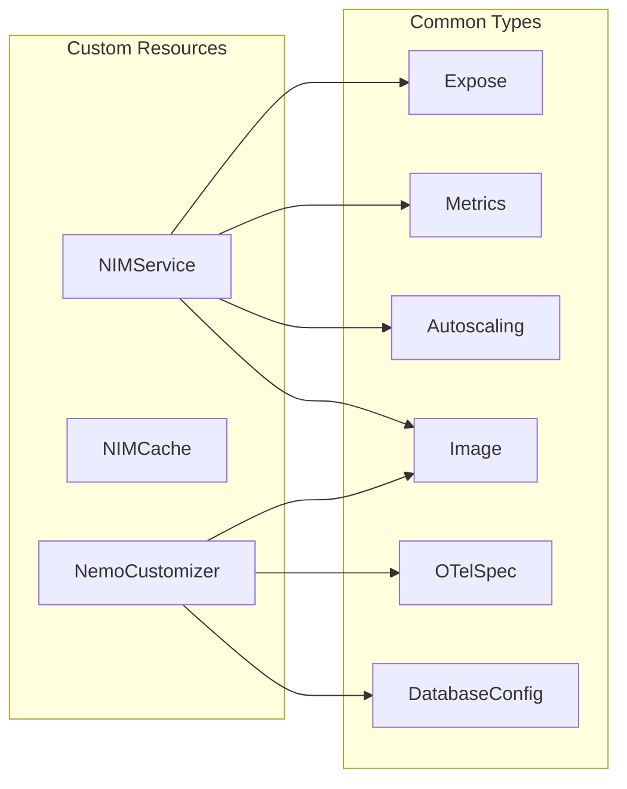

<!-- source: DeepWiki mcp.deepwiki.com · repo NVIDIA/k8s-nim-operator · page 5.1 Common Types · fetched 2026-10-26 -->

# Common Types

<details>
<summary>Relevant source files</summary>

The following files were used as context for generating this wiki page:

- [api/apps/v1alpha1/common_types.go](api/apps/v1alpha1/common_types.go)
- [api/apps/v1alpha1/nemo_common_types.go](api/apps/v1alpha1/nemo_common_types.go)
- [api/apps/v1alpha1/zz_generated.deepcopy.go](api/apps/v1alpha1/zz_generated.deepcopy.go)
- [api/listers/apps/v1alpha1/expansion_generated.go](api/listers/apps/v1alpha1/expansion_generated.go)
- [api/versioned/typed/apps/v1alpha1/generated_expansion.go](api/versioned/typed/apps/v1alpha1/generated_expansion.go)

</details>


This page documents the reusable API types defined in `api/apps/v1alpha1/common_types.go` and `api/apps/v1alpha1/nemo_common_types.go` that are embedded across multiple Custom Resource Definitions (CRDs) in the k8s-nim-operator. These types provide consistent configuration interfaces for networking, observability, autoscaling, storage, and authentication across all managed resources.

For Dynamic Resource Allocation (DRA) types used for GPU allocation, see [5.2 Dynamic Resource Allocation]().

**Sources:** [api/apps/v1alpha1/common_types.go:1-44](), [api/apps/v1alpha1/nemo_common_types.go:1-18]()

---

## Overview

Common types are reusable Go structs that implement cross-cutting concerns. They are embedded in CRD specs (NIMService, NIMCache, etc.) to maintain API consistency. The types fall into several functional categories:

1. **Network Exposure** - Service, Router, Ingress, Gateway configuration.
2. **Observability** - Metrics, ServiceMonitor, and OpenTelemetry (OTel) settings.
3. **Autoscaling** - HorizontalPodAutoscaler configuration.
4. **Container Configuration** - Image, ResourceRequirements, Probe specifications.
5. **Storage** - PersistentVolumeClaim and external Datastore management.
6. **Security & Authentication** - Secret references for NGC, Hugging Face, and external Databases.

### Type Hierarchy

```mermaid
graph TB
    subgraph "Network Exposure"
        Expose["Expose"]
        Router["Router"]
        Service["Service"]
        RouterIngress["RouterIngress"]
        Gateway["Gateway"]
        EPPConfig["EPPConfig"]
    end
    
    subgraph "Observability"
        Metrics["Metrics"]
        ServiceMonitor["ServiceMonitor"]
        OTelSpec["OTelSpec"]
        ExporterConfig["ExporterConfig"]
    end
    
    subgraph "Autoscaling"
        Autoscaling["Autoscaling"]
        HorizontalPodAutoscalerSpec["HorizontalPodAutoscalerSpec"]
    end
    
    subgraph "External Services"
        DatabaseConfig["DatabaseConfig"]
        WandBConfig["WandBConfig"]
        ArgoWorkflows["ArgoWorkflows"]
    end
    
    Expose --> Service
    Expose --> Router
    
    Router --> RouterIngress
    Router --> Gateway
    Router --> EPPConfig
    
    Metrics --> ServiceMonitor
    OTelSpec --> ExporterConfig
    Autoscaling --> HorizontalPodAutoscalerSpec
```

**Sources:** [api/apps/v1alpha1/common_types.go:45-132](), [api/apps/v1alpha1/nemo_common_types.go:133-181]()

### Usage in Custom Resources



**Sources:** [api/apps/v1alpha1/common_types.go:1-451](), [api/apps/v1alpha1/nemo_common_types.go:1-188]()

---

## Network Exposure Types

Network exposure types configure how services are made accessible. The operator supports Kubernetes Services, Ingress controllers, and the Gateway API.

### Expose

The `Expose` struct is the top-level type for network exposure configuration.

| Field | Type | Description |
|-------|------|-------------|
| `service` | `Service` | Kubernetes Service configuration |
| `router` | `Router` | Modern routing via Ingress or Gateway API |

**Sources:** [api/apps/v1alpha1/common_types.go:46-53]()

### Service

Defines attributes for creating a Kubernetes Service.

| Field | Type | Default | Description |
|-------|------|---------|-------------|
| `type` | `corev1.ServiceType` | - | Service type (ClusterIP, etc.) |
| `port` | `*int32` | `8000` | Main API serving port |
| `grpcPort` | `*int32` | - | GRPC port for Triton Inference Server |
| `metricsPort` | `*int32` | - | Metrics endpoint port |

**Sources:** [api/apps/v1alpha1/common_types.go:147-170]()

### Router

The `Router` type provides routing configuration supporting both Ingress and Gateway API. It includes the `EPPConfig` for advanced inference platform extensions.

| Field | Type | Description |
|-------|------|-------------|
| `hostDomainName` | `string` | Domain suffix for hostname construction |
| `ingress` | `*RouterIngress` | Ingress controller configuration |
| `gateway` | `*Gateway` | Gateway API configuration |
| `eppConfig` | `*EPPConfig` | Endpoint picker extension configuration |

**Sources:** [api/apps/v1alpha1/common_types.go:56-76]()

#### EPPConfig

`EPPConfig` configures the Endpoint Picker extension, currently supported for standalone inference platforms on `NIMService`. It allows referencing an existing `ConfigMap` or defining the configuration inline via `apixv1alpha1.EndpointPickerConfig`.

**Sources:** [api/apps/v1alpha1/common_types.go:79-106]()

---

## NeMo Common Types

Specific types for NeMo microservices are defined in `api/apps/v1alpha1/nemo_common_types.go`. These handle connections to external databases, tracking services, and telemetry.

### Database Configuration

#### DatabaseConfig

Used to connect NeMo services to external databases.

| Field | Type | Default | Description |
|-------|------|---------|-------------|
| `host` | `string` | - | Database hostname |
| `port` | `int32` | `5432` | Database port |
| `databaseName` | `string` | - | Name of the database |
| `credentials` | `DatabaseCredentials` | - | Credentials reference |

**Sources:** [api/apps/v1alpha1/nemo_common_types.go:56-79]()

#### DatabaseCredentials

References a Kubernetes Secret for database authentication.

| Field | Type | Default | Description |
|-------|------|---------|-------------|
| `user` | `string` | - | Database username |
| `secretName` | `string` | - | Name of the secret |
| `passwordKey` | `string` | `"password"` | Key in the secret for the password |

**Sources:** [api/apps/v1alpha1/nemo_common_types.go:82-98]()

### Observability & Tracking

#### OTelSpec

Configures OpenTelemetry for distributed tracing and metrics.

| Field | Type | Default | Description |
|-------|------|---------|-------------|
| `enabled` | `*bool` | - | Enable OTel collector and tracing |
| `exporterOtlpEndpoint`| `string` | - | OTLP collector endpoint |
| `exporterConfig` | `ExporterConfig`| - | Settings for traces, metrics, and logs exporters |

**Sources:** [api/apps/v1alpha1/nemo_common_types.go:134-160]()

#### WandBConfig

Configuration for Weights & Biases (WandB) tracking for model training/customization.

| Field | Type | Default | Description |
|-------|------|---------|-------------|
| `secretName` | `string` | - | Secret containing WandB API key |
| `projectName` | `string` | `"nvidia-nemo-customizer"`| WandB project name |
| `entity` | `*string` | - | WandB team or username |

**Sources:** [api/apps/v1alpha1/nemo_common_types.go:101-131]()

---

## Infrastructure Integration Types

These types facilitate integration with external workflow and storage engines.

| Type | Field | Description |
|------|-------|-------------|
| `ArgoWorkflows` | `endpoint` | Connection string for Argo Workflows |
| `VectorDB` | `endpoint` | Connection string for external Vector Database |
| `Datastore` | `endpoint` | Connection string for NeMo Datastore |
| `Entitystore` | `endpoint` | Connection string for NeMo EntityStore |
| `MLFlow` | `endpoint` | Connection string for MLFlow tracking |

**Sources:** [api/apps/v1alpha1/nemo_common_types.go:19-53]()

---

## Storage and Persistence

### PersistentVolumeClaim

Configures storage for NIM and NeMo resources.

| Field | Type | Description |
|-------|------|-------------|
| `create` | `*bool` | Whether to create a new PVC |
| `name` | `string` | Name of the PVC (existing or to be created) |
| `storageClass` | `string` | StorageClass for the PVC |
| `size` | `string` | Storage capacity request |

**Sources:** [api/apps/v1alpha1/common_types.go:432-450]()

---

## DeepCopy Implementation

The operator uses autogenerated `DeepCopy` methods to handle resource cloning during reconciliation loops. These are defined in `api/apps/v1alpha1/zz_generated.deepcopy.go`.

**Key Entities:**
- `func (in *Autoscaling) DeepCopyInto(out *Autoscaling)`: Handles deep copies of HPA specs and annotations. [api/apps/v1alpha1/zz_generated.deepcopy.go:49-64]()
- `func (in *DatabaseConfig) DeepCopyInto(out *DatabaseConfig)`: Handles database configuration cloning. [api/apps/v1alpha1/zz_generated.deepcopy.go:343-347]()

**Sources:** [api/apps/v1alpha1/zz_generated.deepcopy.go:1-347]()

---

