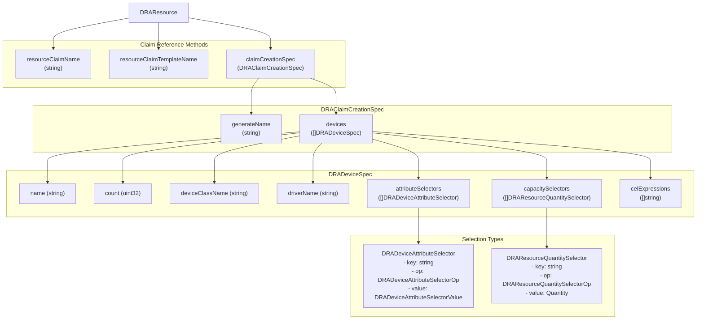
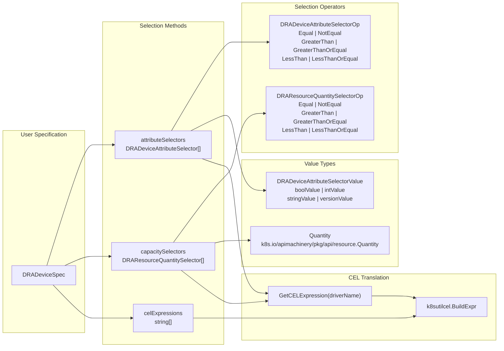
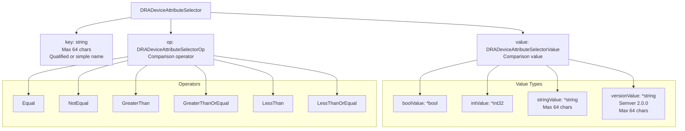
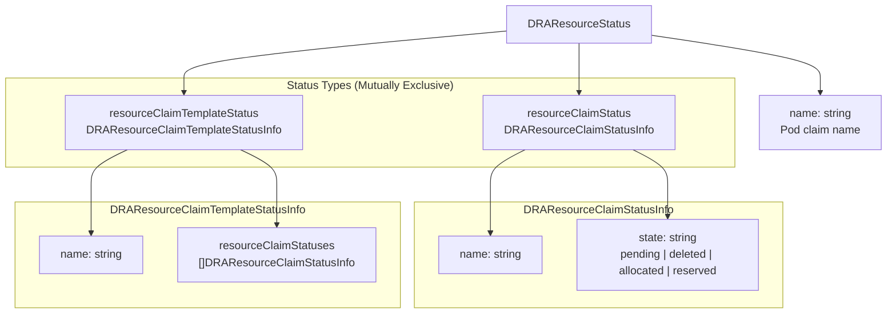

<!-- source: DeepWiki mcp.deepwiki.com · repo NVIDIA/k8s-nim-operator · page 5.2 Dynamic Resource Allocation · fetched 2026-10-26 -->

# Dynamic Resource Allocation

Relevant source files

The following files were used as context for generating this wiki page:

- [api/apps/v1alpha1/dra_types.go](api/apps/v1alpha1/dra_types.go)
- [api/informers/externalversions/factory.go](api/informers/externalversions/factory.go)
- [api/informers/externalversions/generic.go](api/informers/externalversions/generic.go)
- [api/informers/externalversions/internalinterfaces/factory_interfaces.go](api/informers/externalversions/internalinterfaces/factory_interfaces.go)
- [api/versioned/clientset.go](api/versioned/clientset.go)

## Purpose and Scope

This document provides a complete reference for Dynamic Resource Allocation (DRA) types in the `k8s-nim-operator`. DRA enables fine-grained GPU resource allocation for NIM workloads by leveraging Kubernetes' Dynamic Resource Allocation API. This allows the operator to request specific GPU devices based on attributes (e.g., product name, memory) and capacity constraints.

For general API types like `Expose`, `Metrics`, and `Autoscaling`, see [Common Types](5.1). For information on how `NIMService` uses DRA resources, see [NIMService](4.1.1).

---

## Overview

Dynamic Resource Allocation in the `k8s-nim-operator` provides three methods for managing GPU resource claims:

1.  **Direct ResourceClaim reference** - Reference an existing `ResourceClaim` object.
2.  **ResourceClaimTemplate reference** - Reference a `ResourceClaimTemplate` that generates claims.
3.  **Automatic claim generation** - Specify device requirements and let the operator generate the claim template.

The DRA system translates high-level device requirements into Kubernetes `ResourceClaims` that are bound to `NIMService` pods, ensuring that workloads receive GPU devices matching their specifications.

**Sources:** [api/apps/v1alpha1/dra_types.go:28-72]()

---

## DRA Type Hierarchy

**Sources:** [api/apps/v1alpha1/dra_types.go:28-281]()

---

## DRAResource Configuration

The `DRAResource` type is the primary interface for configuring GPU allocation in `NIMService` workloads. It enforces mutual exclusivity between the three claim reference methods through validation rules.

### Field Reference

| Field | Type | Description |
| :--- | :--- | :--- |
| `resourceClaimName` | `*string` | Name of an existing `ResourceClaim` in the same namespace. |
| `resourceClaimTemplateName` | `*string` | Name of an existing `ResourceClaimTemplate`. |
| `claimCreationSpec` | `*DRAClaimCreationSpec` | Specification for auto-generating a claim template. |
| `requests` | `[]string` | List of request names from the claim to make available to pods. |

### Validation Rules

The `DRAResource` type enforces that exactly one of `resourceClaimName`, `resourceClaimTemplateName`, or `claimCreationSpec` must be set via a CEL validation rule: [api/apps/v1alpha1/dra_types.go:33-33]().

### Request Filtering

The optional `requests` field [api/apps/v1alpha1/dra_types.go:71-71]() allows filtering which requests from the claim are made available to the `NIMService` pods. If empty, all requests from the claim are available.

**Sources:** [api/apps/v1alpha1/dra_types.go:28-72]()

---

## Device Selection Architecture

**Sources:** [api/apps/v1alpha1/dra_types.go:74-270]()

---

## Device Attribute Selection

Device attribute selectors allow filtering GPU devices based on their advertised attributes. The operator translates these selectors into CEL expressions that the Kubernetes DRA driver evaluates.

### DRADeviceAttributeSelector Structure

### Attribute Key Resolution

Attribute keys can be:
*   **Qualified**: `gpu.nvidia.com/productName` - Uses the full domain.
*   **Simple**: `productName` - Automatically prefixed with the driver name (default: `gpu.nvidia.com`).

The resolution logic is implemented in `GetCELExpression` [api/apps/v1alpha1/dra_types.go:172-176]().

### Supported Operators

Operators are defined by the `DRADeviceAttributeSelectorOp` enum [api/apps/v1alpha1/dra_types.go:119-128]().

| Operator | Description | Applicable Types |
| :--- | :--- | :--- |
| `Equal` | Exact match | All types |
| `NotEqual` | Non-match | All types |
| `GreaterThan` | Numeric/version greater than | `int`, `version` |
| `GreaterThanOrEqual` | Numeric/version greater or equal | `int`, `version` |
| `LessThan` | Numeric/version less than | `int`, `version` |
| `LessThanOrEqual` | Numeric/version less or equal | `int`, `version` |

### Value Type Mapping

The `GetValueType()` method [api/apps/v1alpha1/dra_types.go:103-116]() maps selector values to `k8sutilcel` types:

| Field Set | CEL Type | Example Usage |
| :--- | :--- | :--- |
| `boolValue` | `TypeBool` | Feature flags (e.g., MIG enabled) |
| `intValue` | `TypeInt` | Numeric attributes (e.g., compute capability) |
| `stringValue` | `TypeString` | String attributes (e.g., product name) |
| `versionValue` | `TypeSemver` | Version comparisons (e.g., driver version) |

**Sources:** [api/apps/v1alpha1/dra_types.go:74-176]()

---

## Device Capacity Selection

Capacity selectors filter devices based on their resource capacity (e.g., memory, compute units). Unlike attribute selectors that match device properties, capacity selectors match quantified resources.

### DRAResourceQuantitySelector Structure

| Field | Type | Description |
| :--- | :--- | :--- |
| `key` | `string` | Resource name (qualified or simple), max 64 chars. |
| `op` | `DRAResourceQuantitySelectorOp` | Comparison operator (default: `Equal`). |
| `value` | `*apiresource.Quantity` | Resource quantity to compare against. |

### CEL Expression Generation

The capacity selector generates CEL expressions using the device capacity map via `GetCELExpression` [api/apps/v1alpha1/dra_types.go:234-238]().

**Sources:** [api/apps/v1alpha1/dra_types.go:209-238]()

---

## DRADeviceSpec Configuration

The `DRADeviceSpec` type [api/apps/v1alpha1/dra_types.go:241-269]() defines the requirements for a single device request within a resource claim.

### Field Reference

| Field | Type | Required | Default | Description |
| :--- | :--- | :--- | :--- | :--- |
| `name` | `string` | Yes | - | DNS_LABEL format name for the device request. |
| `count` | `uint32` | No | `1` | Number of devices to request. |
| `deviceClassName` | `string` | No | `gpu.nvidia.com` | `DeviceClass` to inherit configuration from. |
| `driverName` | `string` | No | `gpu.nvidia.com` | DRA driver providing capacity information. |
| `attributeSelectors` | `[]DRADeviceAttributeSelector` | No | `[]` | Device attribute filters (max 20). |
| `capacitySelectors` | `[]DRAResourceQuantitySelector` | No | `[]` | Device capacity filters (max 12). |
| `celExpressions` | `[]string` | No | `[]` | Raw CEL expressions for device matching. |

### Validation Constraints

The type enforces mutual exclusivity between selector types [api/apps/v1alpha1/dra_types.go:240-240]():
*   Use either `celExpressions` alone.
*   OR use `attributeSelectors` and/or `capacitySelectors` together.

**Sources:** [api/apps/v1alpha1/dra_types.go:240-269]()

---

## Automatic Claim Template Generation

The `DRAClaimCreationSpec` [api/apps/v1alpha1/dra_types.go:271-281]() enables automatic generation of `ResourceClaimTemplate` objects.

### Name Generation Logic

The `GetNamePrefix()` method [api/apps/v1alpha1/dra_types.go:282-288]() determines the name prefix for generated templates. If `generateName` is not specified, the default prefix `"claimtemplate"` is used.

**Sources:** [api/apps/v1alpha1/dra_types.go:271-288]()

---

## DRA Status Tracking

The status object tracks the lifecycle of DRA resources in the `NIMService` [api/apps/v1alpha1/dra_types.go:290-303]().

### DRAResourceStatus Structure

### Resource Claim States

| State | Description |
| :--- | :--- |
| `pending` | `ResourceClaim` is pending allocation by the DRA driver. |
| `deleted` | `ResourceClaim` has deletion timestamp but not yet finalized. |
| `allocated` | `ResourceClaim` is allocated and ready for use. |
| `reserved` | `ResourceClaim` is consumed by a pod. |

**Sources:** [api/apps/v1alpha1/dra_types.go:290-326]()

---

## CEL Expression Construction

The operator translates high-level selectors into Common Expression Language (CEL) expressions.

### Operator Mapping

Both attribute and capacity selectors use identical operator-to-CEL mappings [api/apps/v1alpha1/dra_types.go:130-147]() [api/apps/v1alpha1/dra_types.go:190-207]():

| Selector Operator | CEL Operator | `k8sutilcel` Constant |
| :--- | :--- | :--- |
| `Equal` | `==` | `OpEqual` |
| `NotEqual` | `!=` | `OpNotEqual` |
| `GreaterThan` | `>` | `OpGreater` |
| `GreaterThanOrEqual` | `>=` | `OpGreaterOrEqual` |
| `LessThan` | `<` | `OpLess` |
| `LessThanOrEqual` | `<=` | `OpLessOrEqual` |

**Sources:** [api/apps/v1alpha1/dra_types.go:130-147](), [api/apps/v1alpha1/dra_types.go:172-176](), [api/apps/v1alpha1/dra_types.go:190-207](), [api/apps/v1alpha1/dra_types.go:234-238]()

---

## Integration with NIMService

The DRA system integrates with `NIMService` through pod-level resource claims. When creating `NIMService` pods, the operator adds a unique name in `DNS_LABEL` format to identify the DRA resource [api/apps/v1alpha1/dra_types.go:31-32]().

The `DRAResourceStatus` [api/apps/v1alpha1/dra_types.go:290-303]() allows the operator to track the binding of these resources to the underlying Kubernetes `ResourceClaim` or `ResourceClaimTemplate`.

**Sources:** [api/apps/v1alpha1/dra_types.go:28-33](), [api/apps/v1alpha1/dra_types.go:290-303]()

---

