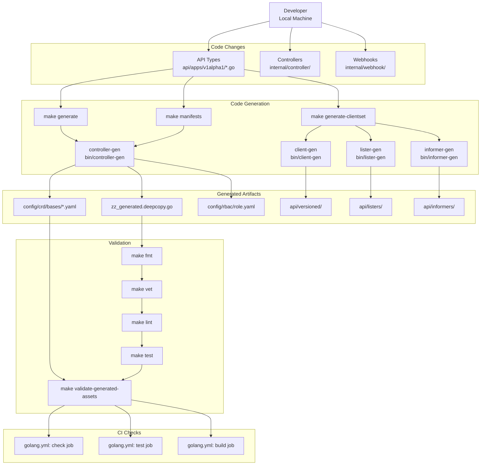
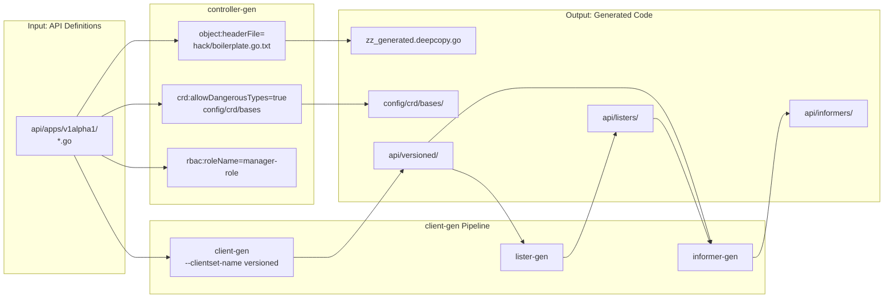

<!-- source: DeepWiki mcp.deepwiki.com · repo NVIDIA/k8s-nim-operator · page 6 Development · fetched 2026-10-26 -->

# Development

Relevant source files

The following files were used as context for generating this wiki page:

- [.github/workflows/golang.yml](.github/workflows/golang.yml)
- [.golangci.yaml](.golangci.yaml)
- [Makefile](Makefile)

This page provides guidance for developers working on the k8s-nim-operator codebase. It covers the build system, code generation pipeline, local development setup, testing workflows, and code quality standards. This page focuses on day-to-day development tasks and the tools that support them.

For information about building and packaging container images, see [Building the Operator](#6.1). For testing strategies and frameworks, see [Testing](#6.2). For code quality tools and linting configuration, see [Code Quality](#6.3).

## Overview

The k8s-nim-operator follows a Kubebuilder-based development workflow where API types drive code generation. The project uses a comprehensive Makefile to orchestrate builds, code generation, testing, and validation. All development workflows are validated through GitHub Actions CI before merging.

**Sources:** [Makefile:1-176](), [.github/workflows/golang.yml:1-113]()

## Development Workflow

The following diagram illustrates the complete development workflow from code changes to validation:

**Sources:** [Makefile:80-111](), [Makefile:113-128](), [.github/workflows/golang.yml:25-60]()

## Prerequisites

Before starting development, ensure you have the following installed:

| Tool | Minimum Version | Purpose |
|------|----------------|---------|
| Go | Determined by `hack/golang-version.sh` | Primary language runtime |
| Docker or Podman | Latest stable | Container building (set via `CONTAINER_TOOL`) |
| kubectl | 1.30+ | Kubernetes cluster interaction |
| make | 3.81+ | Build orchestration |

The project uses a standard `GOPATH/bin` or `GOBIN` path for local tools. The `CONTAINER_TOOL` variable defaults to `docker` but can be overridden.

**Sources:** [Makefile:18-35](), [.github/workflows/golang.yml:33-41](), [.github/workflows/golang.yml:73-78]()

## Code Generation Pipeline

The operator uses multiple code generators to maintain consistency between API definitions and generated artifacts. The pipeline uses `controller-gen` for CRDs and DeepCopy, and the Kubernetes client-gen tools for typed clients.

**Sources:** [Makefile:80-108]()

## Makefile Target Reference

The Makefile provides numerous targets for different development tasks. Key targets are organized by category:

### Code Generation Targets

| Target | Description | Dependencies |
|--------|-------------|--------------|
| `manifests` | Generate CRDs, RBAC, and webhook configurations | `controller-gen` |
| `generate` | Generate DeepCopy implementations | `controller-gen` |
| `generate-clientset` | Generate client-go components (clientset, listers, informers) | `install-tools` |
| `validate-generated-assets` | Verify generated code matches API definitions | `manifests`, `generate`, `generate-clientset`, `sync-crds` |

### Validation Targets

| Target | Description | Output |
|--------|-------------|--------|
| `check-vendor` | Verify Go modules are up-to-date | `vendor` |
| `fmt` | Format Go code using `go fmt` | In-place formatting |
| `vet` | Run Go static analysis | Reports potential issues |
| `lint` | Run golangci-lint | Uses `.golangci.yaml` |

### Build and Test Targets

| Target | Description | Output Location |
|--------|-------------|-----------------|
| `build` | Build operator binary | `bin/manager` |
| `test` | Run unit tests with coverage | `cover.out` |
| `coverage` | Display coverage report | Console output |
| `test-e2e` | Run end-to-end tests | Ginkgo output |

**Sources:** [Makefile:80-161]()

## Code Quality Standards

The project enforces strict code quality standards through `golangci-lint`. The configuration is defined in `.golangci.yaml`.

### Linter Configuration
The project enables several linters, including:
- `asciicheck`: Checks for non-ASCII characters.
- `contextcheck`: Checks if contexts are passed correctly.
- `misspell`: Finds commonly misspelled English words.
- `staticcheck`: Applies various static analysis checks.

**Sources:** [.golangci.yaml:4-12]()

### Formatter Settings
The `gofmt` and `goimports` formatters are enabled. `goimports` is configured with the local prefix `github.com/NVIDIA/k8s-nim-operator` to ensure consistent import grouping.

**Sources:** [.golangci.yaml:24-31]()

## CI Integration

The development lifecycle is mirrored in GitHub Actions. The `golang.yml` workflow ensures that every push and pull request meets the project standards.

1. **Linting:** Runs `golangci-lint` with a 5-minute timeout.
2. **Vendor Check:** Executes `make check-vendor` to ensure `go.mod` and `go.sum` are synchronized.
3. **Asset Validation:** Executes `make validate-generated-assets` to ensure all generated code is committed.
4. **Unit Testing:** Executes `make coverage` to run tests and calculate code coverage.
5. **Build Verification:** Executes `make build` to ensure the manager binary compiles.

**Sources:** [.github/workflows/golang.yml:42-112]()

## Child Pages

For detailed instructions on specific development areas, refer to the following child pages:

- [Building the Operator](#6.1) — Instructions for building the operator locally, including Makefile targets and containerization.
- [Testing](#6.2) — Comprehensive testing guide covering unit tests, E2E tests, and coverage requirements.
- [Code Quality](#6.3) — Documentation for code quality tools, formatting standards, and static analysis.

---

