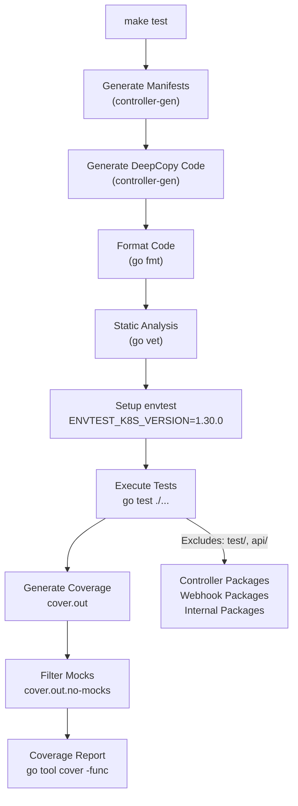
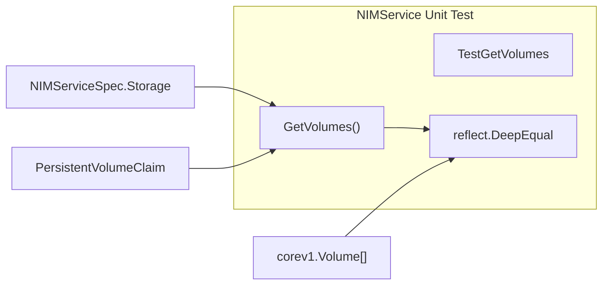
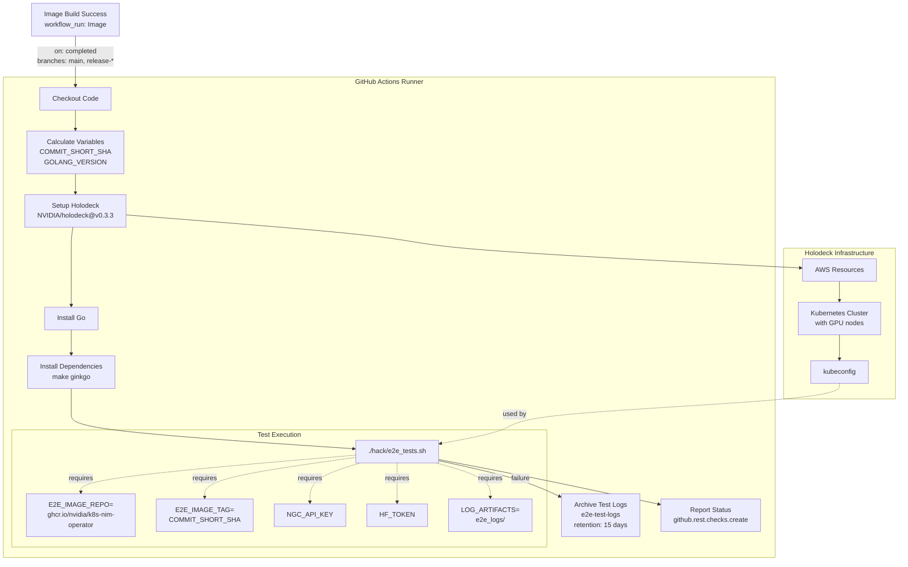
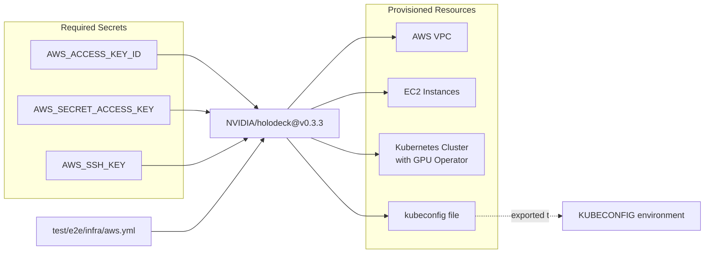
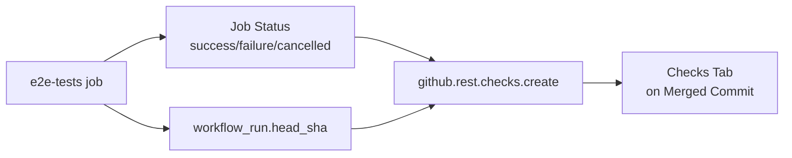
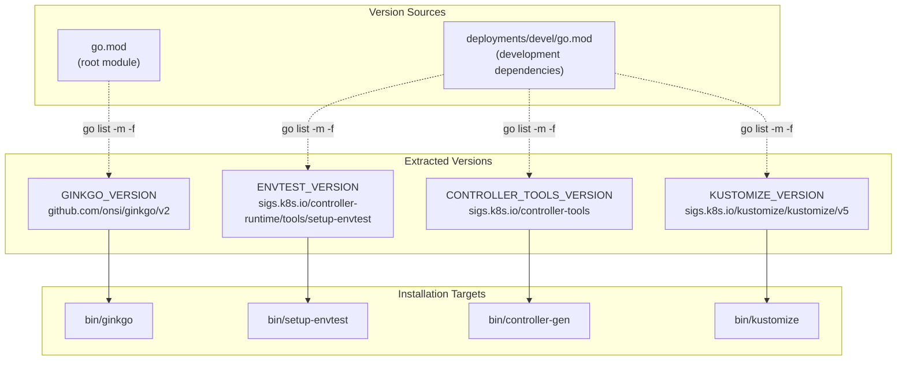
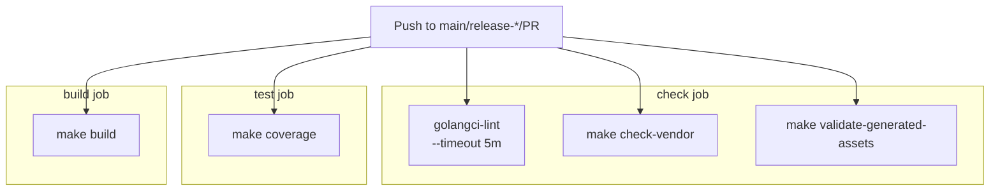
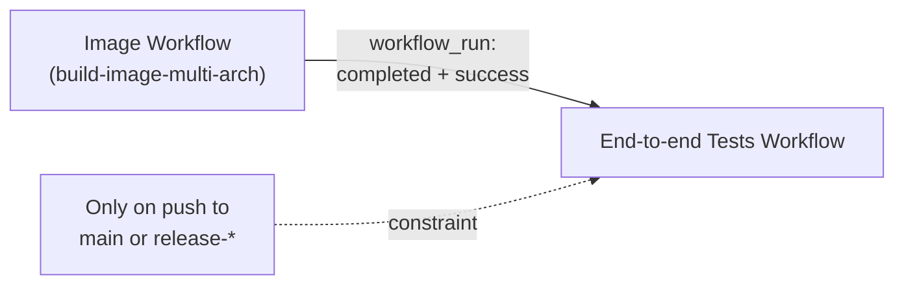

<!-- source: DeepWiki mcp.deepwiki.com · repo NVIDIA/k8s-nim-operator · page 6.2 Testing · fetched 2026-10-26 -->

# Testing

<details>
<summary>Relevant source files</summary>

The following files were used as context for generating this wiki page:

- [.github/workflows/e2e.yml](.github/workflows/e2e.yml)
- [.github/workflows/golang.yml](.github/workflows/golang.yml)
- [api/apps/v1alpha1/nimservice_types_test.go](api/apps/v1alpha1/nimservice_types_test.go)
- [api/versioned/typed/apps/v1alpha1/fake/fake_nimcache.go](api/versioned/typed/apps/v1alpha1/fake/fake_nimcache.go)
- [api/versioned/typed/apps/v1alpha1/fake/fake_nimservice.go](api/versioned/typed/apps/v1alpha1/fake/fake_nimservice.go)

</details>


This document describes the comprehensive testing strategy for the k8s-nim-operator, including unit tests, end-to-end tests, test infrastructure, and coverage requirements. For information about code quality tools and linting standards, see [Code Quality](#6.3). For information about building the operator, see [Building the Operator](#6.1).

## Testing Strategy Overview

The k8s-nim-operator employs a multi-layered testing approach:

| Test Type | Framework | Execution Environment | Purpose |
|-----------|-----------|----------------------|---------|
| Unit Tests | Go testing + envtest | Local/CI simulated cluster | Test controller logic, webhooks, and API validation |
| End-to-End Tests | Ginkgo v2 | Real Kubernetes cluster (Holodeck) | Validate full operator lifecycle and integration |
| Coverage Analysis | go tool cover | Local/CI | Ensure adequate test coverage excluding generated code |

The testing strategy separates fast, isolated unit tests from comprehensive integration tests that require real infrastructure.

**Sources:** [.github/workflows/golang.yml:61-86](), [.github/workflows/e2e.yml:26-112](), [Makefile:136-143]()

## Unit Testing

### Test Execution Flow



**Sources:** [Makefile:136-138](), [Makefile:131-134]()

### Running Unit Tests

Unit tests are executed via the `test` make target:

```bash
make test
```

This target performs the following operations in sequence:
1. **Manifest Generation**: Creates CRDs, RBAC, and webhook configurations using `controller-gen`
2. **Code Generation**: Generates DeepCopy methods for all API types
3. **Formatting**: Runs `go fmt` to ensure code style compliance
4. **Vetting**: Executes `go vet` for static analysis
5. **envtest Setup**: Downloads and configures Kubernetes API binaries (version 1.30.0)
6. **Test Execution**: Runs tests for all packages except `test/` and `api/` directories

The test command explicitly excludes generated API client code and end-to-end test packages: [Makefile:138]()

### API Type Testing Implementation

Unit tests for API types, such as `NIMService`, validate logic for resource generation. For example, `TestGetVolumes` in `api/apps/v1alpha1/nimservice_types_test.go` verifies that the `GetVolumes` function correctly assembles Kubernetes `corev1.Volume` slices based on `NIMServiceSpec` configurations.



Key test cases in `nimservice_types_test.go` include:
- Storage read-only logic: [api/apps/v1alpha1/nimservice_types_test.go:38-109]()
- Proxy configuration and Certificate ConfigMaps: [api/apps/v1alpha1/nimservice_types_test.go:110-125]()
- Initialization container scratch volume logic: [api/apps/v1alpha1/nimservice_types_test.go:126-158]()
- Gateway API `HTTPRoute` spec generation: [api/apps/v1alpha1/nimservice_types_test.go:176-247]()

**Sources:** [api/apps/v1alpha1/nimservice_types_test.go:31-247]()

### Test Environment Setup

Unit tests utilize `envtest`, a Kubernetes API server simulation provided by controller-runtime. The environment configuration:

| Variable | Value | Purpose |
|----------|-------|---------|
| `ENVTEST_K8S_VERSION` | 1.30.0 | Kubernetes API version to simulate |
| `KUBEBUILDER_ASSETS` | `$(ENVTEST) use ...` | Path to etcd, kube-apiserver binaries |
| `LOCALBIN` | `$(pwd)/bin` | Tool installation directory |

The envtest binary is installed on-demand: [Makefile:252-255]()

**Sources:** [Makefile:18](), [Makefile:232](), [Makefile:252-255]()

### Coverage Analysis

Coverage reporting filters out mock files and provides function-level metrics:

```bash
make coverage
```

The coverage process:
1. Executes `make test` to generate `cover.out`
2. Filters lines containing `_mock.go` to exclude generated mocks: [Makefile:133]()
3. Produces coverage report using `go tool cover -func`

Coverage metrics are generated in CI via the `test` job in the golang workflow: [.github/workflows/golang.yml:82-86]()

**Sources:** [Makefile:129-134](), [.github/workflows/golang.yml:61-86]()

## End-to-End Testing

### E2E Test Architecture



**Sources:** [.github/workflows/e2e.yml:17-97]()

### E2E Test Execution Flow

The end-to-end test workflow is triggered automatically after successful image builds on `main` or `release-*` branches: [.github/workflows/e2e.yml:18-24]()

The workflow executes only when:
- The preceding Image workflow completed successfully: [.github/workflows/e2e.yml:29]()
- The trigger was a push event (not a pull request)

### Holodeck Infrastructure Provisioning

Holodeck is NVIDIA's infrastructure-as-code tool for provisioning Kubernetes test clusters:



**Sources:** [.github/workflows/e2e.yml:46-52]()

The Holodeck configuration file specifies cluster topology, node types, and GPU requirements: [.github/workflows/e2e.yml:52]()

### E2E Test Environment Variables

The test execution script requires specific environment variables:

| Variable | Source | Purpose |
|----------|--------|---------|
| `KUBECONFIG` | Holodeck | Path to cluster credentials |
| `E2E_IMAGE_REPO` | Hardcoded | Operator image repository |
| `E2E_IMAGE_TAG` | Computed | Git commit SHA (8 chars) |
| `LOG_ARTIFACTS` | Workflow | Directory for test logs |
| `NGC_API_KEY` | Secret | NVIDIA NGC registry authentication |
| `HF_TOKEN` | Secret | Hugging Face model access |

**Sources:** [.github/workflows/e2e.yml:66-72]()

### Running E2E Tests

E2E tests are executed via the shell script wrapper:

```bash
./hack/e2e_tests.sh
```

The script internally invokes Ginkgo with the appropriate configuration: [.github/workflows/e2e.yml:74]()

E2E tests can also be run manually using the Makefile target:

```bash
make test-e2e
```

This target executes: `go test ./test/e2e/ -v -ginkgo.v` [Makefile:142-143]()

### Test Artifact Collection

On test failure, logs are automatically archived:
- **Artifact Name**: `e2e-test-logs`
- **Source Directory**: `./e2e_logs/`
- **Retention Period**: 15 days
- **Trigger**: `if: ${{ failure() }}`

**Sources:** [.github/workflows/e2e.yml:76-82]()

### Status Reporting

Test results are reported back to the original commit SHA using the GitHub Checks API:



This ensures E2E results appear on the correct commit even though the workflow runs on merge: [.github/workflows/e2e.yml:85-97]()

**Sources:** [.github/workflows/e2e.yml:85-97]()

## Test Infrastructure Components

### Ginkgo Test Framework

Ginkgo v2 is the BDD-style testing framework used for E2E tests:

**Installation:**
```bash
make ginkgo
```

This installs the Ginkgo CLI to `$(PROJECT_DIR)/bin/ginkgo` using the version specified in `go.mod`: [Makefile:262-265]()

The version is extracted dynamically: `GINKGO_VERSION ?= $(shell $(GO_CMD) list -m -f '{{.Version}}' github.com/onsi/ginkgo/v2)` [Makefile:236]()

**Sources:** [Makefile:236](), [Makefile:262-265]()

### envtest Setup

The envtest tool provides a local Kubernetes API server for unit testing:

**Installation:**
```bash
make envtest
```

This downloads `setup-envtest` to `$(LOCALBIN)`: [Makefile:252-255]()

The version is sourced from the `deployments/devel` module: [Makefile:239]()

**Usage in Tests:**
The `KUBEBUILDER_ASSETS` environment variable must point to the downloaded binaries:
```bash
KUBEBUILDER_ASSETS="$(shell $(ENVTEST) use $(ENVTEST_K8S_VERSION) --bin-dir $(LOCALBIN) -p path)"
```

**Sources:** [Makefile:232](), [Makefile:252-255](), [Makefile:138]()

### Tool Version Management

All test tool versions are managed centrally:



**Sources:** [Makefile:236-240]()

## CI Test Execution

### GitHub Actions - Golang Workflow

The golang workflow executes three parallel jobs:



**Sources:** [.github/workflows/golang.yml:17-112]()

#### Check Job

The `check` job validates code quality and consistency:
1. **Linting**: Runs `golangci-lint` with 5-minute timeout: [.github/workflows/golang.yml:42-47]()
2. **Vendor Check**: Verifies `go.mod` and `go.sum` are synchronized: [.github/workflows/golang.yml:51-55]()
3. **Generated Assets**: Ensures generated code and manifests are up-to-date: [.github/workflows/golang.yml:56-60]()

#### Test Job

The `test` job executes unit tests and generates coverage reports:
- Runs `make coverage` which internally calls `make test`: [.github/workflows/golang.yml:82-86]()
- Uses Go proxy for dependency caching: [.github/workflows/golang.yml:79-84]()

#### Build Job

The `build` job verifies the operator binary compiles successfully:
- Executes `make build` to compile `cmd/main.go`: [.github/workflows/golang.yml:108-112]()

**Sources:** [.github/workflows/golang.yml:25-112]()

### GitHub Actions - E2E Workflow

The E2E workflow is triggered by the Image workflow completion:

**Workflow Trigger Relationship:**


This design ensures E2E tests run against freshly built operator images: [.github/workflows/e2e.yml:17-29]()

**Sources:** [.github/workflows/e2e.yml:15-29]()

## Running Tests Locally

### Unit Test Prerequisites

| Requirement | Installation | Notes |
|-------------|--------------|-------|
| Go | See `hack/golang-version.sh` | Version must match CI |
| Make | System package manager | Standard build tool |
| controller-gen | `make controller-gen` | Auto-installed to `bin/` |
| envtest | `make envtest` | Auto-installed to `bin/` |

### Local Unit Test Execution

```bash
# Run all unit tests with coverage
make coverage

# Run tests without coverage
make test

# Run specific package tests
go test ./internal/controller/...
```

**Test Output Filtering:**
Unit tests exclude:
- `test/` directory (E2E tests)
- `api/` directory (generated clients)
- Files matching `*_mock.go` (generated mocks)

**Sources:** [Makefile:136-138](), [Makefile:131-134]()

### Local E2E Test Prerequisites

E2E tests require a real Kubernetes cluster with:
- GPU nodes (for NIM workload testing)
- NGC registry access (for pulling NIM images)
- Hugging Face access (for model downloads)

**Required Environment Variables:**

| Variable | Purpose | Example |
|----------|---------|---------|
| `KUBECONFIG` | Cluster credentials | `~/.kube/config` |
| `E2E_IMAGE_REPO` | Operator image repository | `ghcr.io/nvidia/k8s-nim-operator` |
| `E2E_IMAGE_TAG` | Operator image tag | `main` or commit SHA |
| `NGC_API_KEY` | NGC authentication | API key from NGC portal |
| `HF_TOKEN` | Hugging Face authentication | Token from HF settings |
| `LOG_ARTIFACTS` | Log output directory | `./e2e_logs` |

### Local E2E Test Execution

```bash
# Install Ginkgo framework
make ginkgo

# Set required environment variables
export KUBECONFIG=/path/to/kubeconfig
export E2E_IMAGE_REPO=ghcr.io/nvidia/k8s-nim-operator
export E2E_IMAGE_TAG=latest
export NGC_API_KEY=your-ngc-key
export HF_TOKEN=your-hf-token
export LOG_ARTIFACTS=./e2e_logs

# Run E2E tests
./hack/e2e_tests.sh

# Or use make target
make test-e2e
```

**Sources:** [.github/workflows/e2e.yml:54-74](), [Makefile:142-143]()

## Test Coverage Requirements

The project enforces coverage through CI but does not have a hard minimum threshold. Coverage reports are generated with mock files excluded to provide accurate metrics for hand-written code: [Makefile:133]()

**Coverage Report Format:**
```bash
cat cover.out | grep -v "_mock.go" > cover.out.no-mocks
go tool cover -func=cover.out.no-mocks
```

This produces function-level coverage percentages for all non-generated code.

**Sources:** [Makefile:131-134]()

## Validation of Generated Assets

The CI pipeline includes a critical validation step to ensure generated code remains synchronized with API definitions:

```bash
make validate-generated-assets
```

This target: [Makefile:109-111]()
1. Runs `manifests` to generate CRDs
2. Runs `generate` to create DeepCopy methods
3. Runs `generate-clientset` to create client code
4. Runs `sync-crds` to copy CRDs to Helm/OLM packages
5. Runs `git diff --exit-code` to detect any changes

If changes are detected, the validation fails, indicating that generated assets are out of sync and need to be regenerated and committed.

**Sources:** [Makefile:109-111](), [.github/workflows/golang.yml:56-60]()

---

