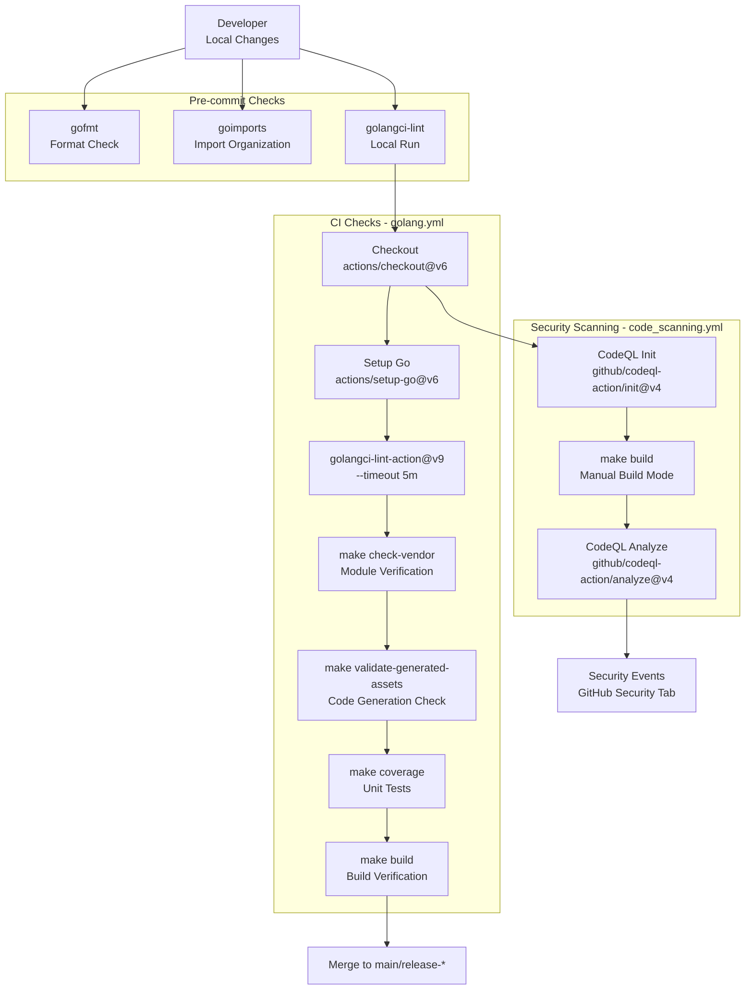
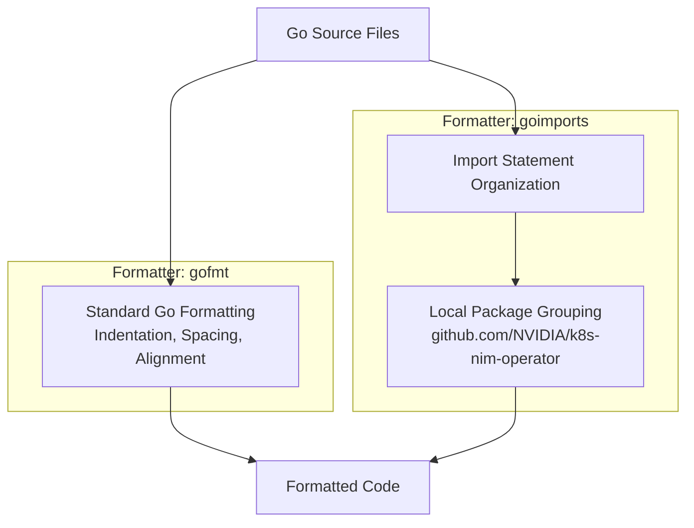
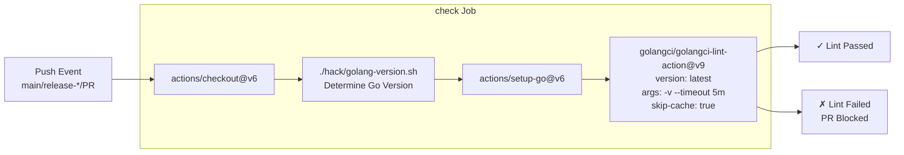
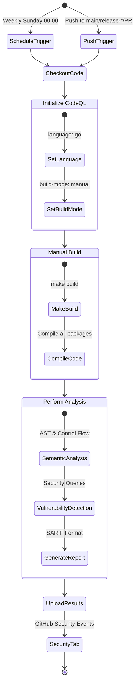
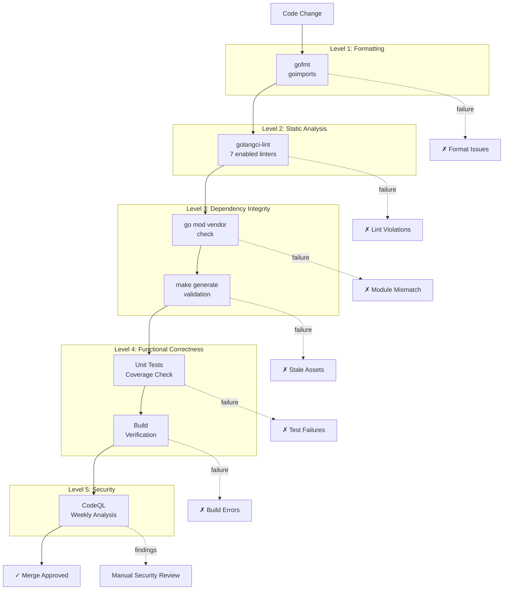

<!-- source: DeepWiki mcp.deepwiki.com · repo NVIDIA/k8s-nim-operator · page 6.3 Code Quality · fetched 2026-10-26 -->

# Code Quality

<details>
<summary>Relevant source files</summary>

The following files were used as context for generating this wiki page:

- [.github/workflows/code_scanning.yml](.github/workflows/code_scanning.yml)
- [.github/workflows/golang.yml](.github/workflows/golang.yml)
- [.golangci.yaml](.golangci.yaml)

</details>


## Purpose and Scope

This document describes the code quality tools, standards, and automated checks enforced in the `k8s-nim-operator` codebase. It covers static analysis with `golangci-lint`, code formatting standards, security scanning with CodeQL, and how these checks are integrated into the CI pipeline. This ensures that NVIDIA NIM microservices are managed by a robust and secure operator.

## Code Quality Architecture

The project enforces code quality through multiple automated layers: static analysis, formatting checks, security scanning, and asset validation. These checks run both locally during development and automatically in CI pipelines.

### Quality Gate Flow



**Sources:** [.github/workflows/golang.yml:1-113](), [.github/workflows/code_scanning.yml:1-49]()

## Static Analysis with golangci-lint

The project uses `golangci-lint` as the primary static analysis tool, configured via [.golangci.yaml:1-37](). This provides automated detection of code issues, style violations, and potential bugs.

### Enabled Linters

The following linters are actively enabled in the configuration:

| Linter | Purpose | Category |
|--------|---------|----------|
| `asciicheck` | Detects non-ASCII identifiers | Code Quality |
| `contextcheck` | Validates `context.Context` usage | Best Practices |
| `forcetypeassert` | Flags type assertions without checks | Safety |
| `gocritic` | Comprehensive Go code analysis | Code Quality |
| `godot` | Enforces comment punctuation | Documentation |
| `misspell` | Detects common spelling errors | Code Quality |
| `staticcheck` | Advanced static analysis | Bug Detection |

**Sources:** [.golangci.yaml:4-12]()

### Formatter Configuration

Two formatters ensure consistent code style across the codebase:



**Configuration Details:**
- `gofmt`: Standard Go formatting rules applied to all Go files.
- `goimports`: Import statements organized with local packages (`github.com/NVIDIA/k8s-nim-operator`) grouped separately via `local-prefixes` [.golangci.yaml:29-31]().

**Sources:** [.golangci.yaml:24-31]()

### Exclusion Patterns

Certain code paths are excluded from linting to reduce noise:

| Exclusion Type | Pattern | Rationale |
|----------------|---------|-----------|
| Generated Code | `generated: lax` | Auto-generated files follow different conventions |
| Third-party Code | `third_party$` | External dependencies not under project control |
| Built-in Code | `builtin$` | Standard library patterns |
| Examples | `examples$` | Example code prioritizes clarity over strict standards |

Additional preset exclusions include `comments`, `common-false-positives`, `legacy`, and `std-error-handling` [.golangci.yaml:15-19]().

**Sources:** [.golangci.yaml:13-23](), [.golangci.yaml:32-37]()

## CI Integration

### Golang Workflow Linting

The `golang.yml` workflow runs `golangci-lint` on every push to `main`, `release-*` branches, and pull requests [.github/workflows/golang.yml:17-23]():



**Key Configuration:**
- **Timeout:** 5 minutes to prevent hanging jobs [.github/workflows/golang.yml:46]().
- **Cache:** Disabled (`skip-cache: true`) to ensure fresh analysis [.github/workflows/golang.yml:47]().
- **Version:** Always uses `latest` golangci-lint version [.github/workflows/golang.yml:45]().

**Sources:** [.github/workflows/golang.yml:25-47]()

### Module and Asset Validation

Beyond linting, the CI enforces additional quality checks:

1. **Vendor Check** (`make check-vendor`): Verifies `go.mod` and `vendor/` directory are in sync [.github/workflows/golang.yml:55]().
2. **Generated Assets Check** (`make validate-generated-assets`): Ensures CRDs, clients, and manifests are up-to-date with API definitions [.github/workflows/golang.yml:60]().

**Sources:** [.github/workflows/golang.yml:51-60]()

## Security Scanning with CodeQL

CodeQL performs deep semantic analysis of the Go codebase to detect security vulnerabilities and code quality issues.

### CodeQL Workflow Configuration

The `code_scanning.yml` workflow runs:
- **Schedule:** Weekly on Sundays at midnight (`cron: "0 0 * * 0"`) [.github/workflows/code_scanning.yml:19]().
- **Triggers:** Pushes to `main`, `release-*` branches, and pull requests [.github/workflows/code_scanning.yml:20-24]().
- **Timeout:** 360 minutes (6 hours) for comprehensive analysis [.github/workflows/code_scanning.yml:30]().



**Key Features:**
- **Manual Build Mode:** Uses `make build` to ensure CodeQL analyzes the actual compiled code path [.github/workflows/code_scanning.yml:41-44]().
- **Category:** `/language:go` for Go-specific security queries [.github/workflows/code_scanning.yml:48]().
- **Permissions:** `security-events: write` to publish results to GitHub Security tab [.github/workflows/code_scanning.yml:32]().

**Sources:** [.github/workflows/code_scanning.yml:15-48]()

## Local Development Workflow

Developers can run quality checks locally before pushing changes to maintain the standard defined in [.golangci.yaml:1-37]().

### Pre-Commit Checklist

```bash
# 1. Format code
gofmt -w .
goimports -w -local github.com/NVIDIA/k8s-nim-operator .

# 2. Run linter
golangci-lint run -v --timeout 5m

# 3. Verify modules
make check-vendor

# 4. Validate generated assets
make validate-generated-assets

# 5. Run tests with coverage
make coverage

# 6. Build verification
make build
```

**Sources:** [.github/workflows/golang.yml:42-112]()

## Quality Metrics and Enforcement

### Coverage Requirements

The project enforces test coverage through the `make coverage` target, which is executed in the `test` job of the `golang.yml` workflow [.github/workflows/golang.yml:82-86]().

### Quality Gate Hierarchy



**Sources:** [.github/workflows/golang.yml:25-113](), [.github/workflows/code_scanning.yml:17-48]()

## Configuration Reference

### golangci-lint Version Configuration

The project uses `version: "2"` of the `golangci-lint` configuration format [.golangci.yaml:1]().

### GitHub Actions Permissions

Quality check workflows require specific permissions:

| Workflow | Permission | Purpose |
|----------|-----------|---------|
| `golang.yml` | `contents: read` | Read source code [.github/workflows/golang.yml:28]() |
| `golang.yml` | `id-token: write` | Artifactory Go proxy authentication [.github/workflows/golang.yml:29]() |
| `code_scanning.yml` | `security-events: write` | Publish CodeQL results [.github/workflows/code_scanning.yml:32]() |
| `code_scanning.yml` | `packages: read` | Access container images [.github/workflows/code_scanning.yml:33]() |

**Sources:** [.github/workflows/golang.yml:27-30](), [.github/workflows/code_scanning.yml:31-33]()

---

