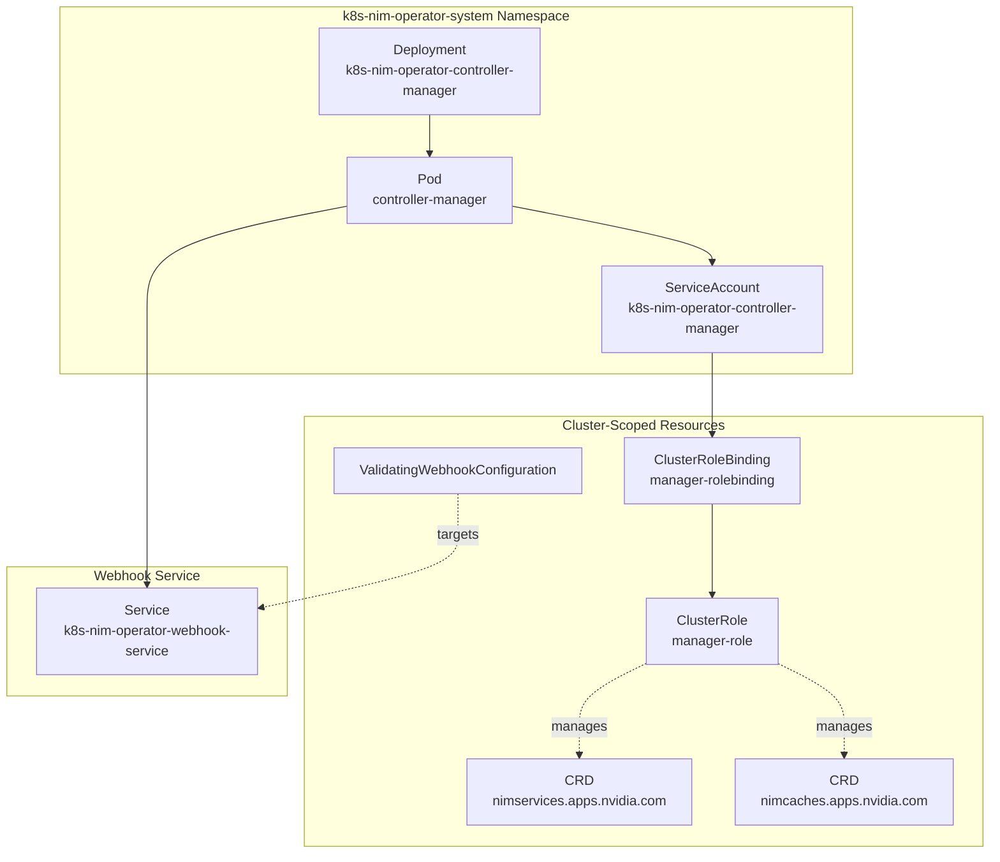
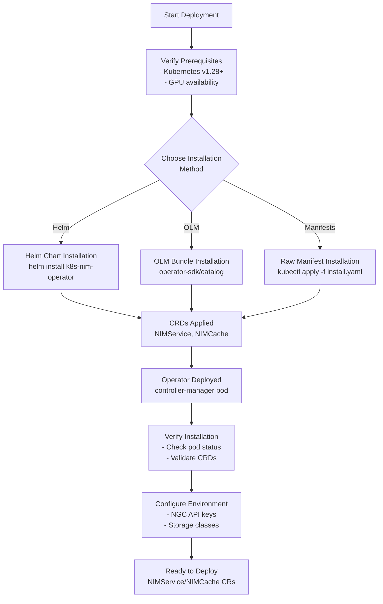

<!-- source: DeepWiki mcp.deepwiki.com · repo NVIDIA/k8s-nim-operator · page 7 Deployment · fetched 2026-10-26 -->

# Deployment

<details>
<summary>Relevant source files</summary>

The following files were used as context for generating this wiki page:

- [.github/workflows/helm.yml](.github/workflows/helm.yml)
- [bundle/manifests/apps.nvidia.com_nimcaches.yaml](bundle/manifests/apps.nvidia.com_nimcaches.yaml)
- [bundle/manifests/apps.nvidia.com_nimservices.yaml](bundle/manifests/apps.nvidia.com_nimservices.yaml)

</details>


## Purpose and Scope

This page provides an overview of deploying the k8s-nim-operator in production Kubernetes environments, including prerequisites, deployment architecture, and verification procedures. For detailed installation instructions using specific methods (Helm, OLM, raw manifests), see [Installation Methods](#7.1). For configuration examples and deployment patterns, see [Configuration Examples](#7.2).

**Scope**: This page covers the operational aspects of deploying the operator itself. For information about deploying NIM services after the operator is installed, see [NIMService](#4.1.1), [NIMCache](#4.1.2), and other Custom Resource pages under section [Custom Resources](#4).

## Prerequisites

### Cluster Requirements

| Requirement | Specification |
|-------------|---------------|
| Kubernetes Version | v1.28 or higher |
| GPU Hardware | NVIDIA GPUs supported by target NIM microservices |
| GPU Driver | NVIDIA GPU drivers installed (via GPU Operator or manual installation) |
| Cluster Access | `cluster-admin` privileges or equivalent RBAC permissions |

**Sources**: [bundle/manifests/apps.nvidia.com_nimservices.yaml:35-46](), [bundle/manifests/apps.nvidia.com_nimcaches.yaml:38-46]()

### Required Tools

The following tools are needed for deploying the operator:

- `kubectl` - Kubernetes command-line tool configured with cluster access
- For Helm installation: `helm` v3.14.4 or higher
- For OLM installation: Operator Lifecycle Manager installed in cluster
- For building from source: `go` 1.21+, `make`, container runtime (Docker/Podman)

**Sources**: [.github/workflows/helm.yml:17-19]()

### External Service Access

The operator requires network access to the following external services:

- **Container Registries**: `ghcr.io` for operator images, `nvcr.io` for NIM container images
- **Model Registries**: NVIDIA NGC and/or Hugging Face for model artifacts
- **API Access**: NGC API key for accessing NVIDIA NIM microservices

**Sources**: [bundle/manifests/apps.nvidia.com_nimcaches.yaml:72-121]() (Environment variable configuration for registry/API access)

## Deployment Architecture

### Operator Components in Cluster



**Deployment Components**:

- **Namespace**: `k8s-nim-operator-system` - isolated namespace for operator components.
- **CRDs**: Custom resource definitions for `NIMService` and `NIMCache` [bundle/manifests/apps.nvidia.com_nimservices.yaml:1-14](), [bundle/manifests/apps.nvidia.com_nimcaches.yaml:1-14]().
- **RBAC**: ClusterRole and ClusterRoleBinding granting operator permissions to manage resources across namespaces.
- **Webhooks**: ValidatingWebhookConfiguration for admission control on NIM resources.

**Sources**: [bundle/manifests/apps.nvidia.com_nimservices.yaml:7-14](), [bundle/manifests/apps.nvidia.com_nimcaches.yaml:7-14]()

## Deployment Workflow

### Standard Deployment Process



**Sources**: [.github/workflows/helm.yml:20-21](), [bundle/manifests/apps.nvidia.com_nimservices.yaml:1-16]()

## Deployment Options Overview

The k8s-nim-operator supports three primary deployment methods, each suited for different operational requirements:

### 1. Helm Charts

- **Location**: `deployments/helm/k8s-nim-operator/`
- **Linting**: Automated linting is performed via GitHub Actions [.github/workflows/helm.yml:20-21]().
- **Use Case**: Recommended for production deployments, supports value customization and lifecycle management.

**Sources**: [.github/workflows/helm.yml:1-21]()

### 2. OLM Bundles

- **Location**: `bundle/` directory.
- **Contents**: Includes Cluster Service Version (CSV) and CRD manifests [bundle/manifests/apps.nvidia.com_nimservices.yaml:1-8]().
- **Use Case**: Ideal for clusters using Operator Lifecycle Manager (e.g., OpenShift).

**Sources**: [bundle/manifests/apps.nvidia.com_nimservices.yaml:1-16](), [bundle/manifests/apps.nvidia.com_nimcaches.yaml:1-16]()

### 3. Raw Manifests

- **Contents**: Consolidated YAML with CRDs and deployment resources.
- **Use Case**: Simple installation for testing or air-gapped environments.

For detailed instructions on each method, see [Installation Methods](#7.1).

## Post-Deployment Configuration

### Essential Secrets

After deploying the operator, configure access to external services. The `NIMCache` and `NIMService` resources can reference these via environment variables [bundle/manifests/apps.nvidia.com_nimcaches.yaml:72-121]().

**NGC API Key** (required for pulling NIM images):
```bash
kubectl create secret generic ngc-api-secret \
  --from-literal=NGC_API_KEY=<your-ngc-api-key> \
  -n <workload-namespace>
```

### Storage Configuration

Ensure appropriate `StorageClasses` are configured. `NIMCache` status tracks the associated PVC [bundle/manifests/apps.nvidia.com_nimcaches.yaml:21-23]().
- **PersistentVolumeClaims**: Used by `NIMCache` for model caching.
- **Performance**: High-speed storage is recommended for model artifact loading.

**Sources**: [bundle/manifests/apps.nvidia.com_nimcaches.yaml:21-23]()

## Verification

### Operator Pod Status

Verify the operator is running:

```bash
# Check operator pod status
kubectl get pods -n k8s-nim-operator-system
```

### CRD Installation

Verify CRDs are installed and have the correct versions [bundle/manifests/apps.nvidia.com_nimservices.yaml:25-28]():

```bash
# List NIM operator CRDs
kubectl get crds | grep apps.nvidia.com
```

**Expected CRDs**:
- `nimservices.apps.nvidia.com` [bundle/manifests/apps.nvidia.com_nimservices.yaml:7]()
- `nimcaches.apps.nvidia.com` [bundle/manifests/apps.nvidia.com_nimcaches.yaml:7]()

### Test CR Deployment

Validate the operator by creating a simple test resource. The status should transition to a known state [bundle/manifests/apps.nvidia.com_nimservices.yaml:18-20]().

```bash
# Check CR status
kubectl get nimservice -A
```

**Sources**: [bundle/manifests/apps.nvidia.com_nimservices.yaml:18-20](), [bundle/manifests/apps.nvidia.com_nimcaches.yaml:18-20]()

## Next Steps

After successfully deploying the operator:

1. **Deploy NIM Services**: Create `NIMService` and `NIMCache` custom resources. See [NIMService](#4.1.1) and [NIMCache](#4.1.2) for specifications.
2. **Explore Configuration Patterns**: Review production-ready examples in [Configuration Examples](#7.2).
3. **Advanced Resource Allocation**: Configure GPU resources using Dynamic Resource Allocation (DRA). See [Dynamic Resource Allocation](#5.2).

**Sources**: [bundle/manifests/apps.nvidia.com_nimservices.yaml:1-28](), [bundle/manifests/apps.nvidia.com_nimcaches.yaml:1-28]()

---

