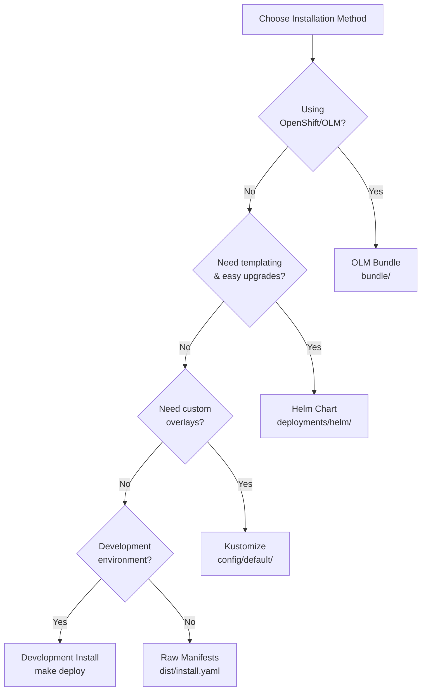
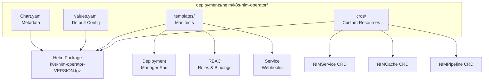
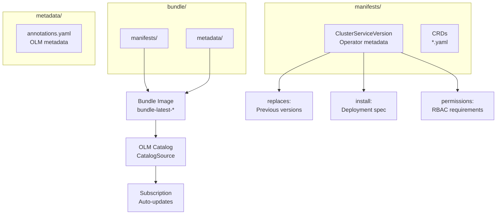
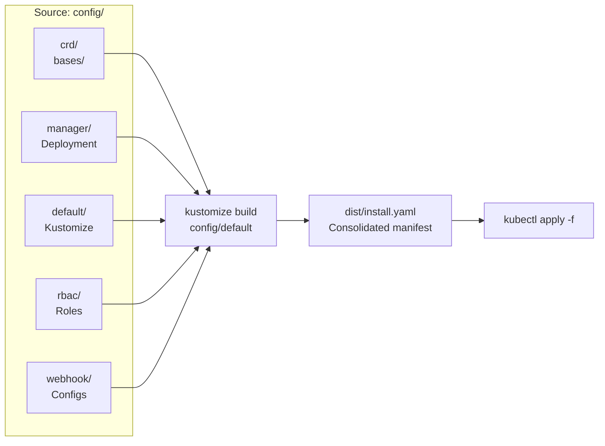

<!-- source: DeepWiki mcp.deepwiki.com · repo NVIDIA/k8s-nim-operator · page 7.1 Installation Methods · fetched 2026-10-26 -->

# Installation Methods

<details>
<summary>Relevant source files</summary>

The following files were used as context for generating this wiki page:

- [.github/workflows/helm.yml](.github/workflows/helm.yml)
- [Makefile](Makefile)
- [bundle/manifests/apps.nvidia.com_nimservices.yaml](bundle/manifests/apps.nvidia.com_nimservices.yaml)

</details>


This page provides detailed instructions for installing the k8s-nim-operator using various methods. Each method is suitable for different use cases, from production deployments to development environments.

For configuration examples after installation, see [Configuration Examples](#7.2). For information about building the operator from source, see [Building the Operator](#6.1).

## Overview

The k8s-nim-operator supports multiple installation methods, each with different trade-offs in terms of simplicity, flexibility, and integration with existing cluster management tools.

### Installation Method Comparison

| Method | Use Case | Pros | Cons | Production Ready |
|--------|----------|------|------|------------------|
| **Helm Charts** | Production deployments with customization needs | Templating, easy upgrades, values-based configuration | Requires Helm client | ✅ Yes |
| **OLM Bundles** | OpenShift and OLM-enabled clusters | Automatic dependency management, lifecycle management | Requires OLM | ✅ Yes |
| **Raw Manifests** | Simple deployments, CI/CD pipelines | No dependencies, easy to version control | Manual upgrades, no templating | ✅ Yes |
| **Kustomize** | Custom deployments with overlays | Declarative customization, no templating | More complex than raw manifests | ✅ Yes |
| **Development Install** | Local development and testing | Quick iteration, debugging support | Not for production | ❌ No |

**Diagram: Installation Method Decision Tree**



Sources: [Makefile:164-207](), [deployments/helm/k8s-nim-operator/Chart.yaml:1-10]()

---

## Prerequisites

All installation methods require:

- Kubernetes v1.28 or higher
- NVIDIA GPUs supported by NIM microservices
- Access to pull images from container registries (ghcr.io or nvcr.io)
- Cluster admin privileges for CRD installation

Sources: [Makefile:136-138]()

---

## Method 1: Helm Charts

Helm is the recommended method for production deployments due to its templating capabilities and simple upgrade process.

### Architecture

**Diagram: Helm Chart Structure**



Sources: [Makefile:171-175](), [.github/workflows/helm.yml:1-22]()

### Installation Steps

**1. Generate Helm Chart Package**

The `helm-charts` Makefile target generates a versioned Helm package. The `CHART_VERSION` is derived from the `VERSION` variable, stripping any "v" prefix to adhere to strict semantic versioning required by Helm [Makefile:171-172]().

```bash
make helm-charts VERSION=v0.1.0
```

This executes `helm package deployments/helm/k8s-nim-operator/` with the calculated version [Makefile:174]().

**2. Install via Helm**

```bash
# Add custom values if needed
helm install nim-operator ./k8s-nim-operator-0.1.0.tgz \
  --namespace nim-operator \
  --create-namespace \
  --set image.repository=ghcr.io/nvidia/k8s-nim-operator \
  --set image.tag=v0.1.0
```

**3. Verify Installation**

```bash
helm list -n nim-operator
kubectl get pods -n nim-operator
kubectl get crds | grep nvidia.com
```

### CI/CD Integration

The Helm charts are automatically linted using GitHub Actions on every push to main or release branches [/.github/workflows/helm.yml:1-21](). The workflow uses `helm lint deployments/helm/*` to ensure chart validity [/.github/workflows/helm.yml:21-21]().

Sources: [Makefile:171-175](), [.github/workflows/helm.yml:1-22]()

---

## Method 2: OLM Bundles

Operator Lifecycle Manager (OLM) bundles provide automated dependency management and lifecycle operations. This method is ideal for OpenShift clusters and environments with OLM installed.

### Architecture

**Diagram: OLM Bundle Structure**



Sources: [Makefile:41-50](), [Makefile:178-184]()

### Bundle Generation

The operator uses `operator-sdk` to generate OLM bundles. The `BUNDLE_DEFAULT_CHANNEL` and `BUNDLE_METADATA_OPTS` variables control the bundle's channel configuration [Makefile:41-50]().

```bash
make bundle VERSION=v0.1.0
```

This target performs several operations [Makefile:178-184]():
1. Updates the manager image using `kustomize edit set image` [Makefile:180]().
2. Generates the bundle manifests using `operator-sdk generate bundle` [Makefile:181]().
3. Validates the generated bundle [Makefile:184]().

### Custom Resources in Bundles

The bundle includes definitions for all managed Custom Resources, such as `NIMService` [bundle/manifests/apps.nvidia.com_nimservices.yaml:1-15](). These definitions include OpenAPI v3 schemas for validation [bundle/manifests/apps.nvidia.com_nimservices.yaml:27-49]().

Sources: [Makefile:41-50](), [Makefile:178-184](), [bundle/manifests/apps.nvidia.com_nimservices.yaml:1-50]()

---

## Method 3: Raw Manifests

Raw manifests provide the simplest installation method without external dependencies. This is suitable for CI/CD pipelines and environments where tools like Helm or OLM are not available.

### Architecture

**Diagram: Raw Manifest Generation Flow**



Sources: [Makefile:164-168]()

### Generating the Installer

The `build-installer` target creates a single consolidated YAML file [Makefile:164-168]():

```bash
make build-installer IMG=ghcr.io/nvidia/k8s-nim-operator:v0.1.0
```

This executes the following process:
1. Creates the `dist/` directory [Makefile:165]().
2. Updates the controller image in `config/manager/` using Kustomize [Makefile:166]().
3. Builds the final manifest from `config/default` and redirects output to `dist/install.yaml` [Makefile:167]().

### Installation Steps

**1. Generate the manifest**

```bash
make build-installer IMG=ghcr.io/nvidia/k8s-nim-operator:v0.1.0
```

**2. Install from generated manifest**

```bash
kubectl apply -f dist/install.yaml
```

Sources: [Makefile:164-168]()

---

## Method 4: Kustomize

Kustomize provides declarative customization of Kubernetes manifests without templating. This is the underlying engine used by the `build-installer` and `deploy` targets.

### Direct Deployment

You can deploy the operator directly using Kustomize targets in the Makefile:

**1. Install CRDs**

```bash
make install
```
This builds `config/crd` and pipes it to `kubectl apply` [Makefile:193-194]().

**2. Deploy Controller**

```bash
make deploy IMG=ghcr.io/nvidia/k8s-nim-operator:v0.1.0
```
This updates the image in `config/manager` and applies the full `config/default` configuration [Makefile:201-203]().

### Configuration Structure

The Kustomize configuration is organized into functional bases:
- `config/crd`: Contains CRD definitions generated by `controller-gen` [Makefile:80-82]().
- `config/rbac`: Contains the `manager-role` and other RBAC objects [Makefile:81]().
- `config/manager`: Contains the operator Deployment [Makefile:166]().

Sources: [Makefile:80-82](), [Makefile:193-207]()

---

## Method 5: Development Installation

For local development, the operator can be run directly from the host or deployed to a local cluster like Kind.

### Running Locally

To run the controller manager binary directly on your host (connected to the cluster in your current context):

```bash
make run
```
This runs `go run ./cmd/main.go` after ensuring manifests and code are generated [Makefile:160-162]().

### Building and Deploying

**1. Build Binary**
```bash
make build
```
Builds the manager binary into `bin/manager` [Makefile:156-157]().

**2. Build Image**
```bash
make docker-build IMG=my-registry/operator:latest
```
Builds the container image using the specified `CONTAINER_TOOL` (defaulting to docker) [Makefile:35](), [Makefile:211-213]().

**3. Run Tests**
Before deployment, you can run unit tests which use `envtest`:
```bash
make test
```
This sets up `KUBEBUILDER_ASSETS` and runs `go test` [Makefile:136-138]().

Sources: [Makefile:35](), [Makefile:136-162](), [Makefile:211-213]()

---

