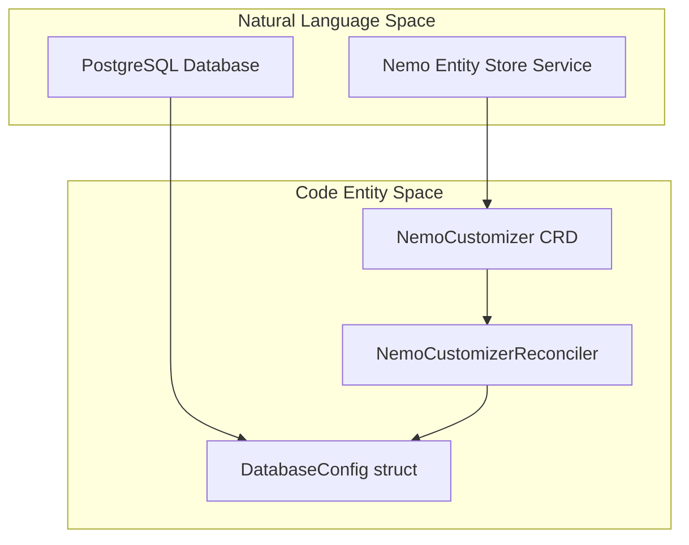
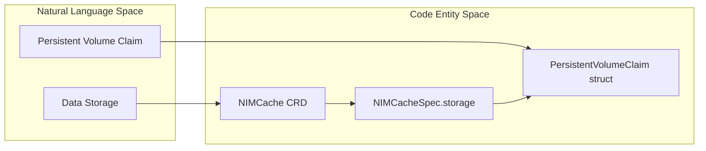

<!-- source: DeepWiki mcp.deepwiki.com · repo NVIDIA/k8s-nim-operator · page 7.2 Configuration Examples · fetched 2026-10-26 -->

# Configuration Examples

<details>
<summary>Relevant source files</summary>

The following files were used as context for generating this wiki page:

- [bundle/manifests/apps.nvidia.com_nemocustomizers.yaml](bundle/manifests/apps.nvidia.com_nemocustomizers.yaml)
- [bundle/manifests/apps.nvidia.com_nimcaches.yaml](bundle/manifests/apps.nvidia.com_nimcaches.yaml)
- [bundle/manifests/apps.nvidia.com_nimpipelines.yaml](bundle/manifests/apps.nvidia.com_nimpipelines.yaml)
- [bundle/manifests/apps.nvidia.com_nimservices.yaml](bundle/manifests/apps.nvidia.com_nimservices.yaml)

</details>


## Purpose and Scope

This document provides real-world configuration examples demonstrating common deployment patterns and advanced features of the NVIDIA NIM Operator custom resources. It focuses on practical configuration patterns for both NIM services and NeMo microservices, showing how to use the common API types defined in [api/apps/v1alpha1/common_types.go]() and advanced features like Dynamic Resource Allocation from [api/apps/v1alpha1/dra_types.go](). For installation methods, see page 7.1, and for API type definitions, see page 5.

## Common Configuration Patterns

Before exploring specific microservice configurations, this section demonstrates common configuration patterns using the reusable API types defined in [api/apps/v1alpha1/common_types.go]().

### Service Exposure Configurations

The operator supports multiple service exposure patterns through the `Expose` type defined in [api/apps/v1alpha1/common_types.go:45-52]().

#### ClusterIP Service (Internal Access)

```yaml
expose:
  service:
    type: ClusterIP
    port: 8000
```

This configuration creates a `ClusterIP` service accessible only within the cluster. The default API port is 8000 as defined in [api/apps/v1alpha1/common_types.go:32]().

#### LoadBalancer Service (External Access)

```yaml
expose:
  service:
    type: LoadBalancer
    port: 8000
    annotations:
      service.beta.kubernetes.io/aws-load-balancer-type: "nlb"
```

This creates a cloud provider LoadBalancer for external access with cloud-specific annotations.

#### Ingress with Router

```yaml
expose:
  service:
    type: ClusterIP
    port: 8000
  router:
    hostDomainName: example.com
    ingress:
      ingressClass: nginx
      tlsSecretName: tls-cert-secret
```

This configuration uses the `Router` type [api/apps/v1alpha1/common_types.go:55-72]() to create an Ingress with hostname pattern `<service-name>.<namespace>.example.com` and TLS termination.

#### Gateway API with HTTPRoute

```yaml
expose:
  service:
    type: ClusterIP
    port: 8000
  router:
    hostDomainName: example.com
    gateway:
      namespace: gateway-system
      name: shared-gateway
      httpRoutesEnabled: true
```

This uses Gateway API's HTTPRoute for traffic routing, implemented in [api/apps/v1alpha1/common_types.go:247-285]().

#### GRPC Service Exposure

```yaml
expose:
  service:
    type: ClusterIP
    port: 8000
    grpcPort: 8001
  router:
    hostDomainName: example.com
    gateway:
      namespace: gateway-system
      name: shared-gateway
      grpcRoutesEnabled: true
```

This exposes both HTTP and GRPC ports, with GRPC routing handled by [api/apps/v1alpha1/common_types.go:287-317]().

Sources: [api/apps/v1alpha1/common_types.go:30-133](), [api/apps/v1alpha1/common_types.go:205-364]()

### Autoscaling Configuration

The `Autoscaling` type from [api/apps/v1alpha1/common_types.go:158-173]() enables automatic horizontal pod autoscaling.

```yaml
autoscaling:
  enabled: true
  hpa:
    minReplicas: 2
    maxReplicas: 10
    metrics:
      - type: Resource
        resource:
          name: cpu
          target:
            type: Utilization
            averageUtilization: 70
      - type: Resource
        resource:
          name: memory
          target:
            type: Utilization
            averageUtilization: 80
    behavior:
      scaleDown:
        stabilizationWindowSeconds: 300
        policies:
          - type: Percent
            value: 50
            periodSeconds: 15
```

This configures HPA with both CPU and memory-based scaling, using the `HorizontalPodAutoscalerSpec` from [api/apps/v1alpha1/common_types.go:165-173]().

Sources: [api/apps/v1alpha1/common_types.go:158-173]()

### Metrics and Monitoring

The `Metrics` type [api/apps/v1alpha1/common_types.go:143-156]() integrates with Prometheus Operator.

```yaml
metrics:
  enabled: true
  serviceMonitor:
    additionalLabels:
      release: prometheus
    interval: 30s
    scrapeTimeout: 10s
```

This creates a `ServiceMonitor` resource for automatic Prometheus discovery.

Sources: [api/apps/v1alpha1/common_types.go:143-156]()

### Dynamic Resource Allocation (DRA) for GPU

The `DRAResource` type from [api/apps/v1alpha1/dra_types.go:28-72]() enables advanced GPU allocation.

#### Basic GPU Allocation

```yaml
resources:
  draResources:
    - resourceClaimName: gpu-claim
      requests:
        - gpu-request
```

#### Auto-Generated Resource Claim

```yaml
resources:
  draResources:
    - claimCreationSpec:
        generateName: nim-gpu
        devices:
          - name: gpu
            count: 2
            deviceClassName: gpu.nvidia.com
            driverName: gpu.nvidia.com
            attributeSelectors:
              - key: productName
                op: Equal
                value:
                  stringValue: "NVIDIA H100"
              - key: memory
                op: GreaterThanOrEqual
                value:
                  intValue: 80
```

This uses `DRAClaimCreationSpec` [api/apps/v1alpha1/dra_types.go:271-280]() with `DRADeviceAttributeSelector` [api/apps/v1alpha1/dra_types.go:150-170]() to select specific GPU types.

#### CEL-Based Device Selection

```yaml
resources:
  draResources:
    - claimCreationSpec:
        devices:
          - name: high-memory-gpu
            count: 4
            deviceClassName: gpu.nvidia.com
            driverName: gpu.nvidia.com
            celExpressions:
              - 'device.capacity["gpu.nvidia.com"].memory.compareTo(quantity("80Gi")) >= 0'
              - 'device.attributes["gpu.nvidia.com"].computeCapability.isGreaterThan(semver("9.0.0"))'
```

This uses CEL expressions from [api/apps/v1alpha1/dra_types.go:268]() for complex device selection logic.

Sources: [api/apps/v1alpha1/dra_types.go:28-327]()

### Persistent Volume Claim Patterns

The `PersistentVolumeClaim` type [api/apps/v1alpha1/common_types.go:432-450]() supports multiple PVC patterns.

#### Auto-Created PVC

```yaml
pvc:
  create: true
  name: model-cache
  storageClass: fast-ssd
  size: 100Gi
  volumeAccessMode: ReadWriteOnce
```

#### Existing PVC Reference

```yaml
pvc:
  create: false
  name: existing-model-cache
  subPath: models/llama
```

Sources: [api/apps/v1alpha1/common_types.go:432-450]()

## NeMo Microservice Configurations

NeMo microservices provide comprehensive capabilities for AI model management, fine-tuning, evaluation, and serving. The following sections demonstrate configuration examples for each microservice.

### NemoEntitystore Configuration

The `NemoEntitystore` resource manages model metadata and serves as a central registry.

```yaml
apiVersion: apps.nvidia.com/v1alpha1
kind: NemoEntitystore
metadata:
  name: nemoentitystore-sample
spec:
  image:
    repository: nvcr.io/nvidia/nemo-microservices/entity-store
    tag: "25.04"
  databaseConfig:
    databaseName: nesdb
    host: entity-store-pg-postgresql.nemo.svc.cluster.local
    port: 5432
    credentials:
      user: nesuser
      secretName: entity-store-pg-existing-secret
      passwordKey: password
```

#### NemoEntitystore Deployment Architecture



Sources: [bundle/manifests/apps.nvidia.com_nemocustomizers.yaml:11-28](), [bundle/manifests/apps.nvidia.com_nemocustomizers.yaml:49-140]()

### NemoDatastore Configuration

The `NemoDatastore` resource manages datasets, providing storage and retrieval capabilities.

```yaml
apiVersion: apps.nvidia.com/v1alpha1
kind: NemoDatastore
metadata:
  name: nemodatastore-sample
spec:
  databaseConfig:
    host: datastore-pg-postgresql.nemo.svc.cluster.local
    databaseName: ndsdb
  pvc:
    name: "pvc-shared-data"
    create: true
    size: "10Gi"
  image:
    repository: nvcr.io/nvidia/nemo-microservices/datastore
    tag: "25.04"
```

#### NemoDatastore Deployment Architecture



Sources: [bundle/manifests/apps.nvidia.com_nimcaches.yaml:11-31](), [bundle/manifests/apps.nvidia.com_nimcaches.yaml:51-150]()

### NemoCustomizer Configuration

The `NemoCustomizer` resource manages model fine-tuning and customization workflows.

```yaml
apiVersion: apps.nvidia.com/v1alpha1
kind: NemoCustomizer
metadata:
  name: nemocustomizer-sample
spec:
  scheduler:
    type: "volcano"
  databaseConfig:
    host: customizer-pg-postgresql.nemo.svc.cluster.local
    databaseName: ncsdb
  trainingConfig:
    modelPVC:
      create: true
      name: finetuning-ms-models-pvc
      size: 50Gi
```

Sources: [bundle/manifests/apps.nvidia.com_nemocustomizers.yaml:47-150]()

### NemoGuardrail Configuration

The `NemoGuardrail` resource provides content filtering and safety guardrails for LLM inference.

```yaml
apiVersion: apps.nvidia.com/v1alpha1
kind: NemoGuardrail
metadata:
  name: nemoguardrails-sample
spec:
  configStore:
    pvc:
      name: "pvc-guardrail-config"
      create: true
      size: "1Gi"
  nimEndpoint:
    baseURL: "http://meta-llama3-1b-instruct.nemo.svc.cluster.local:8000/v1"
```

Sources: [bundle/manifests/apps.nvidia.com_nimservices.yaml:47-140]()

### NemoEvaluator Configuration

The `NemoEvaluator` resource manages model evaluation workflows and benchmarks.

```yaml
apiVersion: apps.nvidia.com/v1alpha1
kind: NemoEvaluator
metadata:
  name: nemoevaluator-sample
spec:
  evaluationImages:
    lmEvalHarness: "nvcr.io/nvidia/nemo-microservices/eval-tool-benchmark-lm-eval-harness:0.12.13"
  databaseConfig:
    host: evaluator-pg-postgresql.nemo.svc.cluster.local
    databaseName: evaldb
```

Sources: [bundle/manifests/apps.nvidia.com_nemocustomizers.yaml:49-140]()

## Advanced Configuration Scenarios

### NIMService with Multi-Model Pipeline

This example demonstrates a `NIMPipeline` orchestrating multiple NIM services.

```yaml
apiVersion: apps.nvidia.com/v1alpha1
kind: NIMPipeline
metadata:
  name: multi-model-pipeline
spec:
  services:
    - name: llama3-8b
      enabled: true
      spec:
        image:
          repository: nvcr.io/nvidia/nim/meta-llama3-8b-instruct
    - name: embedding-model
      enabled: true
      dependencies:
        - name: llama3-8b
          port: 8000
          envName: LLM_ENDPOINT
```

Sources: [bundle/manifests/apps.nvidia.com_nimpipelines.yaml:11-86]()

### NIMCache with Custom Model Puller

```yaml
apiVersion: apps.nvidia.com/v1alpha1
kind: NIMCache
metadata:
  name: custom-model-cache
spec:
  source:
    ngc:
      model:
        repoName: nim/meta/llama-3-8b-instruct
        tag: "1.0.0"
  storage:
    pvc:
      create: true
      name: llama-pvc
      size: 100Gi
```

Sources: [bundle/manifests/apps.nvidia.com_nimcaches.yaml:51-150]()

## Configuration Best Practices

| Category | Best Practice |
|----------|---------------|
| **Resources** | Use `DRA` for fine-grained GPU control as defined in `DRAResource` [api/apps/v1alpha1/dra_types.go:28](). |
| **Storage** | Prefer `NIMCache` for model sharing to reduce startup latency [bundle/manifests/apps.nvidia.com_nimcaches.yaml:31](). |
| **Security** | Always use `pullSecrets` for private registries in the `Image` spec [api/apps/v1alpha1/common_types.go:180](). |
| **Scaling** | Enable `Autoscaling` for production inference workloads [api/apps/v1alpha1/common_types.go:158](). |

Sources: [api/apps/v1alpha1/common_types.go](), [api/apps/v1alpha1/dra_types.go](), [bundle/manifests/apps.nvidia.com_nimcaches.yaml]()

---

