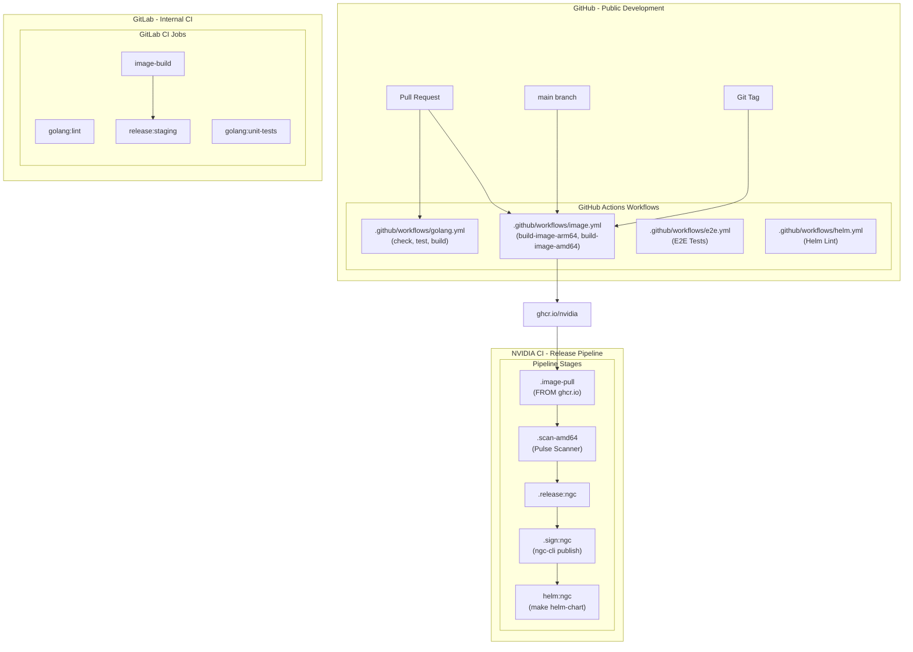
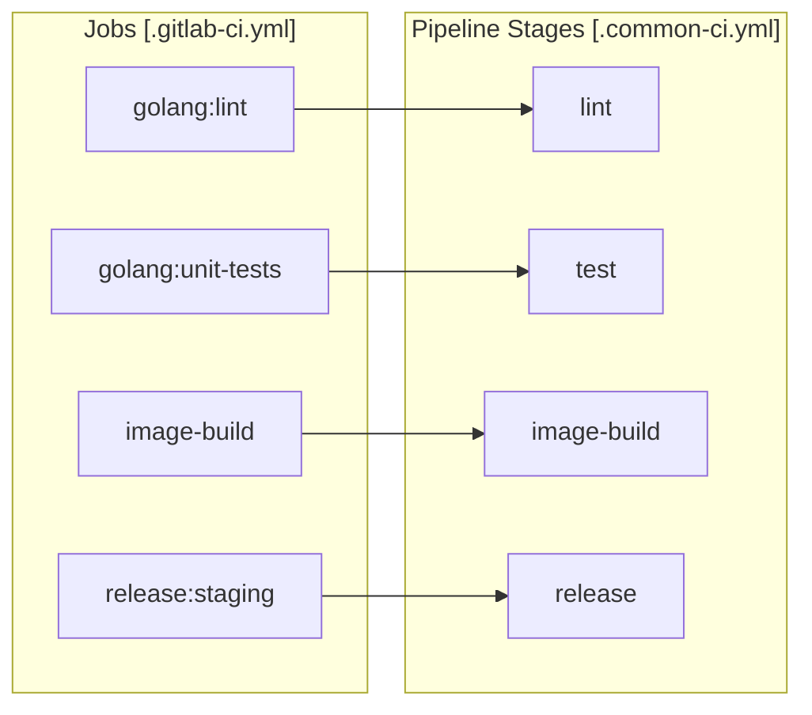

<!-- source: DeepWiki mcp.deepwiki.com · repo NVIDIA/k8s-nim-operator · page 8 CI/CD Pipeline · fetched 2026-10-26 -->

# CI/CD Pipeline

Relevant source files

The following files were used as context for generating this wiki page:

- [.common-ci.yml](.common-ci.yml)
- [.github/workflows/golang.yml](.github/workflows/golang.yml)
- [.gitlab-ci.yml](.gitlab-ci.yml)
- [.nvidia-ci.yml](.nvidia-ci.yml)

This document provides a comprehensive overview of the Continuous Integration and Continuous Deployment (CI/CD) pipeline for the `k8s-nim-operator`. The pipeline implements a dual-strategy architecture using GitHub Actions for public development and GitLab CI for internal release management, security scanning, and publishing to the NVIDIA GPU Cloud (NGC).

## Overview

The `k8s-nim-operator` employs a multi-stage CI/CD architecture that separates public development from controlled releases. 

### CI/CD Systems

| System | Purpose | Trigger Conditions | Primary Outputs |
|--------|---------|-------------------|-----------------|
| **GitHub Actions** | Development CI, build validation, staging releases | Pull requests, pushes to `main` and `release-*` branches | Container images to `ghcr.io/nvidia/k8s-nim-operator`, OLM bundles |
| **GitLab CI** | Internal validation, build verification | Merge requests, pushes to main/release branches | Staging images to internal registry |
| **NVIDIA CI** | Security scanning, production releases | Pulls staging images, triggered on tags or main branch | Signed images to NGC, Helm charts to NGC |

### Pipeline Architecture

The following diagram illustrates how the three CI systems interact, bridging the natural language flow to the specific code entities defined in the workflow files.

**CI System Interaction and Code Entities**

Sources: [.github/workflows/image.yml:1-232](), [.github/workflows/golang.yml:1-113](), [.gitlab-ci.yml:1-106](), [.nvidia-ci.yml:1-211](), [.common-ci.yml:24-34]()

For detailed information on each subsystem, see:
- [Pipeline Overview](#8.1) — High-level overview of the CI/CD architecture.
- [GitHub Actions Workflows](#8.2) — Detailed documentation of workflows like `golang.yml` and `image.yml`.
- [GitLab CI Pipeline](#8.3) — Documentation of internal stages and job templates.
- [Multi-Architecture Image Building](#8.4) — Guide to ARM64/AMD64 builds and manifest creation.
- [Security Scanning](#8.5) — Documentation of CodeQL and Pulse container scanning.
- [Release Process](#8.6) — Step-by-step guide for NGC publishing and signing.

## GitHub Actions Workflows

GitHub Actions is the primary CI for public development. It executes workflows that validate code quality, build multi-arch artifacts, and perform security analysis.

### golang.yml - Code Quality
The `golang.yml` workflow validates Go code using `golangci-lint` and executes unit tests.
- **check job**: Runs `make check-vendor` and `make validate-generated-assets` [[.github/workflows/golang.yml:25-60]]().
- **test job**: Executes `make coverage` [[.github/workflows/golang.yml:61-86]]().
- **build job**: Verifies the binary can be compiled via `make build` [[.github/workflows/golang.yml:87-112]]().

### image.yml - Multi-Architecture Builds
The `image.yml` workflow orchestrates parallel builds for `linux/amd64` and `linux/arm64`.
- It uses `DOCKER_BUILD_PLATFORM_OPTIONS` to specify architectures [[.github/workflows/image.yml:54]]().
- It combines images into a single manifest using `docker manifest create` [[.github/workflows/image.yml:154-164]]().

For details, see [GitHub Actions Workflows](#8.2).

## GitLab CI Pipeline

The GitLab CI pipeline, configured in `.gitlab-ci.yml`, provides internal validation. It inherits shared logic from `.common-ci.yml` [[.gitlab-ci.yml:15-16]]().

**GitLab CI Job Flow**

Sources: [.gitlab-ci.yml:27-106](), [.common-ci.yml:24-34]()

For details, see [GitLab CI Pipeline](#8.3).

## Multi-Architecture Image Building

The operator supports both AMD64 and ARM64. The build process utilizes Docker Buildx [[.common-ci.yml:85-94]](). 
- GitHub Actions uses specific runners like `linux-arm64-cpu4` [[.github/workflows/image.yml:32]]().
- GitLab CI utilizes `docker:dind` with experimental features enabled for multi-arch support [[.common-ci.yml:14-18]]().

For details, see [Multi-Architecture Image Building](#8.4).

## Security Scanning

Security is enforced through multiple layers:
- **Static Analysis**: GitHub Actions uses CodeQL for code scanning.
- **Container Scanning**: NVIDIA CI uses the Pulse scanner (`pulse-cli`) [[.nvidia-ci.yml:82-112]]().
- **Policy Evaluation**: Scans produce `policy_evaluation.json` and `vulns.json` as artifacts [[.nvidia-ci.yml:103-112]]().

For details, see [Security Scanning](#8.5).

## Release Process

The release process is triggered by Git tags. It involves:
1. **Image Pulling**: Moving images from GHCR to the internal registry [[.nvidia-ci.yml:39-71]]().
2. **NGC Publishing**: Pushing images to the NVIDIA GPU Cloud via `release:ngc` [[.nvidia-ci.yml:125-128]]().
3. **Signing**: Using `ngc-cli` to sign images with the `--sign` flag [[.nvidia-ci.yml:172]]().
4. **Helm Distribution**: Packaging and pushing charts using `make helm-chart` [[.nvidia-ci.yml:181-202]]().

For details, see [Release Process](#8.6).

Sources: [.github/workflows/image.yml:1-232](), [.gitlab-ci.yml:1-106](), [.nvidia-ci.yml:1-211](), [.common-ci.yml:1-208]()

---

