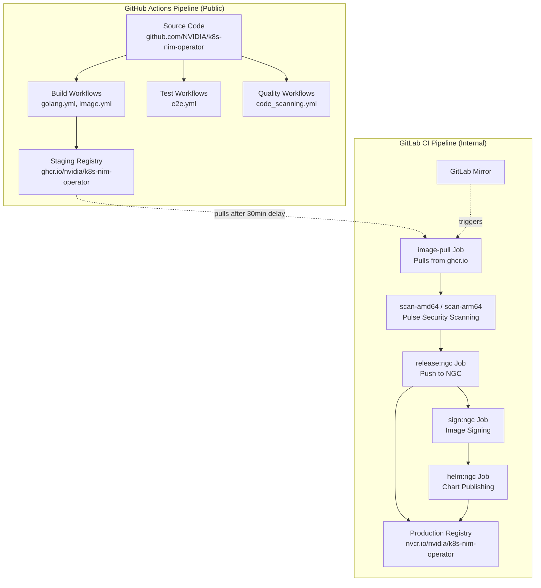
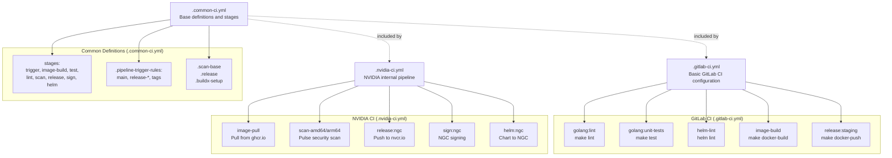
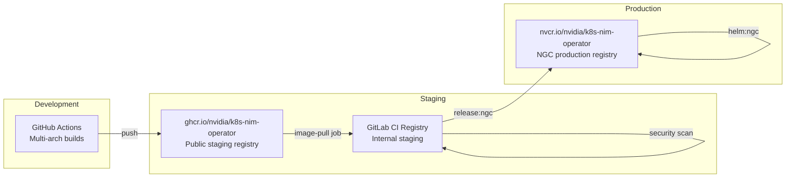
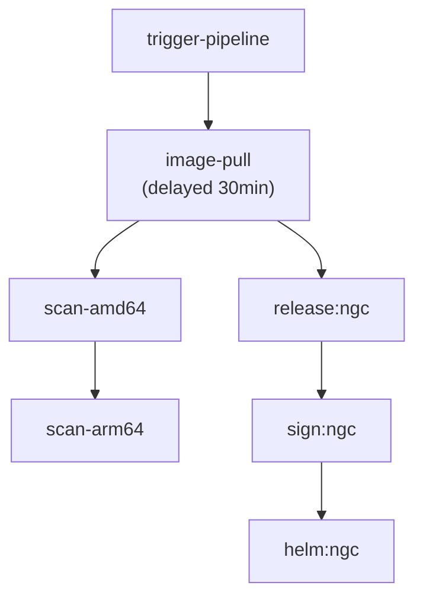

<!-- source: DeepWiki mcp.deepwiki.com · repo NVIDIA/k8s-nim-operator · page 8.1 Pipeline Overview · fetched 2026-10-26 -->

# Pipeline Overview

<details>
<summary>Relevant source files</summary>

The following files were used as context for generating this wiki page:

- [.common-ci.yml](.common-ci.yml)
- [.gitlab-ci.yml](.gitlab-ci.yml)
- [.nvidia-ci.yml](.nvidia-ci.yml)

</details>


This document provides a high-level overview of the k8s-nim-operator CI/CD pipeline architecture. It explains the dual-pipeline design that separates public development workflows (GitHub Actions) from internal release workflows (GitLab CI), and describes how these pipelines interact to deliver operator images and artifacts to multiple registries.

For detailed information about individual GitHub workflows, see [GitHub Actions Workflows](#8.2). For GitLab-specific pipeline stages and jobs, see [GitLab CI Pipeline](#8.3). For the technical details of multi-architecture image building, see [Multi-Architecture Image Building](#8.4).

## Dual Pipeline Architecture

The k8s-nim-operator employs a dual CI/CD strategy that separates public development activities from controlled internal releases:

**GitHub Actions Pipeline** - Handles public-facing development workflows including:
- Code building and compilation
- Unit and integration testing
- Static analysis and security scanning
- Multi-architecture image builds
- Publishing to staging registry (`ghcr.io/nvidia`)

**GitLab CI Pipeline** - Manages internal release workflows including:
- Pulling staged images from GitHub
- Security scanning with NVIDIA Pulse
- Publishing to NGC Registry (`nvcr.io`)
- Image signing for production
- Helm chart distribution

This separation allows the project to maintain transparency in development while ensuring that production releases undergo additional internal security and quality gates.



**Sources:** [.nvidia-ci.yml:39-71](), [.common-ci.yml:146-177]()

## Pipeline Stage Flow

Both pipelines organize work into stages that execute sequentially. The common stage definitions are shared via [.common-ci.yml:24-34]() and used by both the basic GitLab CI and NVIDIA internal CI configurations.

| Stage | Purpose | Key Jobs |
|-------|---------|----------|
| `trigger` | Pipeline initialization and gating | `trigger-pipeline` |
| `package-build` | Build Go binaries and packages | (GitHub Actions) |
| `image-build` | Build container images for multiple architectures | `image-build`, `image-pull` |
| `test` | Execute unit and integration tests | `golang:unit-tests`, integration tests |
| `lint` | Code quality and static analysis | `golang:lint` |
| `helm-lint` | Helm chart validation | `helm-lint` |
| `scan` | Security vulnerability scanning | `scan-amd64`, `scan-arm64` |
| `release` | Push images to target registries | `release:staging`, `release:ngc` |
| `sign` | Cryptographically sign production images | `sign:ngc` |
| `helm` | Publish Helm charts | `helm:ngc` |

**Sources:** [.common-ci.yml:24-34]()

## Configuration File Structure

The pipeline configuration is organized hierarchically to promote code reuse and maintainability:



**Sources:** [.common-ci.yml:15-16](), [.gitlab-ci.yml:15-16](), [.nvidia-ci.yml:15-16]()

### Configuration File Details

**`.common-ci.yml`** - Shared pipeline definitions
- Base job templates: `.scan-base`, `.release`, `.buildx-setup`, `.regctl-setup` [.common-ci.yml:100-144]()
- Stage definitions used by all pipelines [.common-ci.yml:24-34]()
- Platform targets: `.platform-amd64`, `.platform-arm64` [.common-ci.yml:76-82]()
- Pipeline trigger rules: `.pipeline-trigger-rules` [.common-ci.yml:37-46]()

**`.gitlab-ci.yml`** - Basic GitLab CI
- Linting: `golang:lint` executes `make lint` [.gitlab-ci.yml:27-38]()
- Testing: `golang:unit-tests` executes `make test` with coverage reporting [.gitlab-ci.yml:39-46]()
- Helm validation: `helm-lint` performs `helm lint` on operator charts [.gitlab-ci.yml:48-57]()
- Image building: `image-build` using `make docker-build` [.gitlab-ci.yml:60-75]()
- Staging release: `release:staging` using `make docker-push` [.gitlab-ci.yml:78-106]()

**`.nvidia-ci.yml`** - NVIDIA internal pipeline
- Image ingestion: `image-pull` pulls from `ghcr.io/nvidia` using `regctl` and `deployments/container/Makefile` [.nvidia-ci.yml:39-71]()
- Security scanning: Platform-specific `scan` jobs using `pulse-cli` [.nvidia-ci.yml:82-111]()
- NGC release: `release:ngc` pushes images to `NGC_REGISTRY` [.nvidia-ci.yml:114-127]()
- Image signing: `sign:ngc` uses `ngc-cli` to sign images [.nvidia-ci.yml:154-178]()
- Helm publishing: `helm:ngc` pushes charts to NGC using `ngc-cli registry chart push` [.nvidia-ci.yml:181-202]()

**Sources:** [.common-ci.yml:1-208](), [.gitlab-ci.yml:1-106](), [.nvidia-ci.yml:1-211]()

## Image Flow and Registry Strategy

The pipeline implements a staged promotion strategy where images flow from development to staging to production:



**Sources:** [.nvidia-ci.yml:36-49](), [.nvidia-ci.yml:114-127]()

### Key Variables

The pipeline uses several key variables to control image names and versions:

| Variable | Purpose | Example Value |
|----------|---------|---------------|
| `STAGING_REGISTRY` | Public staging registry | `ghcr.io/nvidia` [.nvidia-ci.yml:36]() |
| `STAGING_VERSION` | Staging image tag | `${CI_COMMIT_SHORT_SHA}` [.nvidia-ci.yml:37]() |
| `NGC_REGISTRY` | Production registry | `nvcr.io` [.nvidia-ci.yml:120]() |
| `CI_COMMIT_SHORT_SHA` | Immutable version tag | Git commit SHA [.common-ci.yml:103]() |
| `CI_COMMIT_TAG` | Release version | Git tag (e.g., `v1.0.0`) [.common-ci.yml:46]() |

**Sources:** [.nvidia-ci.yml:27-49](), [.common-ci.yml:103-104]()

## Pipeline Triggers and Execution Rules

The pipeline defines specific rules for when jobs execute, balancing automation with control:

### Common Trigger Rules

The `.pipeline-trigger-rules` template [.common-ci.yml:37-46]() defines when pipelines automatically trigger:

- Manual web UI triggers: `$CI_PIPELINE_SOURCE == "web"`
- Main branch pushes: `$CI_COMMIT_BRANCH == "main"`
- Release branch pushes: `$CI_COMMIT_BRANCH =~ /^release-.*$/`
- Git tags: `$CI_COMMIT_TAG && $CI_COMMIT_TAG != ""`

**Sources:** [.common-ci.yml:37-46]()

### Delayed Image Pull

The `image-pull` job implements a 30-minute delay to allow GitHub Actions to complete and publish images to the staging registry before GitLab attempts to pull them:

```yaml
when: delayed
start_in: 30 minutes
timeout: 30 minutes
```

This delay accounts for the asynchronous nature of the dual-pipeline architecture.

**Sources:** [.nvidia-ci.yml:51-53]()

### Release-Specific Rules

Release jobs only execute for specific conditions:

- **External releases** (`.release:external`): Only on Git tags or specific development branches [.common-ci.yml:192-201]()
- **NGC signing** (`sign:ngc`): Only on Git tags [.nvidia-ci.yml:157-158]()
- **Helm publishing** (`helm:ngc`): Only on Git tags [.nvidia-ci.yml:186-187]()

**Sources:** [.common-ci.yml:192-201](), [.nvidia-ci.yml:157-187]()

## Docker and Container Setup

The pipeline uses Docker-in-Docker with specific configurations for building multi-architecture images:

### Buildx Setup

The `.buildx-setup` template [.common-ci.yml:85-95]() configures Docker Buildx:

1. Downloads `docker-buildx` v0.15.1 binary.
2. Creates builder instance with `linux/amd64,linux/arm64` support.
3. Sets up QEMU for cross-platform builds using `multiarch/qemu-user-static`.

**Sources:** [.common-ci.yml:85-95]()

### Regctl Setup

The `.regctl-setup` template [.common-ci.yml:137-144]() provides registry manipulation capabilities:

1. Downloads `regctl` v0.7.1 for manifest and registry operations.
2. Used in `image-pull` and `release` steps to manage multi-arch manifests.

**Sources:** [.common-ci.yml:137-144]()

## Security Scanning Integration

The pipeline integrates security scanning at multiple points:

### Pulse Security Scanning

The `.scan` job [.nvidia-ci.yml:82-111]() performs container vulnerability scanning:

1. Authenticates to GitLab container registry.
2. Pulls platform-specific image using `--platform="${PLATFORM}"`.
3. Saves image to archive: `k8s-nim-operator.tar`.
4. Executes `pulse-cli` with policy evaluation using a generated `SSA_TOKEN`.
5. Generates artifacts: `sbom.json`, `vulns.json`, `policy_evaluation.json`.

**Sources:** [.nvidia-ci.yml:82-111]()

### Platform-Specific Scanning

Scans execute for both architectures:

- `scan-amd64`: Scans AMD64 images [.common-ci.yml:121-126]()
- `scan-arm64`: Scans ARM64 images [.common-ci.yml:128-134]()

The ARM64 scan depends on AMD64 scan completion to manage resource usage.

**Sources:** [.common-ci.yml:121-134]()

## Job Dependencies and DAG

The pipeline uses GitLab's `needs` keyword to create a directed acyclic graph (DAG) of job dependencies:



**Key Dependencies:**
- `scan-amd64` needs `image-pull` [.common-ci.yml:125-126]()
- `scan-arm64` needs both `image-pull` and `scan-amd64` [.common-ci.yml:132-134]()
- `sign:ngc` needs `release:ngc` [.nvidia-ci.yml:177-178]()
- `helm:ngc` needs `sign:ngc` [.nvidia-ci.yml:184-185]()

**Sources:** [.common-ci.yml:125-134](), [.nvidia-ci.yml:177-185]()

---

