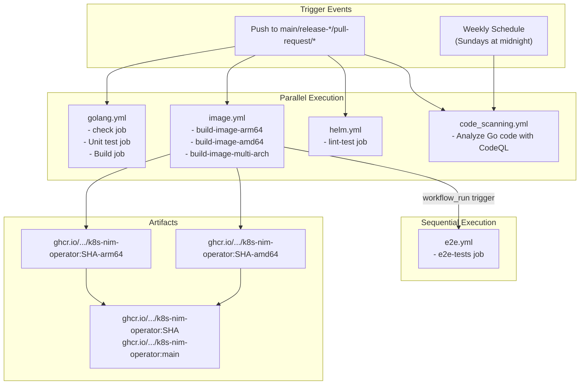
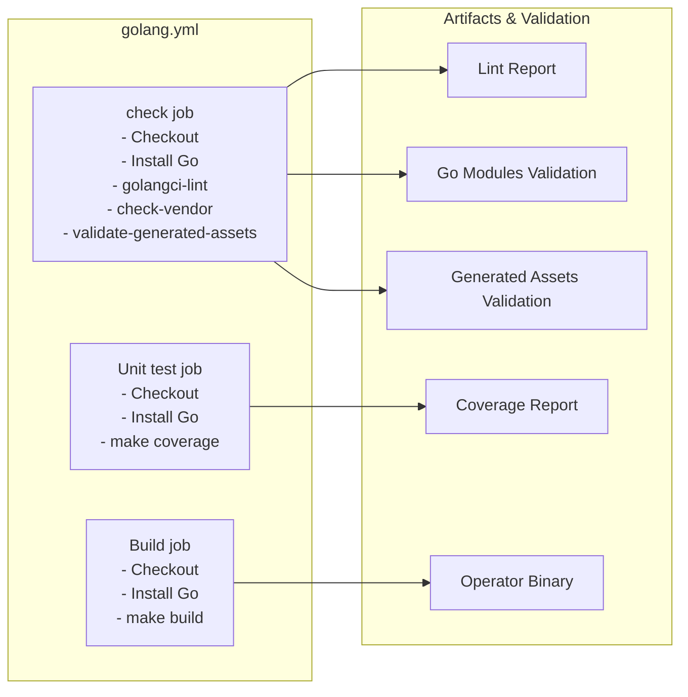
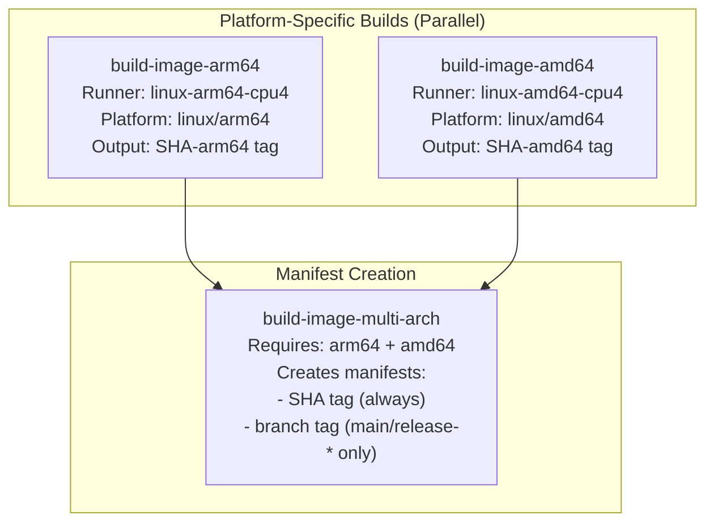
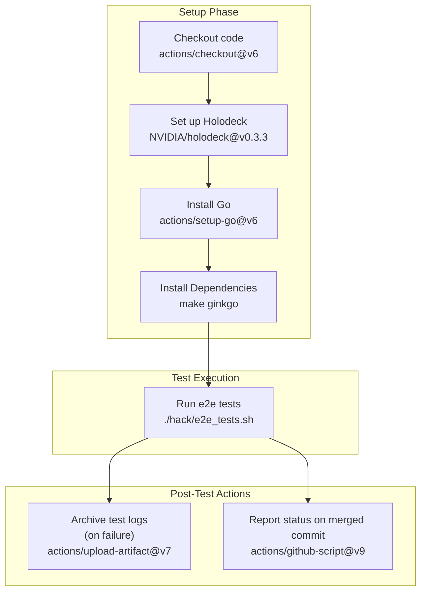

<!-- source: DeepWiki mcp.deepwiki.com · repo NVIDIA/k8s-nim-operator · page 8.2 GitHub Actions Workflows · fetched 2026-10-26 -->

# GitHub Actions Workflows

<details>
<summary>Relevant source files</summary>

The following files were used as context for generating this wiki page:

- [.github/workflows/code_scanning.yml](.github/workflows/code_scanning.yml)
- [.github/workflows/e2e.yml](.github/workflows/e2e.yml)
- [.github/workflows/golang.yml](.github/workflows/golang.yml)
- [.github/workflows/helm.yml](.github/workflows/helm.yml)
- [.github/workflows/image.yml](.github/workflows/image.yml)
- [.github/workflows/stale.yaml](.github/workflows/stale.yaml)

</details>


## Purpose and Scope

This page documents the GitHub Actions workflows that implement the continuous integration and development pipeline for the `k8s-nim-operator`. These workflows handle code quality checks, building, testing, and publishing staging artifacts to GitHub Container Registry (`ghcr.io`).

For information about the production release pipeline to NGC Registry, see [GitLab CI Pipeline](#8.3). For the overall CI/CD architecture, see [Pipeline Overview](#8.1). For details on multi-architecture image building mechanics, see [Multi-Architecture Image Building](#8.4).

**Sources:** [.github/workflows/]()

---

## Workflow Overview

The `k8s-nim-operator` uses five primary GitHub Actions workflows that execute on different triggers and serve distinct purposes:

| Workflow | File | Primary Purpose | Trigger Events |
|----------|------|----------------|----------------|
| **Golang** | `golang.yml` | Go code linting, testing, and building | Push to main/release-*/PR branches |
| **Image** | `image.yml` | Multi-architecture container image builds | Push to main/release-*/PR branches |
| **End-to-end Tests** | `e2e.yml` | Integration testing with Holodeck | Triggered by successful Image workflow completion |
| **Lint Helm Charts** | `helm.yml` | Helm chart validation | Push to main/release-*/PR branches |
| **CodeQL** | `code_scanning.yml` | Static security analysis | Weekly schedule + push to main/release-*/PR |

**Sources:** [.github/workflows/golang.yml:15-23](), [.github/workflows/image.yml:16-24](), [.github/workflows/e2e.yml:15-25](), [.github/workflows/helm.yml:1-9](), [.github/workflows/code_scanning.yml:15-25]()

---

## Workflow Relationships and Execution Flow



**Workflow Execution Characteristics:**

- **Parallel Workflows:** `golang.yml`, `image.yml`, `helm.yml`, and `code_scanning.yml` run in parallel on push events.
- **Sequential Dependency:** `e2e.yml` waits for successful completion of `image.yml` via the `workflow_run` trigger [[.github/workflows/e2e.yml:18-24]]().
- **Conditional Execution:** E2E tests only run if the Image workflow succeeded and was triggered by a push event, not a PR [[.github/workflows/e2e.yml:29]]().

**Sources:** [.github/workflows/e2e.yml:17-29](), [.github/workflows/golang.yml:17-23](), [.github/workflows/image.yml:18-24](), [.github/workflows/helm.yml:3-9](), [.github/workflows/code_scanning.yml:17-25]()

---

## Golang Workflow (`golang.yml`)

The Golang workflow performs code quality checks, unit testing, and build verification. It consists of three parallel jobs that execute on self-hosted `linux-amd64-cpu4` runners.

### Job Structure



### Check Job Details

The `check` job [[.github/workflows/golang.yml:25-60]]() performs static analysis and validation:

| Step | Purpose | Command/Action | Key Files |
|------|---------|----------------|-----------|
| Checkout code | Clone repository | `actions/checkout@v6` | - |
| Get Golang version | Extract Go version from script | `./hack/golang-version.sh` | `hack/golang-version.sh` |
| Install Go | Set up Go environment | `actions/setup-go@v6` | - |
| Lint | Run golangci-lint | `golangci/golangci-lint-action@v9` | `.golangci.yaml` |
| Setup Go Proxy | Configure Artifactory proxy | `nv-gha-runners/setup-artifactory-go-proxy@main` | - |
| Check golang modules | Verify vendor directory | `make check-vendor` | `Makefile`, `go.mod`, `go.sum` |
| Check generated assets | Verify code generation | `make validate-generated-assets` | `Makefile` |

**Lint Configuration:** The linting step uses `golangci-lint-action@v9` with the following parameters:
- Version: `latest` [[.github/workflows/golang.yml:45]]()
- Arguments: `-v --timeout 5m` [[.github/workflows/golang.yml:46]]()
- Cache disabled: `skip-cache: true` [[.github/workflows/golang.yml:47]]()

**Sources:** [.github/workflows/golang.yml:25-60]()

### Test Job Details

The `test` job [[.github/workflows/golang.yml:61-86]]() runs unit tests with coverage:

- **Coverage Command:** `make coverage` [[.github/workflows/golang.yml:86]]()
- **Go Proxy:** Configured via `nv-gha-runners/setup-artifactory-go-proxy@main` [[.github/workflows/golang.yml:81]]().
- **Runner:** `linux-amd64-cpu4` self-hosted runner [[.github/workflows/golang.yml:63]]().

**Sources:** [.github/workflows/golang.yml:61-86]()

### Build Job Details

The `build` job [[.github/workflows/golang.yml:87-113]]() verifies that the operator binary can be built:

- **Build Command:** `make build` [[.github/workflows/golang.yml:112]]()
- **Purpose:** Ensures the code compiles successfully.
- **Runner:** `linux-amd64-cpu4` self-hosted runner [[.github/workflows/golang.yml:89]]().

**Sources:** [.github/workflows/golang.yml:87-113]()

---

## Image Workflow (`image.yml`)

The Image workflow builds multi-architecture container images for both AMD64 and ARM64 platforms and creates multi-arch manifests.

### Job Dependency Chain



### Build Logic and Artifact Generation

All build jobs share logic for determining whether to push artifacts [[.github/workflows/image.yml:44-52](), [.github/workflows/image.yml:94-102]]():

**Artifact Generation Conditions:**

| Actor/Event | Condition | `PUSH_ON_BUILD` |
|-------------|-----------|-----------------|
| Dependabot | `github.actor == "dependabot[bot]"` | `false` |
| Pull Request (same repo) | `event_name == "pull_request"` AND same repo | `true` |
| Push to branch | `event_name == "push"` | `true` |

**Key Environment Variables:**

- `COMMIT_SHORT_SHA`: First 8 characters of commit SHA [[.github/workflows/image.yml:38]]().
- `LOWERCASE_REPO_OWNER`: Lowercased GitHub repository owner [[.github/workflows/image.yml:39]]().

**Sources:** [.github/workflows/image.yml:35-54](), [.github/workflows/image.yml:85-104]()

### Platform-Specific Image Builds

**ARM64 Build Job** [[.github/workflows/image.yml:26-75]]():
- Runner: `linux-arm64-cpu4` [[.github/workflows/image.yml:27]]().
- Platform: `linux/arm64` via `DOCKER_BUILD_PLATFORM_OPTIONS` [[.github/workflows/image.yml:54]]().
- Image Tag: `${COMMIT_SHORT_SHA}-arm64` [[.github/workflows/image.yml:71]]().
- Build Command: `make -f deployments/container/Makefile build` [[.github/workflows/image.yml:75]]().

**AMD64 Build Job** [[.github/workflows/image.yml:76-125]]():
- Runner: `linux-amd64-cpu4` [[.github/workflows/image.yml:77]]().
- Platform: `linux/amd64` via `DOCKER_BUILD_PLATFORM_OPTIONS` [[.github/workflows/image.yml:104]]().
- Image Tag: `${COMMIT_SHORT_SHA}-amd64` [[.github/workflows/image.yml:121]]().
- Build Command: `make -f deployments/container/Makefile build` [[.github/workflows/image.yml:125]]().

**Sources:** [.github/workflows/image.yml:26-125]()

### Multi-Architecture Manifest Creation

The `build-image-multi-arch` job [[.github/workflows/image.yml:126-177]]() creates Docker manifests referencing both platform-specific images.

**Commit SHA Manifest (Always Created):**
The commit SHA manifest is created unconditionally [[.github/workflows/image.yml:154-164]]():
```bash
docker manifest create "${OPERATOR_MULTIARCH_IMAGE}" "${OPERATOR_IMAGE_AMD}" "${OPERATOR_IMAGE_ARM}"
docker manifest push "${OPERATOR_MULTIARCH_IMAGE}"
```

**Branch Tag Manifest (Conditional):**
The branch tag manifest is only created for `main` and `release-*` branches [[.github/workflows/image.yml:166-177]]().

**Sources:** [.github/workflows/image.yml:126-177]()

---

## End-to-End Tests Workflow (`e2e.yml`)

The E2E workflow runs integration tests in a Kubernetes cluster provisioned by Holodeck on AWS.

### E2E Test Execution Flow



**Test Execution Script:** `./hack/e2e_tests.sh` [[.github/workflows/e2e.yml:74]]().

**Sources:** [.github/workflows/e2e.yml:36-97]()

---

## Helm Lint Workflow (`helm.yml`)

The Helm workflow validates all Helm charts in the repository.

**Workflow Configuration** [[.github/workflows/helm.yml:1-22]]():
- Runner: `ubuntu-latest` [[.github/workflows/helm.yml:12]]().
- Helm Version: `v3.14.4` [[.github/workflows/helm.yml:19]]().
- Lint Command: `helm lint deployments/helm/*` [[.github/workflows/helm.yml:21]]().

**Sources:** [.github/workflows/helm.yml]()

---

## CodeQL Security Scanning Workflow (`code_scanning.yml`)

The CodeQL workflow performs static security analysis on the Go codebase.

### CodeQL Configuration

- **Action:** `github/codeql-action/init@v4` [[.github/workflows/code_scanning.yml:38]]().
- **Language:** `go` [[.github/workflows/code_scanning.yml:40]]().
- **Build Mode:** `manual` [[.github/workflows/code_scanning.yml:41]]().
- **Manual Build Step:** `make build` [[.github/workflows/code_scanning.yml:44]]().
- **Analysis Action:** `github/codeql-action/analyze@v4` [[.github/workflows/code_scanning.yml:46]]().

**Sources:** [.github/workflows/code_scanning.yml:26-49]()

---

## Summary Table

| Workflow | Jobs | Primary Artifacts | Critical Dependencies |
|----------|------|-------------------|----------------------|
| **golang.yml** | check, Unit test, Build | Coverage reports, build validation | `golangci-lint`, `go proxy` |
| **image.yml** | build-image-arm64, build-image-amd64, build-image-multi-arch | Multi-arch images | `Docker Buildx`, `GHCR` |
| **e2e.yml** | e2e-tests | Test logs, check runs | `Holodeck`, `NGC/HF tokens` |
| **helm.yml** | lint-test | Lint reports | `Helm 3.14.4` |
| **code_scanning.yml** | Analyze | Security events | `CodeQL`, `make build` |

**Sources:** [.github/workflows/]()

---

