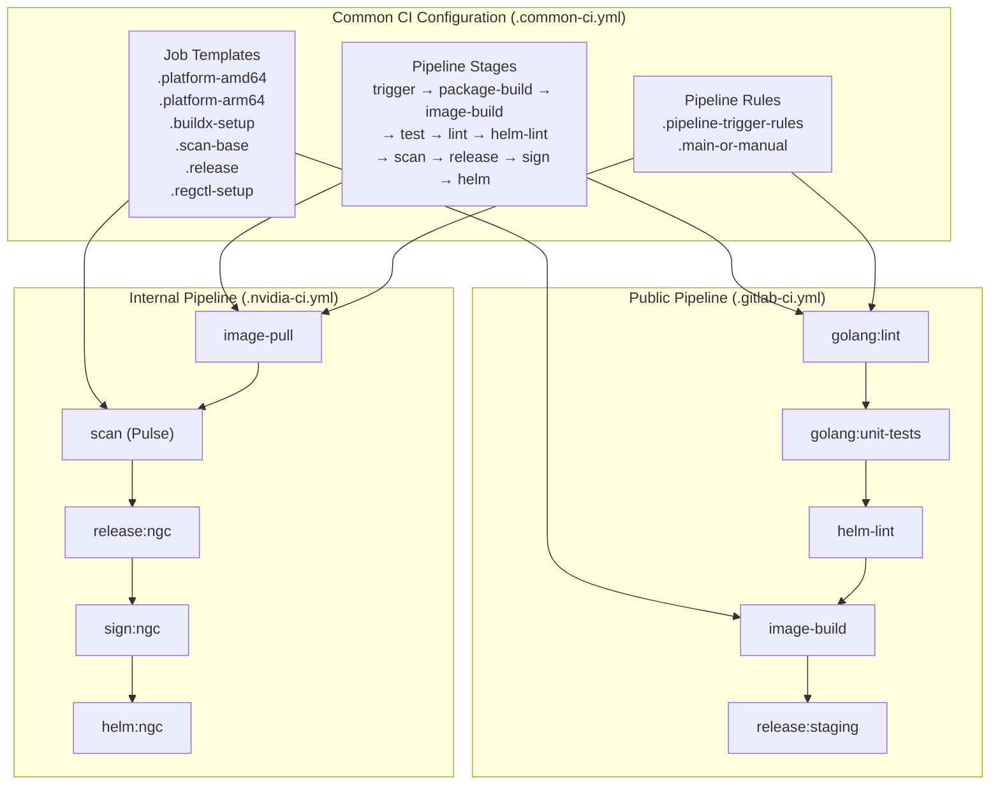
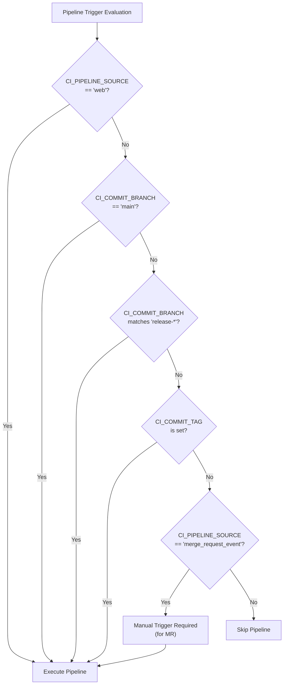
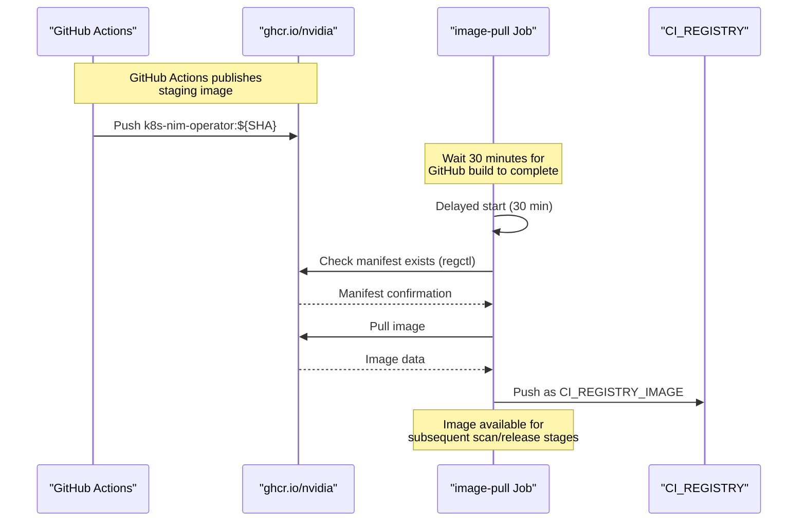
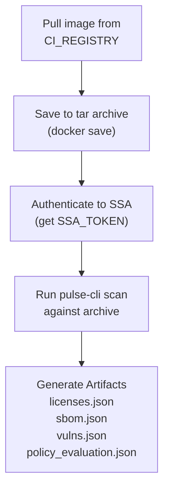

<!-- source: DeepWiki mcp.deepwiki.com · repo NVIDIA/k8s-nim-operator · page 8.3 GitLab CI Pipeline · fetched 2026-10-26 -->

# GitLab CI Pipeline

<details>
<summary>Relevant source files</summary>

The following files were used as context for generating this wiki page:

- [.common-ci.yml](.common-ci.yml)
- [.gitlab-ci.yml](.gitlab-ci.yml)
- [.nvidia-ci.yml](.nvidia-ci.yml)

</details>


## Purpose and Scope

This document describes the GitLab CI pipeline configuration used by the `k8s-nim-operator` project. The GitLab CI pipeline is the internal component of the dual CI/CD strategy, responsible for pulling staging images from GitHub Container Registry (GHCR), performing security scans, and publishing signed artifacts to the NVIDIA NGC Registry.

For information about the overall CI/CD architecture and how GitLab CI relates to GitHub Actions, see [Pipeline Overview](#8.1). For details on GitHub-based workflows, see [GitHub Actions Workflows](#8.2). For security scanning details, see [Security Scanning](#8.5). For the complete release workflow, see [Release Process](#8.6).

**Sources:** [.gitlab-ci.yml](), [.nvidia-ci.yml](), [.common-ci.yml]()

## Pipeline Architecture

The GitLab CI pipeline is structured in two layers:

1.  **Common Configuration** ([.common-ci.yml]()): Defines shared stages, job templates, and helper functions.
2.  **Pipeline-Specific Configurations**:
    *   **Public Pipeline** ([.gitlab-ci.yml]()): Handles basic build, test, and staging releases within the GitLab environment.
    *   **Internal NVIDIA Pipeline** ([.nvidia-ci.yml]()): Manages production releases to NGC, including security scanning and signing.



**Diagram: GitLab CI Pipeline Structure**

**Sources:** [.common-ci.yml:14-34](), [.gitlab-ci.yml:15-106](), [.nvidia-ci.yml:15-211]()

## Pipeline Stages

The GitLab CI pipeline defines 10 sequential stages to manage the lifecycle from triggering to final artifact publication:

| Stage | Purpose | Key Jobs |
| :--- | :--- | :--- |
| `trigger` | Manual pipeline trigger for merge requests | `trigger-pipeline` |
| `package-build` | Placeholder for building Go packages | - |
| `image-build` | Build or pull container images | `image-build`, `image-pull` |
| `test` | Run unit and integration tests | `golang:unit-tests` |
| `lint` | Code quality checks | `golang:lint` |
| `helm-lint` | Helm chart validation | `helm-lint` |
| `scan` | Security scanning with Pulse | `scan-amd64`, `scan-arm64` |
| `release` | Push images to target registries | `release:staging`, `release:ngc` |
| `sign` | Sign container images for NGC | `sign:ngc` |
| `helm` | Publish Helm charts to NGC | `helm:ngc` |

**Sources:** [.common-ci.yml:24-34]()

## Pipeline Trigger Rules

The pipeline uses a rule system defined in `.pipeline-trigger-rules` ([.common-ci.yml:37-46]()) to determine execution context:



**Diagram: Pipeline Trigger Decision Flow**

*   **Manual triggers**: When started via GitLab UI (`CI_PIPELINE_SOURCE == "web"`).
*   **Main branch**: Automatic execution for all pushes to `main`.
*   **Release branches**: Automatic execution for branches matching `release-*`.
*   **Tags**: Automatic execution for any tagged commit.
*   **Merge requests**: Requires manual approval via the `trigger-pipeline` job ([.common-ci.yml:64-73]()).

**Sources:** [.common-ci.yml:37-73](), [.gitlab-ci.yml:27-38]()

## Default Runner Configuration

Jobs utilize tagged runners to ensure the execution environment supports multi-architecture builds and privileged operations:

```yaml
default:
  tags:
    - cnt
    - container-dev
    - docker/multi-arch
    - docker/privileged
    - os/linux
    - type/docker
```

These tags guarantee access to Docker Buildx and QEMU for ARM64/AMD64 cross-compilation and scanning.

**Sources:** [.gitlab-ci.yml:18-25](), [.nvidia-ci.yml:18-25]()

## Image Pull Stage (Internal Pipeline)

The `image-pull` job in the internal pipeline ([.nvidia-ci.yml:68-70]()) acts as a bridge, importing images built by GitHub Actions into the internal GitLab registry for scanning.



**Diagram: Image Pull Flow from GHCR to Internal Registry**

### Delayed Start and Reliability
To account for the time GitHub Actions takes to build images, `image-pull` uses a 30-minute delay ([.nvidia-ci.yml:51-52]()) and a retry mechanism ([.nvidia-ci.yml:54-58]()) for `job_execution_timeout`.

### Manifest Verification
The job uses `regctl manifest get` to verify the image exists in GHCR before attempting the pull ([.nvidia-ci.yml:63]()). It then uses a Makefile target `push` in `deployments/container/Makefile` to transfer the image between registries ([.nvidia-ci.yml:66]()).

**Sources:** [.nvidia-ci.yml:39-70](), [.common-ci.yml:137-144]()

## Testing and Linting Jobs

### Go Linting (`golang:lint`)
Uses the `golang:1.22.0` image to run `make lint` ([.gitlab-ci.yml:27-37]()). It performs a `git fetch origin main` to allow the linter to evaluate changes against the main branch.

### Unit Tests (`golang:unit-tests`)
Executes `make test` and captures code coverage using the regex `/^total:\s+\(statements\)\s+(\d+(?:\.\d+)?%)$/` ([.gitlab-ci.yml:39-46]()).

### Helm Chart Linting (`helm-lint`)
Validates the operator's Helm charts located in `deployments/helm/k8s-nim-operator/` using the `helm lint` command ([.gitlab-ci.yml:48-57]()).

**Sources:** [.gitlab-ci.yml:27-57]()

## Security Scanning

Security scanning is performed by the `scan-amd64` and `scan-arm64` jobs in the internal pipeline using NVIDIA Pulse.



**Diagram: Security Scan Workflow**

### Scan Implementation
The `.scan` template ([.nvidia-ci.yml:82-111]()) performs the following:
1.  **Image Prep**: Pulls the platform-specific image and saves it to a `.tar` archive ([.nvidia-ci.yml:95-96]()).
2.  **Authentication**: Obtains an SSA token using `SSA_CLIENT_ID` and `SSA_CLIENT_SECRET` ([.nvidia-ci.yml:97-99]()).
3.  **Execution**: Runs `pulse-cli` to scan the archive against the defined `CONTAINER_POLICY` ([.nvidia-ci.yml:102]()).
4.  **Artifacts**: Collects logs, SBOMs, and vulnerability reports as GitLab artifacts ([.nvidia-ci.yml:103-111]()).

**Sources:** [.nvidia-ci.yml:82-134](), [.common-ci.yml:100-134]()

## Release to NGC

The `release:ngc` job publishes the final operator images to the NVIDIA NGC Registry.

### Release Job Hierarchy
The release logic is inherited through several templates:
1.  `.release` ([.common-ci.yml:149-176]()): Sets up `regctl` and handles the registry login and `make push` logic.
2.  `.release:external` ([.common-ci.yml:192-201]()): Applies rules for tags (using `CI_COMMIT_TAG`) and the main branch (using `devel` tag).
3.  `.release:ngc` ([.nvidia-ci.yml:114-121]()): Sets the `OUT_REGISTRY` to `NGC_REGISTRY`.

### Versioning Strategy
*   **Tags**: Images are tagged with the specific Git tag ([.common-ci.yml:198]()).
*   **Main Branch**: Images are tagged as `devel` ([.common-ci.yml:201]()).

**Sources:** [.nvidia-ci.yml:114-127](), [.common-ci.yml:146-201]()

## Image Signing and Helm Publication

### Image Signing (`sign:ngc`)
This job ([.nvidia-ci.yml:174-178]()) uses the `ngc-cli` to sign images already published to NGC. It is triggered only for tags and depends on the successful completion of `release:ngc`.

The command `ngc-cli/ngc registry image publish` is used with the `--sign` flag to apply cryptographic signatures ([.nvidia-ci.yml:172]()).

### Helm Publication (`helm:ngc`)
Publishes the Helm chart to the NGC registry ([.nvidia-ci.yml:181-202]()).
1.  **Version Sanitization**: Extracts the version from `versions.mk` and removes the 'v' prefix to comply with Helm semantic versioning requirements ([.nvidia-ci.yml:201]()).
2.  **Packaging**: Runs `make helm-chart` to generate the `.tgz` package ([.nvidia-ci.yml:199]()).
3.  **Upload**: Uses `ngc-cli/ngc registry chart push` to upload the artifact ([.nvidia-ci.yml:202]()).

**Sources:** [.nvidia-ci.yml:131-202]()

## Multi-Architecture Support

The pipeline leverages Docker Buildx and platform variables to manage multi-arch images.

### Buildx Setup
The `.buildx-setup` template ([.common-ci.yml:85-95]()) installs `docker-buildx` and initializes a builder instance supporting `linux/amd64` and `linux/arm64`.

### Platform Targets
Jobs use `.platform-amd64` ([.common-ci.yml:76-78]()) and `.platform-arm64` ([.common-ci.yml:80-82]()) templates to set the `PLATFORM` variable, which is then used by `docker pull` and `regctl` commands.

**Sources:** [.common-ci.yml:76-95]()

---

