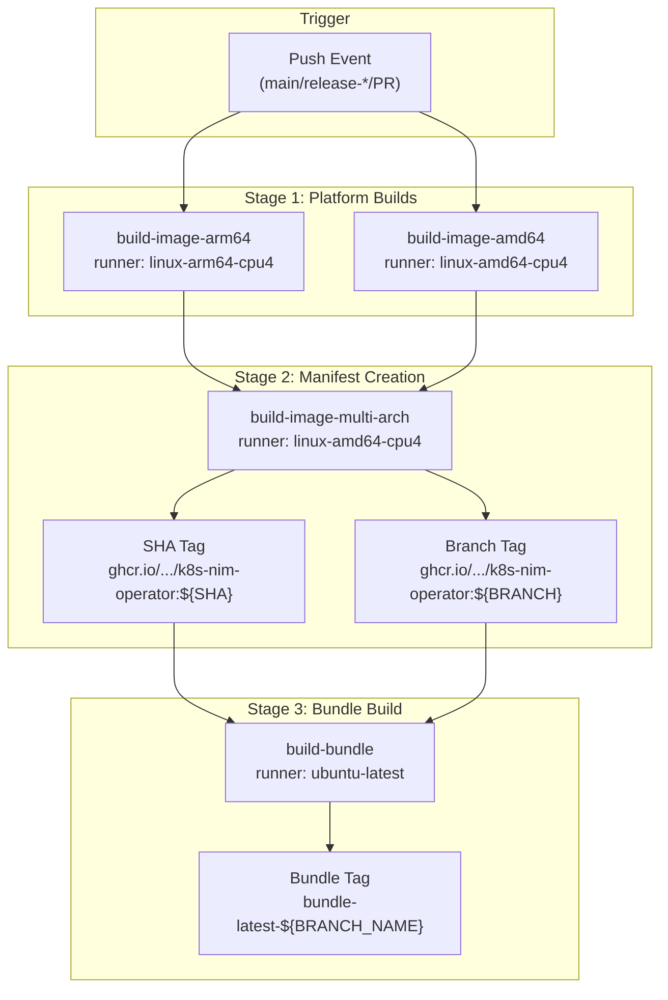
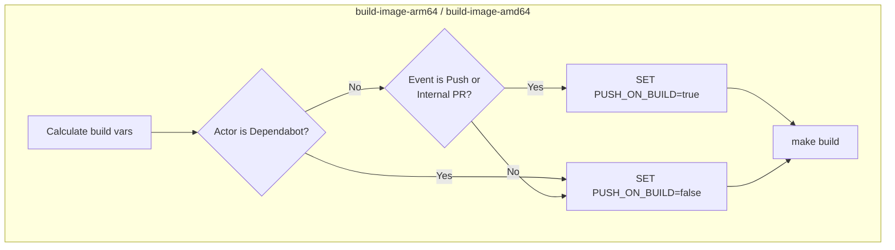
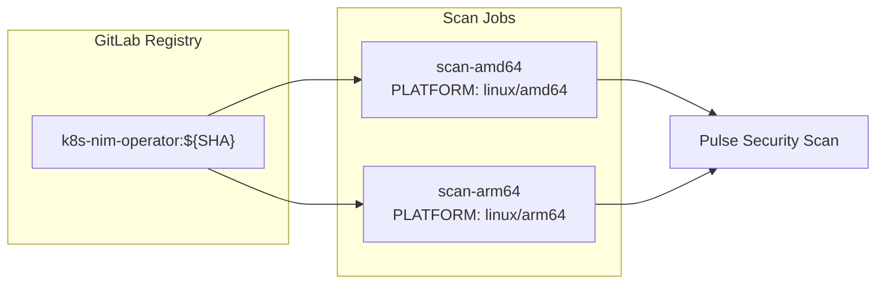

<!-- source: DeepWiki mcp.deepwiki.com · repo NVIDIA/k8s-nim-operator · page 8.4 Multi-Architecture Image Building · fetched 2026-10-26 -->

# Multi-Architecture Image Building

<details>
<summary>Relevant source files</summary>

The following files were used as context for generating this wiki page:

- [.common-ci.yml](.common-ci.yml)
- [.github/workflows/image.yml](.github/workflows/image.yml)
- [.nvidia-ci.yml](.nvidia-ci.yml)

</details>


## Purpose and Scope

This document provides a detailed technical reference for the multi-architecture image building process in k8s-nim-operator. It covers the parallel build strategy for ARM64 and AMD64 platforms, multi-architecture manifest creation, tagging conventions, and integration with the dual GitHub/GitLab CI/CD pipeline.

The operator supports both `linux/amd64` and `linux/arm64` architectures to ensure compatibility across diverse Kubernetes environments, including cloud instances and edge devices.

---

## Build Strategy Overview

The k8s-nim-operator implements a three-stage multi-architecture build process executed primarily through GitHub Actions, with consumption and scanning in GitLab CI:

1.  **Parallel Platform Builds**: ARM64 and AMD64 images are built concurrently on architecture-specific runners using `docker buildx`.
2.  **Manifest Creation**: Platform-specific images are combined into multi-architecture manifests using `docker manifest` commands.
3.  **Bundle Creation**: OLM (Operator Lifecycle Manager) bundle images are generated with references to the multi-arch manifests.



**Sources**: [.github/workflows/image.yml:26-232]()

---

## Platform-Specific Builds

### ARM64 Build Job

The `build-image-arm64` job executes on a native `linux-arm64-cpu4` runner. This avoids the performance overhead of emulation during the compilation phase.

- **Variables**: Sets `DOCKER_BUILD_PLATFORM_OPTIONS=--platform=linux/arm64` [.github/workflows/image.yml:54]().
- **Tagging**: Produces an image with the suffix `-arm64` appended to the commit SHA [.github/workflows/image.yml:71]().
- **Build Execution**: Invokes `make -f deployments/container/Makefile build` [.github/workflows/image.yml:75]().

### AMD64 Build Job

The `build-image-amd64` job mirrors the ARM64 logic but targets the `linux-amd64-cpu4` runner.

- **Variables**: Sets `DOCKER_BUILD_PLATFORM_OPTIONS=--platform=linux/amd64` [.github/workflows/image.yml:104]().
- **Tagging**: Produces an image with the suffix `-amd64` [.github/workflows/image.yml:121]().
- **Build Execution**: Invokes the same Makefile target as the ARM64 job [.github/workflows/image.yml:125]().

### Artifact Generation Logic

Both jobs use a common logic to determine if images should be pushed to the GitHub Container Registry (`ghcr.io`). Artifacts are generated if the actor is not `dependabot[bot]` and the event is either a push or an internal pull request [.github/workflows/image.yml:44-53]().



**Sources**: [.github/workflows/image.yml:35-54](), [.github/workflows/image.yml:85-104]()

---

## Multi-Architecture Manifest Creation

The `build-image-multi-arch` job consolidates the architecture-specific images into a single manifest list. This allows users to pull `ghcr.io/nvidia/k8s-nim-operator:latest` and have the container runtime automatically select the correct layer for their CPU architecture.

### Manifest Commands

The job uses `docker manifest create` to link the AMD64 and ARM64 images [.github/workflows/image.yml:160-163]().

1.  **Commit SHA Manifest**: Always created to provide an immutable reference for every build [.github/workflows/image.yml:154-164]().
2.  **Branch Tag Manifest**: Created conditionally for `main` or `release-*` branches [.github/workflows/image.yml:166-177]().

```bash
# Example logic for Branch Tag Manifest
docker manifest create \
  "${OPERATOR_MULTIARCH_IMAGE}" \
  "${OPERATOR_IMAGE_AMD}" \
  "${OPERATOR_IMAGE_ARM}"
docker manifest push "${OPERATOR_MULTIARCH_IMAGE}"
```

**Sources**: [.github/workflows/image.yml:154-177]()

---

## GitLab CI Integration and Scanning

While GitHub handles the initial builds, GitLab CI is used for internal release processes, security scanning, and signing.

### Image Pull and Synchronization

The `image-pull` job in GitLab [.nvidia-ci.yml:68-71]() acts as a bridge. It pulls the multi-arch manifest from `ghcr.io` and pushes it to the internal GitLab registry [.nvidia-ci.yml:66]().

- **Delayed Start**: The job includes a `start_in: 30 minutes` delay to ensure the GitHub Actions build has completed [.nvidia-ci.yml:52]().
- **Verification**: It uses `regctl manifest get --list` to verify the existence of the manifest before attempting the pull [.nvidia-ci.yml:63]().

### Multi-Arch Scanning

The `.scan` template in GitLab CI handles security analysis for both architectures [.nvidia-ci.yml:82-112]().

- **Platform Targeting**: The scan jobs (`scan-amd64`, `scan-arm64`) extend the `.scan` base and specify the `PLATFORM` variable [.common-ci.yml:121-134]().
- **Architecture Specificity**: The scanner pulls the image using the `--platform` flag to ensure the correct architecture is analyzed [.nvidia-ci.yml:95]().



**Sources**: [.common-ci.yml:121-134](), [.nvidia-ci.yml:82-112]()

---

## Build Tools Reference

The pipeline relies on several specialized tools to manage multi-architecture manifests and cross-platform builds.

### Tooling Table

| Tool | Usage | Version | Source |
| :--- | :--- | :--- | :--- |
| `docker buildx` | Building platform-specific images | `v0.15.1` | [.common-ci.yml:87]() |
| `regctl` | Manifest management and registry sync | `v0.7.1` | [.common-ci.yml:139]() |
| `qemu-user-static` | Emulation for non-native builds | N/A | [.common-ci.yml:95]() |
| `ngc-cli` | Signing and publishing to NGC | Latest | [.nvidia-ci.yml:131-143]() |

### Buildx Configuration

The `.buildx-setup` anchor in GitLab CI configures the Docker environment to support multiple platforms simultaneously.

```yaml
.buildx-setup:
  before_script:
    - docker buildx create --use --platform=linux/amd64,linux/arm64
    - '[[ -n "${SKIP_QEMU_SETUP}" ]] || docker run --rm --privileged multiarch/qemu-user-static --reset -p yes'
```

**Sources**: [.common-ci.yml:85-95]()

---

## Tagging Strategy Summary

The following table describes the tagging convention used across the multi-arch process:

| Tag Format | Scope | Type |
| :--- | :--- | :--- |
| `${SHA}-amd64` | GitHub Registry | Architecture-specific image |
| `${SHA}-arm64` | GitHub Registry | Architecture-specific image |
| `${SHA}` | GitHub & GitLab | Multi-arch manifest list |
| `main` / `release-*` | GitHub & NGC | Mutable branch-latest manifest |
| `devel` | Internal Registry | Development manifest from `main` [.nvidia-ci.yml:32]() |

**Sources**: [.github/workflows/image.yml:154-177](), [.nvidia-ci.yml:30-32]()

---

