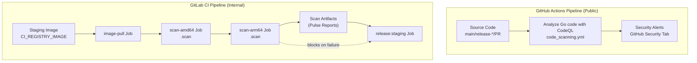
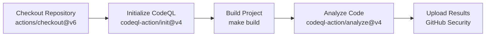
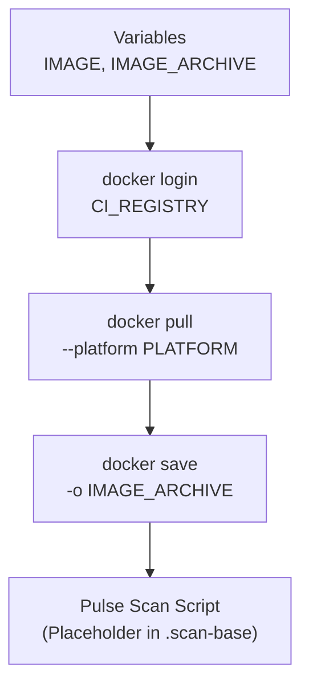
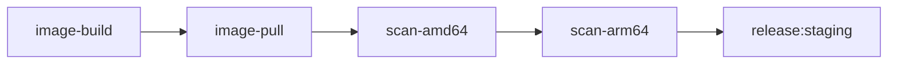

<!-- source: DeepWiki mcp.deepwiki.com · repo NVIDIA/k8s-nim-operator · page 8.5 Security Scanning · fetched 2026-10-26 -->

# Security Scanning

Relevant source files

The following files were used as context for generating this wiki page:

- [.common-ci.yml](.common-ci.yml)
- [.github/workflows/code_scanning.yml](.github/workflows/code_scanning.yml)
- [.gitlab-ci.yml](.gitlab-ci.yml)

## Purpose and Scope

This document describes the security scanning systems used in the k8s-nim-operator CI/CD pipeline. The operator implements two complementary security scanning approaches: **CodeQL static analysis** for source code vulnerability detection and **Pulse container scanning** for runtime image security assessment. These systems run automatically as part of the CI/CD pipeline to identify security vulnerabilities before code reaches production.

For information about the broader CI/CD pipeline architecture, see [Pipeline Overview](#8.1). For details on the release process that consumes scan results, see [Release Process](#8.6).

---

## Security Scanning Architecture

The security scanning system operates at two distinct stages of the CI/CD pipeline:

**Security Scanning Workflow Architecture**

**Sources:** [.github/workflows/code_scanning.yml:15-49](), [.common-ci.yml:100-135](), [.gitlab-ci.yml:102-106]()

---

## CodeQL Static Analysis

CodeQL performs static analysis on the Go source code to identify security vulnerabilities, bugs, and code quality issues. This scanning runs in the public GitHub repository as part of GitHub Actions.

### Trigger Conditions

CodeQL scanning executes under three conditions:

| Trigger | Schedule | Purpose |
|---------|----------|---------|
| Weekly Schedule | Every Sunday at midnight UTC | Regular comprehensive scan |
| Branch Push | On push to `main`, `release-*` | Protect release branches |
| Pull Request | On push to `pull-request/[0-9]+` | Pre-merge validation |

**Sources:** [.github/workflows/code_scanning.yml:17-24]()

### Workflow Configuration

The CodeQL workflow is defined in `.github/workflows/code_scanning.yml` and executes the following steps:

**CodeQL Execution Flow**

**Implementation Details:**

- **Job Name:** `Analyze Go code with CodeQL` [[.github/workflows/code_scanning.yml:28]()]
- **Runner:** `ubuntu-latest` with 360-minute timeout [[.github/workflows/code_scanning.yml:29-30]()]
- **Permissions:** `security-events: write`, `packages: read` [[.github/workflows/code_scanning.yml:31-33]()]
- **Language:** Go with manual build mode [[.github/workflows/code_scanning.yml:40-41]()]
- **Build Command:** `make build` [[.github/workflows/code_scanning.yml:44]()]
- **Analysis Category:** `/language:go` [[.github/workflows/code_scanning.yml:48]()]

**Sources:** [.github/workflows/code_scanning.yml:26-49]()

### CodeQL Query Execution

CodeQL uses manual build mode, which provides more accurate analysis by observing the actual build process. The workflow initializes the CodeQL database, runs the project's build to extract code structure via `make build` [[.github/workflows/code_scanning.yml:44]()], then performs security queries against the extracted database.

The analysis results are automatically uploaded to GitHub's Security tab, where they appear as code scanning alerts. These alerts include severity classification, affected file paths, and remediation guidance.

---

## Pulse Container Scanning

Pulse scanning performs security analysis of container images before they are released. This scanning runs in the GitLab CI pipeline after images are pulled from the staging registry.

### Scan Stage Configuration

The base scan configuration is defined in the `.scan-base` job template [[.common-ci.yml:100-115]()]:

**Container Scan Execution Flow**

**Sources:** [.common-ci.yml:100-115]()

### Scan Execution Details

The `.scan-base` template defines the container scanning process with the following configuration:

| Configuration | Value | Purpose |
|---------------|-------|---------|
| **Stage** | `scan` | Runs after image-build, before release [[.common-ci.yml:101]()] |
| **Image Variable** | `${CI_REGISTRY_IMAGE}/k8s-nim-operator:${CI_COMMIT_SHORT_SHA}` | Image to scan [[.common-ci.yml:103]()] |
| **Archive Name** | `k8s-nim-operator.tar` | Temporary image export for scanning [[.common-ci.yml:104]()] |

**Sources:** [.common-ci.yml:100-104]()

### Skip Conditions

Scanning can be bypassed using the `$SKIP_SCANS` variable. If set to `"yes"`, the scan jobs are excluded from the pipeline.

**Sources:** [.common-ci.yml:105-107]()

---

## Platform-Specific Scanning

Multi-architecture images require platform-specific scanning. The pipeline defines two specific scan targets for the supported architectures:

| Job Name | Platform | Dependencies |
|----------|----------|--------------|
| `scan-amd64` | `linux/amd64` | `image-pull` |
| `scan-arm64` | `linux/arm64` | `image-pull`, `scan-amd64` |

**Implementation Details:**
- The `scan-amd64` job extends `.scan` and `.platform-amd64` [[.common-ci.yml:121-124]()].
- The `scan-arm64` job extends `.scan` and `.platform-arm64` [[.common-ci.yml:128-131]()].
- `scan-arm64` depends on the completion of `scan-amd64` [[.common-ci.yml:134]()].

**Sources:** [.common-ci.yml:76-83](), [.common-ci.yml:121-135]()

---

## Integration with Release Pipeline

Security scanning is integrated into the release pipeline as a gating stage. The release workflow follows this sequence:

**Release Gating Sequence**

The `release:staging` job depends on `image-pull` [[.gitlab-ci.yml:106]()]. In the common CI definition, the scan jobs are positioned in the `scan` stage [[.common-ci.yml:101]()], which occurs after `image-build` [[.common-ci.yml:27]()] and before the `release` stage [[.common-ci.yml:32]()]. This ensures that only vetted images reach the staging release.

**Sources:** [.common-ci.yml:24-35](), [.common-ci.yml:121-135](), [.gitlab-ci.yml:102-106]()

---

## Security Reporting

Vulnerabilities discovered through automated scanning should be reported according to the project's security policy. For details on vulnerability disclosure and NVIDIA PSIRT contact information, see [Security Reporting](#10.2).

**Sources:** [.github/workflows/code_scanning.yml:1-49](), [.common-ci.yml:100-135]()

---

