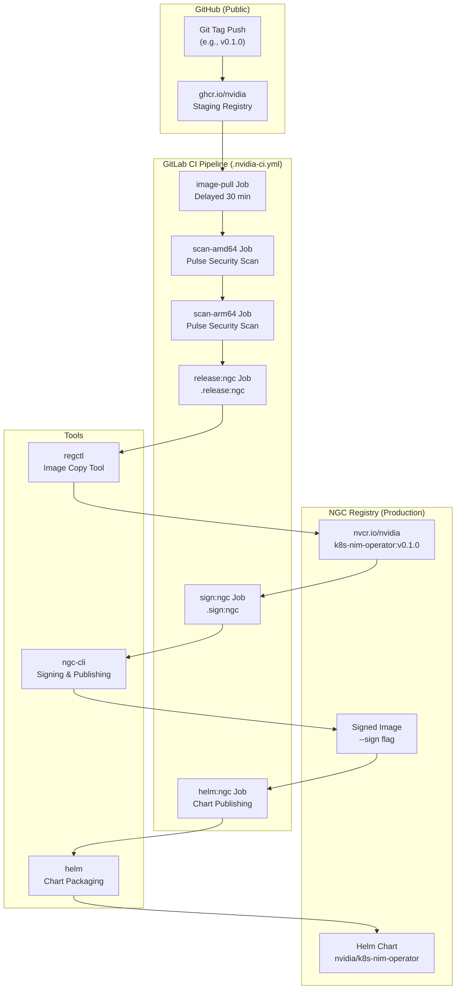
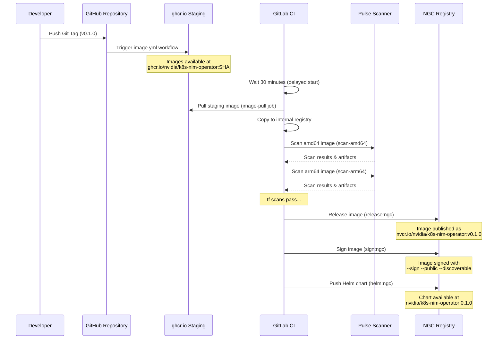
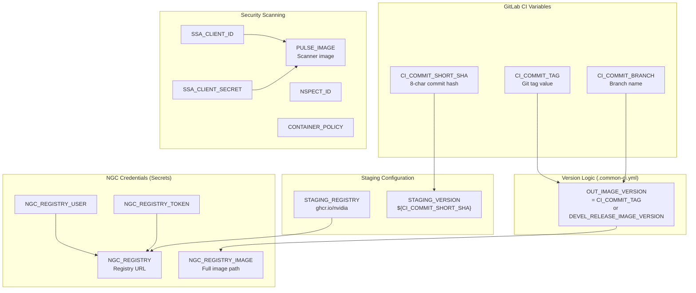

<!-- source: DeepWiki mcp.deepwiki.com · repo NVIDIA/k8s-nim-operator · page 8.6 Release Process · fetched 2026-10-26 -->

# Release Process

<details>
<summary>Relevant source files</summary>

The following files were used as context for generating this wiki page:

- [.common-ci.yml](.common-ci.yml)
- [.github/workflows/helm.yml](.github/workflows/helm.yml)
- [.gitlab-ci.yml](.gitlab-ci.yml)
- [.nvidia-ci.yml](.nvidia-ci.yml)

</details>


## Purpose and Scope

This document describes the process for releasing production versions of the k8s-nim-operator to the NGC Registry. It covers the complete release workflow from triggering a release to publishing signed container images and Helm charts. 

The release architecture is built upon a dual-pipeline system where staging occurs in GitHub Actions and final production distribution is handled via GitLab CI.

## Release Architecture

The release process operates through GitLab CI and publishes artifacts to NVIDIA GPU Cloud (NGC) Registry. Releases are triggered by Git tags and involve multiple stages: image promotion, security scanning, NGC publication, image signing, and Helm chart distribution.

### Release Flow Diagram



**Sources:** [.nvidia-ci.yml:114-203](), [.common-ci.yml:146-208]()

## Release Workflow

The release workflow follows a multi-stage pipeline where each stage depends on successful completion of previous stages. The process ensures that only scanned, validated images reach production.



**Sources:** [.nvidia-ci.yml:39-70](), [.nvidia-ci.yml:125-178](), [.nvidia-ci.yml:181-203]()

## Image Pull Stage

The `image-pull` job is the entry point for the GitLab CI release pipeline. It pulls the staging image from GitHub Container Registry and copies it to the internal GitLab registry for subsequent processing.

### Configuration

| Variable | Value | Description |
|----------|-------|-------------|
| `IN_REGISTRY` | `ghcr.io/nvidia` | Source staging registry |
| `IN_IMAGE_NAME` | `k8s-nim-operator` | Source image name |
| `IN_VERSION` | `${CI_COMMIT_SHORT_SHA}` | Commit SHA from staging |
| `OUT_REGISTRY` | `${CI_REGISTRY}` | Internal GitLab registry |
| `OUT_IMAGE_NAME` | `${CI_REGISTRY_IMAGE}/k8s-nim-operator` | Target image path |

The job includes a 30-minute delay to allow the GitHub Actions workflow to complete the staging build [ .nvidia-ci.yml:51-53](). It uses `regctl` to verify the image exists before pulling [ .nvidia-ci.yml:63-63]().

**Sources:** [.nvidia-ci.yml:39-70](), [.common-ci.yml:137-145]()

## NGC Release Stage

The `release:ngc` job publishes the scanned image from the internal registry to NGC Registry. This job only executes for Git tags or on the development branch.

### Release Rules

The `.release:external` configuration defines when releases occur [ .common-ci.yml:192-202]():

*   **Tagged Releases**: If `$CI_COMMIT_TAG` is present, `OUT_IMAGE_VERSION` is set to the tag.
*   **Development Releases**: If on the `main` branch, `OUT_IMAGE_VERSION` is set to `devel`.

### NGC Configuration

The `release:ngc` job extends `.release:ngc`, which defines the following parameters [ .nvidia-ci.yml:114-122]():

| Variable | Value | Description |
|----------|-------|-------------|
| `OUT_REGISTRY` | `${NGC_REGISTRY}` | NGC Registry URL |
| `OUT_REGISTRY_USER` | `${NGC_REGISTRY_USER}` | NGC credentials |
| `OUT_REGISTRY_TOKEN` | `${NGC_REGISTRY_TOKEN}` | NGC API key |
| `OUT_IMAGE_NAME` | `${NGC_REGISTRY_IMAGE}` | Full NGC image path |

The job uses the Makefile target at `deployments/container/Makefile` to perform the image push [ .common-ci.yml:176-176]().

**Sources:** [.nvidia-ci.yml:114-127](), [.common-ci.yml:192-202](), [.common-ci.yml:149-177]()

## Image Signing Stage

The `sign:ngc` job signs the published NGC image using the `ngc-cli`. This stage only executes for tagged releases [ .nvidia-ci.yml:158-158]() and adds cryptographic verification to the image.

### Signing Process

The signing job performs the following steps:

1.  **NGC CLI Setup**: Downloads and configures the latest `ngc-cli` binary via `.ngccli-setup` [ .nvidia-ci.yml:131-144]().
2.  **Publication**: Executes the `ngc-cli registry image publish` command with the `--sign` flag [ .nvidia-ci.yml:172-172]().

```bash
ngc-cli/ngc registry image publish \
  --source ${IMAGE_NAME}:${IMAGE_TAG} \
  ${IMAGE_NAME}:${IMAGE_TAG} \
  --public \
  --discoverable \
  --allow-guest \
  --sign \
  --org nvidia
```

**Sources:** [.nvidia-ci.yml:154-178](), [.nvidia-ci.yml:131-144]()

## Helm Chart Publishing

The `helm:ngc` job packages and publishes the Helm chart to NGC Registry. This stage executes after successful image signing [ .nvidia-ci.yml:184-185]().

### Chart Preparation and Upload

1.  **Tool Installation**: Sets up `ngc-cli` and `helm` binaries [ .nvidia-ci.yml:193-194]().
2.  **Chart Packaging**: Creates the chart archive using `make helm-chart` [ .nvidia-ci.yml:199-199]().
3.  **Version Processing**: Extracts the version from `versions.mk` and strips the 'v' prefix to follow strict semantic versioning [ .nvidia-ci.yml:201-201]().
4.  **NGC Upload**: Pushes the chart using `ngc-cli registry chart push` [ .nvidia-ci.yml:202-202]().

**Sources:** [.nvidia-ci.yml:181-203](), [.nvidia-ci.yml:145-150]()

## Release Pipeline Configuration

The following diagram illustrates the environment variables and configuration requirements for the release pipeline:



**Sources:** [.nvidia-ci.yml:27-38](), [.nvidia-ci.yml:114-122](), [.nvidia-ci.yml:84-111](), [.common-ci.yml:192-202]()

## Release Stages and Dependencies

The GitLab CI pipeline defines the following sequence for release-related stages [ .common-ci.yml:24-35]():

1.  **trigger**: `trigger-pipeline` job.
2.  **image-build**: `image-pull` job (fetches from GHCR).
3.  **scan**: `scan-amd64` and `scan-arm64` jobs.
4.  **release**: `release:ngc` job.
5.  **sign**: `sign:ngc` job.
6.  **helm**: `helm:ngc` job.

### Job Dependencies

*   `scan-amd64` depends on `image-pull` [ .common-ci.yml:125-126]().
*   `scan-arm64` depends on `image-pull` and `scan-amd64` [ .common-ci.yml:132-134]().
*   `release:ngc` depends on the previous scan and pull stages via the `release` stage order.
*   `sign:ngc` explicitly needs `release:ngc` [ .nvidia-ci.yml:177-178]().
*   `helm:ngc` explicitly needs `sign:ngc` [ .nvidia-ci.yml:184-185]().

**Sources:** [.common-ci.yml:24-35](), [.common-ci.yml:121-135](), [.nvidia-ci.yml:125-203]()

## Initiating a Release

To initiate a production release:

1.  **Tag the Release**: Create and push an annotated Git tag (e.g., `v1.0.0`).
2.  **GitHub Build**: GitHub Actions builds multi-arch images and pushes to `ghcr.io/nvidia/k8s-nim-operator`.
3.  **GitLab Pipeline**: The GitLab CI pipeline automatically triggers on the tag [ .common-ci.yml:46-46]().
4.  **Verification**: After the 30-minute delay [ .nvidia-ci.yml:52-52](), the `image-pull` job will sync the image to internal systems for scanning and final publication to NGC.

**Sources:** [.common-ci.yml:37-47](), [.nvidia-ci.yml:39-70](), [.nvidia-ci.yml:181-203]()

---

