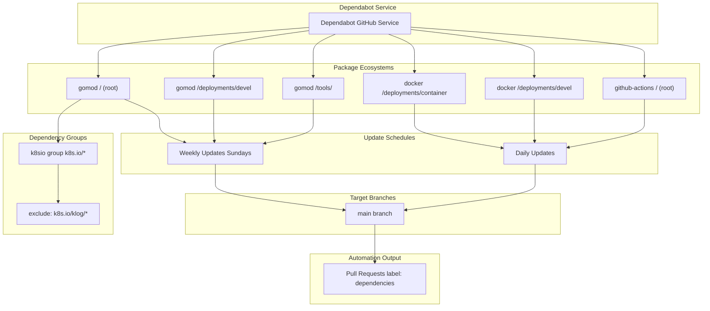
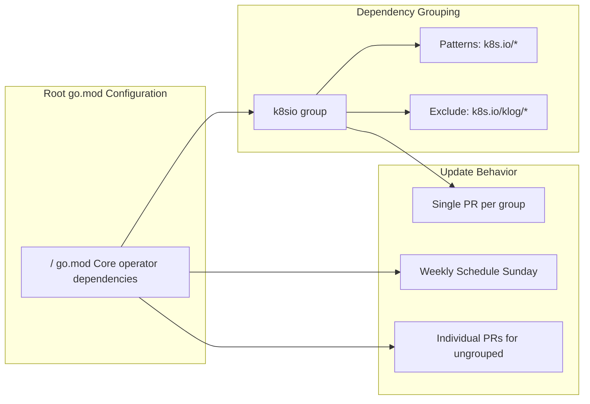
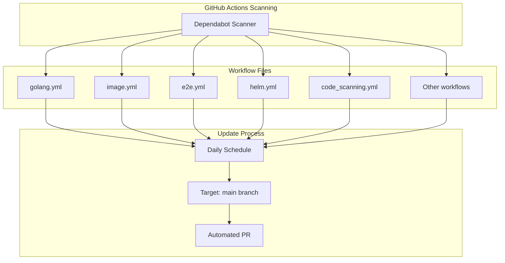
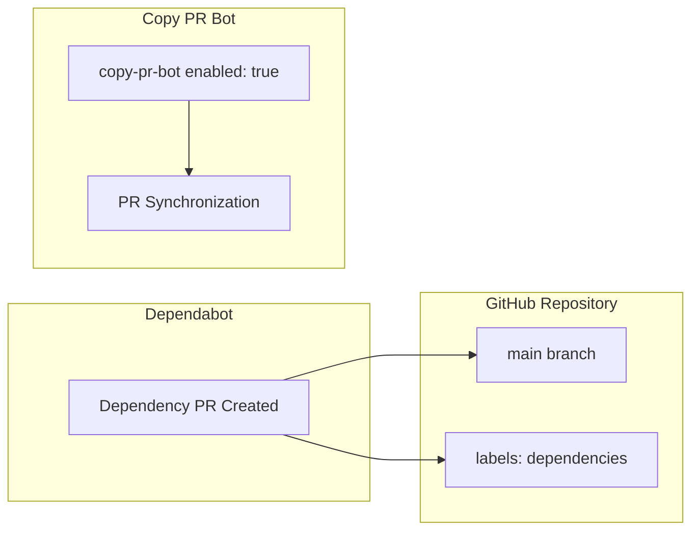

<!-- source: DeepWiki mcp.deepwiki.com · repo NVIDIA/k8s-nim-operator · page 9 Dependency Management · fetched 2026-10-26 -->

# Dependency Management

<details>
<summary>Relevant source files</summary>

The following files were used as context for generating this wiki page:

- [.github/copy-pr-bot.yaml](.github/copy-pr-bot.yaml)
- [.github/dependabot.yml](.github/dependabot.yml)
- [.github/workflows/stale.yaml](.github/workflows/stale.yaml)

</details>


## Purpose and Scope

This document describes the automated dependency management system for the k8s-nim-operator project. It covers how external dependencies are tracked, updated, and maintained across Go modules, container images, and GitHub Actions workflows. 

For information about security scanning of dependencies, see [Security Scanning](8.5). For the broader CI/CD context, see [CI/CD Pipeline](8).

## Dependency Automation Overview

The k8s-nim-operator employs automated dependency management through GitHub's Dependabot service, which monitors multiple package ecosystems and automatically creates pull requests when updates are available. The system is configured to balance security updates with development velocity by using different update frequencies for different types of dependencies.



**Diagram: Dependabot Ecosystem Configuration and Update Flow**

Sources: [.github/dependabot.yml:1-52]()

## Dependabot Configuration Structure

The Dependabot configuration file defines six distinct update configurations, each targeting a specific package ecosystem and directory within the repository.

| Ecosystem | Directory | Schedule | Target Branch | Special Configuration |
|-----------|-----------|----------|---------------|----------------------|
| `gomod` | `/` | Weekly (Sunday) | `main` | `k8sio` dependency group |
| `docker` | `/deployments/container` | Daily | (default) | None |
| `github-actions` | `/` | Daily | `main` | None |
| `gomod` | `/deployments/devel` | Weekly (Sunday) | `main` | None |
| `docker` | `/deployments/devel` | Daily | `main` | None |
| `gomod` | `/tools/` | Weekly (Sunday) | `main` | None |

Sources: [.github/dependabot.yml:5-52]()

## Go Module Dependencies

Go module dependencies are tracked across three distinct locations in the repository, each serving different purposes.

### Root Module Dependencies

The root `go.mod` file contains the core operator dependencies, including Kubernetes client libraries, controller-runtime, and other critical packages. Dependabot checks these dependencies weekly on Sundays.



**Diagram: Root Go Module Dependency Management**

The `k8sio` dependency group consolidates updates for Kubernetes client libraries into a single pull request, reducing PR overhead. This group includes all packages under `k8s.io/*` except `k8s.io/klog/*`, which is intentionally excluded to allow independent versioning.

Sources: [.github/dependabot.yml:6-19]()

### Development Tools Dependencies

The `/deployments/devel` directory contains development and testing tools with their own `go.mod` file. These are updated on the same weekly schedule as root dependencies.

Sources: [.github/dependabot.yml:33-38]()

### Build Tools Dependencies

The `/tools/` directory maintains build-time dependencies like code generators and linters. These are also checked weekly on Sundays.

Sources: [.github/dependabot.yml:46-51]()

## Container Image Dependencies

Container base images are monitored daily to ensure security patches and bug fixes are incorporated quickly. Two locations are tracked:

### Operator Container Images

The primary operator container images are defined in `/deployments/container`. Dependabot checks for updates to base images daily and creates pull requests when new versions are available.

Sources: [.github/dependabot.yml:21-24]()

### Development Container Images

Development and testing containers in `/deployments/devel` are also checked daily, maintaining consistency between production and development environments.

Sources: [.github/dependabot.yml:40-44]()

## GitHub Actions Dependencies

GitHub Actions workflow dependencies are checked daily and target the `main` branch. This ensures that workflow vulnerabilities and deprecated actions are addressed promptly.



**Diagram: GitHub Actions Dependency Updates**

Sources: [.github/dependabot.yml:27-31]()

## Lifecycle and Maintenance Automation

In addition to dependency updates, the repository utilizes automated lifecycle management for issues to maintain project health.

### Stale Issue Management

The project uses the `actions/stale@v10` action to manage inactive issues. This automation runs daily at 04:21 UTC.

- **Stale Threshold**: Issues with no activity for 90 days are marked as `lifecycle/stale`.
- **Closure Threshold**: Stale issues are automatically closed after 30 additional days of inactivity.
- **Exemptions**: Issues labeled with `lifecycle/frozen`, `feature`, or `enhancement` are excluded from the stale check.
- **Reactivation**: Removing the `lifecycle/stale` label or adding a comment resets the clock.

Sources: [.github/workflows/stale.yaml:1-26]()

## Update Schedules and Strategies

The dependency management system uses two distinct update frequencies based on the criticality and stability requirements of each package type:

### Weekly Updates (Sunday)

Go module dependencies are updated weekly on Sundays. This schedule provides a balance between staying current with upstream changes and avoiding excessive PR noise. Sunday updates allow the team to review and merge changes at the start of the week.

Affected locations:
- Root `go.mod` ([.github/dependabot.yml:9-11]())
- `/deployments/devel/go.mod` ([.github/dependabot.yml:36-38]())
- `/tools/go.mod` ([.github/dependabot.yml:49-51]())

### Daily Updates

Container images and GitHub Actions are checked daily due to their security-sensitive nature. Container base images often receive security patches, and GitHub Actions may have vulnerability fixes or deprecation notices that require prompt attention.

Affected locations:
- `/deployments/container` Dockerfiles ([.github/dependabot.yml:23-24]())
- `/deployments/devel` Dockerfiles ([.github/dependabot.yml:42-44]())
- GitHub Actions workflows ([.github/dependabot.yml:30-31]())

Sources: [.github/dependabot.yml:1-52]()

## Dependency Groups

Dependency groups allow Dependabot to consolidate related updates into a single pull request, reducing the number of PRs that maintainers need to review.

### k8sio Group

The `k8sio` group consolidates all Kubernetes client library updates into a single PR. This is particularly useful because Kubernetes releases multiple packages simultaneously (`k8s.io/api`, `k8s.io/apimachinery`, `k8s.io/client-go`, etc.), and they should be updated together to maintain version consistency.

**Group Configuration:**
```yaml
groups:
  k8sio:
    patterns:
    - k8s.io/*
    exclude-patterns:
    - k8s.io/klog/*
```

The `k8s.io/klog/*` packages are excluded from the group to allow them to be updated independently, as they follow a different release cadence than the core Kubernetes libraries.

Sources: [.github/dependabot.yml:14-19]()

## Pull Request Management

### Automated PR Creation

When Dependabot detects an outdated dependency, it automatically creates a pull request with the following characteristics:

- **Target Branch**: `main` (explicitly configured for all updates)
- **Labels**: `dependencies` label applied automatically
- **Title**: Descriptive title indicating the package and version change
- **Body**: Changelog and compatibility notes from upstream

Sources: [.github/dependabot.yml:7-13]()

### Copy PR Bot Integration

The project uses the `copy-pr-bot` to manage PR synchronization across repositories. This bot is enabled to facilitate the mirroring or synchronization of pull requests as required by NVIDIA's internal development workflows.



**Diagram: PR Automation Flow**

Sources: [.github/copy-pr-bot.yaml:1-4]()

## Integration with Development Workflow

Dependency updates flow through the standard development workflow:

1. **Dependabot creates PR** → Tagged with `dependencies` label.
2. **CI/CD validation** → GitHub Actions workflows run tests (e.g., `golang.yml`, `e2e.yml`).
3. **Code review** → CODEOWNERS review requirements apply.
4. **Merge to main** → Updates are incorporated into the next build.
5. **Release propagation** → Changes flow to GitLab CI for NGC release.

This ensures that dependency updates undergo the same quality gates as feature changes, maintaining the stability and security of the operator.

Sources: [.github/dependabot.yml:1-52](), [.github/copy-pr-bot.yaml:1-4](), [.github/workflows/stale.yaml:1-26]()

---

