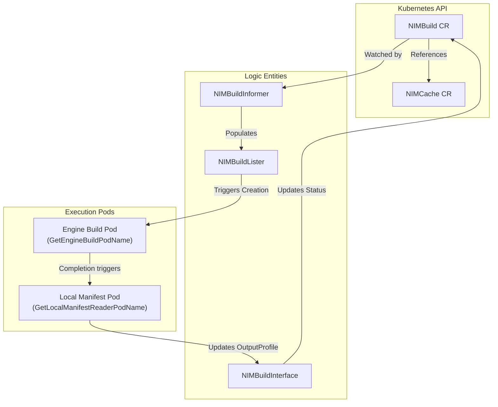
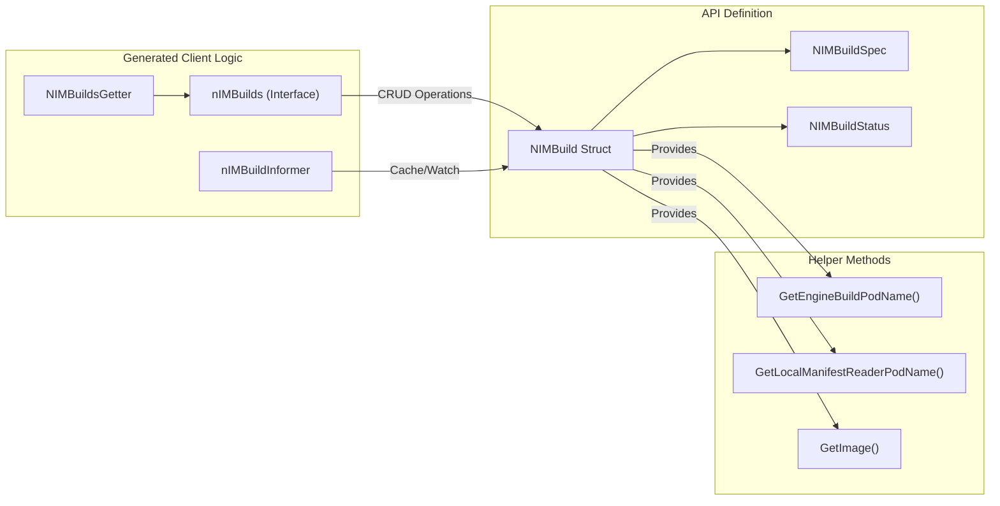

<!-- source: DeepWiki mcp.deepwiki.com · repo NVIDIA/k8s-nim-operator · extra page NIMBuild · fetched 2026-10-26 -->

# NIMBuild

Relevant source files

The following files were used as context for generating this wiki page:

- [api/apps/v1alpha1/nimbuild_types.go](api/apps/v1alpha1/nimbuild_types.go)
- [api/informers/externalversions/apps/v1alpha1/nimbuild.go](api/informers/externalversions/apps/v1alpha1/nimbuild.go)
- [api/listers/apps/v1alpha1/nimbuild.go](api/listers/apps/v1alpha1/nimbuild.go)
- [api/versioned/typed/apps/v1alpha1/nimbuild.go](api/versioned/typed/apps/v1alpha1/nimbuild.go)
- [bundle/manifests/apps.nvidia.com_nimbuilds.yaml](bundle/manifests/apps.nvidia.com_nimbuilds.yaml)

## Purpose and Scope

This document provides a technical reference for the **NIMBuild** Custom Resource Definition (CRD). The `NIMBuild` resource is used to build optimized TensorRT-LLM (TRT-LLM) engines from specific model configurations and weights, producing a ready-to-use NIM container.

For deploying existing NIM services, refer to [NIMService](4.1.1). For managing model caching, refer to [NIMCache](4.1.2).

**Sources**: [api/apps/v1alpha1/nimbuild_types.go:29-30](), [bundle/manifests/apps.nvidia.com_nimbuilds.yaml:48-49]()

## Overview

`NIMBuild` is a Schema within the `apps.nvidia.com/v1alpha1` API group [api/apps/v1alpha1/nimbuild_types.go:67-68](). It provides a declarative way to trigger engine building processes within a Kubernetes cluster. The build process typically involves:
1. Referencing model weights and profiles from a `NIMCache` [api/apps/v1alpha1/nimbuild_types.go:31-32]().
2. Running a specialized Pod to perform the engine compilation [api/apps/v1alpha1/nimbuild_types.go:162-165]().
3. Generating a model manifest to finalize the NIM container [api/apps/v1alpha1/nimbuild_types.go:168-170]().

**Sources**: [api/apps/v1alpha1/nimbuild_types.go:29-170]()

## API Specification

### NIMBuildSpec
The `NIMBuildSpec` defines the desired state of the engine build process. Note that the `Spec` is immutable once created [api/apps/v1alpha1/nimbuild_types.go:72]().

| Field | Type | Description |
|-------|------|-------------|
| `nimCache` | `NIMCacheReference` | Reference to the model weights from a `NIMCache` resource. |
| `modelName` | `string` | The name assigned to the locally built engine. Defaults to the resource name. |
| `image` | `Image` | The container image used to perform the build. |
| `resources` | `ResourceRequirements` | CPU/Memory/GPU requirements for the build Pod. |
| `nodeSelector` | `map[string]string` | Labels to constrain the build Pod to specific nodes. |
| `tolerations` | `[]corev1.Toleration` | Tolerations for the build Pod scheduling. |
| `env` | `[]corev1.EnvVar` | Environment variables for the build process. |

**Sources**: [api/apps/v1alpha1/nimbuild_types.go:30-46](), [api/apps/v1alpha1/nimbuild_types.go:139-145]()

### NIMBuildStatus
The `NIMBuildStatus` tracks the progression of the build through various states and conditions.

| Field | Type | Description |
|-------|------|-------------|
| `state` | `string` | The current high-level state (e.g., `Ready`, `InProgress`, `Failed`). |
| `inputProfile` | `NIMProfile` | The profile configuration used as input for the build. |
| `outputProfile` | `NIMProfile` | The resulting profile configuration after build completion. |
| `conditions` | `[]metav1.Condition` | Detailed observations about the build lifecycle. |

**Sources**: [api/apps/v1alpha1/nimbuild_types.go:49-54]()

## Data Flow and Implementation

The `NIMBuild` lifecycle involves coordination between the controller, the `NIMCache` resource, and transient Pods.

### Build Workflow Diagram
This diagram illustrates the transition from a `NIMBuild` CR to the execution of build logic in the cluster.

**Sources**: [api/apps/v1alpha1/nimbuild_types.go:162-170](), [api/informers/externalversions/apps/v1alpha1/nimbuild.go:36-39](), [api/listers/apps/v1alpha1/nimbuild.go:29-36](), [api/versioned/typed/apps/v1alpha1/nimbuild.go:38-50]()

### Lifecycle States and Conditions

The operator uses a set of constants to manage the state machine of a `NIMBuild` resource.

| Category | Constants | Description |
|----------|-----------|-------------|
| **States** | `NimBuildStatusPending`, `NimBuildStatusStarted`, `NimBuildStatusInProgress`, `NimBuildStatusReady`, `NimBuildStatusFailed` | High-level status reported in `status.state`. |
| **Conditions** | `NimBuildConditionWaitForNimCache` | Blocked until the source `NIMCache` is ready. |
| | `NimBuildConditionEngineBuildPodCreated` | The build container has been successfully dispatched. |
| | `NimBuildConditionEngineBuildPodCompleted` | The TRT-LLM engine compilation finished. |
| | `NimBuildConditionModelManifestPodCompleted` | The manifest generation step is finished. |
| | `NimBuildConditionNoBuildableProfilesFound` | Error state: No valid profiles found in referenced cache. |

**Sources**: [api/apps/v1alpha1/nimbuild_types.go:85-123]()

## Code Entities and Responsibilities

The following diagram maps the code entities generated for handling `NIMBuild` resources to their functional roles in the system.

**Sources**: [api/apps/v1alpha1/nimbuild_types.go:68-170](), [api/informers/externalversions/apps/v1alpha1/nimbuild.go:41-45](), [api/versioned/typed/apps/v1alpha1/nimbuild.go:33-54]()

### Key Functions
- `GetEngineBuildPodName()`: Generates a deterministic name for the pod performing the engine build, formatted as `{name}-engine-build-pod` [api/apps/v1alpha1/nimbuild_types.go:162-165]().
- `GetLocalManifestReaderPodName()`: Generates a name for the manifest reader pod, formatted as `{name}-local-manifest-pod` [api/apps/v1alpha1/nimbuild_types.go:168-170]().
- `GetImage()`: Constructs the full image string from `Spec.Image.Repository` and `Spec.Image.Tag` [api/apps/v1alpha1/nimbuild_types.go:153-155]().
- `GetModelName()`: Returns the user-defined model name or falls back to the resource name [api/apps/v1alpha1/nimbuild_types.go:139-145]().

**Sources**: [api/apps/v1alpha1/nimbuild_types.go:139-170]()

---

