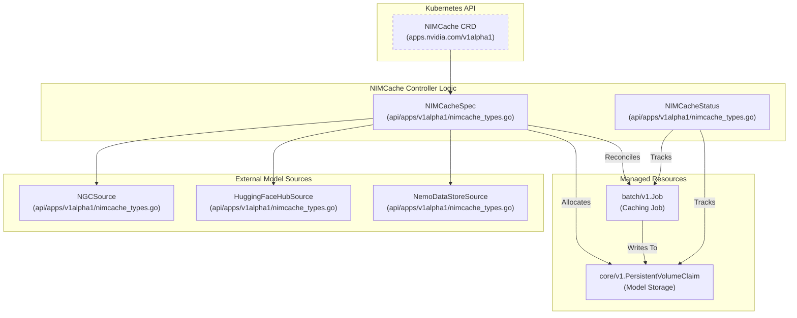
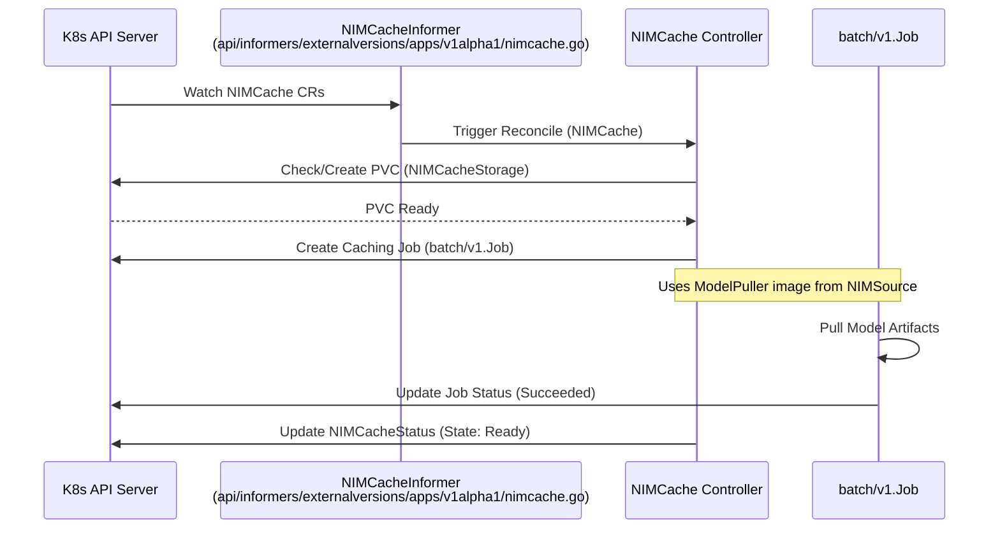

<!-- source: DeepWiki mcp.deepwiki.com · repo NVIDIA/k8s-nim-operator · extra page NIMCache · fetched 2026-10-26 -->

# NIMCache

Relevant source files

The following files were used as context for generating this wiki page:

- [api/apps/v1alpha1/nimcache_types.go](api/apps/v1alpha1/nimcache_types.go)
- [api/informers/externalversions/apps/v1alpha1/nimcache.go](api/informers/externalversions/apps/v1alpha1/nimcache.go)
- [api/listers/apps/v1alpha1/nimcache.go](api/listers/apps/v1alpha1/nimcache.go)
- [api/versioned/typed/apps/v1alpha1/nimcache.go](api/versioned/typed/apps/v1alpha1/nimcache.go)
- [bundle/manifests/apps.nvidia.com_nimcaches.yaml](bundle/manifests/apps.nvidia.com_nimcaches.yaml)

## Purpose and Scope

NIMCache is a Custom Resource Definition (CRD) in the `apps.nvidia.com/v1alpha1` API group that manages the caching of NVIDIA AI model artifacts in Kubernetes. It orchestrates Kubernetes Jobs to download and prepare model data from external registries (NGC, Hugging Face, or NeMo DataStore) into Persistent Volume Claims (PVCs), making models readily available for NIMService deployments.

This document covers the NIMCache resource specification, controller behavior, validation webhooks, and operational aspects.

**Sources:** [api/apps/v1alpha1/nimcache_types.go:34-62](), [bundle/manifests/apps.nvidia.com_nimcaches.yaml:9-15]()

---

## Overview

NIMCache solves the problem of repeatedly downloading large AI model artifacts every time a NIM pod starts. By pre-caching models into persistent storage, NIMCache enables faster pod startup, reduced network egress, and improved reliability.

The NIMCache controller creates and manages Kubernetes Jobs that pull model data, validate the content, and store it in a PVC. The source can be NVIDIA NGC, Hugging Face Hub, or a NeMo DataStore endpoint.

**Sources:** [api/apps/v1alpha1/nimcache_types.go:34-74](), [api/apps/v1alpha1/nimcache_types.go:118-130]()

---

## System Architecture

The following diagram illustrates the relationship between NIMCache and the Kubernetes entities it manages.

### Code Entity Mapping: NIMCache to Kubernetes Resources

**Sources:** [api/apps/v1alpha1/nimcache_types.go:34-114](), [api/apps/v1alpha1/nimcache_types.go:160-184]()

---

## API Specification

### NIMCacheSpec Fields

The `NIMCacheSpec` defines the desired state of the cache.

| Field | Type | Description |
|-------|------|-------------|
| `source` | `NIMSource` | The source of the NIM model (NGC, HF, or DataStore). |
| `storage` | `NIMCacheStorage` | Target storage attributes for the cached model. |
| `resources` | `Resources` | Minimum resources (CPU, Memory, GPU) for the caching job. |
| `tolerations` | `[]corev1.Toleration` | Tolerations for the caching job pod. |
| `nodeSelector` | `map[string]string` | Node selector labels for scheduling the job. |
| `userID` / `groupID` | `*int64` | Security context IDs for the caching job. |
| `env` | `[]corev1.EnvVar` | Custom environment variables for the caching job. |
| `proxy` | `*ProxySpec` | Proxy configuration for the caching job. |

**Sources:** [api/apps/v1alpha1/nimcache_types.go:34-62]()

### Model Sources (`NIMSource`)

Exactly one source must be defined via `XValidation` rules.

| Source Type | Fields | Description |
|-------------|--------|-------------|
| `NGC` | `authSecret`, `modelPuller`, `model`, `modelEndpoint` | Models stored in NVIDIA NGC. |
| `HF` | `endpoint`, `namespace`, `DSHFCommonFields` | Models stored in HuggingFace Hub. |
| `DataStore` | `endpoint`, `namespace`, `DSHFCommonFields` | Models from NVIDIA NeMo DataStore. |

**Sources:** [api/apps/v1alpha1/nimcache_types.go:64-114]()

### Storage Configuration (`NIMCacheStorage`)

NIMCache manages PVCs through the `NIMCacheStorage` struct.

| Field | Type | Description |
|-------|------|-------------|
| `pvc` | `*PVCConfig` | Configuration for a new or existing PVC. |
| `hostPath` | `*string` | Host path for caching (not recommended for production). |

**Sources:** [api/apps/v1alpha1/nimcache_types.go:160-171]()

---

## Controller and Data Flow

The NIMCache controller manages the lifecycle of the model cache. It uses generated informers and listers to monitor the state of `NIMCache` resources.

### Internal Data Flow Diagram

**Sources:** [api/informers/externalversions/apps/v1alpha1/nimcache.go:36-39](), [api/apps/v1alpha1/nimcache_types.go:121-125](), [api/apps/v1alpha1/nimcache_types.go:173-184]()

---

## Validation Webhooks

NIMCache utilizes `XValidation` rules (CEL) defined directly in the CRD spec to enforce data integrity without requiring an external webhook process for basic rules.

### Key Validation Rules

1.  **Source Exclusivity**: Exactly one of `ngc`, `dataStore`, or `hf` must be defined.
    - `rule: "(has(self.ngc) ? 1 : 0) + (has(self.dataStore) ? 1 : 0) + (has(self.hf) ? 1 : 0) == 1"`
    - **Sources:** [api/apps/v1alpha1/nimcache_types.go:64]()
2.  **Model/Dataset Exclusivity**: For HF and DataStore, exactly one of `modelName` or `datasetName` must be defined.
    - `rule: "(has(self.modelName) ? 1 : 0) + (has(self.datasetName) ? 1 : 0) == 1"`
    - **Sources:** [api/apps/v1alpha1/nimcache_types.go:76]()
3.  **Immutable Puller**: The `modelPuller` field in `NGCSource` is immutable.
    - `rule: "self == oldSelf"`
    - **Sources:** [api/apps/v1alpha1/nimcache_types.go:122]()
4.  **Endpoint Patterns**: Validates that endpoints follow expected URL patterns (e.g., `^https?://.*/v1/hf/?$` for DataStore).
    - **Sources:** [api/apps/v1alpha1/nimcache_types.go:98](), [api/apps/v1alpha1/nimcache_types.go:108]()

---

## Status and Monitoring

The `NIMCacheStatus` tracks the progression of the caching operation.

| Field | Type | Description |
|-------|------|-------------|
| `state` | `string` | The current phase (e.g., `Pending`, `Caching`, `Ready`, `Failed`). |
| `pvc` | `string` | The name of the PVC associated with the cache. |
| `job` | `string` | The name of the batch Job performing the pull. |
| `conditions` | `[]metav1.Condition` | Detailed lifecycle conditions. |

**Sources:** [api/apps/v1alpha1/nimcache_types.go:173-184](), [bundle/manifests/apps.nvidia.com_nimcaches.yaml:17-27]()

### Generated Clients
The operator uses generated code for interacting with NIMCache resources:
- **Informer**: `NIMCacheInformer` provides shared access to NIMCache objects [api/informers/externalversions/apps/v1alpha1/nimcache.go:36-39]().
- **Lister**: `NIMCacheLister` allows for efficient retrieval of NIMCaches from the indexer [api/listers/apps/v1alpha1/nimcache.go:29-36]().
- **Interface**: `NIMCacheInterface` defines standard CRUD operations [api/versioned/typed/apps/v1alpha1/nimcache.go:38-50]().

**Sources:** [api/informers/externalversions/apps/v1alpha1/nimcache.go:36-39](), [api/listers/apps/v1alpha1/nimcache.go:29-36](), [api/versioned/typed/apps/v1alpha1/nimcache.go:38-50]()

---

