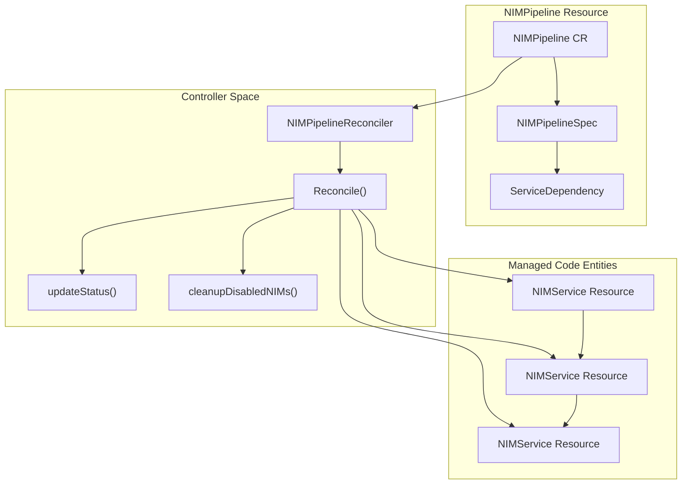
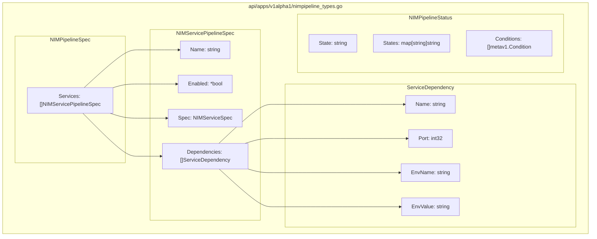
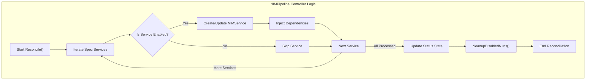

<!-- source: DeepWiki mcp.deepwiki.com · repo NVIDIA/k8s-nim-operator · extra page NIMPipeline · fetched 2026-10-26 -->

# NIMPipeline

<details>
<summary>Relevant source files</summary>

The following files were used as context for generating this wiki page:

- [api/apps/v1alpha1/nimpipeline_types.go](api/apps/v1alpha1/nimpipeline_types.go)
- [api/informers/externalversions/apps/v1alpha1/nimpipeline.go](api/informers/externalversions/apps/v1alpha1/nimpipeline.go)
- [api/listers/apps/v1alpha1/nimpipeline.go](api/listers/apps/v1alpha1/nimpipeline.go)
- [api/versioned/typed/apps/v1alpha1/nimpipeline.go](api/versioned/typed/apps/v1alpha1/nimpipeline.go)
- [bundle/manifests/apps.nvidia.com_nimpipelines.yaml](bundle/manifests/apps.nvidia.com_nimpipelines.yaml)

</details>


## Purpose and Scope

The `NIMPipeline` resource provides an orchestration layer for managing multiple NVIDIA Inference Microservices (NIM) deployments as part of a cohesive pipeline. It enables users to define and deploy a collection of interconnected `NIMService` instances with explicit dependencies between them, managing their lifecycle and relationships [api/apps/v1alpha1/nimpipeline_types.go:40-47](). It operates by reconciling a list of service specifications into individual `NIMService` custom resources [api/apps/v1alpha1/nimpipeline_types.go:86-93]().

## Architecture Overview

`NIMPipeline` operates as a higher-level abstraction above individual `NIMService` resources. It allows users to define multiple services with their dependencies and handles the creation, updating, and deletion of the underlying `NIMService` resources.

### NIMPipeline Component Architecture



Sources:
- [api/apps/v1alpha1/nimpipeline_types.go:40-47]()
- [api/apps/v1alpha1/nimpipeline_types.go:87-93]()

## NIMPipeline Custom Resource Definition

The `NIMPipeline` CRD defines a pipeline of `NIMService` resources with their configurations and dependencies.

### NIMPipeline Resource Structure



### Specification Fields

| Field | Type | Description |
|-------|------|-------------|
| `services` | `[]NIMServicePipelineSpec` | List of NIMService configurations to be deployed as part of the pipeline [api/apps/v1alpha1/nimpipeline_types.go:46-47]() |

Each `NIMServicePipelineSpec` contains:

| Field | Type | Description |
|-------|------|-------------|
| `name` | `string` | Name of the NIMService [api/apps/v1alpha1/nimpipeline_types.go:51-51]() |
| `enabled` | `*bool` | Whether the service is enabled in the pipeline [api/apps/v1alpha1/nimpipeline_types.go:52-52]() |
| `spec` | `NIMServiceSpec` | Full specification for the NIMService [api/apps/v1alpha1/nimpipeline_types.go:53-53]() |
| `dependencies` | `[]ServiceDependency` | List of dependencies this service has on other services [api/apps/v1alpha1/nimpipeline_types.go:54-54]() |

Service dependencies are specified through the `ServiceDependency` type [api/apps/v1alpha1/nimpipeline_types.go:58-67]():

| Field | Type | Description |
|-------|------|-------------|
| `name` | `string` | Name of the dependent service [api/apps/v1alpha1/nimpipeline_types.go:60-60]() |
| `port` | `int32` | Port of the dependent service [api/apps/v1alpha1/nimpipeline_types.go:62-62]() |
| `envName` | `string` | Optional custom environment variable name for the service endpoint [api/apps/v1alpha1/nimpipeline_types.go:64-64]() |
| `envValue` | `string` | Optional custom environment variable value for the service endpoint [api/apps/v1alpha1/nimpipeline_types.go:66-66]() |

Sources:
- [api/apps/v1alpha1/nimpipeline_types.go:40-67]()
- [bundle/manifests/apps.nvidia.com_nimpipelines.yaml:50-85]()

### Status Fields

The `NIMPipelineStatus` tracks the overall and individual health of the pipeline components [api/apps/v1alpha1/nimpipeline_types.go:69-78]().

| Field | Type | Description |
|-------|------|-------------|
| `state` | `string` | Overall state of the pipeline: `Ready`, `NotReady`, or `Failed` [api/apps/v1alpha1/nimpipeline_types.go:77-77]() |
| `states` | `map[string]string` | State of each individual service in the pipeline [api/apps/v1alpha1/nimpipeline_types.go:75-75]() |
| `conditions` | `[]metav1.Condition` | Standard Kubernetes conditions for the resource [api/apps/v1alpha1/nimpipeline_types.go:73-73]() |

The following constants define the possible status values [api/apps/v1alpha1/nimpipeline_types.go:26-38]():
- `NIMPipelineStatusReady`: "Ready" [api/apps/v1alpha1/nimpipeline_types.go:35-35]()
- `NIMPipelineStatusNotReady`: "NotReady" [api/apps/v1alpha1/nimpipeline_types.go:33-33]()
- `NIMPipelineStatusFailed`: "Failed" [api/apps/v1alpha1/nimpipeline_types.go:37-37]()

Sources:
- [api/apps/v1alpha1/nimpipeline_types.go:26-78]()

## Service Creation and Dependency Management

The controller handles creating `NIMService` resources for each enabled service in the pipeline and manages their dependencies via environment variable injection.

### Service Creation Process

When a `NIMPipeline` is reconciled, the controller iterates through the `Services` list in the spec [api/apps/v1alpha1/nimpipeline_types.go:46-47](). For each enabled entry, it ensures a corresponding `NIMService` exists with the provided `NIMServiceSpec` [api/apps/v1alpha1/nimpipeline_types.go:50-55]().

### NIMPipeline Reconciliation Flow



Sources:
- [api/apps/v1alpha1/nimpipeline_types.go:41-55]()
- [bundle/manifests/apps.nvidia.com_nimpipelines.yaml:50-85]()

### Dependency Management

Dependencies between services are managed through environment variables. The controller injects the necessary environment variables into each `NIMService` to allow it to connect to its dependencies [api/apps/v1alpha1/nimpipeline_types.go:58-67]().

The controller supports two ways to specify dependencies:

1.  **Default behavior**: Environment variables are automatically generated based on service name and port.
    *   Format: `<SERVICE_NAME>_ENDPOINT=<service-name>:<port>`
2.  **Custom behavior**: Users can specify custom environment variable names and values via `envName` and `envValue` fields [api/apps/v1alpha1/nimpipeline_types.go:64-66]().

Sources:
- [api/apps/v1alpha1/nimpipeline_types.go:58-67]()

## Data Access and Tooling

The codebase provides generated clients, informers, and listers to interact with `NIMPipeline` resources programmatically.

*   **Informer**: `NIMPipelineInformer` provides access to a shared informer and lister for `NIMPipelines` [api/informers/externalversions/apps/v1alpha1/nimpipeline.go:36-39]().
*   **Lister**: `NIMPipelineLister` and `NIMPipelineNamespaceLister` help list and retrieve resources from the indexer [api/listers/apps/v1alpha1/nimpipeline.go:29-36]().
*   **Interface**: `NIMPipelineInterface` defines the standard CRUD operations (Create, Update, Delete, Get, List, Watch, Patch) [api/versioned/typed/apps/v1alpha1/nimpipeline.go:38-50]().

Sources:
- [api/informers/externalversions/apps/v1alpha1/nimpipeline.go:36-39]()
- [api/listers/apps/v1alpha1/nimpipeline.go:29-63]()
- [api/versioned/typed/apps/v1alpha1/nimpipeline.go:38-50]()

## Example Usage

Below is an example of a `NIMPipeline` resource definition that deploys a simple pipeline with two services: an embedding service and an LLM service, with the LLM service depending on the embedding service:

```yaml
apiVersion: apps.nvidia.com/v1alpha1
kind: NIMPipeline
metadata:
  name: text-processing-pipeline
spec:
  services:
    - name: embedding-service
      enabled: true
      spec:
        image:
          repository: nvcr.io/nvidia/nim/nemo-retriever-embedding
          tag: 1.0.0
    - name: llm-service
      enabled: true
      spec:
        image:
          repository: nvcr.io/nvidia/nim/llama-3-8b-instruct
          tag: 1.0.0
      dependencies:
        - name: embedding-service
          port: 8000
          envName: EMBEDDING_ENDPOINT
```

In this configuration, the `llm-service` will have an environment variable `EMBEDDING_ENDPOINT` pointing to the `embedding-service`.

Sources:
- [api/apps/v1alpha1/nimpipeline_types.go:41-67]()
- [bundle/manifests/apps.nvidia.com_nimpipelines.yaml:50-85]()

---

