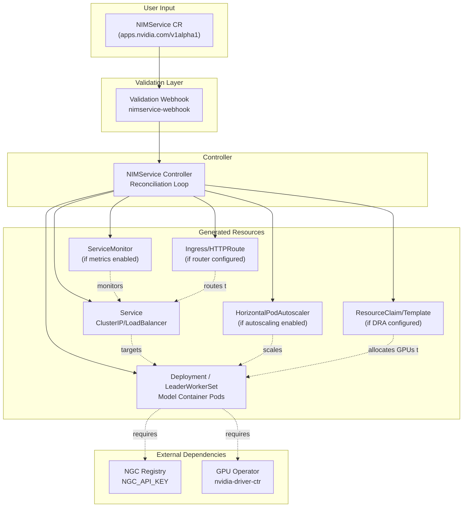
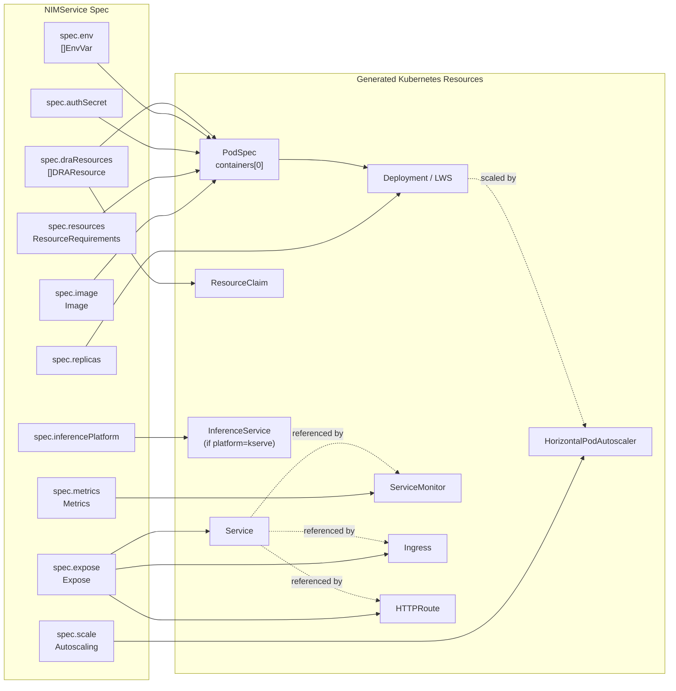

<!-- source: DeepWiki mcp.deepwiki.com · repo NVIDIA/k8s-nim-operator · extra page NIMService · fetched 2026-10-26 -->

# NIMService

<details>
<summary>Relevant source files</summary>

The following files were used as context for generating this wiki page:

- [api/apps/v1alpha1/nimservice_types.go](api/apps/v1alpha1/nimservice_types.go)
- [api/apps/v1alpha1/nimservice_types_test.go](api/apps/v1alpha1/nimservice_types_test.go)
- [api/informers/externalversions/apps/v1alpha1/nimservice.go](api/informers/externalversions/apps/v1alpha1/nimservice.go)
- [api/listers/apps/v1alpha1/nimservice.go](api/listers/apps/v1alpha1/nimservice.go)
- [api/versioned/typed/apps/v1alpha1/nimservice.go](api/versioned/typed/apps/v1alpha1/nimservice.go)
- [bundle/manifests/apps.nvidia.com_nimservices.yaml](bundle/manifests/apps.nvidia.com_nimservices.yaml)

</details>


This page provides complete reference documentation for the `NIMService` Custom Resource Definition (CRD), which enables deployment and management of NVIDIA Inference Microservices (NIM) on Kubernetes clusters.

**Scope**: This page covers the `NIMService` API specification, controller behavior, validation webhooks, and lifecycle management. For model caching strategies, see [NIMCache](#4.1.2). For common types like `Expose`, `Metrics`, and `Autoscaling`, see [Common Types](#5.1). For Dynamic Resource Allocation (DRA) configuration, see [Dynamic Resource Allocation](#5.2).

## Overview

`NIMService` is the primary custom resource for deploying NVIDIA NIM containers that serve AI inference workloads. The operator's controller watches `NIMService` resources and reconciles them into standard Kubernetes workloads (Deployments, Services, HorizontalPodAutoscalers, etc.) while managing GPU allocation, model access credentials, and network exposure.

**API Group**: `apps.nvidia.com/v1alpha1`  
**Kind**: `NIMService`  
**Namespaced**: Yes  
**Controller**: Yes  
**Validation Webhook**: Yes

**Sources**: [api/apps/v1alpha1/nimservice_types.go:17-46](), [bundle/manifests/apps.nvidia.com_nimservices.yaml:9-15]()

## Architecture

### NIMService Controller Pattern

The following diagram illustrates how the `NIMService` controller reconciles custom resources into Kubernetes workloads:



**Sources**: [api/apps/v1alpha1/nimservice_types.go:97-142](), [api/apps/v1alpha1/nimservice_types.go:51-65]()

### Resource Creation Flow

This diagram maps `NIMService` spec fields to the Kubernetes resources they generate:



**Sources**: [api/apps/v1alpha1/nimservice_types.go:97-142](), [api/apps/v1alpha1/nimservice_types_test.go:31-174]()

## API Specification

### Core Spec Fields

The `NIMService` spec is defined in the `NIMServiceSpec` struct:

| Field | Type | Description |
|-------|------|-------------|
| `image` | `Image` | Container image configuration for the NIM service |
| `replicas` | `*int32` | Number of pod replicas to run |
| `resources` | `*corev1.ResourceRequirements` | CPU and memory resource requests/limits |
| `authSecret` | `string` | Name of secret containing the `NGC_API_KEY` |
| `env` | `[]corev1.EnvVar` | Additional environment variables |
| `expose` | `Expose` | Service exposure configuration |
| `metrics` | `Metrics` | Metrics collection configuration |
| `scale` | `Autoscaling` | Horizontal pod autoscaling configuration |
| `draResources` | `[]DRAResource` | Dynamic Resource Allocation for GPU access |
| `inferencePlatform` | `PlatformType` | Target platform: `standalone` (default) or `kserve` |
| `multiNode` | `*NimServiceMultiNodeConfig` | Configuration for multi-node deployments (LWS) |
| `storage` | `NIMServiceStorage` | Model caching configuration if `NIMCache` is not used |

**Sources**: [api/apps/v1alpha1/nimservice_types.go:97-142]()

### Multi-Node Configuration

NIM services can be deployed across multiple nodes using the `LeaderWorkerSet` (LWS) backend.

| Field | Type | Default | Description |
|-------|------|---------|-------------|
| `backendType` | `NIMBackendType` | `lws` | Currently only `lws` is supported |
| `parallelism` | `*int32` | - | Degree of parallelism for multi-node execution |

**Sources**: [api/apps/v1alpha1/nimservice_types.go:145-153]()

### Inference Platforms

The operator supports two deployment platforms defined by `PlatformType`:
- `standalone`: Standard Kubernetes Deployment or LWS.
- `kserve`: Integration with KServe `InferenceService`.

**Sources**: [api/apps/v1alpha1/nimservice_types.go:84-91]()

### Storage and Volumes

The `GetVolumes` function determines the volume mounts for the NIM container based on the spec:

1. **Shared Memory**: A `dshm` `EmptyDir` (memory medium) is always added.
2. **Model Store**: If a `NIMCache` or `NIMServiceStorage` is provided, a `PersistentVolumeClaim` volume is mounted.
3. **Proxy/Certs**: If `ProxySpec` or `InitContainers` are used, additional volumes like `proxy-ca-cert` or `scratch` are added.

**Sources**: [api/apps/v1alpha1/nimservice_types_test.go:31-174]()

### Networking and Routing

The `NIMService` uses the `Router` type to generate networking resources.

#### Gateway API Integration
The `GenerateGatewayHTTPRouteSpec` function translates `NIMService` router settings into a `gatewayv1.HTTPRouteSpec`. It configures:
- `ParentRefs`: References to the specified Gateway.
- `Hostnames`: Constructed from `hostDomainName`.
- `Rules`: Path matching (default prefix `/`) and backend service references.

**Sources**: [api/apps/v1alpha1/nimservice_types_test.go:176-247]()

#### Ingress Integration
The `GenerateIngressSpec` function generates a `networkingv1.IngressSpec` which includes:
- `IngressClassName` mapping.
- TLS configuration if a `tlsSecretName` is provided.
- Rules mapping the hostname to the generated Kubernetes Service.

**Sources**: [api/apps/v1alpha1/nimservice_types_test.go:249-260]()

## Validation and Webhooks

The `NIMService` CRD includes advanced validation rules using CEL (Common Expression Language):

1. **Autoscaling vs Multi-Node**: `autoScaling` must be disabled when `multiNode` is configured.
2. **Replicas vs Autoscaling**: `spec.replicas` cannot be set if `spec.scale.enabled` is true.
3. **Deprecation**: `spec.expose.ingress` is deprecated in favor of `spec.expose.router.ingress`.

**Sources**: [api/apps/v1alpha1/nimservice_types.go:94-96]()

## Status and Lifecycle

The operator tracks the state of the NIM deployment using conditions and state fields:

| State | Description |
|-------|-------------|
| `Pending` | Resources are being created or waiting for dependencies |
| `NotReady` | Pods are created but not passing health checks |
| `Ready` | NIM API is available and serving requests |
| `Failed` | Deployment encountered a terminal error |

**Conditions**:
- `NIM_SERVICE_READY`: True when the underlying workload is healthy.
- `NIM_SERVICE_FAILED`: True if there are scheduling or runtime failures.

**Sources**: [api/apps/v1alpha1/nimservice_types.go:51-65]()

## Examples

### Standalone Multi-Node NIM
```yaml
apiVersion: apps.nvidia.com/v1alpha1
kind: NIMService
metadata:
  name: llama3-70b-multinode
spec:
  image:
    repository: nvcr.io/nim/meta/llama3-70b
    tag: 1.0.0
  authSecret: ngc-api-key
  multiNode:
    backendType: lws
  replicas: 1
  resources:
    limits:
      nvidia.com/gpu: 8
```

### NIM with Gateway API Routing
```yaml
apiVersion: apps.nvidia.com/v1alpha1
kind: NIMService
metadata:
  name: nim-gateway-example
spec:
  image:
    repository: nvcr.io/nim/meta/llama3-8b
    tag: 1.0.0
  authSecret: ngc-api-key
  expose:
    router:
      hostDomainName: nim.example.com
      gateway:
        name: external-gateway
        namespace: istio-system
```

**Sources**: [api/apps/v1alpha1/nimservice_types.go:97-153](), [api/apps/v1alpha1/nimservice_types_test.go:176-247]()

## Implementation Details

### Client and Informers
The operator uses generated typed clients and informers to manage `NIMService` resources efficiently:
- **Informer**: `NIMServiceInformer` provides shared cache access and event handlers ([api/informers/externalversions/apps/v1alpha1/nimservice.go:36-39]()).
- **Lister**: `NIMServiceLister` enables indexed lookups by namespace or labels ([api/listers/apps/v1alpha1/nimservice.go:29-36]()).
- **Interface**: `NIMServiceInterface` defines standard CRUD operations including `UpdateStatus` and `Patch` ([api/versioned/typed/apps/v1alpha1/nimservice.go:38-50]()).

**Sources**: [api/informers/externalversions/apps/v1alpha1/nimservice.go](), [api/listers/apps/v1alpha1/nimservice.go](), [api/versioned/typed/apps/v1alpha1/nimservice.go]()

---

