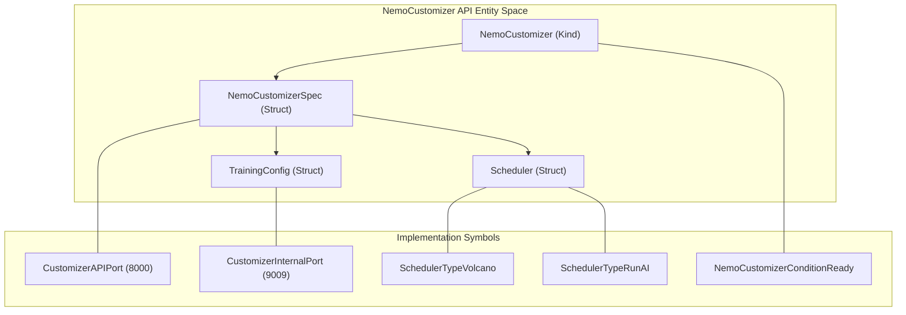
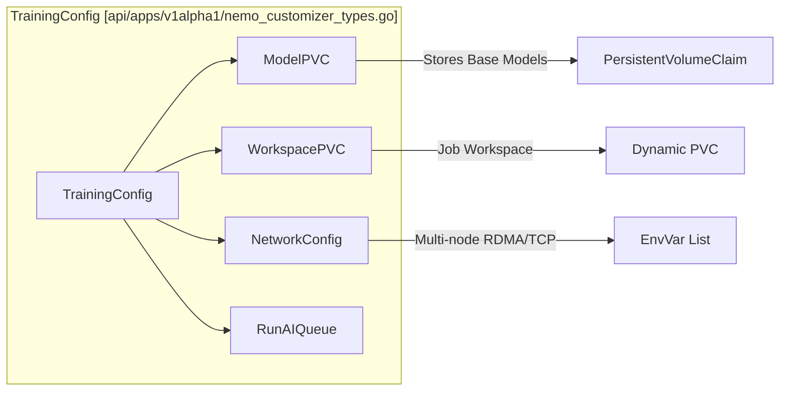

<!-- source: DeepWiki mcp.deepwiki.com · repo NVIDIA/k8s-nim-operator · extra page NemoCustomizer · fetched 2026-10-26 -->

# NemoCustomizer

Relevant source files

The following files were used as context for generating this wiki page:

- [api/apps/v1alpha1/nemo_customizer_types.go](api/apps/v1alpha1/nemo_customizer_types.go)
- [api/informers/externalversions/apps/v1alpha1/nemocustomizer.go](api/informers/externalversions/apps/v1alpha1/nemocustomizer.go)
- [api/listers/apps/v1alpha1/nemocustomizer.go](api/listers/apps/v1alpha1/nemocustomizer.go)
- [api/versioned/typed/apps/v1alpha1/nemocustomizer.go](api/versioned/typed/apps/v1alpha1/nemocustomizer.go)
- [bundle/manifests/apps.nvidia.com_nemocustomizers.yaml](bundle/manifests/apps.nvidia.com_nemocustomizers.yaml)

## Purpose and Scope

The `NemoCustomizer` Custom Resource Definition (CRD) enables model customization workflows within the k8s-nim-operator ecosystem. This resource is part of the NeMo Microservices suite, which provides advanced AI workflow capabilities beyond basic inference serving. It specifically manages the lifecycle of the NeMo Customizer microservice, which orchestrates fine-tuning and alignment jobs for Large Language Models (LLMs).

This document covers the `NemoCustomizer` CRD structure, its integration with external components like MLFlow and Weights & Biases (WandB), and its role in the broader NeMo ecosystem.

**Sources:** [api/apps/v1alpha1/nemo_customizer_types.go:69-72](), [bundle/manifests/apps.nvidia.com_nemocustomizers.yaml:28-29]()

---

## Resource Overview

`NemoCustomizer` is a Kubernetes Custom Resource in the `apps.nvidia.com/v1alpha1` API group. It provides a high-level abstraction for deploying the Customizer API and managing the underlying training infrastructure, including scheduler integration for Volcano or Run.AI.

### API Entity Space Mapping

The following diagram maps the high-level Customizer concepts to the specific Go types and constants used in the implementation.

**Sources:** [api/apps/v1alpha1/nemo_customizer_types.go:42-67](), [api/apps/v1alpha1/nemo_customizer_types.go:72-129]()

---

## CRD Characteristics

The `NemoCustomizer` CRD is defined with the following characteristics:

| Attribute | Value | Description |
|-----------|-------|-------------|
| **API Group** | `apps.nvidia.com` | Namespace for NVIDIA application resources |
| **Version** | `v1alpha1` | API version indicating alpha stability |
| **Kind** | `NemoCustomizer` | Resource type name |
| **Scope** | `Namespaced` | Resource is scoped to Kubernetes namespaces |
| **Default Port** | `8000` | The port the Customizer API serves on |
| **Internal Port**| `9009` | Port used for syncing training progress |

**Sources:** [api/apps/v1alpha1/nemo_customizer_types.go:42-48](), [bundle/manifests/apps.nvidia.com_nemocustomizers.yaml:7-15]()

---

## Specification Details

The `NemoCustomizerSpec` defines the desired state, including service endpoints for supporting microservices and training-specific configurations.

### External Service Integration

NemoCustomizer requires connectivity to several data and tracking services:

| Field | Type | Description |
|-------|------|-------------|
| `datastore` | `Datastore` | Endpoint for the NeMo Datastore service |
| `entitystore` | `Entitystore` | Endpoint for the NeMo Entitystore service |
| `mlflow` | `MLFlow` | MLFlow tracking server endpoint |
| `wandb` | `WandBConfig` | Weights and Biases configuration for experiment tracking |
| `databaseConfig` | `DatabaseConfig` | Configuration for the underlying state database |

**Sources:** [api/apps/v1alpha1/nemo_customizer_types.go:97-128]()

### Training Configuration

The `TrainingConfig` struct defines how fine-tuning jobs are executed on the cluster.

Key fields in `TrainingConfig`:
- **ModelPVC**: Persistent storage for models used for fine-tuning [api/apps/v1alpha1/nemo_customizer_types.go:137]().
- **WorkspacePVC**: Configuration for the `NemoTrainingJob` workspace, which automatically creates a PVC for each job [api/apps/v1alpha1/nemo_customizer_types.go:139]().
- **NetworkConfig**: Environment variables specifically for multi-node training network setup [api/apps/v1alpha1/nemo_customizer_types.go:153]().
- **Scheduler**: Supports `volcano` or `runai` for advanced batch scheduling [api/apps/v1alpha1/nemo_customizer_types.go:63-66]().

**Sources:** [api/apps/v1alpha1/nemo_customizer_types.go:132-162]()

---

## Status and Lifecycle

The operator tracks the state of the Customizer service through the `NemoCustomizerStatus` object.

### State Constants
The implementation uses specific string constants to represent the lifecycle state:
- `NemoCustomizerStatusPending`: Service is awaiting resource allocation [api/apps/v1alpha1/nemo_customizer_types.go:55]().
- `NemoCustomizerStatusNotReady`: Service is starting or failing health checks [api/apps/v1alpha1/nemo_customizer_types.go:57]().
- `NemoCustomizerStatusReady`: Service is fully operational [api/apps/v1alpha1/nemo_customizer_types.go:59]().
- `NemoCustomizerStatusFailed`: Service encountered a terminal error [api/apps/v1alpha1/nemo_customizer_types.go:61]().

**Sources:** [api/apps/v1alpha1/nemo_customizer_types.go:54-61]()

---

## Client and Informer Infrastructure

The operator includes generated code to interact with `NemoCustomizer` resources efficiently.

- **Informer**: `NemoCustomizerInformer` provides a shared cache for the controller to watch for changes without polling the API server [api/informers/externalversions/apps/v1alpha1/nemocustomizer.go:36-39]().
- **Lister**: `NemoCustomizerLister` allows for efficient retrieval of resources from the local cache [api/listers/apps/v1alpha1/nemocustomizer.go:29-36]().
- **Interface**: `NemoCustomizerInterface` provides standard CRUD operations (Create, Update, Delete, Get, List, Patch, Watch) [api/versioned/typed/apps/v1alpha1/nemocustomizer.go:38-50]().

**Sources:** [api/informers/externalversions/apps/v1alpha1/nemocustomizer.go:1-90](), [api/listers/apps/v1alpha1/nemocustomizer.go:1-70](), [api/versioned/typed/apps/v1alpha1/nemocustomizer.go:1-69]()

---

## Validation Rules

The `NemoCustomizer` CRD includes CEL (Common Expression Language) validation rules to ensure spec integrity:

1. **Expose Deprecation**: Prevents simultaneous use of deprecated `spec.expose.ingress` and the newer `spec.expose.router.ingress` [api/apps/v1alpha1/nemo_customizer_types.go:70]().
2. **Scale Conflict**: Prevents setting `spec.replicas` when autoscaling (`spec.scale.enabled`) is active [api/apps/v1alpha1/nemo_customizer_types.go:71]().
3. **Port Restrictions**: Blocks unsupported fields like `grpcPort` and `metricsPort` within the service configuration [api/apps/v1alpha1/nemo_customizer_types.go:85-86]().

**Sources:** [api/apps/v1alpha1/nemo_customizer_types.go:70-86]()

---

