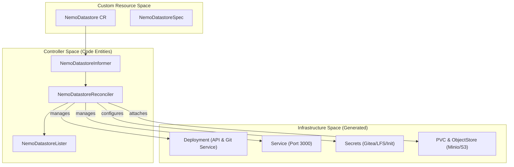
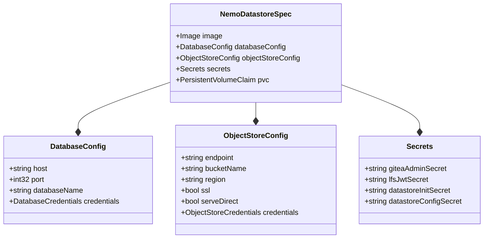

<!-- source: DeepWiki mcp.deepwiki.com · repo NVIDIA/k8s-nim-operator · extra page NemoDatastore · fetched 2026-10-26 -->

# NemoDatastore

<details>
<summary>Relevant source files</summary>

The following files were used as context for generating this wiki page:

- [api/apps/v1alpha1/nemo_datastore_types.go](api/apps/v1alpha1/nemo_datastore_types.go)
- [api/informers/externalversions/apps/v1alpha1/nemodatastore.go](api/informers/externalversions/apps/v1alpha1/nemodatastore.go)
- [api/listers/apps/v1alpha1/nemodatastore.go](api/listers/apps/v1alpha1/nemodatastore.go)
- [api/versioned/typed/apps/v1alpha1/nemodatastore.go](api/versioned/typed/apps/v1alpha1/nemodatastore.go)
- [bundle/manifests/apps.nvidia.com_nemodatastores.yaml](bundle/manifests/apps.nvidia.com_nemodatastores.yaml)

</details>


NemoDatastore is a Custom Resource Definition (CRD) in the k8s-nim-operator that manages data storage services for NVIDIA NeMo microservices. It provides a declarative way to deploy and configure data repository infrastructure for AI workflows including model training, fine-tuning, and evaluation.

For information about other NeMo microservices, see [NeMo Microservices](4.2).

## CRD Registration

NemoDatastore is registered in the operator as part of the `apps.nvidia.com/v1alpha1` API group. It is a namespaced resource that allows for multiple isolated datastore instances within a cluster.

| Property | Value |
|----------|-------|
| API Group | `apps.nvidia.com` |
| Version | `v1alpha1` |
| Kind | `NemoDatastore` |
| Namespaced | `true` |
| Status Subresource | `true` |

Sources:
- [api/apps/v1alpha1/nemo_datastore_types.go:140-153]()
- [bundle/manifests/apps.nvidia.com_nemodatastores.yaml:9-15]()

## Architecture Overview

The NemoDatastore architecture bridges the gap between the high-level Custom Resource and the underlying Kubernetes primitives. The controller (reconciler) transforms the `NemoDatastoreSpec` into a set of functional components including Gitea-based repository services and LFS (Large File Storage) management.

### Data Flow and Component Interaction

The following diagram illustrates how the `NemoDatastore` CR relates to the internal code entities and the resources it generates.



Sources:
- [api/apps/v1alpha1/nemo_datastore_types.go:63-95]()
- [api/informers/externalversions/apps/v1alpha1/nemodatastore.go:36-39]()
- [api/listers/apps/v1alpha1/nemodatastore.go:29-36]()

## Specification Fields

The `NemoDatastoreSpec` defines the desired state, integrating standard Kubernetes pod configurations with specific AI data management requirements.

### Core Configuration

| Field | Type | Description |
|-------|------|-------------|
| `image` | `Image` | The container image for the datastore service. [api/apps/v1alpha1/nemo_datastore_types.go:64]() |
| `databaseConfig` | `DatabaseConfig` | External PostgreSQL configuration for metadata storage. [api/apps/v1alpha1/nemo_datastore_types.go:90]() |
| `objectStoreConfig` | `*ObjectStoreConfig` | Optional external S3/Minio configuration for LFS files. [api/apps/v1alpha1/nemo_datastore_types.go:88]() |
| `secrets` | `Secrets` | References to required pre-created secrets (Gitea, JWT, Init). [api/apps/v1alpha1/nemo_datastore_types.go:92]() |
| `pvc` | `*PersistentVolumeClaim` | Storage for the datastore service. [api/apps/v1alpha1/nemo_datastore_types.go:94]() |

### Data Storage Integration

The Datastore supports a hybrid storage model: metadata in PostgreSQL, git objects in a PVC, and large files in an Object Store.



Sources:
- [api/apps/v1alpha1/nemo_datastore_types.go:63-103]()
- [api/apps/v1alpha1/nemo_datastore_types.go:112-138]()

## Lifecycle and Status

The operator tracks the readiness of the datastore through the `NemoDatastoreStatus` object.

| State | Description |
|-------|-------------|
| `Pending` | Resources are being created or the deployment is scaling up. |
| `NotReady` | The service is running but health checks are failing. |
| `Ready` | The datastore API is accessible on `DatastoreAPIPort` (3000). |
| `Failed` | A terminal error occurred during reconciliation. |

Sources:
- [api/apps/v1alpha1/nemo_datastore_types.go:42-58]()
- [api/apps/v1alpha1/nemo_datastore_types.go:105-110]()

## Implementation Details

### API Constants
The datastore service defaults to port `3000` for its API operations.
- `DatastoreAPIPort = 3000` [api/apps/v1alpha1/nemo_datastore_types.go:44]()

### Validation Rules
The CRD includes CEL (Common Expression Language) validations to ensure configuration integrity:
- **Expose Validation**: Prevents using deprecated `ingress` fields simultaneously with new `router` fields. [api/apps/v1alpha1/nemo_datastore_types.go:61]()
- **Scaling Validation**: Ensures `replicas` is not set manually if `scale.enabled` is true. [api/apps/v1alpha1/nemo_datastore_types.go:62]()

## Example Usage

### Minimal Configuration
A basic datastore using a local PVC and external PostgreSQL:

```yaml
apiVersion: apps.nvidia.com/v1alpha1
kind: NemoDatastore
metadata:
  name: nemo-datastore-basic
spec:
  image:
    repository: nvcr.io/nvidia/nemo-datastore
    tag: "24.07"
  databaseConfig:
    host: postgres-svc.default.svc.cluster.local
    port: 5432
    databaseName: nemodb
    credentials:
      user: admin
      secretName: db-secret
      passwordKey: password
  secrets:
    giteaAdminSecret: gitea-admin-creds
    lfsJwtSecret: lfs-token
    datastoreInitSecret: ds-init
    datastoreConfigSecret: ds-config
    datastoreInlineConfigSecret: ds-inline
  pvc:
    create: true
    size: 50Gi
```

Sources:
- [api/apps/v1alpha1/nemo_datastore_types.go:63-95]()
- [bundle/manifests/apps.nvidia.com_nemodatastores.yaml:48-95]()

---

