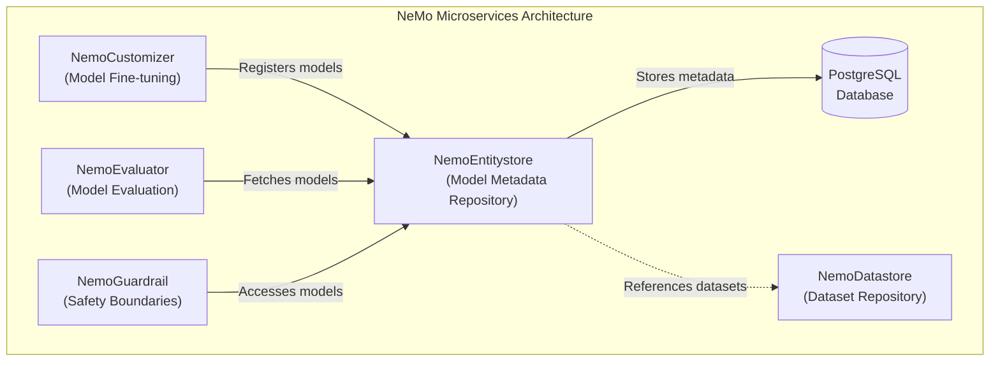
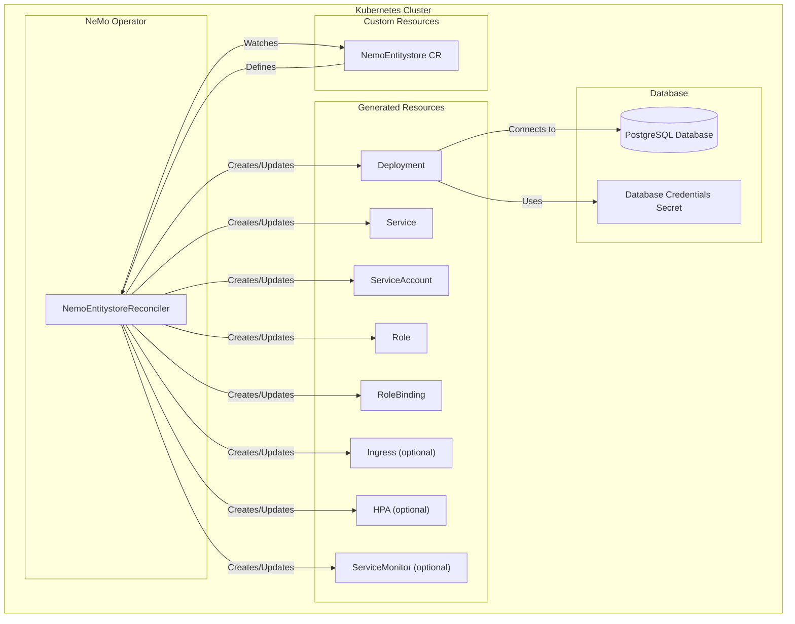
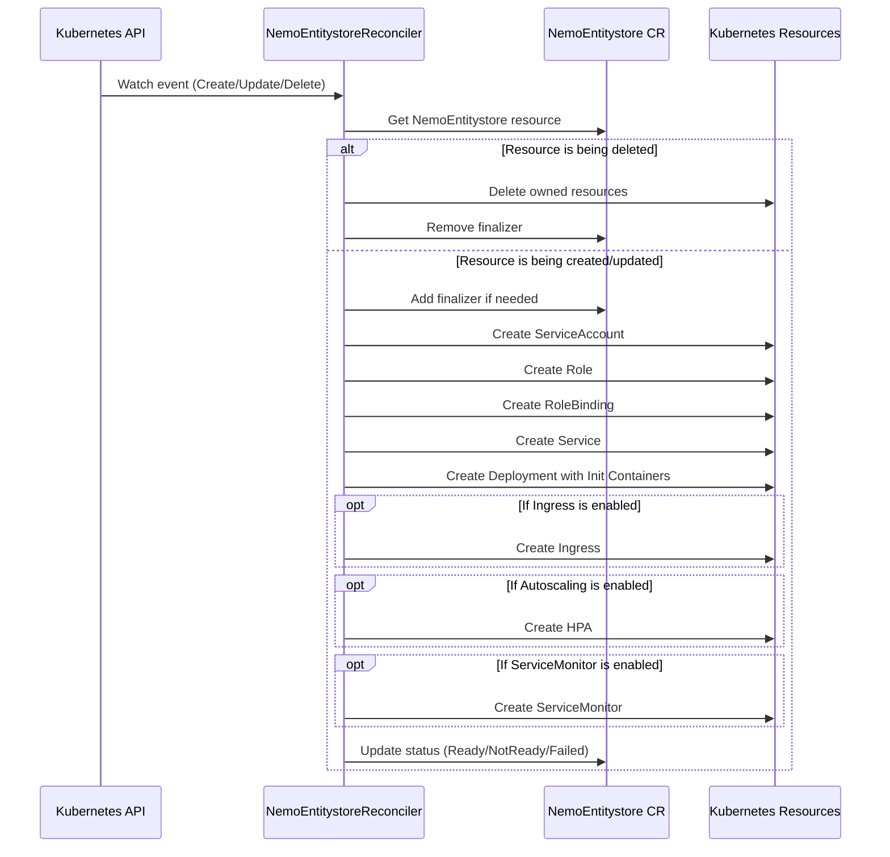
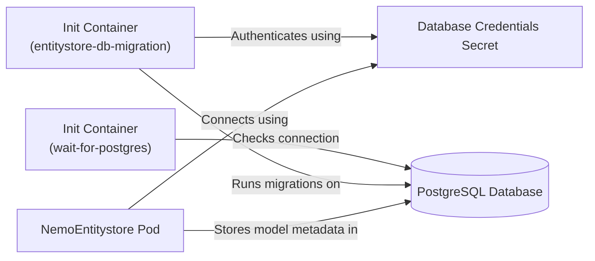
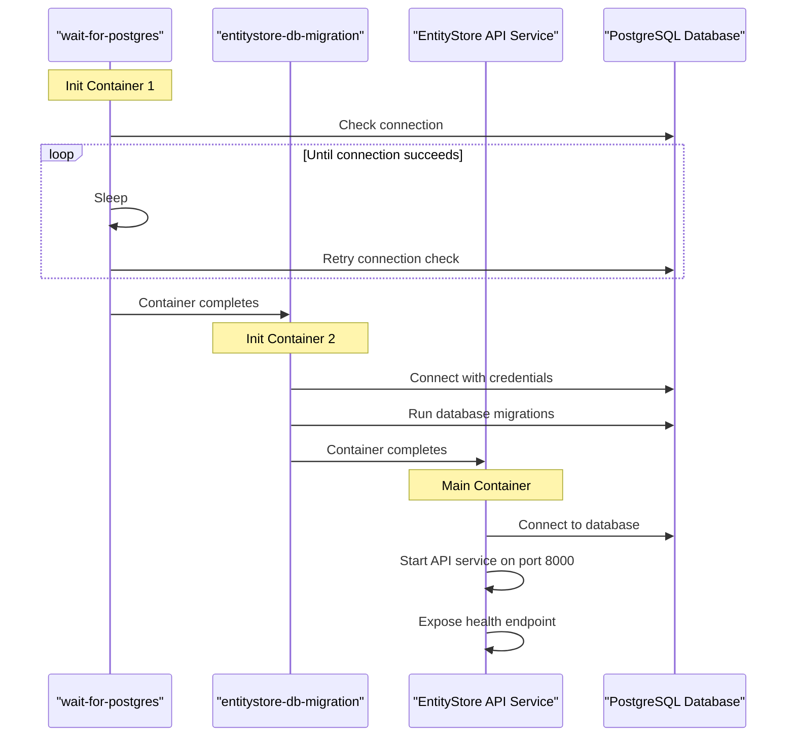
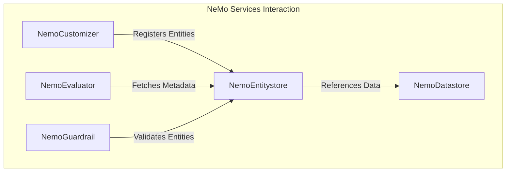

<!-- source: DeepWiki mcp.deepwiki.com · repo NVIDIA/k8s-nim-operator · extra page NemoEntitystore · fetched 2026-10-26 -->

# NemoEntitystore

<details>
<summary>Relevant source files</summary>

The following files were used as context for generating this wiki page:

- [api/apps/v1alpha1/nemo_entitystore_types.go](api/apps/v1alpha1/nemo_entitystore_types.go)
- [api/informers/externalversions/apps/v1alpha1/nemoentitystore.go](api/informers/externalversions/apps/v1alpha1/nemoentitystore.go)
- [api/listers/apps/v1alpha1/nemoentitystore.go](api/listers/apps/v1alpha1/nemoentitystore.go)
- [api/versioned/typed/apps/v1alpha1/nemoentitystore.go](api/versioned/typed/apps/v1alpha1/nemoentitystore.go)
- [bundle/manifests/apps.nvidia.com_nemoentitystores.yaml](bundle/manifests/apps.nvidia.com_nemoentitystores.yaml)

</details>


## Purpose and Scope

This document provides detailed technical documentation for the `NemoEntitystore` custom resource within the NVIDIA Kubernetes NIM Operator. The `NemoEntitystore` is a core component of the NeMo microservices ecosystem that serves as a centralized repository for storing model entities, including model metadata, training configurations, and related information.

For information about other NeMo microservices, see the overview page on [Custom Resources](#4) or specific services such as [NemoCustomizer](#4.2.1), [NemoGuardrail](#4.2.2), [NemoDatastore](#4.2.4), and [NemoEvaluator](#4.2.5).

## Overview

The `NemoEntitystore` manages a service that stores metadata and configurations for large language models (LLMs) used in the NeMo framework. It provides APIs for other NeMo services to store, retrieve, and manage model entities. The service supports standard CRUD operations on model entities and serves as the central registry for all models in the ecosystem.

### NemoEntitystore in the NeMo Ecosystem



Sources: [api/apps/v1alpha1/nemo_entitystore_types.go:43-59](), [api/apps/v1alpha1/nemo_entitystore_types.go:87-94]()

## Architecture

The `NemoEntitystore` operates as a stateless API service with a backing PostgreSQL database. The controller follows the Kubernetes Operator pattern to manage the lifecycle of `NemoEntitystore` instances.

### NemoEntitystore Resource Architecture



Sources: [api/apps/v1alpha1/nemo_entitystore_types.go:109-116](), [api/apps/v1alpha1/nemo_entitystore_types.go:64-94](), [api/versioned/typed/apps/v1alpha1/nemoentitystore.go:38-50]()

## Controller Reconciliation Flow

The NemoEntitystore controller follows a standard Kubernetes reconciliation pattern, creating and managing the necessary Kubernetes resources based on the custom resource specification.



Sources: [api/apps/v1alpha1/nemo_entitystore_types.go:96-101](), [api/informers/externalversions/apps/v1alpha1/nemoentitystore.go:36-39](), [api/listers/apps/v1alpha1/nemoentitystore.go:29-36]()

## Custom Resource Definition

The `NemoEntitystore` custom resource definition defines the schema and configuration options for the entitystore service.

### Key Specification Fields

| Field | Description | Source Reference |
|-------|-------------|------------------|
| `image` | Container image configuration including repository, tag, and pull policy | [api/apps/v1alpha1/nemo_entitystore_types.go:65]() |
| `databaseConfig` | PostgreSQL database connection details and credentials | [api/apps/v1alpha1/nemo_entitystore_types.go:91]() |
| `datastore` | Reference to the NemoDatastore endpoint | [api/apps/v1alpha1/nemo_entitystore_types.go:93]() |
| `expose` | Service and ingress configuration | [api/apps/v1alpha1/nemo_entitystore_types.go:79]() |
| `scale` | Autoscaling configuration | [api/apps/v1alpha1/nemo_entitystore_types.go:80]() |
| `metrics` | Prometheus monitoring configuration | [api/apps/v1alpha1/nemo_entitystore_types.go:81]() |
| `resources` | CPU and memory resource requests/limits | [api/apps/v1alpha1/nemo_entitystore_types.go:76]() |
| `env` | Additional environment variables | [api/apps/v1alpha1/nemo_entitystore_types.go:68]() |
| `nodeSelector` | Node selection constraints | [api/apps/v1alpha1/nemo_entitystore_types.go:71]() |
| `tolerations` | Pod scheduling tolerations | [api/apps/v1alpha1/nemo_entitystore_types.go:72]() |
| `affinity` | Pod affinity rules | [api/apps/v1alpha1/nemo_entitystore_types.go:73]() |
| `replicas` | Number of pod replicas (default: 1) | [api/apps/v1alpha1/nemo_entitystore_types.go:83]() |
| `userID` | User ID for container security context | [api/apps/v1alpha1/nemo_entitystore_types.go:84]() |
| `groupID` | Group ID for container security context | [api/apps/v1alpha1/nemo_entitystore_types.go:85]() |
| `runtimeClass` | Kubernetes runtime class | [api/apps/v1alpha1/nemo_entitystore_types.go:86]() |

Sources: [api/apps/v1alpha1/nemo_entitystore_types.go:64-94](), [bundle/manifests/apps.nvidia.com_nemoentitystores.yaml:47-134]()

### Database Integration

`NemoEntitystore` requires a PostgreSQL database for storing model metadata. The database connection is configured through the `DatabaseConfig` struct.

#### Database Connection Architecture



The EntityStore executes database migrations during initialization. This is typically handled by init containers that run before the main application container. The database configuration includes:

- Host and port for the PostgreSQL server
- Database name
- User credentials stored in a Kubernetes Secret (referenced by `PasswordKey` and `LocalObjectReference`)

Sources: [api/apps/v1alpha1/nemo_entitystore_types.go:91](), [api/apps/v1alpha1/nemo_entitystore_types.go:157-166]()

## Initialization Process

When a `NemoEntitystore` resource is created, the initialization process typically includes:

1. Initial database connection check using an init container.
2. Database schema migration through a migration init container.
3. Starting the main entitystore service container.

### NemoEntitystore Pod Initialization Sequence



Sources: [api/apps/v1alpha1/nemo_entitystore_types.go:43-59](), [api/apps/v1alpha1/nemo_entitystore_types.go:157-166]()

## Controller Implementation

The `NemoEntitystore` controller (referenced in generated code as `nemoentitystores`) implements the reconciliation logic. It uses generated clients, informers, and listers to interact with the Kubernetes API.

### Status Management

The controller updates the status of the `NemoEntitystore` resource:

| Status | Description |
|--------|-------------|
| `Pending` | Initial state during creation |
| `NotReady` | Deployment exists but is not yet ready |
| `Ready` | Deployment is successful and pods are running |
| `Failed` | Error occurred during reconciliation |

Sources: [api/apps/v1alpha1/nemo_entitystore_types.go:43-59](), [api/apps/v1alpha1/nemo_entitystore_types.go:96-101]()

## API Server Configuration

The `NemoEntitystore` API server listens on port 8000 by default (defined as `EntitystoreAPIPort`).

### Health Probes Configuration

The pod typically includes probes that check the health of the service. These probes ensure that the service is properly initialized and remains responsive during operation.

Sources: [api/apps/v1alpha1/nemo_entitystore_types.go:43-45]()

## Integration with Other Services

NemoEntitystore interacts with other services in the NeMo microservices ecosystem, specifically requiring a `datastore` endpoint for full functionality.



Sources: [api/apps/v1alpha1/nemo_entitystore_types.go:93](), [api/apps/v1alpha1/nemo_entitystore_types.go:152]()

## Example NemoEntitystore Resource

Here's a conceptual example of a `NemoEntitystore` custom resource:

```yaml
apiVersion: apps.nvidia.com/v1alpha1
kind: NemoEntitystore
metadata:
  name: entitystore-sample
spec:
  image:
    repository: nvcr.io/nvidia/nemo-entitystore
    tag: latest
  databaseConfig:
    host: postgres-host
    port: 5432
    databaseName: entitystore
    credentials:
      secretName: db-secret
      user: admin
      passwordKey: password
  datastore:
    endpoint: http://datastore-svc:8000
  replicas: 1
```

Sources: [api/apps/v1alpha1/nemo_entitystore_types.go:64-94](), [bundle/manifests/apps.nvidia.com_nemoentitystores.yaml:28-48]()

---

