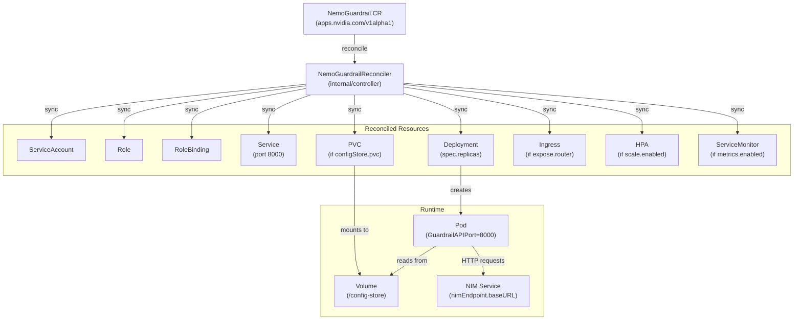
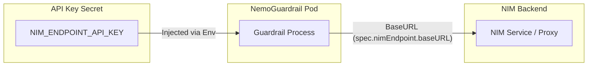

<!-- source: DeepWiki mcp.deepwiki.com · repo NVIDIA/k8s-nim-operator · extra page NemoGuardrail · fetched 2026-10-26 -->

# NemoGuardrail

<details>
<summary>Relevant source files</summary>

The following files were used as context for generating this wiki page:

- [api/apps/v1alpha1/nemo_guardrails_types.go](api/apps/v1alpha1/nemo_guardrails_types.go)
- [api/informers/externalversions/apps/v1alpha1/nemoguardrail.go](api/informers/externalversions/apps/v1alpha1/nemoguardrail.go)
- [api/listers/apps/v1alpha1/nemoguardrail.go](api/listers/apps/v1alpha1/nemoguardrail.go)
- [api/versioned/typed/apps/v1alpha1/nemoguardrail.go](api/versioned/typed/apps/v1alpha1/nemoguardrail.go)
- [bundle/manifests/apps.nvidia.com_nemoguardrails.yaml](bundle/manifests/apps.nvidia.com_nemoguardrails.yaml)

</details>


## Overview

`NemoGuardrail` is a Custom Resource Definition (CRD) in the `apps.nvidia.com/v1alpha1` API group that manages NeMo Guardrails service deployments. NeMo Guardrails enforces safety boundaries on Large Language Model (LLM) interactions by validating inputs and outputs against configurable rules.

The operator implements the `NemoGuardrailReconciler` controller that creates and manages:
- `Deployment` with guardrail container serving on port 8000 [api/apps/v1alpha1/nemo_guardrails_types.go:44-46]()
- `Service` exposing the HTTP API [api/apps/v1alpha1/nemo_guardrails_types.go:81-83]()
- Optional `HorizontalPodAutoscaler`, `Ingress`, and `ServiceMonitor` [api/apps/v1alpha1/nemo_guardrails_types.go:83-85]()
- RBAC resources (`ServiceAccount`, `Role`, `RoleBinding`)

Sources:
- [api/apps/v1alpha1/nemo_guardrails_types.go:44-60]()
- [api/apps/v1alpha1/nemo_guardrails_types.go:65-97]()
- [bundle/manifests/apps.nvidia.com_nemoguardrails.yaml:7-16]()

## Architecture

### Component Structure

The `NemoGuardrail` controller watches the CR and reconciles Kubernetes resources to match the desired state. It utilizes common types for standard configurations like images, metrics, and autoscaling.

#### Resource Reconciliation Flow



Sources:
- [api/apps/v1alpha1/nemo_guardrails_types.go:44-46]()
- [api/apps/v1alpha1/nemo_guardrails_types.go:65-97]()
- [api/apps/v1alpha1/nemo_guardrails_types.go:122-125]()

### API Type Hierarchy

The `NemoGuardrailSpec` embeds common types to maintain consistency across the operator:

| Field | Type | Purpose |
|-------|------|---------|
| `image` | `Image` | Container image configuration [api/apps/v1alpha1/nemo_guardrails_types.go:66-66]() |
| `expose` | `ExposeV1` | Service, Router, and Ingress configuration [api/apps/v1alpha1/nemo_guardrails_types.go:83-83]() |
| `scale` | `Autoscaling` | HPA and scaling parameters [api/apps/v1alpha1/nemo_guardrails_types.go:84-84]() |
| `metrics` | `Metrics` | Prometheus ServiceMonitor configuration [api/apps/v1alpha1/nemo_guardrails_types.go:85-85]() |
| `resources` | `*corev1.ResourceRequirements` | Standard K8s resource requests/limits [api/apps/v1alpha1/nemo_guardrails_types.go:80-80]() |

Sources:
- [api/apps/v1alpha1/nemo_guardrails_types.go:65-97]()

## Custom Resource Definition

### Specification Fields

| Field | Type | Description |
|-------|------|-------------|
| `nimEndpoint` | `*NIMEndpoint` | Configuration for connecting to the backend NIM service [api/apps/v1alpha1/nemo_guardrails_types.go:70-70]() |
| `configStore` | `GuardrailConfig` | Source for guardrail configuration files [api/apps/v1alpha1/nemo_guardrails_types.go:72-72]() |
| `databaseConfig` | `*DatabaseConfig` | Metadata storage configuration [api/apps/v1alpha1/nemo_guardrails_types.go:93-93]() |
| `otel` | `*OTelSpec` | OpenTelemetry settings for observability [api/apps/v1alpha1/nemo_guardrails_types.go:96-96]() |
| `replicas` | `*int32` | Desired pod count (if HPA disabled) [api/apps/v1alpha1/nemo_guardrails_types.go:87-87]() |

Sources:
- [api/apps/v1alpha1/nemo_guardrails_types.go:65-97]()

### Status Fields

The `NemoGuardrailStatus` tracks the observed state:

| Field | Type | Description |
|-------|------|-------------|
| `conditions` | `[]metav1.Condition` | Lifecycle conditions (Ready, Failed) [api/apps/v1alpha1/nemo_guardrails_types.go:129-129]() |
| `availableReplicas` | `int32` | Current ready pod count [api/apps/v1alpha1/nemo_guardrails_types.go:130-130]() |
| `state` | `string` | High-level status (Pending, Ready, etc.) [api/apps/v1alpha1/nemo_guardrails_types.go:131-131]() |

Sources:
- [api/apps/v1alpha1/nemo_guardrails_types.go:128-132]()
- [api/apps/v1alpha1/nemo_guardrails_types.go:52-59]()

## Key Components

### NIMEndpoint Configuration

The `NIMEndpoint` struct defines how the guardrail service communicates with the LLM backend.



- `BaseURL`: Must be a valid URI pointing to `/v1` [api/apps/v1alpha1/nemo_guardrails_types.go:106-106]().
- `APIKeySecret`: Name of the secret containing the auth token [api/apps/v1alpha1/nemo_guardrails_types.go:111-111]().
- `APIKeyKey`: The key within the secret, defaults to `NIM_ENDPOINT_API_KEY` [api/apps/v1alpha1/nemo_guardrails_types.go:112-116]().

Sources:
- [api/apps/v1alpha1/nemo_guardrails_types.go:99-117]()

### Configuration Storage

The `GuardrailConfig` supports two mutually exclusive methods for providing guardrail definitions (Colang/YAML files).

| Method | Field | Description |
|--------|-------|-------------|
| ConfigMap | `configMap` | Reference to a K8s ConfigMap [api/apps/v1alpha1/nemo_guardrails_types.go:123-123]() |
| PVC | `pvc` | Reference to a PersistentVolumeClaim [api/apps/v1alpha1/nemo_guardrails_types.go:124-124]() |

Validation ensures that both cannot be set simultaneously [api/apps/v1alpha1/nemo_guardrails_types.go:121-121]().

Sources:
- [api/apps/v1alpha1/nemo_guardrails_types.go:119-125]()

## Generated Code Entities

The CRD implementation relies on several generated entities for cluster interaction:

| Entity | Path | Purpose |
|--------|------|---------|
| `NemoGuardrailInformer` | [api/informers/externalversions/apps/v1alpha1/nemoguardrail.go:36-39]() | Shared informer for watching resource changes |
| `NemoGuardrailLister` | [api/listers/apps/v1alpha1/nemoguardrail.go:29-36]() | Efficient local cache lookup for CRs |
| `NemoGuardrailInterface` | [api/versioned/typed/apps/v1alpha1/nemoguardrail.go:38-50]() | Standard CRUD operations for the CR |

Sources:
- [api/informers/externalversions/apps/v1alpha1/nemoguardrail.go:1-90]()
- [api/listers/apps/v1alpha1/nemoguardrail.go:1-70]()
- [api/versioned/typed/apps/v1alpha1/nemoguardrail.go:1-69]()

## Configuration Example

```yaml
apiVersion: apps.nvidia.com/v1alpha1
kind: NemoGuardrail
metadata:
  name: safety-layer
spec:
  image:
    repository: nvcr.io/nvidia/nemo-guardrails
    tag: 24.04
  nimEndpoint:
    baseURL: "http://llama3-70b-nim:8000/v1"
  configStore:
    configMap:
      name: guardrail-rules-cm
  replicas: 2
  expose:
    service:
      type: ClusterIP
  metrics:
    enabled: true
```

Sources:
- [api/apps/v1alpha1/nemo_guardrails_types.go:65-97]()
- [bundle/manifests/apps.nvidia.com_nemoguardrails.yaml:48-82]()

---

