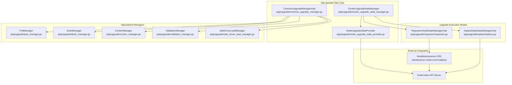
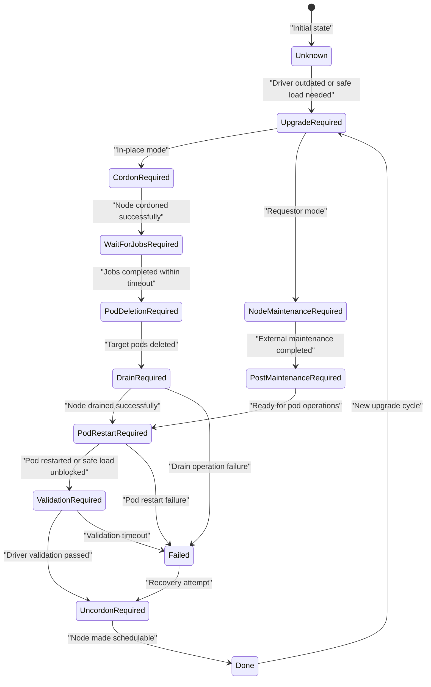
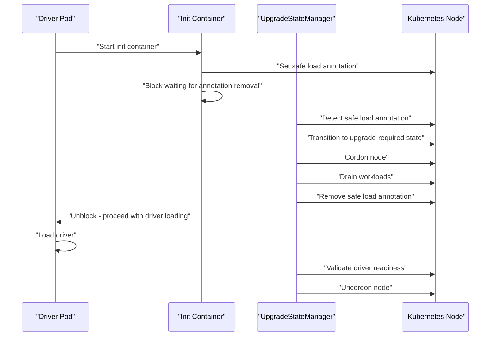

<!-- source: DeepWiki mcp.deepwiki.com · repo NVIDIA/k8s-operator-libs · page 1 Overview · fetched 2026-10-26 -->

# Overview

Relevant source files

The following files were used as context for generating this wiki page:

- [docs/automatic-ofed-upgrade.md](docs/automatic-ofed-upgrade.md)
- [go.mod](go.mod)
- [pkg/upgrade/safe_driver_load_manager.go](pkg/upgrade/safe_driver_load_manager.go)
- [pkg/upgrade/safe_driver_load_manager_test.go](pkg/upgrade/safe_driver_load_manager_test.go)

This document provides an overview of the NVIDIA k8s-operator-libs repository, a Go library designed for building Kubernetes operators that manage driver upgrade workflows. The library provides reusable components and state management capabilities for orchestrating complex node maintenance operations during driver upgrades.

For detailed information about the core upgrade system architecture, see [Architecture](#2). For specific upgrade modes and their implementation, see [Upgrade Modes](#3.2). For API specifications and custom resources, see [APIs and Custom Resources](#4).

## Purpose and Scope

The k8s-operator-libs repository is a specialized Go library that addresses the challenges of safely upgrading containerized drivers in Kubernetes clusters. The library focuses on three primary concerns:

**Driver Upgrade Orchestration**: Managing the complex workflow of upgrading drivers across cluster nodes while maintaining application availability and cluster stability.

**Safe Driver Loading**: Ensuring that nodes are properly prepared before driver loading to prevent workload disruption and resource access failures.

**Node Maintenance Coordination**: Providing flexible integration with external maintenance operators or direct node operations for cordoning, draining, and scheduling management.

The library is built as a reusable component that can be embedded into various NVIDIA operator projects, providing consistent upgrade behavior across different driver types (GPU drivers, network drivers, etc.).

## Library Architecture

The k8s-operator-libs follows a modular architecture centered around a state machine that manages node upgrade lifecycles. The library provides both direct node operations and external maintenance operator integration.

### Core Components

**Sources**: [go.mod:1-17](), [docs/automatic-ofed-upgrade.md:92-135](), [pkg/upgrade/safe_driver_load_manager.go:28-47]()

### Node Upgrade State Machine

The library implements a comprehensive state machine that tracks each node's progress through the upgrade workflow. The state machine ensures safe transitions and provides recovery mechanisms for failed operations.

**Sources**: [docs/automatic-ofed-upgrade.md:70-84](), [docs/automatic-ofed-upgrade.md:86-90]()

## Key Features

### Dual Upgrade Modes

The library supports two distinct upgrade execution modes to accommodate different operational requirements and cluster configurations.

| Mode | Description | Use Case |
|------|-------------|----------|
| **In-place** | Direct node operations through Kubernetes API | Self-contained operators, simple deployments |
| **Requestor** | External maintenance operator integration | Complex maintenance workflows, multi-operator coordination |

**In-place Mode**: The library directly manages all node operations including cordoning, draining, and uncordoning through the standard Kubernetes API. This mode provides complete control over the upgrade process and maintains backward compatibility with existing operator implementations.

**Requestor Mode**: The library delegates node maintenance operations to an external maintenance operator via `NodeMaintenance` custom resources. This mode enables coordination between multiple operators and supports advanced maintenance policies.

**Sources**: [docs/automatic-ofed-upgrade.md:92-116](), [go.mod:6]()

### Safe Driver Loading

The safe driver loading feature prevents workload disruption during driver initialization by ensuring nodes are properly prepared before driver loading begins.

The implementation uses a two-phase approach:
1. **Blocking Phase**: Driver pod init container sets a safe load annotation and blocks until removed
2. **Preparation Phase**: Library cordons and drains the node, then removes the annotation to unblock loading

**Sources**: [docs/automatic-ofed-upgrade.md:43-66](), [pkg/upgrade/safe_driver_load_manager.go:49-71]()

### Node State Management

The library provides comprehensive node state tracking through labels and annotations. Each node's upgrade status is reflected in dedicated Kubernetes metadata that can be queried and monitored.

**State Labels**: The primary state is tracked via the `nvidia.com/<driver-name>-driver-upgrade-state` label with values including `upgrade-required`, `cordon-required`, `drain-required`, `validation-required`, `upgrade-done`, and `upgrade-failed`.

**Safe Load Annotations**: The safe driver loading mechanism uses the annotation key format defined in [pkg/upgrade/safe_driver_load_manager.go:58]() to coordinate between init containers and the upgrade state manager.

**Sources**: [docs/automatic-ofed-upgrade.md:70-84](), [pkg/upgrade/safe_driver_load_manager.go:49-71]()

## Integration Points

### Kubernetes API Dependencies

The library integrates extensively with the Kubernetes ecosystem through several key dependencies:

- **controller-runtime**: Provides the foundational controller framework and client interfaces
- **k8s.io/client-go**: Enables direct Kubernetes API interactions for node and pod operations
- **k8s.io/kubectl**: Supports drain operations and advanced node management capabilities

**Sources**: [go.mod:11-16]()

### External Maintenance Operator

When operating in requestor mode, the library integrates with the Mellanox maintenance operator through the `NodeMaintenance` custom resource definition. This enables sophisticated maintenance workflows and multi-operator coordination.

The integration supports both exclusive and shared-requestor patterns, allowing multiple operators to coordinate maintenance operations on the same nodes without conflicts.

**Sources**: [go.mod:6](), [docs/automatic-ofed-upgrade.md:117-135]()

### Embedding in Operator Projects

The library is designed to be embedded within larger operator projects as a reusable component. Operators can instantiate the `ClusterUpgradeStateManager` with appropriate configuration and integrate it into their reconciliation loops to provide automatic driver upgrade capabilities.

The modular design allows operators to customize specific aspects of the upgrade process while leveraging the core state management and orchestration logic provided by the library.

**Sources**: [go.mod:1](), [docs/automatic-ofed-upgrade.md:8-39]()

---

