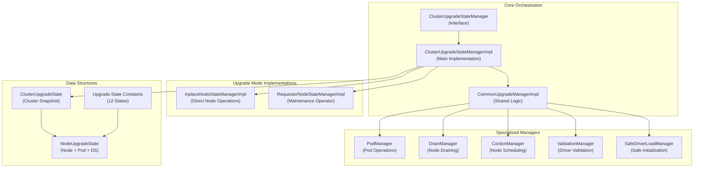
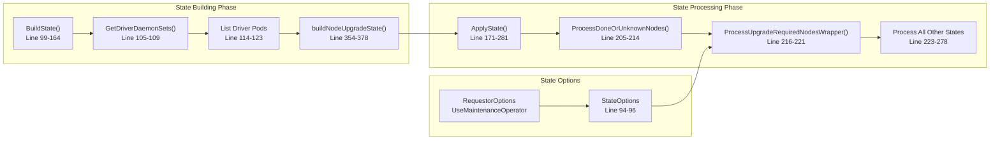
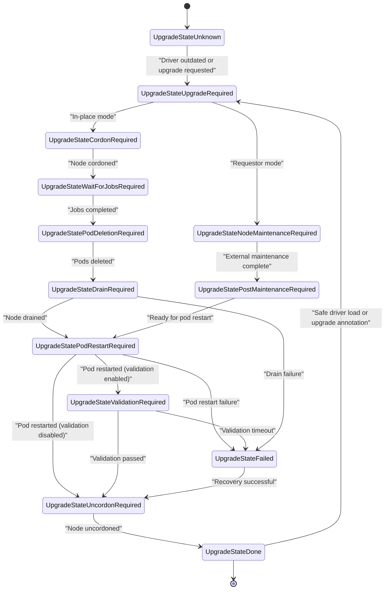
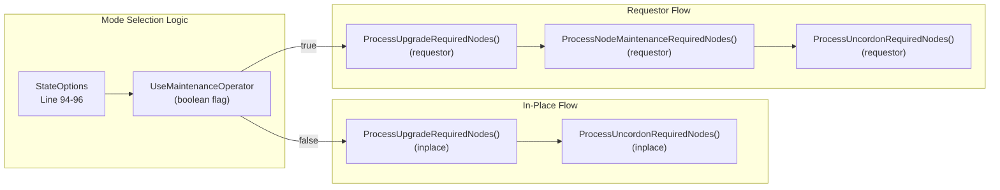

<!-- source: DeepWiki mcp.deepwiki.com · repo NVIDIA/k8s-operator-libs · page 2 Architecture · fetched 2026-10-26 -->

# Architecture

Relevant source files

The following files were used as context for generating this wiki page:

- [pkg/upgrade/common_manager.go](pkg/upgrade/common_manager.go)
- [pkg/upgrade/consts.go](pkg/upgrade/consts.go)
- [pkg/upgrade/upgrade_state.go](pkg/upgrade/upgrade_state.go)

This document provides a comprehensive overview of the k8s-operator-libs system architecture, focusing on the core driver upgrade management components and their interactions. It covers the main orchestration components, state management, and the two supported upgrade modes.

For information about specific API definitions and custom resources, see [APIs and Custom Resources](#4). For details on individual manager components, see [Manager Components](#3.3).

## System Overview

The k8s-operator-libs library provides a state machine-driven approach to managing Kubernetes driver upgrades. The system is built around a central orchestrator that coordinates specialized managers to handle different aspects of the upgrade process.

Sources: [pkg/upgrade/upgrade_state.go:34-92](), [pkg/upgrade/common_manager.go:22-54](), [pkg/upgrade/common_manager.go:82-133]()

## Core Upgrade Orchestration

The upgrade orchestration follows a well-defined flow from state building through processing. The `ClusterUpgradeStateManagerImpl` serves as the central coordinator.

Sources: [pkg/upgrade/upgrade_state.go:98-164](), [pkg/upgrade/upgrade_state.go:171-281](), [pkg/upgrade/upgrade_state.go:94-96]()

## Upgrade State Machine

The system implements a comprehensive state machine with 12 distinct states that nodes transition through during driver upgrades.

Sources: [pkg/upgrade/consts.go:48-82](), [pkg/upgrade/upgrade_state.go:184-198]()

## Manager Subsystem Architecture

The system uses specialized managers to handle different aspects of the upgrade process, all coordinated through the `CommonUpgradeManagerImpl`.

```mermaid
graph TB
    subgraph "State Provider Layer"
        NUSP["NodeUpgradeStateProvider<br/>(Labels & Annotations)"]
    end
    
    subgraph "Manager Layer"
        CUMI["CommonUpgradeManagerImpl"]
        
        PM["PodManager<br/>- SchedulePodsRestart()<br/>- SchedulePodEviction()<br/>- ScheduleCheckOnPodCompletion()"]
        
        DM["DrainManager<br/>- ScheduleNodesDrain()<br/>- DrainConfiguration"]
        
        CM["CordonManager<br/>- Cordon()<br/>- Uncordon()"]
        
        VM["ValidationManager<br/>- Validate()<br/>- podSelector"]
        
        SDLM["SafeDriverLoadManager<br/>- UnblockLoading()<br/>- IsWaitingForSafeDriverLoad()"]
    end
    
    subgraph "Processing Methods"
        ProcessCordon["ProcessCordonRequiredNodes()<br/>Line 361-379"]
        ProcessWait["ProcessWaitForJobsRequiredNodes()<br/>Line 384-419"]
        ProcessDeletion["ProcessPodDeletionRequiredNodes()<br/>Line 424-453"]
        ProcessDrain["ProcessDrainNodes()<br/>Line 329-357"]
        ProcessRestart["ProcessPodRestartNodes()<br/>Line 457-524"]
        ProcessValidation["ProcessValidationRequiredNodes()<br/>Line 573-603"]
    end
    
    CUMI --> PM
    CUMI --> DM
    CUMI --> CM
    CUMI --> VM
    CUMI --> SDLM
    CUMI --> NUSP
    
    ProcessCordon --> CM
    ProcessWait --> PM
    ProcessDeletion --> PM
    ProcessDrain --> DM
    ProcessRestart --> PM
    ProcessRestart --> SDLM
    ProcessValidation --> VM
    ProcessValidation --> SDLM
```

Sources: [pkg/upgrade/common_manager.go:82-133](), [pkg/upgrade/common_manager.go:361-379](), [pkg/upgrade/common_manager.go:384-419](), [pkg/upgrade/common_manager.go:424-453]()

## Upgrade Mode Comparison

The system supports two distinct upgrade modes, each implementing the `ProcessNodeStateManager` interface with different operational approaches.

| Aspect | In-Place Mode (`InplaceNodeStateManagerImpl`) | Requestor Mode (`RequestorNodeStateManagerImpl`) |
|--------|-----------------------------------------------|--------------------------------------------------|
| **Node Operations** | Direct Kubernetes API calls | External maintenance operator integration |
| **Cordoning** | Internal `CordonManager.Cordon()` | Via NodeMaintenance CRD |
| **Draining** | Internal `DrainManager.ScheduleNodesDrain()` | Handled by external operator |
| **State Flow** | `UpgradeRequired` → `CordonRequired` → ... | `UpgradeRequired` → `NodeMaintenanceRequired` → ... |
| **Dependencies** | Only Kubernetes API | NodeMaintenance CRDs + external operator |
| **Configuration** | Always available | Requires `UseMaintenanceOperator: true` |

Sources: [pkg/upgrade/upgrade_state.go:287-325](), [pkg/upgrade/upgrade_state.go:57-92]()

---

