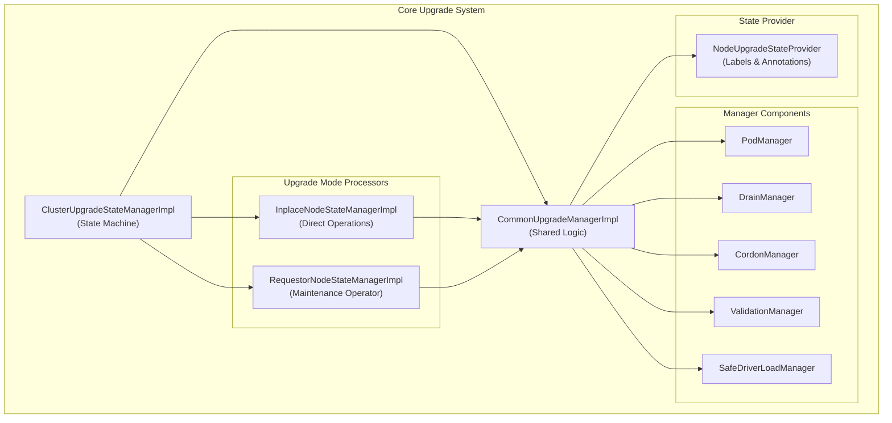
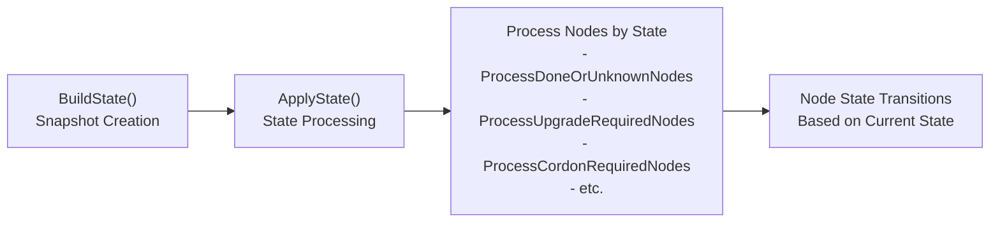
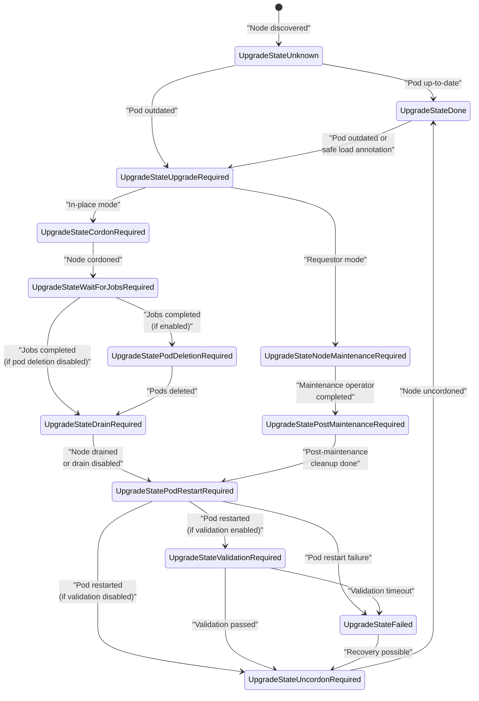
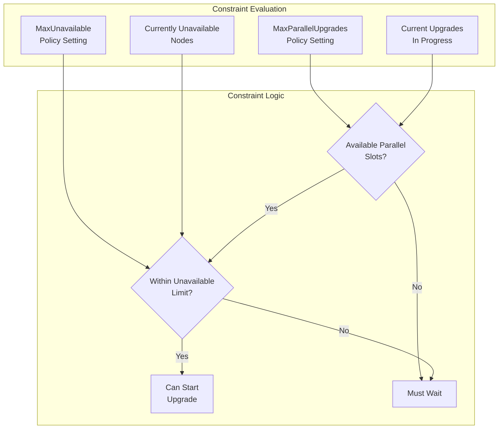
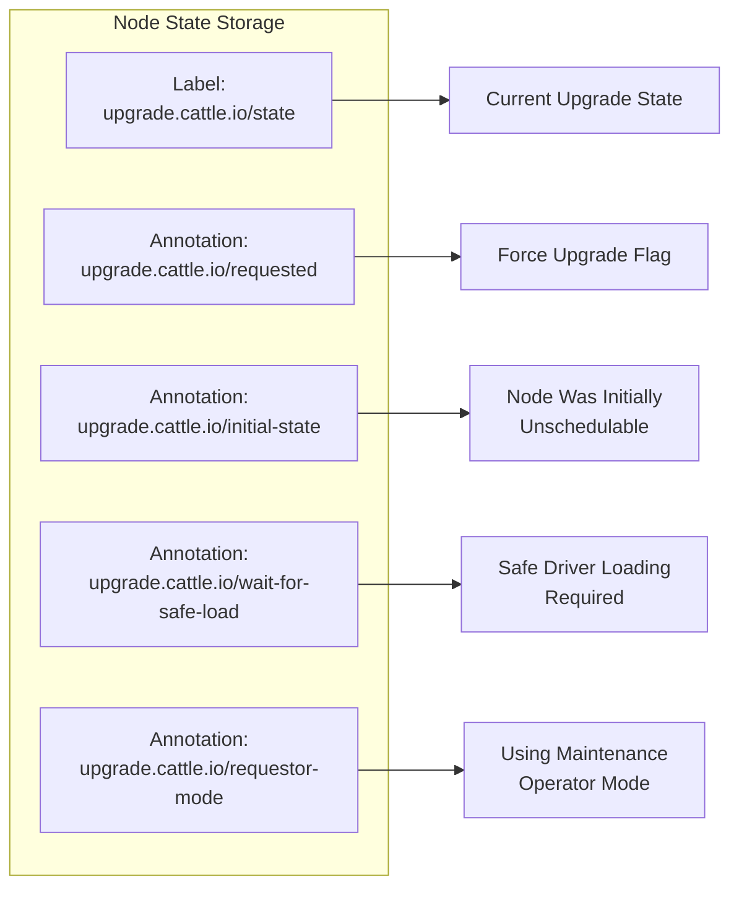
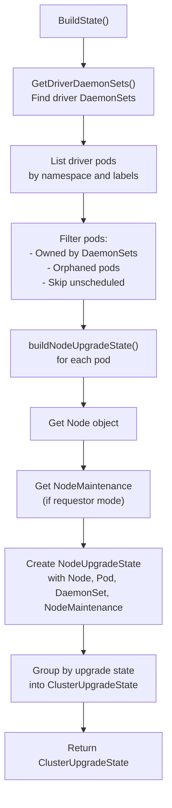
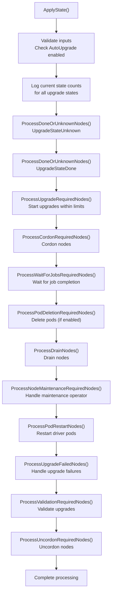
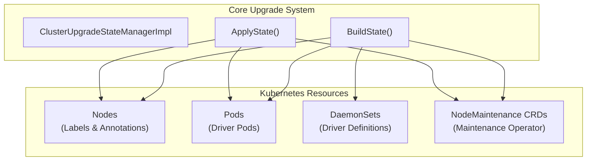

<!-- source: DeepWiki mcp.deepwiki.com · repo NVIDIA/k8s-operator-libs · page 3 Core Upgrade System · fetched 2026-10-26 -->

# Core Upgrade System

Relevant source files

The following files were used as context for generating this wiki page:

- [pkg/upgrade/upgrade_state.go](pkg/upgrade/upgrade_state.go)
- [pkg/upgrade/upgrade_state_test.go](pkg/upgrade/upgrade_state_test.go)

## Purpose and Scope

The Core Upgrade System is the central orchestration layer responsible for managing driver upgrades across Kubernetes clusters. This system implements a sophisticated state machine that coordinates node-by-node driver upgrades while respecting operational constraints such as maximum parallel upgrades, node availability requirements, and validation policies.

This document covers the core state management, orchestration logic, and upgrade workflows. For information about specific manager components (PodManager, DrainManager, etc.), see [Manager Components](#3.3). For details about upgrade modes implementation, see [Upgrade Modes](#3.2). For API specifications and custom resource definitions, see [APIs and Custom Resources](#4).

## System Architecture

The Core Upgrade System is built around the `ClusterUpgradeStateManager` interface and its primary implementation `ClusterUpgradeStateManagerImpl`. This manager serves as a state machine that processes cluster-wide upgrade states and coordinates transitions between upgrade phases.

**Core State Management Flow**

Sources: [pkg/upgrade/upgrade_state.go:34-92](), [pkg/upgrade/upgrade_state.go:98-164](), [pkg/upgrade/upgrade_state.go:166-281]()

## Upgrade State Machine

The system implements a comprehensive state machine with 12 distinct node upgrade states. Each state represents a specific phase in the upgrade lifecycle, with well-defined entry and exit conditions.

### State Definitions and Transitions

### State Processing Methods

The `ClusterUpgradeStateManagerImpl` processes nodes through dedicated methods for each state:

| State | Processing Method | Purpose |
|-------|------------------|---------|
| `UpgradeStateUnknown` / `UpgradeStateDone` | `ProcessDoneOrUnknownNodes()` | Determine if upgrade is needed |
| `UpgradeStateUpgradeRequired` | `ProcessUpgradeRequiredNodes()` | Start upgrade process |
| `UpgradeStateCordonRequired` | `ProcessCordonRequiredNodes()` | Cordon nodes |
| `UpgradeStateWaitForJobsRequired` | `ProcessWaitForJobsRequiredNodes()` | Wait for job completion |
| `UpgradeStatePodDeletionRequired` | `ProcessPodDeletionRequiredNodes()` | Delete pods (optional) |
| `UpgradeStateDrainRequired` | `ProcessDrainNodes()` | Drain nodes |
| `UpgradeStateNodeMaintenanceRequired` | `ProcessNodeMaintenanceRequiredNodes()` | Handle maintenance operator |
| `UpgradeStatePodRestartRequired` | `ProcessPodRestartNodes()` | Restart driver pods |
| `UpgradeStateValidationRequired` | `ProcessValidationRequiredNodes()` | Validate upgrade |
| `UpgradeStateUncordonRequired` | `ProcessUncordonRequiredNodes()` | Uncordon nodes |
| `UpgradeStateFailed` | `ProcessUpgradeFailedNodes()` | Handle failures |

Sources: [pkg/upgrade/upgrade_state.go:204-281](), [pkg/upgrade/upgrade_state_test.go:196-225](), [pkg/upgrade/upgrade_state_test.go:884-918]()

## Operational Constraints

The upgrade system enforces several operational constraints to maintain cluster stability and control upgrade velocity.

### Parallel Upgrade Limits

The system supports flexible upgrade constraints:
- `MaxParallelUpgrades`: Limits concurrent upgrades (0 = unlimited)
- `MaxUnavailable`: Limits total unavailable nodes (supports percentage or absolute values)
- The more restrictive constraint takes precedence

Sources: [pkg/upgrade/upgrade_state_test.go:294-349](), [pkg/upgrade/upgrade_state_test.go:384-440](), [pkg/upgrade/upgrade_state_test.go:514-544]()

### Node State Tracking

The system tracks node state through Kubernetes labels and annotations:

Sources: [pkg/upgrade/upgrade_state.go:354-378](), [pkg/upgrade/upgrade_state_test.go:226-270](), [pkg/upgrade/upgrade_state_test.go:271-293]()

## Key Processing Workflows  

### BuildState Workflow

The `BuildState()` method creates a point-in-time snapshot of the cluster upgrade state:

### ApplyState Workflow

The `ApplyState()` method processes the cluster state and applies upgrade policy:

Sources: [pkg/upgrade/upgrade_state.go:98-164](), [pkg/upgrade/upgrade_state.go:166-281]()

## Integration Points

The Core Upgrade System integrates with several external components and systems:

### Kubernetes API Integration

### Manager Component Integration

The Core Upgrade System delegates specific operations to specialized manager components:

| Manager | Responsibility | Integration Point |
|---------|---------------|-------------------|
| `PodManager` | Pod lifecycle operations | Pod restart, deletion, validation |
| `DrainManager` | Node draining operations | Node drain scheduling and monitoring |
| `CordonManager` | Node scheduling control | Cordon/uncordon operations |
| `ValidationManager` | Upgrade validation | Post-upgrade validation checks |
| `SafeDriverLoadManager` | Safe driver loading | Driver initialization coordination |
| `NodeUpgradeStateProvider` | State persistence | Node label/annotation management |

Sources: [pkg/upgrade/upgrade_state.go:57-62](), [pkg/upgrade/upgrade_state.go:327-350](), [pkg/upgrade/upgrade_state_test.go:46-71]()

---

