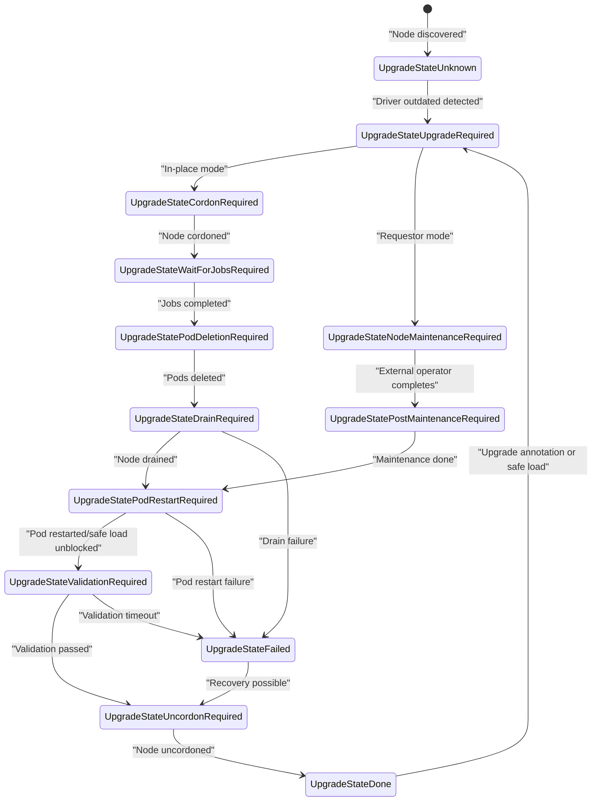
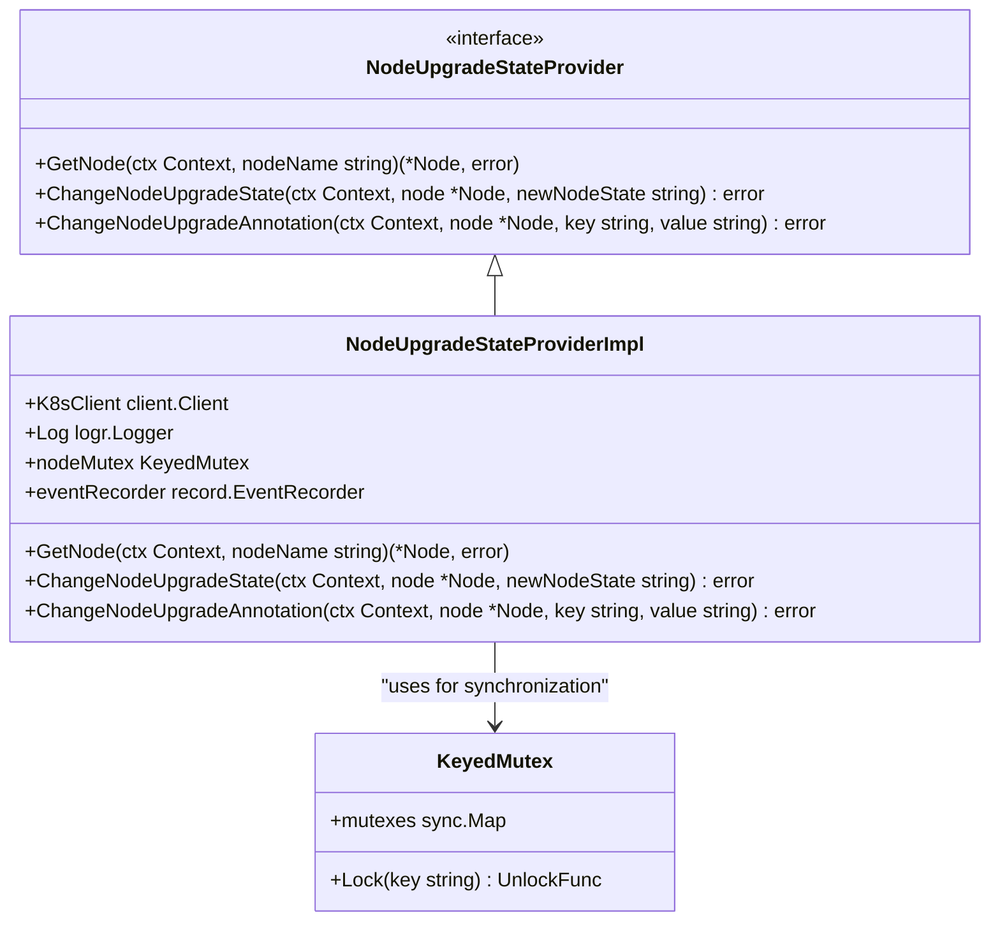
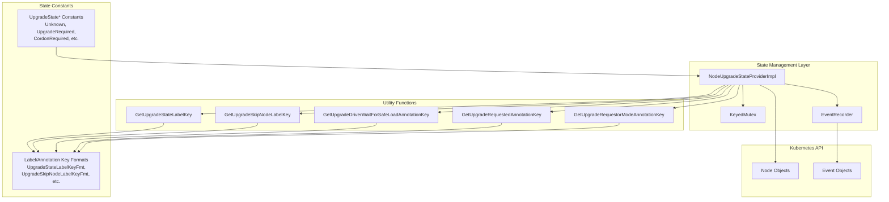

<!-- source: DeepWiki mcp.deepwiki.com · repo NVIDIA/k8s-operator-libs · page 3.1 State Management · fetched 2026-10-26 -->

# State Management

Relevant source files

The following files were used as context for generating this wiki page:

- [pkg/upgrade/consts.go](pkg/upgrade/consts.go)
- [pkg/upgrade/node_upgrade_state_provider.go](pkg/upgrade/node_upgrade_state_provider.go)
- [pkg/upgrade/util.go](pkg/upgrade/util.go)

This document covers the node upgrade state management system in the k8s-operator-libs upgrade package. It explains how nodes are tracked through various upgrade states, the mechanisms for state persistence, and the utilities that support state transitions during driver upgrades.

For information about upgrade execution modes, see [Upgrade Modes](#3.2). For details about the specialized managers that perform upgrade operations, see [Manager Components](#3.3).

## Overview

The state management system tracks the progress of driver upgrades on individual Kubernetes nodes using a comprehensive state machine with 12 distinct states. Each node's current state is persisted using Kubernetes labels and annotations, allowing the upgrade system to maintain progress across controller restarts and handle failure recovery.

The system uses a centralized `NodeUpgradeStateProvider` interface to ensure thread-safe, synchronized access to node state information and provides utilities for state transitions.

## Upgrade States

The upgrade system defines 12 distinct states that represent the complete lifecycle of a node upgrade process:

| State | Constant | Purpose |
|-------|----------|---------|
| Unknown | `UpgradeStateUnknown` | Initial state when upgrade flow is disabled or node hasn't been processed |
| Upgrade Required | `UpgradeStateUpgradeRequired` | Driver pod is outdated and requires upgrade |
| Cordon Required | `UpgradeStateCordonRequired` | Node needs to be made unschedulable |
| Wait for Jobs Required | `UpgradeStateWaitForJobsRequired` | Waiting for running jobs to complete |
| Pod Deletion Required | `UpgradeStatePodDeletionRequired` | Pods need to be deleted for upgrade to proceed |
| Drain Required | `UpgradeStateDrainRequired` | Node requires draining of workloads |
| Node Maintenance Required | `UpgradeStateNodeMaintenanceRequired` | External maintenance operator handles the node |
| Post Maintenance Required | `UpgradeStatePostMaintenanceRequired` | Post-maintenance operations needed |
| Pod Restart Required | `UpgradeStatePodRestartRequired` | Driver pod needs restart or safe load unblocking |
| Validation Required | `UpgradeStateValidationRequired` | New driver validation before completion |
| Uncordon Required | `UpgradeStateUncordonRequired` | Node ready to be made schedulable again |
| Done | `UpgradeStateDone` | Upgrade completed successfully |
| Failed | `UpgradeStateFailed` | Upgrade encountered an error |

### State Machine Flow

Sources: [pkg/upgrade/consts.go:49-82]()

## State Tracking Mechanism

The state management system uses Kubernetes node labels and annotations to persist upgrade state information. This approach ensures that state survives controller restarts and provides a declarative way to track upgrade progress.

### Labels and Annotations

The system uses formatted keys that incorporate the driver name to avoid conflicts:

```mermaid
graph TB
    subgraph "Node Labels"
        StateLabel["nvidia.com/{driver}-driver-upgrade-state<br/>Current upgrade state"]
        SkipLabel["nvidia.com/{driver}-driver-upgrade.skip<br/>Skip upgrade flag"]
    end
    
    subgraph "Node Annotations"
        SafeLoadAnnot["nvidia.com/{driver}-driver-upgrade.driver-wait-for-safe-load<br/>Safe load blocking"]
        InitialStateAnnot["nvidia.com/{driver}-driver-upgrade.node-initial-state.unschedulable<br/>Initial schedulability state"]
        WaitStartAnnot["nvidia.com/{driver}-driver-upgrade-wait-for-pod-completion-start-time<br/>Pod completion wait start time"]
        ValidationStartAnnot["nvidia.com/{driver}-driver-upgrade-validation-start-time<br/>Validation start time"]
        UpgradeRequestedAnnot["nvidia.com/{driver}-driver-upgrade-requested<br/>External upgrade request"]
        RequestorModeAnnot["nvidia.com/{driver}-driver-upgrade-requestor-mode<br/>Requestor mode flag"]
    end
    
    StateLabel --> |"Primary state tracking"| StateManagement["State Management System"]
    SkipLabel --> |"Upgrade control"| StateManagement
    SafeLoadAnnot --> |"Safe loading control"| StateManagement
    InitialStateAnnot --> |"Recovery information"| StateManagement
    WaitStartAnnot --> |"Timeout tracking"| StateManagement
    ValidationStartAnnot --> |"Timeout tracking"| StateManagement
    UpgradeRequestedAnnot --> |"External triggers"| StateManagement
    RequestorModeAnnot --> |"Mode selection"| StateManagement
```

The utility functions in [pkg/upgrade/util.go:106-131]() provide formatted key generation:

- `GetUpgradeStateLabelKey()` - Returns the primary state label key
- `GetUpgradeSkipNodeLabelKey()` - Returns the skip upgrade label key  
- `GetUpgradeDriverWaitForSafeLoadAnnotationKey()` - Returns safe load annotation key
- `GetUpgradeInitialStateAnnotationKey()` - Returns initial state annotation key
- `GetUpgradeRequestedAnnotationKey()` - Returns upgrade requested annotation key
- `GetUpgradeRequestorModeAnnotationKey()` - Returns requestor mode annotation key

Sources: [pkg/upgrade/consts.go:19-47](), [pkg/upgrade/util.go:106-131]()

## NodeUpgradeStateProvider

The `NodeUpgradeStateProvider` interface provides the core abstraction for state management operations. It ensures thread-safe access to node objects and maintains cache consistency.

### Interface Definition

### Key Features

**Thread-Safe Access**: The `NodeUpgradeStateProviderImpl` uses a `KeyedMutex` to ensure that only one goroutine can modify a specific node at a time. This prevents race conditions during concurrent state changes.

**Cache Consistency**: After updating node labels or annotations, the provider polls the Kubernetes API until the operator cache reflects the changes. This ensures subsequent operations see the updated state.

**Event Recording**: State changes are recorded as Kubernetes events, providing audit trails and debugging information.

### State Change Process

The state change process follows these steps:

1. **Acquire Lock**: Use `KeyedMutex.Lock()` to get exclusive access to the node
2. **Apply Patch**: Use Kubernetes patch operations to update labels/annotations
3. **Wait for Cache**: Poll the API until the operator cache shows the updated values
4. **Release Lock**: Automatically release the lock when the function completes
5. **Record Event**: Log the state change as a Kubernetes event

Sources: [pkg/upgrade/node_upgrade_state_provider.go:33-56](), [pkg/upgrade/util.go:72-89]()

## State Management Architecture

Sources: [pkg/upgrade/node_upgrade_state_provider.go:39-56](), [pkg/upgrade/util.go:91-161](), [pkg/upgrade/consts.go:19-83]()

## Synchronization and Thread Safety

The state management system provides several synchronization primitives to ensure safe concurrent access:

### KeyedMutex

The `KeyedMutex` class provides per-node locking using a sync.Map to store individual mutexes for each node name:

- **Lock Acquisition**: `Lock(key string) UnlockFunc` returns a function to release the lock
- **Automatic Cleanup**: Mutexes are created on-demand and stored efficiently
- **Deadlock Prevention**: Uses defer patterns to ensure locks are always released

### StringSet

The `StringSet` utility provides thread-safe set operations for tracking collections of node names or other string identifiers:

- **Thread-Safe Operations**: Add, Remove, Has, and Clear methods use read-write locks
- **Efficient Membership Testing**: O(1) lookup performance using internal map
- **Concurrent Access**: Multiple readers can access simultaneously, with exclusive writes

Sources: [pkg/upgrade/util.go:29-89]()

## State Persistence and Recovery

The state management system is designed to handle controller restarts and failures gracefully:

### Cache Synchronization

After updating node state, the system waits up to 10 seconds for the operator cache to reflect changes using `wait.PollImmediateUntil()`. This ensures that subsequent reconciliation loops see consistent state.

### Initial State Tracking

The system tracks whether a node was initially unschedulable before starting an upgrade using the `UpgradeInitialStateAnnotationKeyFmt` annotation. This allows proper restoration of the node's scheduling state after upgrade completion.

### Timeout Tracking

Time-based operations (job completion waits, validation timeouts) store their start times in node annotations, allowing the system to resume timeout calculations after controller restarts.

Sources: [pkg/upgrade/node_upgrade_state_provider.go:100-134](), [pkg/upgrade/node_upgrade_state_provider.go:171-197]()

---

