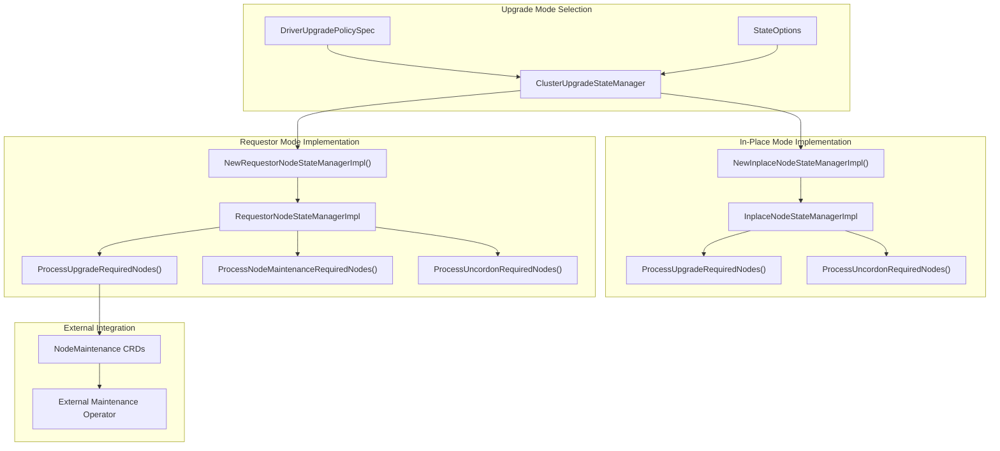
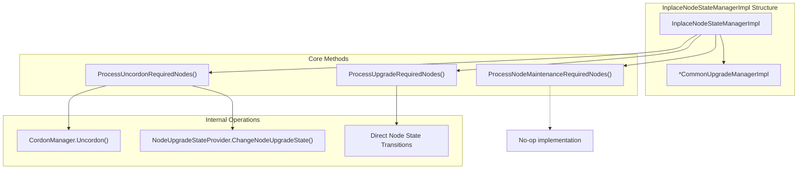
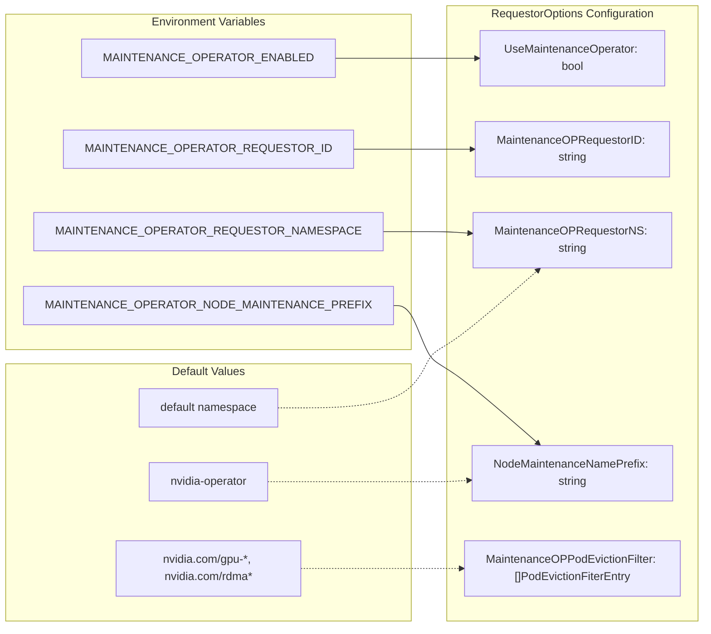
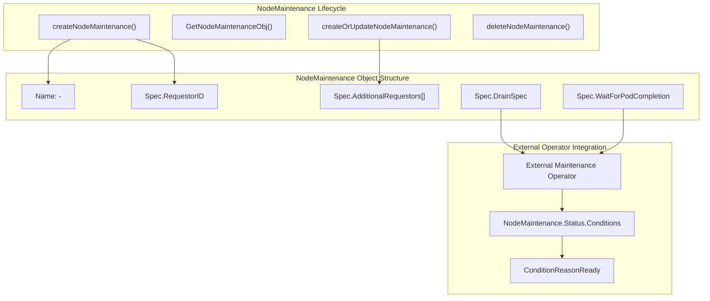
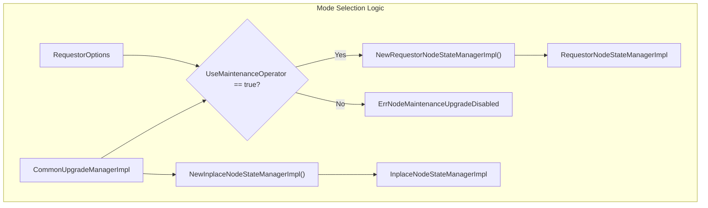

<!-- source: DeepWiki mcp.deepwiki.com · repo NVIDIA/k8s-operator-libs · page 3.2 Upgrade Modes · fetched 2026-10-26 -->

# Upgrade Modes

Relevant source files

The following files were used as context for generating this wiki page:

- [pkg/upgrade/upgrade_inplace.go](pkg/upgrade/upgrade_inplace.go)
- [pkg/upgrade/upgrade_requestor.go](pkg/upgrade/upgrade_requestor.go)

## Purpose and Scope

This document explains the two upgrade modes available in the k8s-operator-libs upgrade system: **In-Place Mode** and **Requestor Mode**. These modes determine how node maintenance operations are performed during driver upgrades. For details about the overall upgrade state management, see [State Management](#3.1). For information about the specific manager components used by these modes, see [Manager Components](#3.3).

## Overview

The upgrade system supports two distinct operational modes, each implementing the `ProcessNodeStateManager` interface but with different approaches to node maintenance:

- **In-Place Mode**: Directly performs node operations (cordon, drain, uncordon) using internal managers
- **Requestor Mode**: Delegates node maintenance to an external maintenance operator via NodeMaintenance custom resources

Both modes share common functionality through the `CommonUpgradeManagerImpl` base class but differ in their execution strategies for node maintenance operations.

## Architecture Overview

Sources: [pkg/upgrade/upgrade_inplace.go:28-40](), [pkg/upgrade/upgrade_requestor.go:84-273]()

## In-Place Mode

In-Place Mode performs node maintenance operations directly using internal managers. This mode provides full control over the upgrade process without external dependencies.

### Implementation Details

The `InplaceNodeStateManagerImpl` struct extends `CommonUpgradeManagerImpl` and implements direct node operations:

Sources: [pkg/upgrade/upgrade_inplace.go:28-31](), [pkg/upgrade/upgrade_inplace.go:42-112](), [pkg/upgrade/upgrade_inplace.go:122-147]()

### Key Operations

In-Place Mode handles the following operations directly:

| Operation | Implementation | State Transition |
|-----------|---------------|------------------|
| Upgrade Initiation | `ProcessUpgradeRequiredNodes()` | `UpgradeRequired` → `CordonRequired` |
| Node Uncordoning | `ProcessUncordonRequiredNodes()` | `UncordonRequired` → `Done` |
| Maintenance Processing | `ProcessNodeMaintenanceRequiredNodes()` | No-op (returns immediately) |

The mode respects upgrade limits and availability constraints through `MaxParallelUpgrades` and `MaxUnavailable` policy settings.

Sources: [pkg/upgrade/upgrade_inplace.go:44-112](), [pkg/upgrade/upgrade_inplace.go:114-120](), [pkg/upgrade/upgrade_inplace.go:124-147]()

## Requestor Mode

Requestor Mode delegates node maintenance operations to an external maintenance operator by creating and managing NodeMaintenance custom resources.

### Configuration

Requestor Mode is configured through the `RequestorOptions` struct:

Sources: [pkg/upgrade/upgrade_requestor.go:68-82](), [pkg/upgrade/upgrade_requestor.go:526-546](), [pkg/upgrade/upgrade_requestor.go:46-53]()

### NodeMaintenance CRD Integration

The requestor mode creates and manages NodeMaintenance objects for each node requiring upgrade:

Sources: [pkg/upgrade/upgrade_requestor.go:176-200](), [pkg/upgrade/upgrade_requestor.go:320-368](), [pkg/upgrade/upgrade_requestor.go:436-451]()

### Requestor Mode Operations

Requestor Mode implements specialized processing for each upgrade state:

| Method | Purpose | Key Operations |
|--------|---------|---------------|
| `ProcessUpgradeRequiredNodes()` | Initiate maintenance requests | Create NodeMaintenance CRDs, set requestor mode annotation |
| `ProcessNodeMaintenanceRequiredNodes()` | Monitor maintenance progress | Check NodeMaintenance status conditions |
| `ProcessUncordonRequiredNodes()` | Clean up after maintenance | Delete/update NodeMaintenance CRDs, remove annotations |

The mode supports both exclusive ownership and shared NodeMaintenance objects through the `AdditionalRequestors` mechanism.

Sources: [pkg/upgrade/upgrade_requestor.go:275-319](), [pkg/upgrade/upgrade_requestor.go:416-452](), [pkg/upgrade/upgrade_requestor.go:454-488]()

## Mode Selection and Integration

### Factory Pattern Implementation

The upgrade system uses a factory pattern to instantiate the appropriate mode implementation:

Sources: [pkg/upgrade/upgrade_requestor.go:259-273](), [pkg/upgrade/upgrade_inplace.go:33-40](), [pkg/upgrade/upgrade_requestor.go:56]()

### State Annotation Management

Both modes use node annotations to track upgrade mode state:

- `GetUpgradeRequestorModeAnnotationKey()`: Marks nodes in requestor mode
- `IsNodeInRequestorMode()`: Checks if a node is being handled by requestor mode
- Mode-specific processing: Each mode checks annotations to determine if it should handle a particular node

This annotation system prevents conflicts between the two modes when processing the same cluster.

Sources: [pkg/upgrade/upgrade_requestor.go:306](), [pkg/upgrade/upgrade_inplace.go:130](), [pkg/upgrade/upgrade_requestor.go:461]()

## Comparison Matrix

| Aspect | In-Place Mode | Requestor Mode |
|--------|---------------|----------------|
| **Dependencies** | Internal managers only | External maintenance operator |
| **Node Operations** | Direct via CordonManager | Indirect via NodeMaintenance CRDs |
| **State Transitions** | `UpgradeRequired` → `CordonRequired` | `UpgradeRequired` → `NodeMaintenanceRequired` |
| **Concurrency** | Managed internally | Delegated to external operator |
| **Configuration** | Minimal (uses common settings) | Rich options via `RequestorOptions` |
| **Error Handling** | Direct control | Dependent on external operator |
| **Multi-tenancy** | Single operator instance | Supports `AdditionalRequestors` |

Sources: [pkg/upgrade/upgrade_inplace.go:42-112](), [pkg/upgrade/upgrade_requestor.go:275-319](), [pkg/upgrade/upgrade_requestor.go:68-82]()

---

